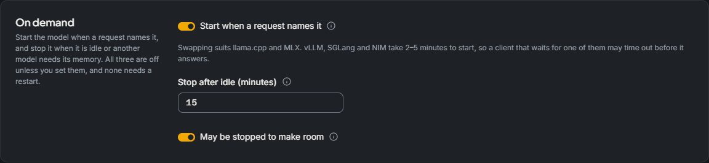
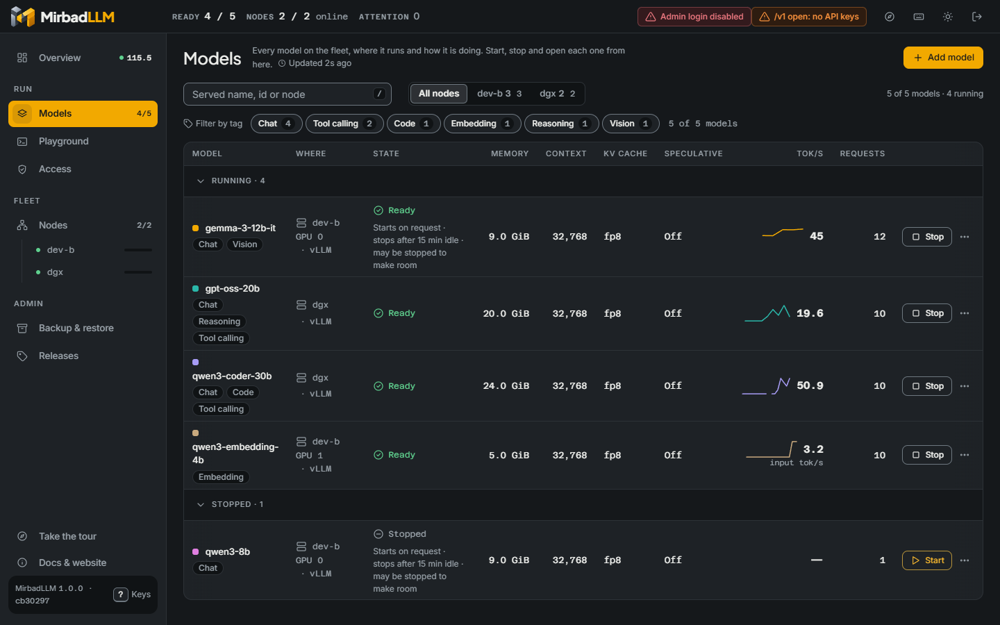
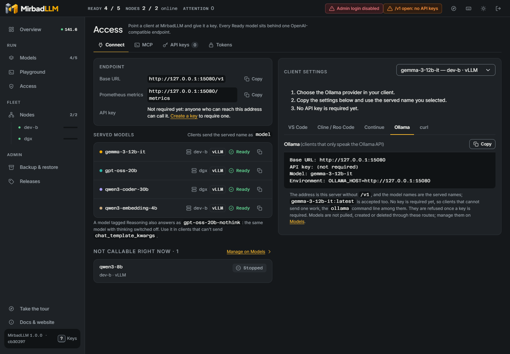

<p align="center">
  
</p>

<h1 align="center">MirbadLLM</h1>

<p align="center">
  Put your spare machines to work. MirbadLLM runs small and medium AI models on the old gaming PC, the laptop
  and the Mac you already own, and manages all of them from one place behind one OpenAI-compatible endpoint.
</p>

<p align="center">
  <a href="https://github.com/samykabu/MirbadLLM/actions/workflows/ci.yml"></a>
  <a href="LICENSE"></a>
  <a href="https://dotnet.microsoft.com/download/dotnet/10.0"></a>
  
</p>

<p align="center">
  <a href="https://mirbadllm.vektragrid.com">Website</a> ·
  <a href="#quick-start">Quick start</a> ·
  <a href="docs/setup.md">Setup guide</a> ·
  <a href="docs/README.md">Documentation</a> ·
  <a href="CONTRIBUTING.md">Contributing</a> ·
  <a href="SECURITY.md">Security</a>
</p>


## What MirbadLLM is

You probably own more compute than you use. There's the gaming PC you replaced two upgrades ago, the laptop with an
RTX card that spends its days closed, the Apple Silicon Mac that sits idle every evening, and maybe one serious GPU
box. Any of them can run a useful language model. The catch is that each one turns into its own small project, with
its own runtime, its own flags and its own port, and you end up with no single place that shows what is running
where.

MirbadLLM turns those machines into one service. You install a small agent on each machine, approve it from the
browser, and decide which model runs where. From then on every model sits behind one OpenAI-compatible `/v1` endpoint,
so your coding agents, chat clients and scripts keep one base URL and pick a model by name. They never need to know
which machine answered. The same browser UI downloads models, checks that a model fits in memory before it starts,
watches throughput and memory, benchmarks and tunes models, hands out API keys and backs everything up.

Under the hood there are two parts. The **master** holds the model registry, API keys, the UI, the admin API and the
router. A **node agent** runs on every machine that serves models. It starts each model with that machine's runtime,
checks memory before a start, and reports GPU, memory and throughput telemetry. The master reaches every agent over
mutual TLS and never touches a GPU or a model file itself.

The name comes from the Arabic word مِرْبَد (mirbad), the enclosure where camels are gathered and kept. MirbadLLM does
the same for models scattered across your machines.

### What your old machines can run

How big a model can a machine serve? The memory on the GPU, or the unified memory on a Mac, decides that. Here's a
rough guide for 4-bit GGUF models with a moderate context window:

| Machine you may already have | Memory for the model | Comfortable model size |
|---|---|---|
| Gaming PC or gaming laptop with an 8 GB NVIDIA card (RTX 2070, 3060 Ti, 4060) | 8 GB | 7B to 8B |
| Gaming PC with a 12 to 16 GB card (RTX 3060 12 GB, 4070, 4080) | 12 to 16 GB | up to about 14B |
| Gaming PC with a 24 GB card (RTX 3090, 4090) | 24 GB | up to about 32B |
| PC with an AMD or Intel graphics card (Vulkan, experimental) | the card's VRAM | as the NVIDIA rows for the same VRAM; not yet verified on such a card |
| PC or laptop without a supported GPU (CPU only) | host RAM | whatever fits in RAM; it runs on the CPU, and no speed has been measured yet |
| Apple Silicon MacBook or Mac with 16 GB | shared with macOS | 7B to 8B |
| Apple Silicon Mac with 32 GB or more | shared with macOS | 14B to 32B |
| A DGX Spark or a large GPU workstation | 128 GB unified, or several cards | large models on vLLM |

Treat these as rules of thumb. Context length, quantization and how many requests run at once all move them. You
don't have to do the arithmetic yourself, though: the agent reads each GGUF header, estimates the memory a model
needs, and refuses a start that would not fit, with the reason. To look up your own machine, try
[Will it run?](https://mirbadllm.vektragrid.com/will-it-run/) on the website.

Here's what a node needs today. A Mac needs Apple Silicon. A PC runs Windows 11 or Linux and joins in one of three
ways:

- **With an NVIDIA GPU.** llama.cpp on Windows; vLLM, llama.cpp or SGLang in Docker on Linux, and NIM where it's
  enabled. This is the path the project is measured on.
- **Without a supported GPU (CPU only).** llama.cpp only. The installer picks this when it finds no NVIDIA driver.
  On Windows it installs the CPU build of llama.cpp; on Linux you point the node at the CPU `server` image. A model's
  whole budget is counted against host RAM, and the node reports no GPU figures because there are none to read.
- **With an AMD or Intel GPU, through Vulkan (experimental).** llama.cpp only, and only when you ask for it
  (`-Accelerator vulkan` on Windows, `--accelerator vulkan` on Linux). The Windows GPU readings were checked against
  `nvidia-smi` on NVIDIA cards; nothing has run on AMD or Intel hardware yet. On Linux it covers AMD cards only, one GPU
  per model. A machine whose only GPU is integrated joins as a CPU-only node.

A PC with an NVIDIA card keeps the NVIDIA path, and mixing an NVIDIA card with an AMD or Intel one in the same node is
not supported.

### Why it exists

The project started on a single NVIDIA DGX Spark, where a single-slot model server made every parallel coding agent
queue behind the others. vLLM fixed the throughput, but it brought a new job with it: one container per model, flags
to get right, memory to budget, and nothing to show what was running.

Once that was sorted for one box, the next question came naturally. Why stop at one? The older gaming PC and the Mac
in the next room could serve the smaller models, and the coding agents didn't care which machine answered. That's the
shape MirbadLLM has today: one place to manage every machine you're willing to lend to AI, whether it cost a lot or
was about to be thrown out.

A word on scope. MirbadLLM is a control plane for a handful of machines you own. If you need a general cluster
scheduler or a hosted service, this is the wrong tool.

### Who it is for

- **Anyone with spare hardware**: an old gaming PC, a gaming laptop, a MacBook that is no longer the daily machine.
  Instead of gathering dust, each one serves a model to every tool in the house.
- **Homelab and AI enthusiasts** who already run models on more than one machine and are tired of managing each one
  by hand.
- **Small teams** that self-host an OpenAI-compatible API for coding agents (Cline, Roo Code, Continue and others)
  and need API keys, per-machine memory rules and a clear view of what is running.
- **Platform and DevOps engineers** who want model lifecycle, placement, backups and agent updates handled the same
  way on every machine, with signed updates and an audit log.
- **Researchers and model tinkerers** who compare models and settings: the benchmark presets and the tuner measure a
  model on its own hardware and keep the history.

## What's new in 1.0

Version 1.0 is the first release you can install without building anything: the images are published, and a demo
runs with one command (see [Quick start](#quick-start)). It also brings three additions. The screenshots below come
from the development fleet, so the models in them are fake.

### Swap models on demand

An 8 GB card holds one model at a time. Say you chat with one model in the morning and switch to a coding model
after lunch. Before, that meant opening the UI, stopping one and starting the other. Now a request can do it for
you. Every model has three optional settings under **On demand** in its editor, all off until you turn them on:



- **Start when a request names it.** A request for a stopped model starts it, and the request waits until the model
  is ready.
- **Stop after idle (minutes).** A model nobody has called for that long is stopped, which frees its memory.
- **May be stopped to make room.** When a new model needs the memory, idle models with this setting are stopped,
  least recently used first.

The Models page shows what each model is set to do:



Two things to know before you rely on it. Memory admission still judges every start, and a model that is answering a
request is never stopped. And the request waits while the model loads, so this fits llama.cpp and MLX, which load in
seconds. vLLM, SGLang and NIM take minutes to start, and a waiting client may give up first. When two requests ask
for two models that cannot both fit, one is answered and the other gets a 503 with `Retry-After`.

### Use the clients that only speak Ollama

Plenty of home-automation, note-taking and chat tools only know Ollama's API. They can now use your fleet as it is:
MirbadLLM answers `/api/chat`, `/api/generate`, `/api/embed`, `/api/tags` and a few more on the same port, and
translates them to `/v1`. The API key, the model names and the routing stay the same. **Access > Connect** has an
**Ollama** tab with the settings to paste:



The limits: you manage models in MirbadLLM, so pulling, creating and deleting models through Ollama routes is not
offered. A client that cannot send an API key, such as the `ollama` command line, works only while `/v1` is open.
It has been checked with the `ollama` command line (0.40.16) and Ollama's Python library (0.6.3) against llama.cpp
models. Other clients have not been tried, so tell us in an issue if yours trips over something.

### Machines without an NVIDIA card

Until now a PC needed an NVIDIA GPU to join. Two more kinds of machine can join in 1.0, both with llama.cpp:

- **CPU-only machines.** A PC or mini PC with plenty of RAM serves a model on its CPU. The installer picks this by
  itself when it finds no NVIDIA driver. No speed has been measured yet, so expect it to suit small and embedding
  models better than large chat models.
- **AMD and Intel GPUs, through Vulkan.** This one is experimental. It has been checked against NVIDIA cards and has
  not run on AMD or Intel hardware yet, so you opt in with `-Accelerator vulkan` (Windows) or `--accelerator vulkan`
  (Linux, AMD cards only). If you try it on such a card, a report in the issues, good or bad, helps a lot.

The details are in [What your old machines can run](#what-your-old-machines-can-run) above.

## Features

- **One OpenAI-compatible endpoint.** `/v1/models` lists every model on every node. Every other `/v1` path the
  runtime supports (chat completions, completions, embeddings), streaming included, is proxied to the node that
  serves the model named in the request.
- **An Ollama-compatible API.** Clients that only speak Ollama's API reach the same models on the same port.
  `/api/chat`, `/api/generate` and `/api/embed` are translated to their `/v1` requests, and `/api/tags`, `/api/show`,
  `/api/ps` and `/api/version` describe the same models, so the API key, the served names and the routing are the
  same. Pulling, creating and deleting models through Ollama routes is not offered.
- **Runtimes follow node capabilities.** Linux and DGX agents run vLLM, llama.cpp and SGLang containers, with NIM only
  when explicitly enabled and digest-approved. Windows and macOS keep native llama.cpp, and Apple Silicon also runs MLX
  (`mlx_lm.server`). SGLang/NIM on Windows require a separately enrolled Linux agent in WSL2, not native-agent control.
- **Models from Hugging Face.** Download a repository or pick a single GGUF variant; the agent downloads on its own
  node, reads the GGUF header and estimates the memory a model needs. Saved Hugging Face tokens are picked by name.
- **Memory admission and placement.** Every model has a memory budget. A start is refused with a reason when the
  budget does not fit the node's free memory minus its reserve, per GPU on discrete-GPU machines. Models are placed
  on a node (and on GPUs by UUID), can be moved between nodes, and start one at a time per node.
- **Recovery.** Models that were running come back after a node or the master restarts, one at a time per node. A
  model you stopped stays stopped.
- **Swap models on demand.** A GPU that holds one model at a time can serve several. Each model has three optional
  settings, all off by default: start when a request names it, stop after a number of idle minutes, and allow being
  stopped while idle so another model can start on request. Memory admission still decides every start, and a model
  with a request in flight is never stopped. The request waits while the model loads, so this suits llama.cpp and
  MLX; vLLM, SGLang and NIM take minutes to start, and a waiting client may time out first.
- **Overview "Command Deck".** A live page with fleet KPIs, a WebGL Signal chart of generation per model and GPU use
  per node, a leaderboard with a full readout per model, the fleet's counters (requests served, tokens today, crash-free
  streak, error budget), service levels, and per-node headroom and disk.
- **Benchmark and tune.** Workload presets (interactive chat, agents and tools, throughput, long documents,
  embeddings) measure a running model. The tuner searches vLLM settings phase by phase and re-measures the leaders, with a smaller search for llama.cpp, MLX and SGLang (NIM has nothing to tune)
  before it names a winner; nothing changes until you choose **Apply**.
- **Access control.** An admin login for the UI and the admin API, API keys holding one or more scopes, which you can change later, for `/v1`, `/metrics`, and the protected stateless Streamable HTTP MCP endpoint at `/mcp`, and a Connect
  page with ready-to-paste settings for common clients, including a VS Code configuration export.
- **Back up and restore everything.** Model definitions, running models, node settings, managed host services,
  history, API keys and saved tokens (encrypted with your passphrase), on a schedule to a local folder or an SMB or
  NFS share, and a restore that previews every change and downloads missing checkpoints again.
- **Fleet operations.** Join a machine with a one-line command, approve it by key fingerprint, drain, rekey, revoke
  and rotate certificates, and push signed agent updates from the master.
- **Host services.** An optional root helper lists and manages whitelisted systemd units, launchd jobs or Windows
  services (ComfyUI, Ollama, LM Studio and similar) next to the models, behind a compiled-in deny list.
- **Prometheus metrics** at `/metrics`, and light and dark themes built to WCAG 2.2 AA.

## Screenshots

| Overview (light) | Models |
|---|---|
|  |  |
| **Tune** | **Backup and restore** |
|  |  |
| **Access: saved tokens** | **Nodes** |
|  |  |
| **On demand settings on Models** | **Connect: Ollama clients** |
|  |  |

The screenshots come from the development fleet described below: fake runtimes and generated traffic, no real
hardware.

## Quick start

### Look at the UI without a GPU

The demo image runs a master, two fake nodes and four fake models in one container, and keeps calling the models so
the charts have something to show. You need Docker and nothing else: no GPU, no .NET SDK and no clone.

```bash
docker run --rm -p 127.0.0.1:8080:8080 ghcr.io/samykabu/mirbadllm-demo
```

Open `http://127.0.0.1:8080/` when the log prints `Up`. Once the image is pulled, that takes about 20 seconds
(measured on an x86_64 PC).

Everything the demo shows is fake data: the nodes `demo-dgx` and `demo-pc` are processes inside the container, the
models answer with made-up text, and the traffic is generated. The demo has no login and no API key, so anyone who can
reach its port has full control of it. The command publishes the port on `127.0.0.1` for that reason; keep it there.
Stop the demo with Ctrl+C. Its state goes with the container. The [setup guide](docs/setup.md#demo) lists what works
in the demo and what does not.

### Run the master and your first node

Pick the machine that stays on: the master runs there, together with that machine's own agent, as two containers.
Any Linux PC with an NVIDIA GPU works, from an old gaming tower to a DGX Spark. You need Docker Engine with the
NVIDIA Container Toolkit, and a vLLM image the machine can run. This compose file expects the NVIDIA GPU; a machine
without one joins as a node with the agent installer ([Add your other machines](#add-your-other-machines)). Each
[release](https://github.com/samykabu/MirbadLLM/releases) publishes the master and agent images for x86_64 and arm64,
so nothing is built on the machine and no clone is needed.

```bash
mkdir mirbadllm && cd mirbadllm
curl -fsSLO https://github.com/samykabu/MirbadLLM/releases/latest/download/compose.release.yaml
curl -fsSL -o .env https://github.com/samykabu/MirbadLLM/releases/latest/download/env.example
sudo install -d -o 1654 -g 1654 /srv/mirbadllm/data /srv/mirbadllm/backups   # 1654 = the "app" user of the .NET image
sudo install -d /srv/mirbadllm/models /srv/mirbadllm/cache
# In .env set at least:
#   DOCKER_GID=<output of: stat -c %g /var/run/docker.sock>
#   MIRBADLLM_VLLM_IMAGE=<a vLLM image available on this machine>
#   MIRBADLLM_ADMIN_PASSWORD=<admin password for the UI>
#   MIRBADLLM_NODE_ID=<a short name for this machine, for example tower>
docker compose -f compose.release.yaml up -d
```

Open `http://<host>:8080/`, sign in, and add a model on **Models**. The newest release runs unless
`MIRBADLLM_VERSION` in `.env` names another, for example `1.2.0`. The agent looks at the machine's GPUs: cards with
their own VRAM get a memory budget each, and a machine whose GPU shares the system memory, such as a DGX Spark, is
counted as one pool. The model list starts empty; the [setup guide](docs/setup.md) has the details.

### Build from source

To run code that is not released yet, build the same two containers from a clone. The settings are the ones above,
in `deploy/.env`:

```bash
git clone https://github.com/samykabu/MirbadLLM.git && cd MirbadLLM
cp deploy/.env.example deploy/.env
docker compose -f deploy/compose.multinode.yaml --env-file deploy/.env up -d --build
```

To work on the code without Docker or a GPU, start the development fleet: a master and two fake-runtime agents as
local processes on loopback, which is what the demo image packages. It needs the .NET 10 SDK (10.0.100 or a later
feature band) and PowerShell 7 or Bash.

```bash
pwsh tools/dev-multinode/start.ps1 -Reset      # Windows, or PowerShell 7 anywhere
tools/dev-multinode/start.sh --reset           # Linux and macOS
```

Open `http://127.0.0.1:5080/`. The script builds the solution, enrolls agent `dgx` (a unified-memory node) and agent
`dev-b` (a PC with two fake 16 GiB GPUs), adds a fake model on each and sends chat requests through `/v1`. Stop it
with `pwsh tools/dev-multinode/stop.ps1` or `tools/dev-multinode/stop.sh`.

### Add your other machines

On the master, open **Nodes > Add node** and copy the one-line command for Windows, Linux or macOS. Run it on the
gaming PC, the laptop or the Mac. The command installs the agent as a service and enrolls it; you approve the machine
in the browser after comparing its key fingerprint. From then on, its models appear on the same `/v1` endpoint as
everything else.

### Call a model

```bash
curl http://<host>:8080/v1/chat/completions \
  -H "Authorization: Bearer $MIRBADLLM_API_KEY" \
  -H "Content-Type: application/json" \
  -d '{"model":"<served-name>","messages":[{"role":"user","content":"Hello"}],"max_tokens":128}'
```

Any OpenAI SDK works the same way:

```python
from openai import OpenAI

client = OpenAI(base_url="http://<host>:8080/v1", api_key="<your MirbadLLM API key>")
reply = client.chat.completions.create(
    model="<served-name>",
    messages=[{"role": "user", "content": "Hello"}],
)
print(reply.choices[0].message.content)
```

A model tagged Reasoning also answers as `<served-name>-nothink`, the same model with thinking switched off. Clients that can
send extra body fields can instead set `"chat_template_kwargs": {"enable_thinking": false}` per request.

A client that only speaks Ollama's API uses the same host and port without `/v1`:

```bash
curl http://<host>:8080/api/chat \
  -H "Authorization: Bearer $MIRBADLLM_API_KEY" \
  -d '{"model":"<served-name>","messages":[{"role":"user","content":"Hello"}],"stream":false}'
```

These routes are translated to `/v1`: the key is the same, and so are the served names (`<served-name>:latest` is
accepted too). A client that cannot send the `Authorization` header, such as the `ollama` command line with
`OLLAMA_HOST=http://<host>:8080`, works only while `/v1` is open. [Ollama clients](docs/configuration.md#ollama-clients)
lists the routes and what is not offered.

Until the first API key exists, `/v1` is open and the UI says so in its header. Create a key on **Access**, or set
`MIRBADLLM_REQUIRE_API_KEY=true` to require one from the start.

## Setup

| Topology | What runs where | Guide |
|---|---|---|
| Single machine | Master and agent as two containers on one Linux GPU machine | [Single machine](docs/setup.md#single-machine) |
| Multi-node | Master on one machine; agents on Linux PCs (systemd), Windows PCs (a Windows service) and Apple Silicon Macs (a LaunchDaemon) | [Add nodes](docs/setup.md#add-nodes) |
| Development | Master and two fake-runtime agents on loopback | [Development fleet](docs/setup.md#development-fleet) |
| Demo | Master and two fake-runtime agents in one container, with fake models and generated traffic | [Demo](docs/setup.md#demo) |


Joining a machine takes one command. On the master, **Nodes > Add node** creates a one-time join command for Linux,
Windows or macOS. The command downloads the agent bundle from the master, checks its SHA-256, installs the agent as a
service and enrolls it. You then approve the node after comparing the key fingerprint it printed. The master dials
agents on TCP 9443, and agents reach the master's enroll listener on TCP 8443. Keep both on the LAN.

## Remote MCP

Create a key with the **MCP Read** or **MCP Operator** scope under **Access → API keys**, or add the scope to a key you have, then use `http://<host>:8080/mcp`. Keys without an MCP scope and admin-cookie credentials cannot authenticate this endpoint. MCP Read cannot invoke mutations.

```toml
[mcp_servers.mirbad]
url = "http://HOST:8080/mcp"
bearer_token_env_var = "MIRBAD_MCP_KEY"
```

Claude Code: `claude mcp add --transport http --scope user mirbad http://HOST:8080/mcp --header 'Authorization: Bearer ${MIRBAD_MCP_KEY}'`. The single quotes save a reference to the variable, not the key.

Claude Desktop connectors connect from Anthropic's cloud, so they need a public HTTPS URL. On a private network, use the `mcp-remote` bridge. **Access → MCP** has the steps for each client, the full tool list and a prompt that asks your agent to configure itself, all filled in with your address.

Plain HTTP is suitable only on a trusted LAN. Put a TLS reverse proxy in front and use an HTTPS URL for wider access. Never place keys in URLs or source control.

## Configuration

The container deployment reads `deploy/.env`. The settings you are most likely to change:

| Variable | Default | What it does |
|---|---|---|
| `DOCKER_GID` | none, required | Group id of `/var/run/docker.sock`, so the agent can start model containers |
| `MIRBADLLM_VLLM_IMAGE` | a locally built image name | vLLM image for models that do not name their own; set it |
| `MIRBADLLM_ADMIN_PASSWORD` | empty (login disabled) | Admin password for the UI and `/api` |
| `MIRBADLLM_REQUIRE_API_KEY` | `false` | Require an API key on `/v1` even before the first key exists |
| `MIRBADLLM_MEMORY_RESERVE_GIB` | `8` | Memory kept free on the node; admission refuses starts that would use it |
| `MIRBADLLM_PORT` | `8080` | Port of the UI, `/api`, `/v1` and `/metrics` |
| `MIRBADLLM_DATA`, `MIRBADLLM_MODELS`, `MIRBADLLM_CACHE`, `MIRBADLLM_BACKUPS` | `/srv/mirbadllm/...` | Host folders for state, checkpoints, the download cache and backups |
| `MIRBADLLM_BACKUP_PASSPHRASE` | empty | Encrypts API keys and secrets inside scheduled backups |

Every master setting also has an environment form (`MirbadLLM__Key`, `MirbadLLM__Section__Key`) and a JSON form
(`MirbadLLM:Section:Key` in `appsettings.json`). The full list is in [docs/configuration.md](docs/configuration.md).

## Architecture


The master is one ASP.NET Core process: the Blazor Server UI, the `/api` admin API, the `/v1` router, the registry,
jobs, backups and a small certificate authority. Each agent is a separate .NET process that runs the runtime drivers,
admission, downloads, telemetry and a reverse proxy to its models. A request takes this path:


More detail, including the behaviour contracts every part keeps, is in [docs/architecture.md](docs/architecture.md).

## Project structure


```
src/
  MirbadLLM.Core/             Shared contracts: model definitions, statuses, nodes, options, interfaces
  MirbadLLM.Orchestration/    Master side: registry, vLLM arguments, node registry and monitor, agent client,
                              placement, jobs (benchmark, tune), backups, recovery, PKI rotation
  MirbadLLM.Router/           /v1 proxy through the agents, /v1/models, API-key check
  MirbadLLM.Web/              The master: Program.cs composition, /api endpoints, Blazor UI, enroll listener
  MirbadLLM.Agent/            The node agent: mTLS API, operations, admission, proxy, telemetry, updates
  MirbadLLM.Agent.Contracts/  Master and agent protocol: routes, envelopes, events, error codes
  MirbadLLM.NodeRuntime/      Node-local code: Docker client, container and process drivers, downloads, probes
  MirbadLLM.Pki/              CA, certificate issuing, SPKI pins, TLS validators
  MirbadLLM.HostAgent/        mirbadllm-hostd, the optional root helper for host services and backup mounts
tests/
  MirbadLLM.UnitTests/        xUnit v3 tests, one folder per area
  MirbadLLM.FakeLlamaServer/  A fake llama-server for process-driver tests and the development fleet
deploy/                       Dockerfiles, compose files, agent installers (linux, windows, macos), hostd, k8s
tools/                        dev-multinode (development fleet), perf-multinode (performance harness)
docs/                         Architecture, setup, operator guides, designs, images
```

## Documentation

The [documentation index](docs/README.md) lists every guide. The same guides are on the website, with search and an
Arabic interface: [mirbadllm.vektragrid.com/docs](https://mirbadllm.vektragrid.com/docs/). The ones you will use most:

- [Setup guide](docs/setup.md): single machine, adding nodes, the development fleet
- [Configuration](docs/configuration.md): environment variables and settings
- [Backup and restore](docs/backup-and-restore.md): what a backup holds, schedules, NAS destinations, disaster recovery
- [Host services](docs/host-services.md): the optional root helper and its security model
- [Architecture](docs/architecture.md): components and behaviour contracts
- Operator guides for [multi-node basics](docs/multinode/operations.md), [Linux PC nodes](docs/multinode/operations-p2.md)
  and [Windows nodes and llama.cpp](docs/multinode/operations-p3p4.md)
- Agent install guides for [Linux](deploy/agent/linux/README.md), [Windows](deploy/agent/windows/README.md) and
  [macOS](deploy/agent/macos/README.md)

## Roadmap

Work is tracked in [GitHub issues](https://github.com/samykabu/MirbadLLM/issues). The design documents describe one
larger step that is not built yet: running the master in Kubernetes behind an ingress, with the agents unchanged. The
manifests in `deploy/k8s` are a starting point for it, not a supported deployment.

## Contributing

Contributions are welcome. [CONTRIBUTING.md](CONTRIBUTING.md) covers the development setup, the build and test
commands, the branch and pull request flow, and how CI treats pull requests from forks. Please read the
[code of conduct](CODE_OF_CONDUCT.md) first.

## Community and support

- Website, in English and Arabic: [mirbadllm.vektragrid.com](https://mirbadllm.vektragrid.com), including a
  [100-second tour](https://mirbadllm.vektragrid.com/tour/) and a [FAQ](https://mirbadllm.vektragrid.com/faq/)
- Questions and ideas: [GitHub Discussions](https://github.com/samykabu/MirbadLLM/discussions)
- Bugs and feature requests: [GitHub issues](https://github.com/samykabu/MirbadLLM/issues/new/choose)

## Security

Please do not report vulnerabilities in public issues. Use GitHub's private vulnerability reporting as described in
[SECURITY.md](SECURITY.md).

## License

MirbadLLM is released under the [MIT License](LICENSE).

## Acknowledgments

MirbadLLM orchestrates other people's work: [vLLM](https://github.com/vllm-project/vllm),
[llama.cpp](https://github.com/ggml-org/llama.cpp), [MLX](https://github.com/ml-explore/mlx) and
[mlx-lm](https://github.com/ml-explore/mlx-lm), with models from [Hugging Face](https://huggingface.co). It is built
with [.NET and ASP.NET Core Blazor](https://dotnet.microsoft.com/), [Bootstrap](https://getbootstrap.com/),
[xUnit](https://xunit.net/) and [bUnit](https://bunit.dev/). The interface uses the Plus Jakarta Sans, Inter and
Azeret Mono typefaces under the SIL Open Font License.
