<p align="center">
  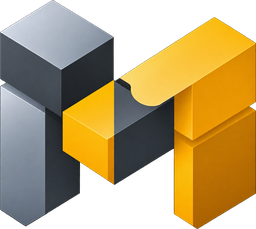
</p>

<h1 align="center">MirbadLLM</h1>

<p align="center">
  Put your spare machines to work. MirbadLLM runs small and medium AI models on the old gaming PC, the laptop
  and the Mac you already own, and manages all of them from one place behind one OpenAI-compatible endpoint.
</p>

<p align="center">
  <a href="https://github.com/samykabu/MirbadLLM/actions/workflows/ci.yml"></a>
  <a href="LICENSE"></a>
  <a href="https://dotnet.microsoft.com/download/dotnet/10.0"></a>
  
</p>

<p align="center">
  <a href="https://mirbadllm.vektragrid.com">Website</a> ·
  <a href="#quick-start">Quick start</a> ·
  <a href="docs/setup.md">Setup guide</a> ·
  <a href="docs/README.md">Documentation</a> ·
  <a href="CONTRIBUTING.md">Contributing</a> ·
  <a href="SECURITY.md">Security</a>
</p>

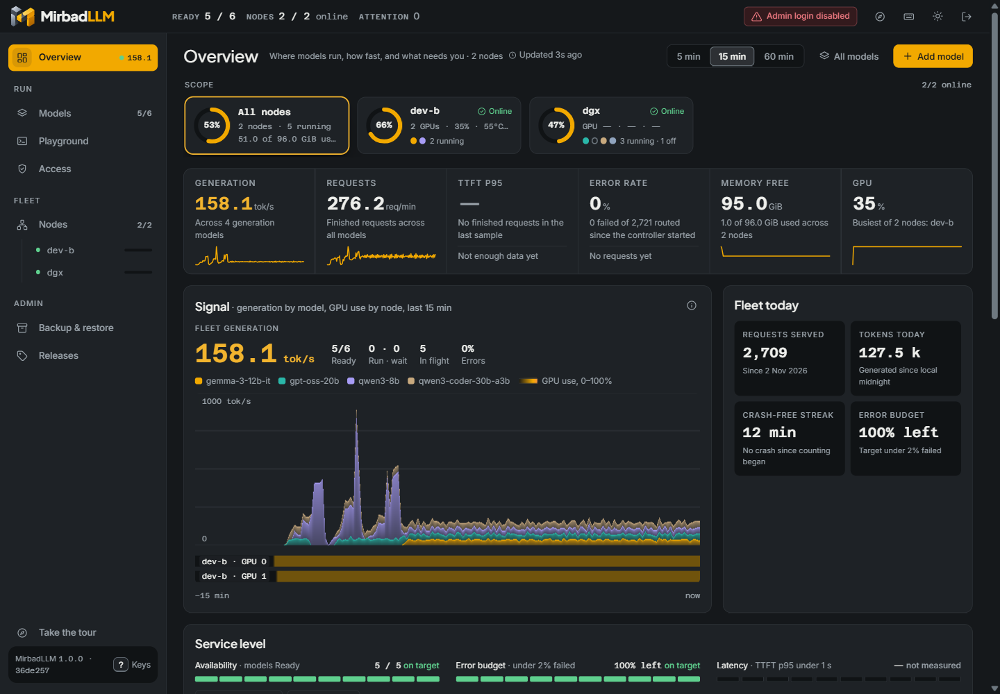

## What MirbadLLM is

Most homes and small offices own more compute than they use. There is the gaming PC that was replaced two upgrades
ago, the laptop with an RTX card that now spends its days closed, the Apple Silicon Mac that sits idle every
evening, and sometimes one serious GPU box. Each of them can run a useful language model. The trouble is that each
one becomes its own small project: its own runtime, its own flags, its own port, and no single place that shows what
is running where.

MirbadLLM turns those machines into one service. You install a small agent on each machine, approve it from the
browser, and decide which model runs where. Every model then sits behind one OpenAI-compatible `/v1` endpoint, so
your coding agents, chat clients and scripts keep one base URL and pick a model by name. They never need to know
which machine answered. The same browser UI downloads models, checks that a model fits in memory before it starts,
watches throughput and memory, benchmarks and tunes models, hands out API keys and backs everything up.

It has two parts. The **master** holds the model registry, API keys, the UI, the admin API and the router. A **node
agent** runs on every machine that serves models. It starts each model with that machine's runtime, checks memory
before a start, and reports GPU, memory and throughput telemetry. The master reaches every agent over mutual TLS and
never touches a GPU or a model file itself.

The name comes from the Arabic word مِرْبَد (mirbad), the enclosure where camels are gathered and kept. MirbadLLM does
the same for models scattered across your machines.

### What your old machines can run

The memory on the GPU, or the unified memory on a Mac, decides how large a model a machine can serve. As a rough
guide for 4-bit GGUF models with a moderate context window:

| Machine you may already have | Memory for the model | Comfortable model size |
|---|---|---|
| Gaming PC or gaming laptop with an 8 GB NVIDIA card (RTX 2070, 3060 Ti, 4060) | 8 GB | 7B to 8B |
| Gaming PC with a 12 to 16 GB card (RTX 3060 12 GB, 4070, 4080) | 12 to 16 GB | up to about 14B |
| Gaming PC with a 24 GB card (RTX 3090, 4090) | 24 GB | up to about 32B |
| Apple Silicon MacBook or Mac with 16 GB | shared with macOS | 7B to 8B |
| Apple Silicon Mac with 32 GB or more | shared with macOS | 14B to 32B |
| A DGX Spark or a large GPU workstation | 128 GB unified, or several cards | large models on vLLM |

These are rules of thumb, not guarantees. Context length, quantization and how many requests run at once all move
them. You do not have to do the arithmetic yourself, though: the agent reads each GGUF header, estimates the memory a
model needs, and refuses a start that would not fit, with the reason. To look up your own machine, use
[Will it run?](https://mirbadllm.vektragrid.com/will-it-run/) on the website.

Two limits to know today. A PC node needs an NVIDIA GPU, on Windows 11 (llama.cpp) or on Linux (vLLM in Docker), and a
Mac node needs Apple Silicon. AMD GPUs and CPU-only machines are not supported yet.

### Why it exists

The project started on a single NVIDIA DGX Spark, where a single-slot model server made every parallel coding agent
queue behind the others. vLLM fixed the throughput, but it brought a new job: one container per model, flags to get
right, memory to budget, and nothing to show what was running.

Once that job was done for one box, the next question was obvious. Why stop at one? The older gaming PC and the Mac
in the next room could serve the smaller models, and the coding agents did not care which machine answered. That is
the shape MirbadLLM has today: one place to manage every machine you are willing to lend to AI, whether it cost a lot
or was about to be thrown out.

It is a control plane for a handful of machines you own. It is not a general cluster scheduler, and it is not a
hosted service.

### Who it is for

- **Anyone with spare hardware**: an old gaming PC, a gaming laptop, a MacBook that is no longer the daily machine.
  Instead of gathering dust, each one serves a model to every tool in the house.
- **Homelab and AI enthusiasts** who already run models on more than one machine and are tired of managing each one
  by hand.
- **Small teams** that self-host an OpenAI-compatible API for coding agents (Cline, Roo Code, Continue and others)
  and need API keys, per-machine memory rules and a clear view of what is running.
- **Platform and DevOps engineers** who want model lifecycle, placement, backups and agent updates handled the same
  way on every machine, with signed updates and an audit log.
- **Researchers and model tinkerers** who compare models and settings: the benchmark presets and the tuner measure a
  model on its own hardware and keep the history.

## Features

- **One OpenAI-compatible endpoint.** `/v1/models` lists every model on every node. Every other `/v1` path the
  runtime supports (chat completions, completions, embeddings), streaming included, is proxied to the node that
  serves the model named in the request.
- **Runtimes follow node capabilities.** Linux and DGX agents run vLLM, llama.cpp and SGLang containers, with NIM only
  when explicitly enabled and digest-approved. Windows and macOS keep native llama.cpp, and Apple Silicon also runs MLX
  (`mlx_lm.server`). SGLang/NIM on Windows require a separately enrolled Linux agent in WSL2, not native-agent control.
- **Models from Hugging Face.** Download a repository or pick a single GGUF variant; the agent downloads on its own
  node, reads the GGUF header and estimates the memory a model needs. Saved Hugging Face tokens are picked by name.
- **Memory admission and placement.** Every model has a memory budget. A start is refused with a reason when the
  budget does not fit the node's free memory minus its reserve, per GPU on discrete-GPU machines. Models are placed
  on a node (and on GPUs by UUID), can be moved between nodes, and start one at a time per node.
- **Recovery.** Models that were running come back after a node or the master restarts, one at a time per node. A
  model you stopped stays stopped.
- **Overview "Command Deck".** A live page with fleet KPIs, a WebGL Signal chart of generation per model and GPU use
  per node, a leaderboard with a full readout per model, the fleet's counters (requests served, tokens today, crash-free
  streak, error budget), service levels, and per-node headroom and disk.
- **Benchmark and tune.** Workload presets (interactive chat, agents and tools, throughput, long documents,
  embeddings) measure a running model. The tuner searches vLLM settings phase by phase and re-measures the leaders
  before it names a winner; nothing changes until you choose **Apply**.
- **Access control.** An admin login for the UI and the admin API, isolated API-key scopes for `/v1`, `/metrics`, and the protected stateless Streamable HTTP MCP endpoint at `/mcp`, and a Connect
  page with ready-to-paste settings for common clients, including a VS Code configuration export.
- **Back up and restore everything.** Model definitions, running models, node settings, managed host services,
  history, API keys and saved tokens (encrypted with your passphrase), on a schedule to a local folder or an SMB or
  NFS share, and a restore that previews every change and downloads missing checkpoints again.
- **Fleet operations.** Join a machine with a one-line command, approve it by key fingerprint, drain, rekey, revoke
  and rotate certificates, and push signed agent updates from the master.
- **Host services.** An optional root helper lists and manages whitelisted systemd units, launchd jobs or Windows
  services (ComfyUI, Ollama, LM Studio and similar) next to the models, behind a compiled-in deny list.
- **Prometheus metrics** at `/metrics`, and light and dark themes built to WCAG 2.2 AA.

## Screenshots

| Overview (light) | Models |
|---|---|
| 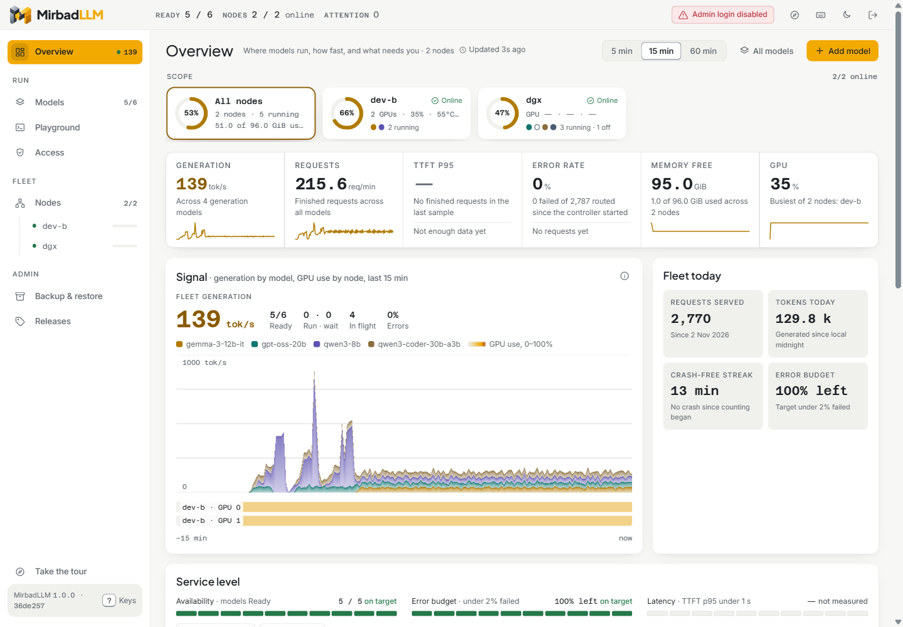 | 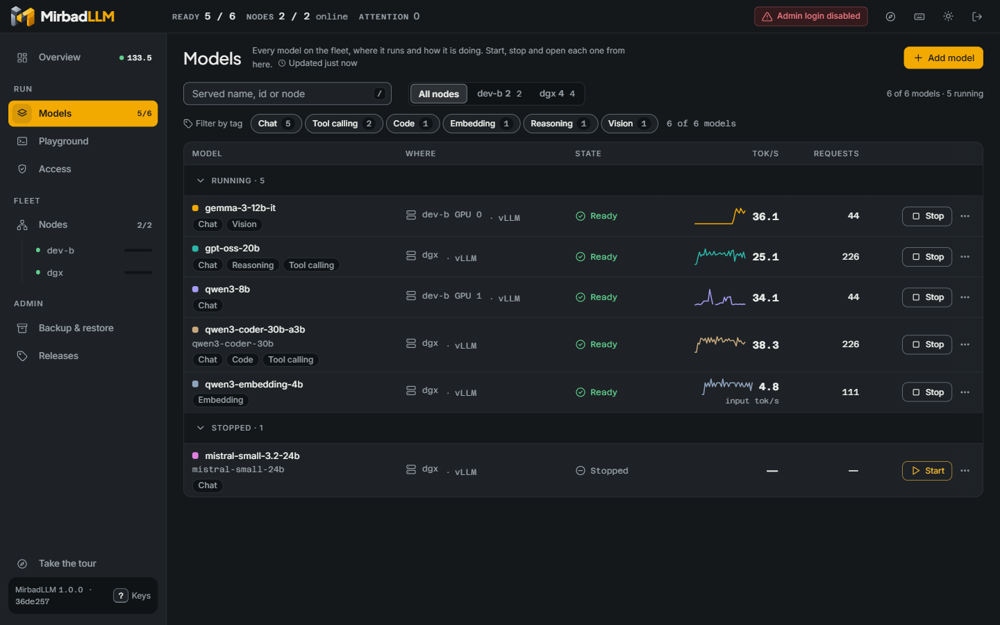 |
| **Tune** | **Backup and restore** |
| 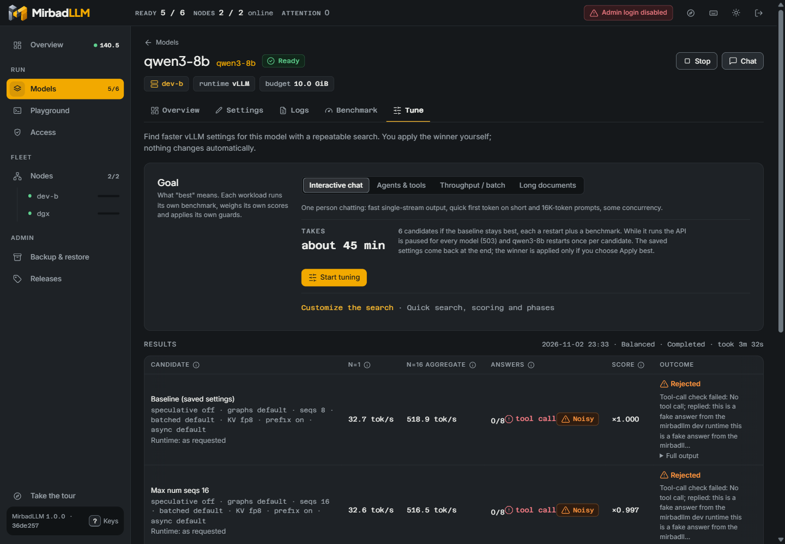 | 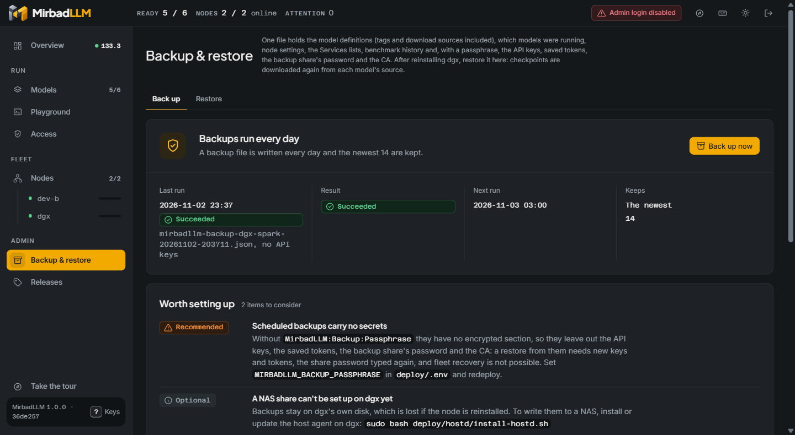 |
| **Access: saved tokens** | **Nodes** |
| 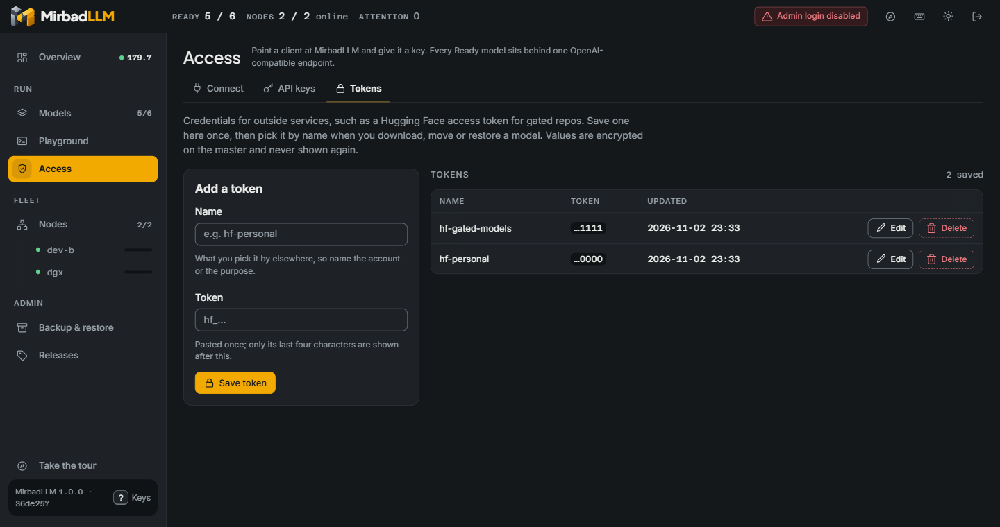 | 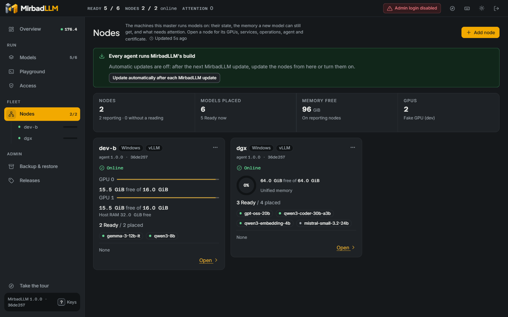 |

The screenshots come from the development fleet described below: fake runtimes and generated traffic, no real
hardware.

## Quick start

### Try it on a laptop, without a GPU

The development fleet runs a master and two node agents on one machine, with fake models in place of vLLM. Nothing
touches Docker or a GPU, and everything listens on loopback. You need the .NET 10 SDK (10.0.100 or a later feature
band) and PowerShell 7 or Bash.

```bash
git clone https://github.com/samykabu/MirbadLLM.git
cd MirbadLLM
pwsh tools/dev-multinode/start.ps1 -Reset      # Windows, or PowerShell 7 anywhere
tools/dev-multinode/start.sh --reset           # Linux and macOS
```

Open `http://127.0.0.1:5080/`. The script builds the solution, enrolls agent `dgx` (a unified-memory node) and agent
`dev-b` (a PC with two fake 16 GiB GPUs), adds a fake model on each and sends chat requests through `/v1`. Stop it
with `pwsh tools/dev-multinode/stop.ps1` or `tools/dev-multinode/stop.sh`.

### Run the master and your first node

Pick the machine that stays on: the master runs there, together with that machine's own agent, as two containers.
Any Linux PC with an NVIDIA GPU works, from an old gaming tower to a DGX Spark. You need Docker Engine with the
NVIDIA Container Toolkit, and a vLLM image the machine can run.

```bash
git clone https://github.com/samykabu/MirbadLLM.git && cd MirbadLLM
sudo install -d -o 1654 -g 1654 /srv/mirbadllm/data /srv/mirbadllm/backups   # 1654 = the "app" user of the .NET image
sudo install -d /srv/mirbadllm/models /srv/mirbadllm/cache
cp deploy/.env.example deploy/.env
# In deploy/.env set at least:
#   DOCKER_GID=<output of: stat -c %g /var/run/docker.sock>
#   MIRBADLLM_VLLM_IMAGE=<a vLLM image available on this machine>
#   MIRBADLLM_ADMIN_PASSWORD=<admin password for the UI>
docker compose -f deploy/compose.multinode.yaml --env-file deploy/.env up -d --build
```

Open `http://<host>:8080/`, sign in, and add a model on **Models**. The compose file treats the machine as one
unified memory pool, as on a DGX Spark. On a PC with discrete NVIDIA GPUs, join the PC as a node with the Linux agent
installer instead, so admission works per GPU; the [setup guide](docs/setup.md) covers both.

### Add your other machines

On the master, open **Nodes > Add node** and copy the one-line command for Windows, Linux or macOS. Run it on the
gaming PC, the laptop or the Mac. The command installs the agent as a service and enrolls it; you approve the machine
in the browser after comparing its key fingerprint. From then on, its models appear on the same `/v1` endpoint as
everything else.

### Call a model

```bash
curl http://<host>:8080/v1/chat/completions \
  -H "Authorization: Bearer $MIRBADLLM_API_KEY" \
  -H "Content-Type: application/json" \
  -d '{"model":"<served-name>","messages":[{"role":"user","content":"Hello"}],"max_tokens":128}'
```

Any OpenAI SDK works the same way:

```python
from openai import OpenAI

client = OpenAI(base_url="http://<host>:8080/v1", api_key="<your MirbadLLM API key>")
reply = client.chat.completions.create(
    model="<served-name>",
    messages=[{"role": "user", "content": "Hello"}],
)
print(reply.choices[0].message.content)
```

Until the first API key exists, `/v1` is open and the UI says so in its header. Create a key on **Access**, or set
`MIRBADLLM_REQUIRE_API_KEY=true` to require one from the start.

## Setup

| Topology | What runs where | Guide |
|---|---|---|
| Single machine | Master and agent as two containers on one Linux GPU machine | [Single machine](docs/setup.md#single-machine) |
| Multi-node | Master on one machine; agents on Linux PCs (systemd), Windows PCs (a Windows service) and Apple Silicon Macs (a LaunchDaemon) | [Add nodes](docs/setup.md#add-nodes) |
| Development | Master and two fake-runtime agents on loopback | [Development fleet](docs/setup.md#development-fleet) |

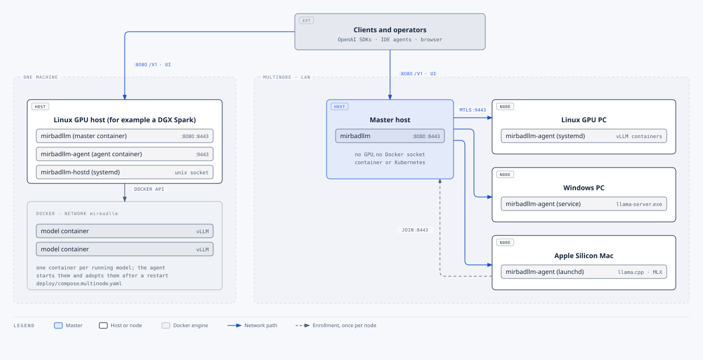

Joining a machine takes one command. On the master, **Nodes > Add node** creates a one-time join command for Linux,
Windows or macOS. The command downloads the agent bundle from the master, checks its SHA-256, installs the agent as a
service and enrolls it. You then approve the node after comparing the key fingerprint it printed. The master dials
agents on TCP 9443, and agents reach the master's enroll listener on TCP 8443. Keep both on the LAN.

## Remote MCP

Create an **MCP Read** or **MCP Operator** key under **Access → API keys**, then use `http://<host>:8080/mcp`. MCP keys are intentionally isolated: inference, metrics, and admin-cookie credentials cannot authenticate this endpoint. Read keys cannot invoke mutations.

```toml
[mcp_servers.mirbad]
url = "http://HOST:8080/mcp"
bearer_token_env_var = "MIRBAD_MCP_KEY"
```

Claude Code: `claude mcp add --transport http mirbad http://HOST:8080/mcp --header "Authorization: Bearer $MIRBAD_MCP_KEY"`. Claude Desktop users should use **Settings → Connectors**; no undocumented JSON bearer-header form is recommended. Plain HTTP is suitable only on a trusted LAN. Put a TLS reverse proxy in front and use an HTTPS URL for wider access. Never place keys in URLs or source control.

## Configuration

The container deployment reads `deploy/.env`. The settings you are most likely to change:

| Variable | Default | What it does |
|---|---|---|
| `DOCKER_GID` | none, required | Group id of `/var/run/docker.sock`, so the agent can start model containers |
| `MIRBADLLM_VLLM_IMAGE` | a locally built image name | vLLM image for models that do not name their own; set it |
| `MIRBADLLM_ADMIN_PASSWORD` | empty (login disabled) | Admin password for the UI and `/api` |
| `MIRBADLLM_REQUIRE_API_KEY` | `false` | Require an API key on `/v1` even before the first key exists |
| `MIRBADLLM_MEMORY_RESERVE_GIB` | `8` | Memory kept free on the node; admission refuses starts that would use it |
| `MIRBADLLM_PORT` | `8080` | Port of the UI, `/api`, `/v1` and `/metrics` |
| `MIRBADLLM_DATA`, `MIRBADLLM_MODELS`, `MIRBADLLM_CACHE`, `MIRBADLLM_BACKUPS` | `/srv/mirbadllm/...` | Host folders for state, checkpoints, the download cache and backups |
| `MIRBADLLM_BACKUP_PASSPHRASE` | empty | Encrypts API keys and secrets inside scheduled backups |

Every master setting also has an environment form (`MirbadLLM__Key`, `MirbadLLM__Section__Key`) and a JSON form
(`MirbadLLM:Section:Key` in `appsettings.json`). The full list is in [docs/configuration.md](docs/configuration.md).

## Architecture

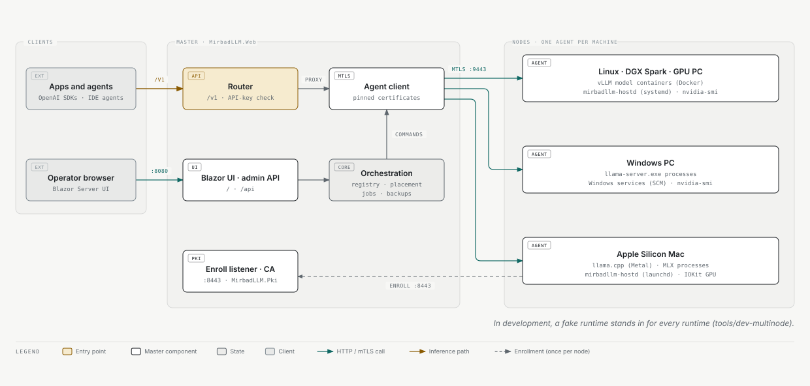

The master is one ASP.NET Core process: the Blazor Server UI, the `/api` admin API, the `/v1` router, the registry,
jobs, backups and a small certificate authority. Each agent is a separate .NET process that runs the runtime drivers,
admission, downloads, telemetry and a reverse proxy to its models. A request takes this path:

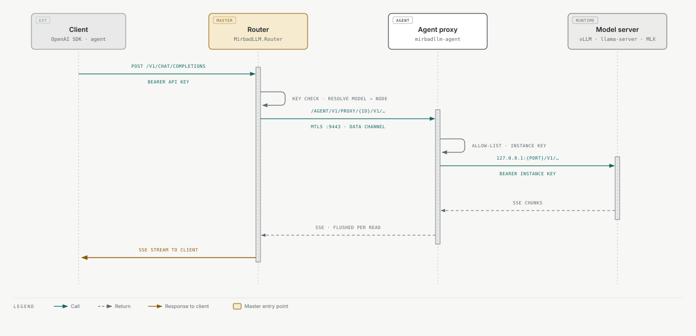

More detail, including the behaviour contracts every part keeps, is in [docs/architecture.md](docs/architecture.md).

## Project structure

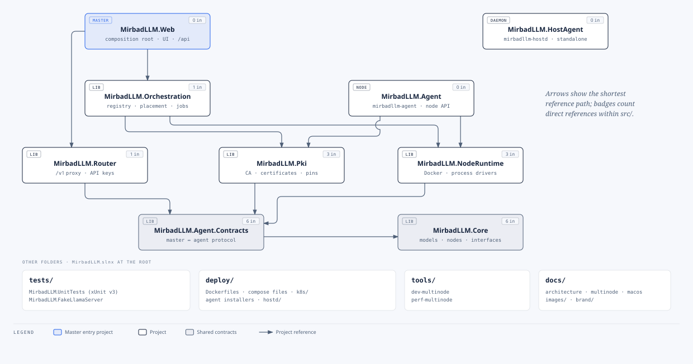

```
src/
  MirbadLLM.Core/             Shared contracts: model definitions, statuses, nodes, options, interfaces
  MirbadLLM.Orchestration/    Master side: registry, vLLM arguments, node registry and monitor, agent client,
                              placement, jobs (benchmark, tune), backups, recovery, PKI rotation
  MirbadLLM.Router/           /v1 proxy through the agents, /v1/models, API-key check
  MirbadLLM.Web/              The master: Program.cs composition, /api endpoints, Blazor UI, enroll listener
  MirbadLLM.Agent/            The node agent: mTLS API, operations, admission, proxy, telemetry, updates
  MirbadLLM.Agent.Contracts/  Master and agent protocol: routes, envelopes, events, error codes
  MirbadLLM.NodeRuntime/      Node-local code: Docker client, container and process drivers, downloads, probes
  MirbadLLM.Pki/              CA, certificate issuing, SPKI pins, TLS validators
  MirbadLLM.HostAgent/        mirbadllm-hostd, the optional root helper for host services and backup mounts
tests/
  MirbadLLM.UnitTests/        xUnit v3 tests, one folder per area
  MirbadLLM.FakeLlamaServer/  A fake llama-server for process-driver tests and the development fleet
deploy/                       Dockerfiles, compose files, agent installers (linux, windows, macos), hostd, k8s
tools/                        dev-multinode (development fleet), perf-multinode (performance harness)
docs/                         Architecture, setup, operator guides, designs, images
```

## Documentation

The [documentation index](docs/README.md) lists every guide. The same guides are on the website, with search and an
Arabic interface: [mirbadllm.vektragrid.com/docs](https://mirbadllm.vektragrid.com/docs/). The ones you will use most:

- [Setup guide](docs/setup.md): single machine, adding nodes, the development fleet
- [Configuration](docs/configuration.md): environment variables and settings
- [Backup and restore](docs/backup-and-restore.md): what a backup holds, schedules, NAS destinations, disaster recovery
- [Host services](docs/host-services.md): the optional root helper and its security model
- [Architecture](docs/architecture.md): components and behaviour contracts
- Operator guides for [multi-node basics](docs/multinode/operations.md), [Linux PC nodes](docs/multinode/operations-p2.md)
  and [Windows nodes and llama.cpp](docs/multinode/operations-p3p4.md)
- Agent install guides for [Linux](deploy/agent/linux/README.md), [Windows](deploy/agent/windows/README.md) and
  [macOS](deploy/agent/macos/README.md)

## Roadmap

Work is tracked in [GitHub issues](https://github.com/samykabu/MirbadLLM/issues). The design documents describe one
larger step that is not built yet: running the master in Kubernetes behind an ingress, with the agents unchanged. The
manifests in `deploy/k8s` are a starting point for it, not a supported deployment.

## Contributing

Contributions are welcome. [CONTRIBUTING.md](CONTRIBUTING.md) covers the development setup, the build and test
commands, the branch and pull request flow, and how CI treats pull requests from forks. Please read the
[code of conduct](CODE_OF_CONDUCT.md) first.

## Community and support

- Website, in English and Arabic: [mirbadllm.vektragrid.com](https://mirbadllm.vektragrid.com), including a
  [100-second tour](https://mirbadllm.vektragrid.com/tour/) and a [FAQ](https://mirbadllm.vektragrid.com/faq/)
- Questions and ideas: [GitHub Discussions](https://github.com/samykabu/MirbadLLM/discussions)
- Bugs and feature requests: [GitHub issues](https://github.com/samykabu/MirbadLLM/issues/new/choose)

## Security

Please do not report vulnerabilities in public issues. Use GitHub's private vulnerability reporting as described in
[SECURITY.md](SECURITY.md).

## License

MirbadLLM is released under the [MIT License](LICENSE).

## Acknowledgments

MirbadLLM orchestrates other people's work: [vLLM](https://github.com/vllm-project/vllm),
[llama.cpp](https://github.com/ggml-org/llama.cpp), [MLX](https://github.com/ml-explore/mlx) and
[mlx-lm](https://github.com/ml-explore/mlx-lm), with models from [Hugging Face](https://huggingface.co). It is built
with [.NET and ASP.NET Core Blazor](https://dotnet.microsoft.com/), [Bootstrap](https://getbootstrap.com/),
[xUnit](https://xunit.net/) and [bUnit](https://bunit.dev/). The interface uses the Plus Jakarta Sans, Inter and
Azeret Mono typefaces under the SIL Open Font License.

## Star history

<a href="https://star-history.com/#samykabu/MirbadLLM&Date">
  <picture>
    <source media="(prefers-color-scheme: dark)" srcset="https://api.star-history.com/svg?repos=samykabu/MirbadLLM&type=Date&theme=dark">
    
  </picture>
</a>
