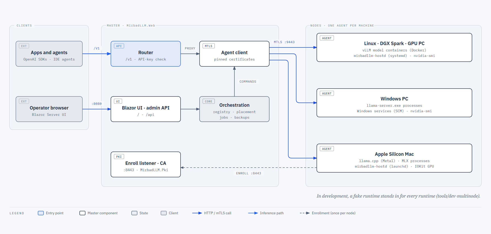
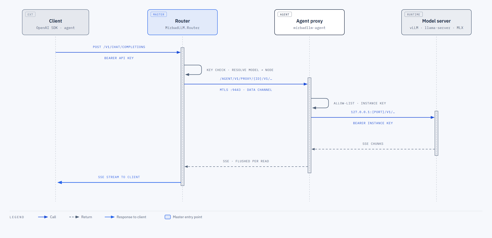
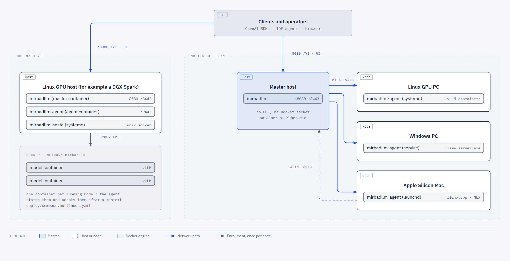

# MirbadLLM architecture and behaviour contracts

This document describes how MirbadLLM is built and the behaviour each part promises. The project started as a
controller for a single NVIDIA DGX Spark; the sections after the overview still carry that history, phase by phase
(P1 to P4), because the contracts were written as each phase landed.

MirbadLLM runs local LLMs on one or more machines and serves all of them behind one OpenAI-compatible `/v1`
endpoint. A **master** holds the model registry, API keys, the Blazor UI, the admin API and the router. A **node
agent** on every machine starts and stops the models with that machine's runtime (vLLM in containers, llama.cpp as a
native process, MLX on Apple Silicon), checks memory before a start, and reports telemetry.

## Architecture



The master never touches Docker, a GPU or a model file. Every host-specific action goes through the node's agent over
mutual TLS (`https://<agent>:9443/agent/v1`). A request to `/v1` flows like this:



1. The router checks the bearer key (when keys are required) and resolves the `model` field against the registry.
2. The master proxies the request to the model's node agent, `https://<agent>:9443/agent/v1/proxy/{modelId}/v1/...`.
3. The agent forwards it to the runtime on a loopback or container-network port, adding the per-instance key where
   the runtime has one.
4. Responses, including server-sent event streams, come back the same way. Bodies up to 64 MiB are accepted, chunked
   or not; larger ones get 413 `request_too_large`.



The single-controller build (`deploy/compose.yaml`) is the original one-process layout, kept for the way back. The
multi-node build (`deploy/compose.multinode.yaml`) runs the master and the machine's own agent as two containers, and
other machines join as nodes with the Linux, Windows or macOS agent installers.

### The original single-host layout

The behaviour contracts below were first written for the single-host controller. The diagram is kept because the
contracts still refer to it:

```
 VS Code (Cline/Roo/Continue), other agents
                 │  http://<host>:8080/v1/*   (OpenAI API, optional bearer key)
 ┌───────────────▼────────────────────────────────────────────┐
 │ MirbadLLM.Web  (ASP.NET Core, one process, one container)  │
 │  ├─ Router       /v1/*  → picks upstream by body "model"    │
 │  ├─ Admin API    /api/* → registry + runtime                │
 │  ├─ Blazor UI    /      → dashboard, model editor, logs     │
 │  └─ Orchestration: Docker Engine API over /var/run/docker.sock│
 └───────┬───────────────────────────────┬────────────────────┘
         │ docker network "mirbadllm"  │ creates/removes
   http://ss-<id>:8000            http://ss-<id>:8000
   ┌─────▼──────┐                 ┌──────▼─────┐
   │ vLLM model │   ...           │ vLLM model │   (sibling containers, --gpus all)
   └────────────┘                 └────────────┘
```

Single host process on purpose: one image, one port, no inter-service auth. The projects are
separate so the pieces stay decoupled and could be split later, which is what the multi-node build did.

## Since the multi-node split (P1)

This brief describes the single-host controller (`deploy/compose.yaml`). `main` now deploys the multi-node P1 build
(`deploy/compose.multinode.yaml`; design: `docs/multinode/design.md`, operator guide: `docs/multinode/operations.md`),
which splits that process. The behaviour contracts below still hold; what changed is **where** they run:

- The **master** (`MirbadLLM.Web` composition) has no Docker socket, no `/models`, no hostd socket and no GPU. It
  keeps the registry, API keys, UI, admin API, router, backups, jobs, PKI and fencing, and reaches each node through
  its agent over mTLS (HTTP/2, `https://<agent>:9443/agent/v1`).
- The **node agent** (`MirbadLLM.Agent`, container `mirbadllm-agent` on the DGX) creates, adopts and stops the
  model containers (`ContainerRuntimeDriver` in `MirbadLLM.NodeRuntime`, same naming, labels and create parameters as
  below), runs admission (memory reserve, one start at a time on unified memory), downloads, folder listing, hostd
  calls, telemetry (`/proc/meminfo`, `nvidia-smi`, each model's `/metrics` scrape) and a reverse proxy to the models.
- Master-side replacements of the single-host types: `RemoteModelRuntime` (for `DockerModelRuntime`),
  `RemoteTelemetryCollector` and the remote probes (for `MetricsSampler` and the local memory/GPU probes),
  `AgentEndpointResolver` in `MirbadLLM.Router` (for `ModelEndpointResolver` and `UpstreamUri`), and
  `RemoteHostUnitBackend` / `RemoteHostContainerBackend` / `RemoteBackupMountClient` (for the local hostd and Docker
  clients behind the Services page and the backup destination). `DockerModelRuntime`, `MetricsSampler`,
  `ModelEndpointResolver` and `UpstreamUri` were kept unregistered as parity references until MN-047 and are removed
  there (D60).
- The router's `/v1` path is unchanged for clients; the master proxies to
  `https://<agent>/agent/v1/proxy/{modelId}/v1/...`. Since MN-047 (D70) the master accepts the full 64 MiB per `/v1`
  request (`Content-Length` or chunked) and answers 413 `request_too_large` above it; other endpoints keep Kestrel's
  default (30,000,000 bytes).

P2 (live on the DGX from `main`; operator guide `docs/multinode/operations-p2.md`) adds Linux PC agents
(systemd, `deploy/agent/linux`), discrete GPUs with per-GPU admission and placement by GPU UUID, moves and unplace
(`MoveService`, `ownership.json`), one job per node with node-scoped maintenance once two nodes are approved, takeover
with continuation, restore modes and fleet recovery in recovery mode, the audit log (`{DataPath}/audit`) and a manual
CA rotation. On the single DGX the contracts below are unchanged.

P3/P4 (`feature/multinode-p3`, not deployed; design `docs/multinode/design-p3p4.md`, operator guide
`docs/multinode/operations-p3p4.md`) adds a second runtime kind and a Windows node:

- **llama.cpp as a native process.** `ProcessRuntimeDriver` (`MirbadLLM.NodeRuntime/Runtimes/Process`) implements
  the same `IRuntimeDriver` as the container driver, with `Delivery = Process`. It owns the state machine,
  `processes.json`, port use, health, logs, crash handling and adoption, and never calls a Win32 API: the OS work is
  behind `IProcessHost`, implemented by `WindowsProcessHost` (`CreateProcessW` + a per-instance job object without
  kill-on-close, so a model outlives an agent restart, upgrade or crash and is adopted by PID, creation time and
  image path). `ExecutableCatalog` maps a logical name and version to a verified path; `IGgufReader` reads GGUF
  headers; `IInstanceKeyProtector` protects each instance's API key at rest. Master side: `LlamaCppArgsBuilder` and
  `LlamaCppArgsParser` for the argv, `LlamaCppMemoryEstimate` for the admission estimate, and the router's
  `dimensions` emulation for llama.cpp embedding models. A llama.cpp model has no legacy config hash: restart-pending
  compares execution fingerprints alone.
- **The Windows agent** hosts itself as a Windows service (`MirbadLLM.Agent/Hosting/WindowsServiceHosting`,
  `Microsoft.Extensions.Hosting.WindowsServices`), logs to the Windows Event Log, and runs under the virtual account
  `NT SERVICE\mirbadllm-agent` (installer `deploy/agent/windows/install-agent.ps1`). `WindowsServiceLifetime`
  reports RUNNING when the host starts, so only the code before `app.RunAsync` counts against the SCM's 30 s: long
  start work (the catalogue's first hashing, Ready probes of adopted processes, the TLS key sweep) belongs in a
  `BackgroundService`, never in a blocking `StartAsync`, which would keep 9443 closed. Node-local subsystems are
  Windows ones: `WindowsMemoryProbe`, `nvidia-smi` for discrete GPUs, SCM host services instead of hostd.
- **The composition gate** is one setting, `Agent:Docker:Enabled`. With Docker on, the agent composes exactly as in
  P2, registration for registration — which is what `P2CompositionTests` and the pinned DGX capability fixture prove.
  With Docker off it composes the process half instead, but only when an `IProcessHost` **and** an
  `IInstanceKeyProtector` are available (Windows registers both itself; a test or the dev setup injects them off
  Windows, so the Linux CI leg exercises the same code). There is no second `Agent:Runtime` switch. `Agent:CacheRoot`
  is mandatory with Docker off, duplicate `Agent:Executables` names are refused, and a Docker-off node that supplies
  neither service still starts — it logs one warning, reports an empty runtime list and refuses every launch 422
  `spec_rejected`. Two P2 contributors (`GpuSelectionContributor`, `LaunchFeaturesContributor`) read every driver,
  not only the container one, so a process node reports `gpus.uuids` and `launch.env`; the widening is inert with
  Docker on.
- **Protocol 1 is unchanged.** One new route (`GET /model-folders/{folder}/gguf`), new feature flags
  (`gguf.inspect`, `admission.gpu-budgets`, `downloads.ollama`, plus the P1 constants `runtime.llamacpp.process`,
  `downloads.hf-native` and `services.scm`, which no P1/P2 agent reports), and additive wire fields omitted at their
  defaults. The DGX's launch bodies, hashes, fingerprints and capabilities are byte-identical.

## Projects and ownership

| Project | Owns | Depends on |
|---|---|---|
| `src/MirbadLLM.Core` | Contracts only: `ModelDefinition`, `ModelStatus`, `ModelEndpoint`, `MemorySnapshot`, `ModelMetrics`, `RouterModelStats`, the interfaces in `Abstractions.cs`, `MirbadLLMOptions`. Shared by every project, so changes here are reviewed with extra care. | — |
| `src/MirbadLLM.Orchestration` | Master side: vLLM argument builder, JSON registry, health monitor, metrics history, jobs, backups; since P1 also the node registry and monitor, agent client, `RemoteModelRuntime`, `RemoteTelemetryCollector`, remote probes/storage/host services, certificate rotation, fencing, `AddMirbadLLMOrchestration`. | Core, Agent.Contracts, Pki, NodeRuntime |
| `src/MirbadLLM.Router` | `/v1/*` proxy (through the agents since P1, `AgentEndpointResolver`), `/v1/models`, API-key check, `IRouterStats`, `AddMirbadLLMRouter` / `MapMirbadLLMRouter`. | Core, Agent.Contracts |
| `src/MirbadLLM.Web` | `Program.cs` composition (the master), `/api/*` admin endpoints, Blazor pages, the enroll listener. | all |
| `src/MirbadLLM.Agent` | The node agent `mirbadllm-agent` (P1). | Core, Agent.Contracts, NodeRuntime, Pki |
| `src/MirbadLLM.Agent.Contracts` | Master ↔ agent protocol: routes, envelopes, events, error codes (P1). | Core |
| `src/MirbadLLM.NodeRuntime` | Node-local code the agent uses: Docker Engine client, container driver, Hugging Face downloader, `/proc/meminfo` and `nvidia-smi` probes, hostd client (P1); since P3/P4 also the llama.cpp process driver and its `IProcessHost` (Windows), the executable catalogue, the GGUF reader, the process record store and the instance-key protector. | Core, Agent.Contracts |
| `src/MirbadLLM.Pki` | CA, certificate issuing from CSRs, SPKI pins, TLS validators (P1). | Agent.Contracts |
| `tests/MirbadLLM.UnitTests` | One folder per area: `Orchestration/`, `Router/`, `Web/`, `Agent/`, `Multinode/`. | all |
| `deploy/` | Dockerfiles, `compose.yaml`, `compose.multinode.yaml`, `agent/`, `hostd/`, `k8s/`. | — |
| `tools/` | `dev-multinode` (a master and two fake-runtime agents on one machine), `perf-multinode` (perf harness). | — |

## Conventions (all workstreams)

- .NET 10, `TreatWarningsAsErrors`, nullable on, `latest-recommended` analyzers: **0 warnings, 0 errors**.
- Central package management (`Directory.Packages.props`), exact versions. **Do not add packages**
  without discussing it in an issue first; everything here is doable with the BCL + ASP.NET Core.
- No `Docker.DotNet`: talk to the Docker Engine API (`/v1.47/...`) with `HttpClient` over the Unix
  socket (`SocketsHttpHandler.ConnectCallback` + `UnixDomainSocketEndPoint`), named pipe, or TCP.
- Async all the way, `CancellationToken` on every I/O call, `System.Text.Json` with web defaults.
- Tests: xUnit v3 (`xunit.v3`), `Assert.*`, no mocking library — hand-written fakes. Run with
  `dotnet artifacts/bin/MirbadLLM.UnitTests/debug/MirbadLLM.UnitTests.dll` (in-process runner),
  filter with `-class` / `-namespace`. The default run includes the multi-node `Chaos` category (deterministic
  seeds, about 35 s in parallel); the full `Perf` harness is opt-in (`MIRBADLLM_PERF=1`).

## Behaviour contracts

### Orchestration

Since P1 the container, memory, metrics and endpoint contracts in this section run on the node agent
(`MirbadLLM.NodeRuntime` / `MirbadLLM.Agent`); the master reaches them through `RemoteModelRuntime`,
`RemoteTelemetryCollector` and `AgentEndpointResolver` (see "Since the multi-node split" above).

- **Container naming/labels:** container `ss-{Id}`; labels `mirbadllm.model={Id}`,
  `mirbadllm.served-name={ServedName}`, `mirbadllm.port={hostPort}`. State is always derived from
  Docker (list containers with label filter), never cached as truth — the controller can restart at
  any time and must adopt running containers.
- **State mapping:** no container → `Stopped`; running and `GET http://upstream/health` = 200 →
  `Ready`; running, not healthy yet → `Starting`; exited/dead → `Failed` (with the last 20 log lines
  in `Error`); `Stopping` while a stop is in flight.
  `/health` cannot see a wedged engine, so the master also flags a Ready model as *Stalled* or *Slow* from its
  metrics history (`ModelProgress`, see `docs/multinode/operations.md` §9), and the agent proxy ends requests a model
  stays silent on for `ProxyUpstreamIdleTimeout`.
- **Start:** refuse (throw `ModelMemoryAdmissionException`, Core) when
  `MemoryBudgetGiB > AvailableGiB - MemoryReserveGiB` unless `force`. Pick the lowest free host port
  ≥ `PortRangeStart` not used by another mirbadllm container. Ensure the Docker network exists.
  Create with: image, `--gpus all` equivalent (`DeviceRequests: [{Driver:"nvidia",Count:-1,Capabilities:[["gpu"]]}]`),
  `IpcMode: host`, binds `{ModelsHostPath}:/models:ro` and `{CacheHostPath}:/root/.cache`,
  port `8000/tcp` → `127.0.0.1:{hostPort}`, network `{DockerNetwork}` with alias `ss-{Id}`,
  `RestartPolicy: no`, command = vLLM args below. Missing image → pull first. Docker never starts a model on its
  own: after a reboot only `AutoStart` models come back, through the controller's one-at-a-time boot auto-start
  (`unless-stopped` let Docker relaunch every model at once on 2026-10-14 and the smallest one ran out of KV-cache
  memory). A container created before this change keeps its old policy until it is recreated;
  `docker update --restart=no ss-<id>` switches it in place.
- **vLLM args** (entrypoint is `vllm serve`), in this order:
  `--model /models/{ModelPath} --served-model-name {ServedName} [--quantization {Quantization}]
  --kv-cache-dtype {KvCacheDtype} --max-model-len {MaxModelLen} --max-num-seqs {MaxNumSeqs}
  --gpu-memory-utilization {MemoryBudgetGiB / TotalGiB, 4 decimals, invariant culture}
  [--enable-auto-tool-choice --tool-call-parser {ToolCallParser}] [--reasoning-parser {ReasoningParser}]
  [--enable-prefix-caching | --no-enable-prefix-caching]
  [--speculative-config {Speculative as the vLLM object, keys sorted}]
  [--compilation-config {"cudagraph_mode":"…", …CompilationConfig keys}] [--async-scheduling | --no-async-scheduling]
  [--mamba-cache-mode {MambaCacheMode}] --disable-access-log-for-endpoints /health,/metrics {ExtraArgs…}`
  (the Phase 0 command lines are the golden tests in `VllmArgsBuilderTests`.)
- **Canonical effective configuration** (`VllmArgsNormalizer`): the settings mirbadllm owns — speculative
  config, compilation config, max num seqs, max batched tokens, KV cache dtype, prefix caching, async scheduling,
  mamba cache mode — live only in typed `ModelDefinition` fields and are emitted exactly once. Any of them found in
  `ExtraArgs` (`--flag value`, `--flag=value`, one-line `--flag value`, `_` spellings, `-cc`, dotted
  `--speculative-config.num_speculative_tokens=3` / `--speculative_config.model X` / `-cc.cudagraph_mode=…`,
  `--x`/`--no-x`) is lifted into its field with vLLM's semantics: ExtraArgs come last, so a scalar replaces the
  typed value, a full JSON object replaces the whole object (vLLM keeps the last `--speculative-config`, verified in
  the image); when any dotted key of a config is present vLLM builds it from the dotted keys alone (last wins per key) and discards every full JSON object for it, typed one included, in any order (verified); every JSON key is kept. `-O…` is not owned. Applied on registry load (migration,
  persisted on the next save), on every save/API upsert (an unreadable owned flag → 400), by the builder, by the
  parser (a container's `Cmd` reads back as what vLLM ran) and by tuning apply.
  - `Speculative` (`SpeculativeDecoding`): typed `method` (empty = inferred from the draft), `num_speculative_tokens`,
    `model` (draft path) plus `Extra` (every other key). Serialized as the vLLM object; the old
    `{"Method","NumSpeculativeTokens"}` shape still reads.
  - `CudaGraphMode` stays the typed owner of `cudagraph_mode`; `CompilationConfig` holds every other
    `--compilation-config` key (never `cudagraph_mode`); the builder merges both into one argument. This keeps old
    files and the tuning planner unchanged.
  - `EnablePrefixCaching` and `AsyncScheduling` are tri-state (`null` = vLLM default, nothing emitted). A stored
    `false` (pre-tri-state files) now means explicit `--no-enable-prefix-caching` (it used to emit nothing).
- **Stop:** `POST /containers/{id}/stop?t=30` then `DELETE /containers/{id}`.
- **Registry:** `{DataPath}/models.json`, atomic write (temp file + move), `SemaphoreSlim` guarded.
  Validate `Id` (`^[a-z0-9][a-z0-9-]{0,39}$`) and `ServedName` uniqueness; throw `ArgumentException`.
  Seed on first run with one example definition, `ornith-9b-fp8`, stopped.
- **Memory probe:** parse `/proc/meminfo` `MemTotal` / `MemAvailable` (kB → GiB). On non-Linux dev
  boxes return a configurable fake (`MirbadLLM:DevMemoryTotalGiB`, default 121).
- **Metrics reader:** scrape `GET upstream/metrics` (Prometheus text). Use
  `vllm:num_requests_running`, `vllm:num_requests_waiting`, `vllm:kv_cache_usage_perc`
  (fallback `vllm:gpu_cache_usage_perc`), and rates from counters `vllm:generation_tokens_total`,
  `vllm:prompt_tokens_total` (difference between consecutive scrapes / elapsed seconds). Since P1 the agent
  scrapes each Ready model into its telemetry ring and the master's `RemoteTelemetryCollector` computes the rates
  (the single-host `MetricsSampler` is removed in MN-047).
- **Endpoint resolver:** `BaseUri` = `http://ss-{Id}:8000/` when `UseContainerNetwork`, else
  `http://{UpstreamHost}:{hostPort}/`. Resolves by `ServedName` (case-insensitive). Since P1 this upstream rule is
  the agent's (its proxy reaches the model this way); the master resolves served names with `AgentEndpointResolver`
  (registry placement + node status cache) and proxies through the agent. `ModelEndpointResolver` and `UpstreamUri`
  are removed in MN-047.
- **Health monitor** (`BackgroundService`): every `HealthPollInterval` refresh states; on boot start
  models with `AutoStart`; log state transitions. After a node agent reboot the node's previous running set
  (`ModelRecoveryState`, `{DataPath}/running-models.json`) is relaunched one at a time through the per-node start lane.
  **Crash auto-restart** (`MirbadLLM:CrashRestart`, default on): a model the recovery state still lists (started and
  never explicitly stopped) that goes Ready/Starting → Failed, or Ready → Stopped without an acknowledged Stop, is
  restarted through the same lane after a 10 s / 30 s / 60 s backoff, audited as `system:autostart`; models under a
  maintenance window, a tuning run or a job's ownership record are skipped. After `MirbadLLM:CrashRestartLimit`
  (default 3) crashes in a row the monitor stops retrying: the model stays Failed, the pause (model, node, crashes, last
  error, time) is written to `{DataPath}/restart-pauses.json` so it survives a controller restart, the Models page and
  the model's Overview read "Crashed 3 times, automatic restarts paused", and the Dashboard attention list (the
  status-bar badge counts it) says "Automatic restarts paused for <model> after <n> crashes: <cause>". A Start by hand
  (UI or `POST /api/models/{id}/start`) or 10 minutes of Ready clears the counter and the pause.

### Router

- `GET /v1/models` → OpenAI list shape (`{"object":"list","data":[{"id","object":"model","created","owned_by":"mirbadllm"}]}`)
  containing **Ready** models by `ServedName`.
- Any other `/v1/{**path}` (POST/GET): buffer the JSON body (limit 64 MiB), read `model`. Unknown →
  404 OpenAI error shape `{"error":{"message","type":"invalid_request_error","code":"model_not_found"}}`.
  Known but not Ready → 503 with `Retry-After: 30` and a message naming the state, unless
  `AutoStartOnRequest`: then start it and wait (poll) up to `StartupTimeout`.
- Proxy to `{BaseUri}v1/{path}{query}` with `HttpCompletionOption.ResponseHeadersRead`; copy status,
  headers (minus hop-by-hop), stream the body with flush per chunk (SSE must not be buffered —
  disable response buffering). Client abort cancels the upstream request (vLLM then aborts it).
  No upstream timeout (long generations); connect timeout 10 s.
- `ApiKey` set → require `Authorization: Bearer {key}` on `/v1/*`, else 401 in OpenAI error shape.
- `IRouterStats`: total, failed (non-2xx or exception), in-flight per served name; thread-safe.

### Web (admin API + UI)

- `Program.cs`: bind `MirbadLLMOptions`, `AddMirbadLLMOrchestration`, `AddMirbadLLMRouter`,
  Razor components (interactive server), map `/api/*`, `MapMirbadLLMRouter`, `/healthz`.
- Admin API: `GET/POST /api/models`, `GET/PUT/DELETE /api/models/{id}`, `POST /api/models/{id}/start?force=`,
  `POST /api/models/{id}/stop`, `GET /api/models/{id}/logs?tail=` (text/event-stream), `GET /api/status`
  (memory + all statuses + metrics + router stats). 409 on memory refusal, 404 unknown id. The multi-node master adds
  409/503/504 answers for node problems (D51, D64, D67; `docs/multinode/operations.md` section 7).
- UI pages: **Dashboard** (memory bar: used by mirbadllm / other / free; model cards with state
  badge, served name, port, budget, live running/waiting/tok/s, Start/Stop; auto-refresh 2 s),
  **Model editor** (create/edit every `ModelDefinition` field, validation, delete), **Logs** (live
  tail of one model), **Connect** (copy-paste snippets: base URL, model names, Cline/Continue config).
  Plain Bootstrap that ships with the template; dark/light via `data-bs-theme`.

## Services page and host agent (`src/MirbadLLM.HostAgent`)

```
 Browser ──/services, /api/services──► controller (container, uid app + group docker)
                                         ├─ Docker socket ──► containers: discovery (all) + control (whitelist only)
                                         │     {DataPath}/host-services.json: container whitelist + remembered restart policies
                                         ├─ IAdminReauthenticator: authenticated portal-session authorization
                                         └─ /run/mirbadllm-hostd/hostd.sock (bind mount, ro)
                                               ▼
                                   mirbadllm-hostd (host, systemd, root; Kestrel on the Unix socket only)
                                         ├─ compiled-in deny list (+ root-owned /etc/mirbadllm/hostd-deny.json, add-only)
                                         ├─ /var/lib/mirbadllm-hostd/whitelist.json (root 0600, StateDirectory)
                                         │     seeded from /etc/mirbadllm/hostd.json (root 0644)
                                         ├─ /usr/bin/systemctl [--user -M dgxuser@] list-units|list-unit-files|show (discovery, read-only)
                                         ├─ /usr/bin/systemctl [--user -M dgxuser@] start|stop|restart|enable|disable -- <whitelisted unit>
                                         └─ /usr/bin/nvidia-smi --query-compute-apps → /proc/<pid>/cgroup → unit
```

- **Contracts** (`Core/HostServices.cs`): `IHostServiceManager` (list, discover, run, autostart, whitelist
  add/update/remove), `HostServiceStatus`, `DiscoveredService` (managed + denied flags, deny pattern),
  `HostServiceWhitelistAdd/Update`, `IAdminReauthenticator`, `HostServicesOptions` (`MirbadLLM:HostAgentSocket`,
  `MirbadLLM:ManagedContainers` = seed only).
- **Discovery** (read-only): the agent merges `systemctl list-units --type=service --all -o json` and
  `list-unit-files --type=service -o json` for the system manager and for each `discoverUsers` user (default: the
  users of the seed's user units, i.e. dgxuser), skips templates without an instance (`foo@.service`), aliases,
  masked, transient and not-found units, then reads everything else in batched `systemctl show` calls (state, unit
  file state, `MemoryCurrent`, cgroup → GPU memory, description). Units that are loaded but have no unit file are
  dropped. The controller adds every Docker container (`GET /containers/json?all=true`, memory from one-shot stats)
  except `mirbadllm`, containers labelled `mirbadllm.model` and download jobs (`mirbadllm.download`). The page
  loads discovery only while **Discovered** is open (refresh every 30 s) and sorts it by RAM + GPU, largest first.
- **Security model** (in order, each layer enforced where it runs, never only in the UI):
  1. **Socket**: only root and the `docker` group can reach the agent (dir `root:docker 0750`, socket `0660`). The
     docker group can already control Docker, so the agent does not widen who holds root-equivalent power.
  2. **Hard deny list** (`HostAgent/DenyList.cs`), compiled into the agent: `ssh*`, `sshd*`, `systemd-*`, `dbus*`,
     `docker*`, `containerd*`, `NetworkManager*`, `networkd*`, `systemd-resolved*`, `wpa_supplicant*`, `polkit*`,
     `getty*`, `serial-getty*`, `nvidia-persistenced*`, `nvidia-fabricmanager*`, `nvidia-*driver*`, `udev*`, `cron*`,
     `rsyslog*`, `snapd*`, `apparmor*`, `ufw*`, `chrony*`, `auditd*`, `user@*`, `mirbadllm-hostd*`, `gdm*`,
     `display-manager*`, `accounts-daemon*`, `unattended-upgrades*`, `multipathd*`, `lvm2*` (case-insensitive globs;
     a bare name is also tested with `.service`). Nothing the controller sends can shrink it; a root-owned,
     not group/other-writable `/etc/mirbadllm/hostd-deny.json` (`{"patterns": [...]}`) can only add to it (the
     agent refuses to start if that file is insecure or malformed). Denied units still appear in discovery,
     read-only, as "System — not manageable" with the matching pattern. Any action (`POST /services/{name}/…`)
     or whitelist-add for a denied unit is **403** (`code: denied`) and logged; `UnitManager` re-checks it below
     the API, and denied entries found in the whitelist file are dropped (with a warning) when it is loaded.
  3. **Whitelist** (`HostAgent/WhitelistStore.cs`): only whitelisted units are ever started, stopped, restarted or
     enabled/disabled (unknown name → 404 before anything runs). Stored in `$STATE_DIRECTORY/whitelist.json`
     (`/var/lib/mirbadllm-hostd`, dir 0700, file 0600, written atomically; the agent refuses to start if it is
     not root-owned, is group/other-writable or is malformed). First start seeds it from `/etc/mirbadllm/hostd.json`
     (names, display names, descriptions, protected flags, risks kept); hostd.json entries added later are merged
     once (their names are remembered in `seeded`, so a unit removed in the UI is not re-added). Agent API:
     `GET /services` (whitelisted status), `GET /services?include=all` (+ `discovered`, `discoveryErrors`,
     `denyPatterns`), `POST /whitelist {unit, scope, user?, displayName?, protected?, confirm}` (`confirm` = the
     name the unit gets, e.g. `smartmontools`; the unit must be loaded with a unit file; user units only for
     `discoverUsers`), `PATCH /whitelist/{name} {displayName?, protected?, confirm?}` (unprotect needs
     `confirm=<name>`), `DELETE /whitelist/{name}`, and the read-only `GET /gpu-processes` →
     `[{pid, name, usedMiB, containerId?, unit?, displayName?}]` (`HostAgent/GpuProcesses.cs`: nvidia-smi
     `--query-compute-apps=pid,process_name,used_memory` by argv with a 5 s timeout; each PID's owner from
     `/proc/<pid>/cgroup` — `docker-<64hex>.scope` or `/docker/<64hex>` → container id, else the innermost `.service`
     unit, with the whitelist's display name; 503 when nvidia-smi fails). Telemetry uses it (3 s bound; since P1 the
     node agent's `HostdGpuProcessProbe`, read by the master's `RemoteTelemetryCollector`) for
     the Overview's per-model memory history — each model's container processes summed, named host services kept apart — and
     falls back to each running model's budget when the agent is missing, older (404) or failing; every host sample
     records which source it used. Every change is one journald line with the entry before and
     after (`whitelist add|update|remove service=… before={…} after={…}`). Containers: the controller keeps the
     container whitelist in `{DataPath}/host-services.json` (`containers`, next to `restartPolicies`), seeded once
     from `MirbadLLM:ManagedContainers` (or the built-in defaults), and refuses start/stop/restart/autostart for
     any container not in it; a corrupt file fails closed instead of re-seeding.
  4. **Admin session authorization** (controller, `HostServiceManager` + `Web/AdminReauthentication.cs`): adding a
     service to the whitelist or unprotecting one uses the signed-in session and typed service name. The server
     resolves the principal from the HTTP request or Blazor authentication state; request JSON cannot supply it.
     Legacy password fields are ignored. Login still uses constant-time password comparison and its 5-per-minute
     rate limit; portal actions do not spend login attempts. With admin login disabled, whitelist changes remain
     refused. Protected-service confirmations and the agent's deny list remain enforced.
  5. **Protected services**: stop/restart/autostart-off need `confirm=<name>` (typed in the dialog), checked in the
     controller and again in the agent (403 `code: confirm`).
- **Actions**: `--no-block` (the page polls status); every call has a timeout (15 s queries, 60 s actions, 10 s
  nvidia-smi). Status comes from `systemctl show --timestamp=unix`; GPU memory is the sum of `nvidia-smi` compute
  processes whose cgroup is the unit's cgroup or below it. Each action/refusal is one journald line
  (`action service=… unit=… action=… result=ok|failed|refused`).
- **Controller** (`Orchestration/HostServiceManager.cs`; since P1 its unit and container backends are
  `RemoteHostUnitBackend` / `RemoteHostContainerBackend`, which call the node agent, and the agent uses
  `NodeRuntime/HostAgentClient.cs` and `DockerServiceClient.cs`; whitelist, confirmations and session authorization stay
  on the master): units via hostd; containers via Docker (`inspect`, `stats?one-shot=true` memory = usage − inactive_file,
  start/stop/restart, autostart = restart policy via `POST /containers/{id}/update`). Turning autostart off
  remembers the old policy in `host-services.json` so turning it on restores `always`; a container that never
  had one gets `unless-stopped`.
- **Hardening** (`deploy/hostd/mirbadllm-hostd.service`): `User=root`, `Group=docker`, `UMask=0117`,
  `RuntimeDirectory=mirbadllm-hostd` (0750, preserved across restarts so the container's bind mount stays
  valid, also created at boot by tmpfiles.d), `StateDirectory=mirbadllm-hostd` (0700),
  `NoNewPrivileges`, `ProtectSystem=strict`, `ProtectHome=read-only`, `PrivateTmp`,
  `RestrictAddressFamilies=AF_UNIX AF_NETLINK AF_INET AF_INET6` (the inet families only for `mount.cifs`/`mount.nfs`
  in the backup-share test; nothing listens on them), `ReadWritePaths=/etc/systemd/system -/etc/mirbadllm-hostd`
  (the backup mount unit and its credentials), kernel/cgroup/clock protections, `MemoryMax=256M`.
  enable/disable still work because the managers (PID 1, the user manager) write the unit links, not the agent.
- **Install / migration** (`deploy/hostd/install-hostd.sh`): keeps an existing `/etc/mirbadllm/hostd.json` as
  the seed, installs the unit with `StateDirectory`, tightens an existing `hostd-deny.json` to root/go-w, restarts
  the agent (which writes the whitelist on first start) and prints the whitelist's owner, mode and entries.

## Restarts, benchmarks and tuning (`Orchestration/Benchmarking/`)

- **Launch config + pending restart.** Every vLLM setting is a launch argument. Model containers carry
  `mirbadllm.config-hash` (16 hex of SHA-256 over image + the canonical args, `VllmArgsParser.Canonicalize`:
  parsed, normalized and rebuilt in the builder's order, keeping the budget-derived utilization text) and
  `mirbadllm.budget-gib`. A builder output is its own canonical form, so hashes of unchanged definitions are
  what they always were. `ModelStatus.RestartPending` is true for a Starting/Ready container whose hash differs
  from the saved definition's; when the label differs, the hash is recomputed from the container's `Cmd` (cached
  per container) so a container launched with a raw override in ExtraArgs matches the normalized definition vLLM
  effectively ran; no label (older containers) or `mirbadllm.tuning=1` → not pending. `VllmArgsParser` reads a container's `Cmd` back into a definition so
  the Apply dialog can list "old → new" even for unlabelled containers. Only `AutoStart` applies without restart.
- **Restart**: `IModelRuntime.RestartAsync` / `POST /api/models/{id}/restart?force=` = stop + remove + create
  with the saved definition; admission counts the running container's budget as released
  (`available + own − reserve`). `IModelLauncher.LaunchAsync` does the same with any definition (tuning).
- **Jobs** (`ModelJobService`, one at a time box-wide; `JobConflictException` → 409): on-demand benchmark
  (Ready model, current settings, no restart) and tuning. While a job runs the router is in **maintenance
  mode** (`IMaintenanceMode`, `{DataPath}/maintenance.json`, cleared on boot): every `/v1/*` call gets 503
  `code=maintenance` with `Retry-After` from the job's estimate, before the API-key check; the chat page's
  `IChatClient` throws the same message; `/healthz`, `/metrics`, `/api/*` and the UI keep working. A job first
  drains (Ready models report 0 running/waiting on fresh samples, 120 s timeout → "noisy: in-flight requests at
  start"), then samples `nvidia-smi` for 5 s (> 10 % → "noisy: GPU busy with work outside mirbadllm").
- **Suite** (`BenchmarkSuite`, port of Phase 0 `bench.py`): streaming chat, fixed prompts, max_tokens =
  min_tokens = 256, temperature 0, thinking off; warm-up; N = 1/4/8/16 × 3 runs, per-metric median;
  per-request tok/s = tokens ÷ (total − TTFT), aggregate = tokens ÷ wall, TTFT p50/p95 (nearest rank);
  prefill of a min(MaxModelLen, 65,536)-token prompt with a unique prefix, then the same prompt again
  (prefix-cache hit); tool call (schema-without-properties case) and 8 objective questions scored by regex.
  Other Ready models' `num_requests_running` (from `IMetricsHistory`) during each run → noisy flag.
  Results: `{DataPath}/benchmarks/{modelId}/{yyyyMMddTHHmmssZ}.json` with the settings read back from the
  container and its config hash. API: `POST /api/models/{id}/benchmark`, `GET /api/models/{id}/benchmarks`,
  `GET|DELETE /api/benchmark`.
- **Workload presets** (schema v2; `WorkloadProfiles`, `WorkloadScorer`): Interactive chat, Agents & tools,
  Throughput / batch, Long documents, Embeddings. A preset picks the workloads, the score components and the guards.
  Workloads: an untimed warm-up; short chat of 256 and 1,024 output tokens over code / tool-style / prose prompt sets
  with a distinct suffix per request, at N = 1, 16 and the configuration's max num seqs (≤ 64), failed requests
  counted per level instead of failing the run; tool calls (every repetition, 3 cases) whose arguments must validate
  against the tool's JSON schema (`JsonSchemaValidator`: type, required, enum, items, closed objects); cold 16K/64K
  prompts (only when they fit max model len), an untimed warm-up and then a fresh random 24-word sequence BEFORE the
  reusable content each repetition; a shared-prefix workload (a per-run ~8K-token system prompt with different
  questions, primed once untimed) with the delta of the model's own `vllm:prefix_cache_hits` counter over the timed
  questions — "repeated prompt (no cache reuse observed)" when it is 0, "(cache metrics unavailable)" when /metrics
  can't be read; the 8 objective questions. Score = weighted geometric mean of candidate ÷ baseline ratios (latencies
  inverted), weights renormalized over the components measured on both sides: Interactive N1 .5 / N16 .2 / 16K TTFT
  .3; Agents N1 .25 / N16 .3 / 16K .15 / shared-prefix TTFT .3; Throughput N16 .4 / max-seqs aggregate .6; Long
  documents N1 .3 / 16K .35 / 64K .35; Embeddings input tok/s N1 .4 / N16 .6. Guards (`SloGuards`, per preset,
  overridable through `ModelJobOptions.Guards`): short TTFT p95 ≤ 1 s at N=1 and ≤ 3 s at N=16, long-prompt TTFT ≤
  baseline +25 %, error rate 0, objective answers ≥ baseline (generation), tool validity 100 % (Agents), embeddings:
  valid vectors, unchanged normalization, latency p95@16 ≤ 2× (Throughput has no latency guards). A non-finite or
  non-positive active measurement rejects. Results carry `SchemaVersion` (absent = 1, the classic suite), `Preset` and
  `Repetitions`; stored v1 benchmarks and tuning runs load and render as before. `POST /api/models/{id}/benchmark?preset=…`
  runs a preset (no preset = classic suite); the Benchmark page has a preset picker (plus "Classic suite").
- **Embeddings suite** (pooling models: `--runner pooling`, `--convert embed`, `--task embed` or the `embedding`
  tag; `PoolingDetection`): warm-up, then N = 1, 16 and the configuration's max num seqs (≤ 64) × 3 runs of
  `/v1/embeddings` requests, each a batch of 4 distinct inputs of mixed lengths (unique per run, so no cache hits);
  input tok/s (usage.prompt_tokens ÷ wall), req/s, latency p50/p95; shape check (one vector per input, one
  dimension, finite, non-zero; unit length reported). Rerankers (`--convert classify`, `--task score`, `reranker`
  tag) are refused for benchmarks and tuning.
- **Workload-preset search** (`SearchPlanner`, `TuningGates`, `TuningDescriptions`, `RuntimeLogParser`,
  `TuningEstimator`; plan sections B + D). Gates, computed without measuring: MTP only with MTP layers
  (`mtp_num_hidden_layers` > 0) **and** an MTP architecture the image registers (`MirbadLLM:MtpArchitectures`,
  matched as `{family}MTP` against the architecture's base name; when the list is empty the image is unknown and only a
  saved MTP config counts as proof, else MTP is skipped with the reason); draft-model depths {saved, 3, 7, 11} only with
  a configured draft model, capped by the drafter's trained block size from its `config.json` (unknown → saved depth and
  off only); Mamba hybrids (`hybrid_override_pattern`, `layers_block_type`, mamba/ssm keys, Mamba-family
  architectures) pair prefix caching on with `--mamba-cache-mode align` and off with `none`; KV auto gated by memory
  (FP8 always eligible); dense models over 20 B parameters (estimated from weights and format) also try max num seqs 1
  and 2; max batched tokens always includes the saved value and drops values below max model len when chunked prefill is
  disabled. Phases: (1) KV {fp8, auto} × prefix {on, off} — both prefix configurations always; (2) max num seqs
  {4, 8, 16, 32, 64}, then max batched tokens {2048 … 32768}; (3) speculative {off, saved, MTP 1/2/3/5 or drafter depths}
  with FULL_AND_PIECEWISE graphs, then PIECEWISE follow-ups only for a full-graph candidate that failed and for the two
  best depths (when CUDA graph mode is selected), then async {on, off}; refinement: neighbours of the winning max num
  seqs and speculative depth with everything else fixed, then prefix on/off with the winning decode settings. The old
  forced PIECEWISE-with-MTP rule is gone (also from the classic planner). Coordinate descent with fingerprint de-dup on
  the effective configuration, then the confirmation stage. Quick = {max num seqs, speculative}; Full = every
  dimension (`TuningSearch` in the API body, or explicit `steps`). Pooling models keep the phase-A plan. Each step and
  candidate carries a goal + tradeoff from `TuningDescriptions` (plan preview, live progress
  `JobSnapshot.CandidateDescription`, result rows); each result records `EffectiveConfig` (one line of the normalized
  settings) and `RuntimeNotes` — the container log parsed for the resolved `cudagraph_mode`, `SpeculativeConfig(…)`,
  `async_scheduling` and notices such as "max_num_scheduled_tokens is set to …", compared with the request ("as
  requested" when nothing differs) — and `BenchmarkSeconds`. ETA = candidates × (start + benchmark) − a reused start +
  confirmations × (start + benchmark × 5/3), from the median measured starts of recent runs and benchmark times of the
  last run with this preset (else the last benchmark with it, else defaults), re-projected live from the run's own pace.
  A baseline that breaks an absolute guard (short TTFT p95 > 1 s / 3 s, error rate) makes that guard relative for the
  run ("no worse than the baseline"), noted on the run.
- **Tuning** (`TuningPlanner`, `TuningScorer`): coordinate descent in a fixed order on top of the best so far —
  speculative off / MTP × 1-3 (only with `mtp_num_hidden_layers` > 0; the graph mode is left alone), max num seqs
  8/16/32, `--max-num-batched-tokens` 2048/8192/16384 (`ModelDefinition.MaxNumBatchedTokens`), KV fp8/auto
  (only when the budget admits one full-length request at auto). Never MaxModelLen or the budget; duplicates
  skipped. The baseline is the normalized saved definition, so no raw flag can override a candidate. Pooling
  models only vary max num seqs 4–64 and max batched tokens 2048–32768 and are scored on input tok/s (same goal
  shapes) with latency p95@16 ≤ 2× baseline, valid vectors and unchanged normalization. Candidates run as
  `mirbadllm.tuning=1` containers (registry untouched), wait for Ready (Failed → recorded with the
  FailureReport cause), then the suite. **Bounded recovery**: job cancel always propagates; a candidate's
  launch error, readiness failure or benchmark failure fails that candidate, then its container is removed and
  verified gone within 120 s (`CleanupTimeout`); a start conflict with another model waits up to
  `StartupTimeout` for it, retries once, else fails the candidate (not the run); when the cleanup itself fails
  (Docker unreachable, container stuck) the run stops (`TuningInfrastructureException`), records the candidate,
  and restores. The restore waits (bounded) for Ready and notes when the model did not come back. **Workload presets** search
  with 3 repetitions per candidate, then re-measure the top two accepted candidates and the baseline with 5
  repetitions, each from a fresh start, in randomized order (step `Confirmation`); a candidate wins only when it beats
  the re-measured baseline by ≥ 5 % with non-overlapping per-repetition score ranges (`ScoreMin`/`ScoreMax`), else
  the baseline's re-measurement is the winner (saved settings kept). Runs are `SchemaVersion` 2. An embedding model is
  always tuned on Embeddings, a generation model never; the classic goals (Balanced, Many agents, Single user) keep the
  classic suite and scorer without confirmation, for stored runs and API clients (API default stays Balanced; the UI
  offers the presets). Apply writes
  the normalized definition: the candidate's effective owned settings onto the saved one with no owned flag left
  in ExtraArgs. Guardrails: valid tool call and objective score ≥
  baseline. Goals: Single user = N=1 tok/s; Many agents = N=16 aggregate with TTFT p95@16 ≤ 2× baseline;
  Balanced = √(N1 gain × N16 gain) with the same guard. The saved settings are restored at the end, on cancel
  and on failure (and at boot for a leftover tuning container); the winner is only applied by the user
  (Apply best → save → restart dialog). Results: `{DataPath}/tuning/{modelId}/{timestamp}.json`. API:
  `POST /api/models/{id}/tune` (`{goal, steps}`), `GET /api/models/{id}/tuning`, `GET|DELETE /api/tuning`.

## Model tags and backup & restore

- **Tags** (`Core/ModelTags.cs`): `ModelDefinition.Tags`, lowercase slugs `[a-z0-9-]`, 1–24 characters, at most 12,
  normalized and de-duplicated by the registry (`ArgumentException` → 400 otherwise). Built-in catalog with labels and
  descriptions; `ModelTags.Suggest(definition, architecture, hasVisionConfig)` is a pure function over the parsers,
  `ExtraArgs`, names and `config.json` (`ModelFolderInspection.HasVisionConfig`). Filter rule: ALL selected tags
  (`ModelTags.HasAll`), in the UI (`Ui/TagFilter.razor`, `?tags=a,b`) and in `GET /api/models?tag=a&tag=b`.
- **Sources** (`ModelDefinition.Sources`, `ModelSource(RepoId, Folder, Revision, AllowPatterns)`): the source whose
  folder equals `ModelPath` is the primary checkpoint, the others are extra folders. Validated by the registry (repo
  `owner/name`, one plain folder name, no duplicates). Tags and sources are not in `VllmArgsBuilder`'s output, so
  `ModelConfigHash` and `SettingChanges.RestartNeeded` ignore them.
- **Backups** (`Orchestration/Recovery`): `BackupService` builds a `BackupDocument` (models,
  `HostServicesStore.ExportAsync`, and — with a passphrase — `BackupCrypto`'s AES-256-GCM / PBKDF2-SHA256 (600,000)
  encrypted `BackupSecrets` with the API key records). The single controller wrote `schemaVersion` 1; the multi-node
  master writes 2 (`MultiNodeSchemaVersion`), which adds `master` (instance id, epoch), `nodes` (non-secret records),
  per-node host services and, with a passphrase and `MirbadLLM:Backup:IncludeCa` (default true), the CA in the
  encrypted section; the secrets are bound to the document version (D50). `Parse` reads versions 1 and 2 and refuses
  other versions, bad JSON and weakened KDF parameters; `DecryptSecrets` throws `BackupPassphraseException` on a wrong passphrase or tampering.
  `BackupScheduler` (hosted) writes one per day to `BackupDirectory` (`MirbadLLM:Backup:Directory`, atomic temp +
  move, prune to `Keep`, never creates the directory, records failures instead of throwing).
  `BackupDownloadTokens`: one-time, two-minute tokens for `GET /api/backup/download/{token}`;
  `GET /api/backup/files/{name}` serves only bare `mirbadllm-backup-<host>-<stamp>.json` names inside the directory.
- **Restore**: `RestorePlanner.PreviewAsync` (read-only: new/changed/identical with the changed fields, folders on
  disk via `ICheckpointFolders`, download sizes via `IHuggingFaceRepoInspector`, manual models, new API keys);
  `RestoreJobService` (singleton, one job, in memory): upsert → `IApiKeyStore.ImportAsync` (merge by id/hash) →
  `HostServicesStore.ImportAsync` → per model, sequential `IHuggingFaceDownloader` downloads of missing folders →
  auto-start once all folders are present, retrying `ModelStartConflictException` and reporting
  `ModelMemoryAdmissionException` (model left stopped). Cancel stops the download in flight. Since P1 a version-1
  backup's models are placed on the bootstrap node, a version-2 backup keeps its placements, downloads run through the
  model's node agent and auto-starts run sequentially per node (`PerNodeStartLanes`); the backup's nodes, master
  identity and CA are never imported (fleet recovery is P2).

## Backup destination (NAS share)

- **Agent** (`HostAgent/BackupMount*.cs`): `GET/PUT/DELETE /backup-mount`, `POST /backup-mount/test`. The target is
  fixed (`/srv/mirbadllm/backups`, unit `srv-mirbadllm-backups.mount`); requests only describe the share.
  `BackupMountValidator` (pure) allows a small character set per field (no `,` `=` quotes newlines `%` `..`), the
  password only printable characters; `BackupMountRendering` (pure) renders the source, the options, the unit (first
  line = managed marker) and the cifs credentials file. `BackupMountManager`: probe = mount into a fresh directory
  in the agent's private `/tmp` (`mount -n -t … -o … -- source dir`), `IBackupMountHost.ProbeWrite` writes/reads/deletes
  a file on a dedicated thread with `setfsuid/setfsgid(1654)` (so root's file capabilities don't mask a permission
  problem), `umount` (lazy as a fallback). Apply = validate → refuse a foreign unit/automount or a foreign mount at the
  target (409) → probe (422 on failure, nothing written) → write credentials (0600) + unit (0644) → `daemon-reload`,
  `enable`, `restart` → on failure restore the previous files, reload and restart the old unit → write the
  non-secret state. Delete = `disable --now` (422 and nothing removed if busy) → remove unit, credentials, state →
  reload, `reset-failed` → `stat` the local directory and warn if it is not 1654:1654. Status reads
  `/proc/self/mountinfo` (the service namespace is a slave of the host's, so later host mounts show up) and the free
  space with a 3 s cap. File system and processes are behind `IBackupMountHost` / `IProcessRunner` for tests.
- **Controller** (`Orchestration/Recovery/BackupDestination.cs`): `IBackupDestinationManager` over
  `IHostAgentBackupMountClient` (`HostAgentClient`; since P1 `RemoteBackupMountClient`, through the DGX agent to hostd). Apply and disconnect authorize the signed-in portal session
  (`IAdminReauthenticator`) before anything reaches the agent; a test needs none. The share
  password goes to hostd and, after a successful apply, is kept Data-Protection-encrypted on the master
  (`BackupDestinationSecretStore`, `backup-destination.json`) only so passphrase backups can carry it in their encrypted
  section; it is never shown or logged. `BackupDirectory.CurrentMount()` reads the container's own
  mountinfo for `/backups`; `CheckBeforeBackupAsync` makes `BackupScheduler.RunNowAsync` skip (and report) a run when
  a share is configured (or was, if the agent stops answering) but `/backups` is not a network file system.
  `BackupService` records `BackupDocument.BackupDestination` (no secret; an optional field, added without a schema version change).
- **Compose**: the backups bind mount uses `propagation: rslave` so a share mounted later on the host appears in the
  running container.
