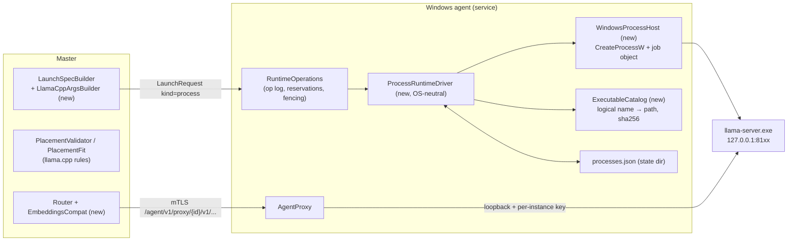
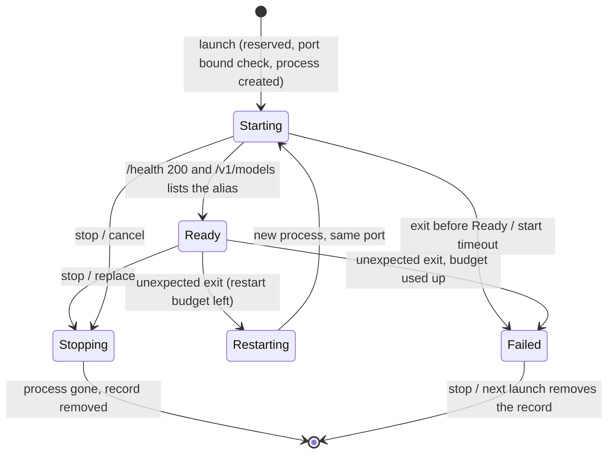

# MirbadLLM multi-node: P3/P4 design addendum (native llama.cpp + Windows node)

Status: **owner decisions final** (O1–O9, 2026-10-07, recorded as design.md D107–D115, §A.11); **contracts frozen** by
MN-202 (D116–D117, §A.12); **spikes S1, S2 and S4 folded in** by the W11 review MN-207 (2026-10-08, D118–D123: corrections
C1–C11 of spikes/s1-s2.md and F1–F8 of spikes/s4.md; each change below names its
finding). S3 (MN-205) has not run; O3 keeps `Qwen3-VL-Embedding-2B` on the DGX meanwhile. Written by MN-201 (design and
planning only).
Companion to [design.md](design.md) rev 3 (decisions D1–D123), plan-p3p4.md and the P3/P4 section of
tasks.md. "§" alone refers to design.md; "§A.x" to this addendum.
Grounding: `origin/feature/multinode-p3` at `e2d8243` (= `main`, P2 live on the DGX). Hardware facts about the owner's
Windows PC were read locally and read-only on 2026-10-07 (`nvidia-smi`, the local Ollama store). Facts about llama.cpp,
Hugging Face and Ollama were checked against current sources on 2026-10-07; each is marked **verified** with a reference
[Rn] (list at the end), or **spike** when it still has to be proven on the PC.

---

## A.0 Summary

- **What is added.** A llama.cpp runtime kind delivered as a **native process** (`llama-server.exe`), supervised by the
  agent, and a **Windows agent** running as a real Windows service. The owner's PC joins the fleet as node `win-1`
  (name is the owner's choice) and serves GGUF models through the same `/v1` front door.
- **First use.** Move OpenViking's embedding model `Qwen3-Embedding-4B` off the DGX, onto the PC's RTX 5060 Ti
  (O8). **The query planner `guoxuter/ov_intent_analysis_sft:v7_q8` stays on the DGX as it is (owner decision O7,
  D113)**, and `Qwen3-VL-Embedding-2B` stays on the DGX under vLLM until spike S3 passes (O3, §A.5.4).
- **What does not change.** The DGX: same containers, same vLLM launch specs, same legacy hashes, same `/v1`
  behaviour. Nothing in this phase starts a llama.cpp container on the DGX. The protocol stays version 1; every new
  field is additive and gated by a feature flag, as in P2 (D73).
- **Scope cut, stated plainly.** design.md §14 put llama.cpp *containers* on the DGX (own arm64 image, D12) and native
  *user units* on Linux PCs in P3. Neither is needed for the owner's goal, so both move to a later phase ("P3b"). The
  driver below is split into an OS-neutral core and an OS host, so a Linux host can be added without touching the core.

### Hardware facts (owner's PC, read 2026-10-07)

| Item | Value |
|---|---|
| GPU 0 | NVIDIA GeForce RTX 5070, **12 227 MiB** (12 GB class, not 16), compute capability 12.0, **display attached**, 11 204 MiB in use at read time |
| GPU 1 | NVIDIA GeForce RTX 5060 Ti, 16 311 MiB, compute capability 12.0, display attached, 3 373 MiB in use |
| Driver | 617.14, WDDM, CUDA user-mode driver 13.4 |
| Host RAM | 127 GiB |
| Shells | Windows PowerShell 5.1 (default); PowerShell 7.6 installed from the Store |
| Per-process GPU memory | `nvidia-smi --query-compute-apps` reports `[N/A]` for every process (WDDM) [R11] |
| Ollama | Local store holds `guoxuter/ov_intent_analysis_sft:v7_q8` |

Two consequences shape the design: the cards are **unequal** (12 vs 16 GB), and both carry **desktop load**, so free
VRAM moves while the owner uses the PC. Per-GPU reserves and live admission (P2) matter more here than on the DGX.

---

## A.1 llama.cpp runtime driver (agent, native process)

### A.1.1 Components



- `ProcessRuntimeDriver` (NodeRuntime) implements the existing `IRuntimeDriver` with `Delivery = Process`. It owns the
  state machine, `processes.json`, port use, health, logs, crash handling and adoption. It never calls a Win32 API.
- `IProcessHost` (new abstraction, frozen by MN-202) does the OS work: start, open by PID, wait for exit, kill, list
  candidate orphans. `WindowsProcessHost` implements it now; a `SystemdUserProcessHost` (design §6.6) can come later.
- The agent already holds a list of drivers and picks one by `spec.Kind` (`RuntimeOperations.Drivers`,
  `AgentReconciler.DriverFor`). One gap: `RuntimeDriverUpstreamResolver` takes a single driver; it must look up the
  driver that owns the instance (MN-232).

### A.1.2 Binary acquisition and versioning

**Decision (recommended, owner decision O2): pinned official llama.cpp release builds, CUDA 13.4 variant, verified by
SHA-256, installed by the Windows installer. We do not build llama.cpp ourselves in this phase.**

Facts (verified [R1][R2]; spike S1 on the PC, 2026-10-08):
- Releases are tagged `bNNNN` and published several times a day. **Every recent release is flagged `prerelease`**, so
  `releases/latest` never returns one: the pin is looked up **by tag** (S1 / C10). Pinned: **`b11476`**, commit
  `988190680` (`llama-server --version`: `version: 0.6.0-dev (build 11476, commit 988190680)`).
- Windows CUDA assets per release: `llama-bNNNN-bin-win-cuda-12.4-x64.zip`, `llama-bNNNN-bin-win-cuda-13.4-x64.zip`
  (+ arm64), and runtime zips `cudart-llama-bin-win-cuda-{12.4,13.4}-x64.zip`. Both zips unpack flat into one folder
  (55 files at `b11476`, no overlap). **`llama-server.exe` is a 9 KB launcher**: the server is `llama-server-impl.dll`,
  with `llama.dll`, `llama-common.dll`, `ggml*.dll` (`ggml-cuda.dll` 148 MB, 16 CPU variants), `mtmd.dll`, `libomp.dll`
  and the CUDA DLLs (`cudart64_13.dll`, `cublas64_13.dll`, `cublasLt64_13.dll`). Verifying two files would leave the
  code unverified (S1 / C3). The launcher imports `llama-server-impl.dll` statically and starts no process (checked by
  MN-207 from its import table), so the server runs **in the `llama-server.exe` process**: its PID and image path are
  what adoption checks.
- **Prerequisite outside the zips (found by MN-207):** the binaries import `msvcp140.dll`, `vcruntime140.dll` and
  `vcruntime140_1.dll` (Microsoft Visual C++ 2015–2022 redistributable, x64), which neither zip ships. They are in
  `System32` on the owner's PC, but a clean Windows 11 install does not guarantee them. The installer checks for the
  three files and, when one is missing, stops with a message naming the redistributable (it does not download it
  itself: that would be an unpinned download). `nvcuda.dll` comes with the NVIDIA driver.
- Driver: CUDA 13.x needs ≥ 580 (minor-version compatibility), CUDA 13.4's own branch is R615; the PC runs 617.14. The
  lock file's `minDriver` is **`615.00`** (the tested range, S1 / C10).
- The default CUDA architecture list (`ggml/src/ggml-cuda/CMakeLists.txt`) gives the **12.4 build no sm_120 code**
  (RTX 50 cards would JIT-compile compute_90 PTX at first load). The **13.4 build adds `120a-real` and `121a-real`**,
  i.e. native kernels for compute capability 12.0 (RTX 5070 / 5060 Ti). The PC's driver supports CUDA 13.4.
- There is **no SHA256SUMS file**; GitHub's API gives a per-asset `sha256:` digest.

How the pin works:

| Step | Who | What |
|---|---|---|
| Pin | MN-207 (from S1), re-checked by MN-216 | `deploy/agent/windows/llama-cpp.lock.json` (Core `LlamaCppLockFile`): `{version: "b11476", commit: "988190680", cuda: "13.4", minDriver: "615.00", assets: [{name, url, sha256, bytes}] (the two zips), files: [{path, sha256, bytes}] (all 55 unpacked files)}`. The asset SHA-256 values were taken from the GitHub API digest **and** recomputed after download (equal); the file hashes were computed from the unpacked, verified zips. Committed by MN-207 (D120). |
| Install | `install-agent.ps1 -LlamaCpp` (admin) | Refuses a driver below `minDriver`. Downloads the two zips into a new temp folder, checks their SHA-256 against the lock file, unpacks both into one staging folder and requires **exactly** the lock file's `files` set (each hash and size; nothing missing, nothing extra), moves it to `C:\Program Files\mirbadllm-agent\runtimes\llama.cpp\b11476\` (read-only for the service account), writes `manifest.json` (same list) there, then the catalog entry in `agent.json`. |
| Start | Agent | `ExecutableCatalog` hashes **every file in the manifest** (≈ 712 MiB, in the background at startup; again when a file's size or mtime changes) and treats any `.exe`/`.dll` in the folder that the manifest does not list as a mismatch (a planted DLL would load from the application folder first). A mismatch marks that version unusable (health reason `executable_unverified`, capability `available: false`); launches naming it get 422 `executable_unverified` (S1 / C3). |
| Launch | Master | Sends `executable: "llama-server"` and `executableVersion: "b11476"` (a logical name and a version, never a path). The version is in the execution fingerprint (already supported: `ExecutionFingerprint` hashes `exe` and `exe-version`). |

Why not build our own:
- It needs a Windows CUDA 13 toolchain on a **self-hosted** Windows runner (owner CI rule: no GitHub-hosted runners).
  None exists today; the owner's PC would have to become one.
- The official 13.4 build already contains sm_120 kernels, which was the main reason to consider our own build.
- S1 found none: native `sm_120a`/`sm_121a` kernels (`ARCHS = …,1200,1210`), runs with `CUDA_DISABLE_PTX_JIT=1` and an
  empty CUDA cache, cold start to `/health` 200 in 3.3 s. The fallback stays documented only.
- Fallback: if spike S1 (MN-203) shows a defect in the official build on these cards, MN-216 gains a
  `build-llama-cpp.ps1` for a local build with `-DCMAKE_CUDA_ARCHITECTURES=120`, run on the PC, with its output hashed
  into the same lock file. No change elsewhere.

Versions side by side: each version is its own folder; `agent.json` lists the versions and a default. Updating
llama.cpp = install a new version, change the node default (or a model's `executableVersion`), restart the model
(the fingerprint changes, so the UI shows "restart pending"). Rollback = switch back. Old folders are removed only by
`install-agent.ps1 -RemoveLlamaCpp <version>`, refused while an instance uses it.

The 12.4 build is not offered on RTX 50 nodes. If it were used, the first start of every model would JIT-compile
kernels into the CUDA cache; the agent therefore always sets `CUDA_CACHE_PATH={cache}\cuda` and
`CUDA_CACHE_MAXSIZE=4294967296` so the cache lives in the agent's cache root, not in the virtual account's profile.

### A.1.3 Process supervision



**Start (Windows host).**
1. Resolve the executable from `ExecutableCatalog` (logical name + version → verified path).
2. Substitute `{models}`/`{cache}` in argv, then confine every path argument after resolving symlinks (the existing
   `PathConfinement`, §10.3). Only flags on the builder's allow-list may carry a path (`-m`, `--mmproj`,
   `--chat-template-file`); `ExtraArgs` with a path-valued flag are refused (`spec_rejected`).
3. Open the per-model log file `{state}\logs\ss-{id}.log` (rotate: keep `.1`, `.2`; 50 MiB cap per file). Rotation runs
   before a start and, while the process runs, by copy and truncate every health-poll interval: the child holds the file
   with `FILE_APPEND_DATA` (shared for writing), so its next write lands at the new end; lines written between the copy
   and the truncation are lost (MN-219, D128).
4. Write a **pending start** to `processes.json` (`pending[]`: `{modelId, operationId, executablePath, port, argvDigest,
   at}`, durable before the create; D121). Then `CreateProcessW` with `CREATE_SUSPENDED | CREATE_NO_WINDOW |
   CREATE_NEW_PROCESS_GROUP | CREATE_UNICODE_ENVIRONMENT | EXTENDED_STARTUPINFO_PRESENT`, an explicit environment block
   (below), `STARTF_USESTDHANDLES` with stdout and stderr bound to the log file handle (not a pipe), stdin bound to
   `NUL`, and `PROC_THREAD_ATTRIBUTE_HANDLE_LIST` naming only those handles, so the child inherits nothing else of the
   service (S4 / F2).
5. Create a **per-instance job object** `mirbadllm-ss-{id}` **without** `JOB_OBJECT_LIMIT_KILL_ON_JOB_CLOSE`, assign the
   suspended process to it, then resume it. The job is per instance, **not** the agent's own job, so the process
   outlives the agent. Kill-on-close is never set: the agent holds the job's only handle, so the job closes whenever the
   agent stops, upgrades or crashes, and kill-on-close would kill llama-server every time (verified by S4 / F2). The
   agent logs its own job membership at start (`IsProcessInJob`; today it is in none, so `CREATE_BREAKAWAY_FROM_JOB` is
   not needed).
6. Replace the pending start with the record in one atomic write (temp + move, fsync like the op log):
   `{modelId, operationId, spec, process: {pid, startTime, imagePath}, executableName, executableVersion, port,
   argvDigest, protectedApiKey, jobName, logPath, gpus, startedAt, readyAt, restartCount, restartTimes,
   measuredGpuGiB}` (`ProcessRecord`). A failed create removes the pending start.

Why files instead of pipes: if stdout were a pipe to the agent, an agent restart would leave the child writing to a
broken pipe, which can kill or block it. A file handle survives. Job objects and `CreateProcessW` need only P/Invoke
into `kernel32` (no package) [R12].

Environment block (complete, nothing inherited from the service):
`SystemRoot`, `TEMP`/`TMP` = `{cache}\tmp`, `PATH` = the version folder only, `CUDA_VISIBLE_DEVICES` = the placed GPU
UUIDs in order, `CUDA_CACHE_PATH`, `CUDA_CACHE_MAXSIZE`, `LLAMA_API_KEY` = the per-instance key (§A.8). The master
cannot set any of these; spec `env` names are refused if they collide (`spec_rejected`).

**Health and readiness.** llama-server answers **503 `Loading model`** on every endpoint while it loads and 200 on
`/health` when ready; `/health` is the only endpoint open without the API key (S1: `/v1/models` and `/metrics` answer
401 without it, C5) [R3]. The driver polls `/health` every 2 s and declares Ready only when `/health` is 200 **and**
`GET /v1/models` **with the per-instance key** lists the expected alias. The second check catches a foreign process that
grabbed the port (it would not know the key either). A third check reads the lines this start wrote to the log:
llama-server still answers `/health` 200 when its GPU backend failed during the warm-up (Metal: `Insufficient Memory
(kIOGPUCommandBufferCallbackErrorOutOfMemory)`, then `backend is in error state`), and every request would fail, so
such a start is stopped and Failed with that line as its cause. Start timeout: `Agent:Process:StartTimeout`, default 10 min (large
GGUFs from a slow disk; S1 measured 3.3 s for the 4.3 GB embedding GGUF from the OS file cache).

**Free GPU memory comes from `nvidia-smi` only.** Under WDDM, CUDA reports far more free memory than the card has (S1:
15 172 MiB "free" on the 5060 Ti while `nvidia-smi` showed 3.1–4.0 GiB used, C9). The agent never takes a free-memory
figure from llama.cpp (`--fit`, `--list-devices`) or from CUDA; admission, the start meter and `gpu_external_use_high`
read `nvidia-smi --query-gpu=memory.used,memory.total` as designed.

**Stop.** llama-server has no graceful-stop signal that works for a windowless child on Windows, and it holds no state
worth flushing. Stop = `TerminateJobObject` (kills the process tree), wait for the handle, delete the record. Stages go
through `IRuntimeStageSink` as for containers (fencing re-check before the destructive step, §4.2).

**Crash detection.** The driver waits on the process handle (also for adopted processes, opened with
`SYNCHRONIZE | PROCESS_QUERY_LIMITED_INFORMATION`). On exit: record the exit code and the last 400 log lines through
`FailureReport`, as the container driver does.

**Restart policy.** A process that exits **before** Ready is Failed at once (configuration or memory problem; a retry
would fail the same way). A process that exits **after** Ready is restarted by the agent on the same port, at most
2 times in 10 minutes; the third exit is Failed with the root cause. This mirrors D43 for containers ("restarted at
least once and still not healthy → Failed") with an explicit budget, because no Docker restart policy exists here.
Restarts are not new operations; they are recorded on the instance (`restartCount`) and in the agent log.

**Adoption after an agent restart.** For each record in `processes.json`:
1. `OpenProcess(pid, SYNCHRONIZE | PROCESS_QUERY_LIMITED_INFORMATION | PROCESS_SET_QUOTA | PROCESS_TERMINATE)`; compare
   the process creation time with `process.startTime` and the image path with `process.imagePath` (PID reuse check).
   Mismatch or gone → the instance is gone: remove the record, state Stopped.
2. Match → **create a new job** (labelled with the record's `jobName`, no kill-on-close) and `AssignProcessToJobObject`.
   The old job cannot be re-opened by name: the kernel drops a job's name with its last handle even while processes are
   still in it (`OpenJobObjectW` → 2), and the new job nests under the orphaned one (Windows 8+; S4 / F2 verified
   assign, `IsProcessInJob` and `TerminateJobObject` on the new job). Then resume waiting on the handle and report the
   instance as Starting until the asynchronous `/health` + `/v1/models` probe passes (the probe is not start-up work,
   §A.4.1). Reservations for instances still Starting are rebuilt (§4.8). The new job holds only the adopted process;
   children it created before the restart stay in the orphaned job (llama-server creates none; accepted, D129). When
   the job cannot be made or assigned (`Win32Exception`), recovery goes on: the record is dropped and the orphan sweep
   below ends the process, so the master starts the model again under supervision (MN-219, D125). One failing
   candidate (a command line that cannot be read, a kill that fails) never aborts the sweep, and a candidate that is now
   an instance's own process (restarted during recovery) is never killed.

After a **reboot** every record fails step 1, so all instances read Stopped and the master's per-node auto-start starts
them again (P4 exit criterion "survives reboot").

**Orphans (required, D121).** Without kill-on-close nothing else cleans up after a crash between create and record
(S4 / F2: the PID-reuse case left exactly such a process). At startup, after adoption, the host lists running processes
whose image lies under the executable's version folder and whose owner is the service account (`ListCandidatesAsync`).
A candidate is killed only when it is provably the agent's: its arguments (`ReadArgumentsAsync`: the PEB command line
split by `CommandLineToArgvW`) hash to the `argvDigest` of a record or a pending start and it was created after that
entry's `at`. The command line the agent built is its marker; no extra flag is added. Anything else is logged as foreign
and never touched: a process outside the runtimes folder, owned by another account, or with an unknown command line
(S1 found the owner's own `D:\AI\llama.cpp\llama-server.exe` on port 8000, C11). Resolved pending starts are removed.
`install-agent.ps1 -Uninstall` stops the account's runtime processes itself, because they outlive the service.

### A.1.4 Ports

Unchanged rule: the agent allocates from `PortRangeStart` under the node-wide lock (§4.8). New on Windows: other
desktop programs hold ports (S1: the owner's own llama-server listens on 8000, C11), so before creating the process the
driver skips every port that any process listens on (`IPGlobalProperties.GetActiveTcpListeners()`, any address) and
then test-binds `127.0.0.1:{port}` with exclusive address use; if either says taken it takes the next free port (still
under the lock: the reservation manager does the check itself through `AdmissionOptions.PortInUse`, which MN-232 sets
to `ProcessPorts.IsTaken` on a process node; the driver's own re-check before the create stays as a safety net for a
port taken in between; MN-219, D127). The Windows example keeps `PortRangeStart` 8101, away from 8000. llama-server binds `--host 127.0.0.1 --port {port}`; a bind failure
after start shows in the log and makes the instance Failed before Ready. The Windows firewall never sees these ports
(loopback).

### A.1.5 GPU pinning and tensor split

- **Pinning by UUID.** `CUDA_VISIBLE_DEVICES=GPU-…,GPU-…` (the CUDA runtime accepts UUIDs). Inside the process the
  visible devices are renumbered from 0 in the given order, so the builder emits `--device CUDA0[,CUDA1]` and never a
  physical index. nvidia-smi's index and CUDA's index can differ; UUIDs avoid that question (§5.1 rule kept).
  **Spike S1 (one UUID): pass.** `--list-devices` shows only the RTX 5060 Ti as `CUDA0`, and the RTX 5070's
  `memory.used` moved by 0 MiB across every start. The two-UUID reverse-order check and `--tensor-split` were not run
  (both open a context on the display card, which the owner ruled out); the two-GPU path stays covered by tests only
  until someone runs it.
- **One GPU** (the default and the plan for OpenViking's models): `--split-mode none --device CUDA0`.
- **Two unequal GPUs.** `--split-mode layer --tensor-split a,b` [R3]. The vLLM rule "TP only on equal GPUs" (§5.1)
  does **not** apply to llama.cpp. The operator gives a per-GPU budget (`LlamaCppSettings.GpuBudgetsGiB`, ordered like
  the placement) and the builder derives the split from it: `tensor-split = budget_i / Σ budget` rounded to 3
  decimals. Default when absent: proportional to each card's `memory.total` minus its reserve. Admission then checks
  each GPU against its own budget (new `AdmissionRequest.GpuBudgetsGiB`, gated by `admission.gpu-budgets`; without it
  the agent keeps P2's even split).
- `row` and `tensor` split modes are not offered in the editor (ExtraArgs only).

### A.1.6 `LlamaCppSettings` → `llama-server` arguments

The builder is the only place that knows llama-server flags. Order is fixed so the canonical argv (and the
fingerprint) is stable.

| Setting (Core) | Argument | Notes |
|---|---|---|
| `ModelFile` | `-m {models}/{folder}/{file}` | First part of a split GGUF; llama.cpp loads `-0000k-of-0000N` parts itself [R4]. |
| `ServedName` (top level) | `--alias {servedName}` | Exact name, including `/` and `:` (`guoxuter/ov_intent_analysis_sft:v7_q8`). The registry does not restrict served names; the alias is passed as one argv element, no quoting issue. |
| `ContextSize` | `-c ContextSize × Parallel` | `ContextSize` is defined as **per slot** (per request). **S1 confirmed** at `b11476`: `n_ctx_slot = c / np`, `kv_unified = false`; an input over the slot size gets 400 `exceed_context_size_error`. |
| `Parallel` | `-np` | Explicit always (`-np -1` = auto would make memory unpredictable). |
| `GpuLayers` | `-ngl` | 999 = all. |
| `FlashAttention` | `-fa on\|off\|auto` | |
| `CacheTypeK` / `CacheTypeV` | `-ctk` / `-ctv` | `f16`, `q8_0`, `q4_0`, … [R3]. |
| `BatchSize` / `MicroBatchSize` | `-b` / `-ub` | Embedding models: `-b = -ub = LlamaCppSettings.EmbeddingMicroBatch()` (§A.1.7). Chat models: as set, else llama.cpp's defaults (2048 / 512). |
| `Embedding` (new) | `--embedding --pooling {Pooling}` | `Pooling` new, values `none, mean, cls, last, rank` [R3]; default from the GGUF's `pooling_type`. |
| `TensorSplit` / `GpuBudgetsGiB` (new) | `--split-mode`, `--tensor-split`, `--device` | §A.1.5. |
| `ChatTemplate` (new) | `--chat-template {builtin}` (`builtin:chatml`) or `--chat-template-file {models}/…` | For GGUFs whose embedded template must be overridden (e.g. an Ollama GGUF, §A.2.2). |
| `Reasoning` (new) | `--reasoning on\|off\|auto` | Default auto. |
| `Threads` (new, optional) | `-t` | Default: llama.cpp's choice. |
| always | `--host 127.0.0.1 --port {port} --metrics --no-ui --cache-ram 0 --fit off` (`LlamaCppFlags.AlwaysArgs`) | `--fit` defaults **on** and silently shrinks unset values to fit free memory [R13]; admission must decide, so it is always off. `--no-ui`: `--no-webui` is deprecated at `b11476` (S1 / C4). `--cache-ram 0`: llama-server otherwise keeps a host-RAM prompt cache of up to 8 GiB that admission does not count; it is useless for embeddings and unbudgeted for chat, so it is always off (S1 / C6; a chat model that wants it later gets a typed setting with a host budget, not an ExtraArg). Logging goes to stderr (the file handle; stdout stays empty), so `--log-file` is not needed; **S1 confirmed** that argument errors and CUDA init errors land in the redirected file. |
| `ExtraArgs` | appended last | Refused (`LlamaCppFlags.RefusedInExtraArgs` + `PathValued`): `--host`, `--port`, `--api-key*`, `--alias`, `-m`, `--fit`, `--log-file`, `--device`, `--ui`/`--no-ui`/`--webui`/`--no-webui`, `--cache-ram`/`-cram`, any flag that takes a path, and every typed setting admission or the read-back relies on (`LlamaCppFlags.TypedInArgv`, MN-219, D126: `-c`/`--ctx-size`, `-np`/`--parallel`, `-ngl`/`--gpu-layers`/`--n-gpu-layers`, `-b`/`--batch-size`, `-ub`/`--ubatch-size`, `-ctk`/`-ctv` and their long forms, `-fa`/`--flash-attn`, `--embedding`/`--embeddings`, `--pooling`, `-ts`/`--tensor-split`, `-mg`/`--main-gpu`; llama-server takes the last value of a repeated flag, so an ExtraArg would override the typed one and skew the budget). `-sm`/`--split-mode` stays allowed (`row` has no typed setting). |

Read-back: `/launch-config` returns the argv as launched; `RemoteModelRuntime.GetLaunchedDefinitionAsync` maps a
`kind: process` llama-server read-back through `LlamaCppArgsParser` for "old → new" in the Apply dialog (MN-219). There
is no legacy config hash for llama.cpp: the launch sends `expectedConfigHash` null (`BuiltLaunchSpec.LegacyConfigHash`),
restart-pending compares the execution fingerprints alone (it includes the canonical argv and the executable version for
non-vLLM runtimes), and the launcher's config hash of a llama.cpp model (`IModelLauncher.ComputeConfigHashAsync` /
`GetLaunchedConfigHashAsync`, what benchmarks and the tune page key on) is its execution fingerprint (D125).

### A.1.7 Embeddings mode

- `Embedding = true` adds `--embedding --pooling {p}`. For Qwen3-Embedding the GGUF says `pooling_type = last` and
  `add_eos_token = true`, so llama.cpp appends the EOS token itself (verified from the file header, fix in PR #14314)
  [R5][R6]. The model card's command is `--embedding --pooling last -ub 8192` [R5].
- **Micro-batch (S1 / C2, D118).** "An input must fit one micro-batch" holds only for **non-causal** embedding models
  (BERT-style, GGUF `{arch}.attention.causal = false`). A causal model with last-token pooling (Qwen3-Embedding:
  `causal attn = 1`) processes a long input over several micro-batches against the KV cache: at `b11476` 8 102-token
  inputs embed at `-ub 2048` with vectors equal to `-ub 8192` (median cosine 1.0), while the compute buffer drops from
  5.1 to 1.3 GiB (it is linear in `ub`). llama-server forces `n_batch = n_ubatch` when embeddings are on, so the builder
  always emits `-b = -ub = LlamaCppSettings.EmbeddingMicroBatch()`: `MicroBatchSize` when set, else
  `min(ContextSize, 2048)` for a causal model and `ContextSize` for a non-causal one. The builder cannot read the GGUF,
  so it assumes causal (llama.cpp's own default when the key is absent); the editor reads `GgufSummary.CausalAttention`
  and writes `MicroBatchSize = ContextSize` for a non-causal GGUF.
- `PoolingDetection.Detect` (Core) gains the llama.cpp case (`Runtime == LlamaCpp && LlamaCpp.Embedding`), so the
  benchmark picks the embeddings suite and the router knows the model is an embedding model.

### A.1.8 Integration with operations, reservations and admission

Nothing new in the operation model. A llama.cpp launch is a `LaunchRequest` with `spec.kind = process`:
durable accept → reservation (one start per GPU on a discrete node, host part node-wide, §4.8) → stages
`admitted → created → started` → Ready releases the reservation. Stop and `replace` as for containers. The reconciler
learns two cases: launch at `created` with a record whose process is gone → re-run from create (if the master triple is
still accepted) or fail `superseded`; record without operation → adopt.

### A.1.9 Telemetry: llama.cpp `/metrics`

With `--metrics`, names carry the `llamacpp:` prefix [R7]; S1 found every name below at `b11476` (no KV-usage gauge, as
designed). With `LLAMA_API_KEY` set, **`/metrics` needs the key** (401 without it, S1 / C5), so the agent's scrape sends
`Authorization: Bearer <per-instance key>` from `IRuntimeDriver.GetUpstreamApiKeyAsync`, like the proxy. Mapping into
`ModelKpis`:

| KPI | vLLM source today | llama.cpp source |
|---|---|---|
| Running requests | `vllm:num_requests_running` | `llamacpp:requests_processing` |
| Waiting requests | `vllm:num_requests_waiting` | `llamacpp:requests_deferred` |
| Prompt tokens/s | Δ`vllm:prompt_tokens_total` | Δ`llamacpp:prompt_tokens_total` |
| Generation tokens/s | Δ`vllm:generation_tokens_total` | Δ`llamacpp:tokens_predicted_total` |
| Prefix-cache hit rate | `prefix_cache_hits/queries` | Δ`llamacpp:prompt_tokens_cached_total` ÷ Δ`prompt_tokens_total` |
| Spec-decode acceptance | `spec_decode_*` | `llamacpp:spec_decode_num_accepted_tokens_total` ÷ `…_draft_tokens_total` |
| Requests done | `vllm:request_success_total` | none (counted by the master's `RouterStats`) |
| KV cache usage | `vllm:kv_cache_usage_perc` | **none**: `kv_cache_usage_ratio` was removed from current llama.cpp [R7]; shown as "—" |
| TTFT / ITL histograms | `vllm:time_to_first_token_seconds`, … | none ("—"); the benchmark measures them client-side as today |

The agent's `MetricFamilyFilter` adds the `llamacpp:` families above; the names are constants frozen by MN-202
(`LlamaCppMetrics`). Benchmark noise detection (§6.5 item 4) uses `llamacpp:requests_processing` and the token
counters.

GPU memory per model: under WDDM nvidia-smi reports no per-process memory [R11], so "Memory by model" on Windows uses
(a) the declared budget, and (b) a **measured** figure: the agent samples the placed GPU's `memory.used` right before
create and right after Ready and stores the delta on the instance (`measuredGpuGiB`, an existing field). This is
approximate when other programs allocate at the same moment, and the UI labels it "measured at start".

### A.1.10 Admission memory estimate for GGUF

The agent reads the GGUF header (pure .NET reader, MN-209; no package) and returns a summary through a new route
`GET /agent/v1/model-folders/{folder}/gguf?file=` (feature `gguf.inspect`). The master's `PlacementFit` and the editor
compute:

```
weights      = Σ size of tensor data in all split parts (≈ file sizes)            × gpuLayers/blockCount (partial offload)
kv           = attnLayers × ctxTotal × headCountKv × (keyLength × bytes(ctk) + valueLength × bytes(ctv))
               attnLayers = blockCount, or blockCount / fullAttentionInterval for hybrid models (qwen35)
               ctxTotal   = ContextSize × Parallel
ssmState     = hybrid models only: (blockCount − attnLayers) × Parallel × (convState + ssmStateSize)   (small)
compute      = max(256 MiB, ub × (embeddingLength + vocab) × 4 B × 1.2)   (ub as emitted: §A.1.6/§A.1.7)
cudaContext  = 0.45 GiB per GPU
budget       = 1.10 × (weights + kv + ssmState + compute) + cudaContext
```

It is an estimate, as design.md §6.2 already says for llama.cpp. Two safeguards: `--fit off` (llama.cpp never shrinks
values to "make it fit"), and the measured delta (§A.1.9) shown next to the budget with the existing
"uses X GiB more than its budget" flag. If `llama-fit-params` (which prints llama.cpp's own projection [R13]; it ships in
the pinned folder) proves usable non-interactively, the agent may use it as a second opinion in a later task.

**Calibration (S1 on the RTX 5060 Ti, `b11476`; MN-207 kept the formula, D118).** Buffer sizes from the `-lv 4` log
against the formula, for the embedding model below:

| Term | ub 8192: measured / formula | ub 2048: measured / formula | Verdict |
|---|---|---|---|
| weights (GPU) | 4 075.7 / 4 081.5 MiB | same | right (the 393 MiB token-embedding table stays in host RAM) |
| kv | 2 304.0 / 2 304.0 MiB | same | exact |
| compute | 5 187.8 / 5 783.4 MiB | 1 297.0 / 1 445.9 MiB | linear in `ub`; measured = `ub × (n_embd + n_vocab) × 4 B × 1.076`, so × 1.2 is 11 % high: kept as the safe side |
| CUDA context | ≈ 0.1 / 0.45 GiB | ≈ 0.1 / 0.45 GiB | conservative under WDDM, kept |
| **total** | **11.4 / 13.5 GiB** | **7.6 / 8.9 GiB** | the estimate is 17–18 % above the measurement |

Recalibrating (× 1.08 on compute, 0.1 GiB context) would bring the estimate to ≈ 12.6 / 8.4 GiB. It is not done: the
estimate is the admission budget, the measurement at start is noisy under desktop load (the cold start measured 470 MiB
*below* the sum of the buffers because the desktop released memory meanwhile), and a 16 GB card with a 2.5 GiB reserve
and 3–4 GiB of desktop use still admits 8.9 GiB. The memory is all reserved at start (8 102-token requests on both slots
added 21 MiB).

Worked example (Qwen3-Embedding-4B Q8_0, 36 layers, 8 KV heads, head dim 128, n_embd 2560, vocab 151 665, f16 KV,
`ContextSize` 8192, `Parallel` 2, so `ub` = `min(8192, 2048)` = 2048, §A.1.7):
weights = 4 279 660 224 B ≈ 3.99 GiB; kv = 36 × 16 384 × 8 × (128 + 128) × 2 B = 2.25 GiB;
compute = 2048 × 154 225 × 4 B × 1.2 ≈ 1.41 GiB → budget = 1.10 × 7.65 + 0.45 ≈ **8.9 GiB** (measured 7.6 GiB).
At the model card's `-ub 8192` the same formula gives compute ≈ 5.65 GiB and a budget of **13.5 GiB** (measured
11.4 GiB), which would not be admitted next to the desktop on the 16 GB card: that is why the micro-batch default
changed (S1 / C1, C2). With `Parallel` 1 the kv term halves (budget ≈ 7.6 GiB). The planner (qwen35, 24 layers,
6 attention layers, 2 KV heads, head dim 256, `ContextSize` 4096, `Parallel` 4): weights 0.75 GiB (tensor data),
kv ≈ 0.19 GiB, recurrent state ≈ 0.08 GiB (18 layers × 4 slots), compute at the chat `ub` 512 = 512 × (1 024 + 248 320)
× 4 B × 1.2 ≈ 0.57 GiB → budget = 1.10 × 1.59 + 0.45 ≈ **2.2 GiB** (2.19; MN-219 corrected the earlier ≈ 1.8, which left
out the compute and recurrent terms; not measured: the planner stays on the DGX, O7).

---

## A.2 GGUF model acquisition

### A.2.1 Hugging Face GGUF repos

- `HuggingFaceRepoInspector` already groups `.gguf` files into variants (split parts kept together, `mmproj-*`
  auxiliary). The editor shows the variants with size and quant; the operator picks one; the master records the source
  as `{repoId, revision → commit SHA, allowPatterns: [the variant's files (+ mmproj)]}` and `LlamaCpp.ModelFile` as the
  first part.
- Quant default for embeddings: **Q8_0** (near-lossless, half of F16). For chat models the editor suggests Q4_K_M or
  Q5_K_M when VRAM is tight and shows the estimate for each.
- Download on Windows needs the **native downloader** (design §6.4, already specified: immutable commit SHA, manifest,
  range resume, LFS SHA-256, disk pre-check, path confinement, atomic finalize). Feature `downloads.hf-native`
  (constant exists). The HF token is passed in the request (memory only), set as the `Authorization` header of the
  agent's own `HttpClient`; it never reaches a child process or a command line.
- **Paused (needs token)** stays a terminal `Failed` download with `NodeDownloadStatus.NeedsToken = true` and an error
  starting `Paused (needs token)` (MN-219, D125): `DownloadState` gets no `Paused` member (a P1/P2 master would not read
  it); starting it again with the token resumes from the bytes in `{folder}.partial`, and the disk pre-check counts those
  bytes as present. Folder names compare case-insensitively on Windows (one folder, one download).

**Several model GGUFs in one folder.** `GET /model-folders/{folder}/gguf` without `?file=` refuses with 400
`invalid_request`, the message listing the candidates **and** `GgufChoiceDetails { candidates: [...] }` carrying the
same names as a structured field (MN-230, D130; additive, an older agent sends no details). The editor's file picker
reads the field and falls back to parsing the message, so a file name with a comma in it is still offered correctly.

### A.2.2 Ollama-registry GGUFs (deferred: owner decisions O4 + O7)

> **Status (D110, D113).** The planner stays on the DGX (O7), so nothing in P3/P4 needs an Ollama GGUF. The
> registry pull below stays the designed acquisition path (O4) and its contract is frozen by MN-202
> (`ModelSource.Kind = ollama`, `OllamaSource`, `DownloadStartRequest.source/ollama`, `downloads.ollama`,
> `unsupported_manifest`), but MN-221 (the puller) and the Ollama parts of MN-226/MN-229 are optional/deferred, and
> spike S2 runs no planner parity and no registry pull. The facts below are kept for when an Ollama model moves.

Facts (verified [R8][R9], and on the local store):
- The planner exists on ollama.com with tags `v1_q8`, `v4_q8`, `v7_q8` (no `latest`).
- Its manifest (`application/vnd.docker.distribution.manifest.v2+json`) has three layers:
  `application/vnd.ollama.image.model` `sha256:aa98adccdec6a3be82d462563586abe1db520f93281ecc3f9bc3ff978b12d795`
  (811 843 072 bytes), a Go **template** layer and a **params** layer (`{"stop":["<|im_end|>","<|im_start|>","<|endoftext|>"]}`).
- The model blob is a plain GGUF v3: `general.architecture = qwen35`, 752 393 024 parameters (a Qwen3.5-0.8B
  fine-tune, "Checkpoint 600"), file type Q8_0, 24 blocks, 6 of them attention (`full_attention_interval = 4`),
  context 262 144. Its embedded Jinja `tokenizer.chat_template` is the full Qwen3.5 template (vision, thinking).
- The Ollama **template** is plain ChatML without a think block:
  `{{ if .System }}<|im_start|>system\n{{ .System }}<|im_end|>\n{{ end }}<|im_start|>user\n{{ .Prompt }}<|im_end|>\n<|im_start|>assistant\n`
- `registry.ollama.ai/v2/<ns>/<model>/manifests/<tag>` and `/blobs/sha256:<hex>` answer without authentication and
  honour byte ranges [R8].

**Decision (recommended, owner decision O4): the agent pulls from the Ollama registry itself, pinned to the model
layer's digest. No export from the DGX's Ollama store.**

| Option | For | Against |
|---|---|---|
| **Registry pull by the agent (chosen)** | Same path as HF downloads (resume, verify, confine). The blob is content-addressed: SHA-256 of the file = digest, a perfect integrity check. Works on any node, no SSH, no copy. | Depends on registry.ollama.ai staying up and the tag not being deleted (the digest pin detects a changed tag). |
| Export from the DGX store | Exactly the bytes OpenViking uses today. | Needs SSH or a hostd export endpoint (root helper, new surface), and node-to-node copy is a non-goal (§1). The registry gives the same bytes, proven by the digest. |
| Copy from the PC's own Ollama store | Already on disk. | The agent would read another user's profile; one-off manual step outside the product. Acceptable only as a manual fallback (`install-agent.ps1 -ImportGguf <path> -Folder <name>` copies into the models root and verifies the digest). |

Implementation (MN-221, feature `downloads.ollama`): `POST /downloads` with `source: "ollama"` and
`ollama: {registry: "registry.ollama.ai", name: "guoxuter/ov_intent_analysis_sft", tag: "v7_q8", modelDigest?}`.
The agent fetches the manifest, takes the model layer (refuses a manifest with more than one model layer or an adapter
layer, `unsupported_manifest`), downloads it as `{folder}.partial/model.gguf` with range resume, verifies SHA-256 =
digest, saves the template and params layers next to it as `ollama.template` and `ollama.params.json` (for the
operator and for the chat-template step), records the manifest and digest in `.mirbadllm-download.json`, renames to
`{folder}`. The model's `Sources` gain an `ollama` kind (Core), so a move or restore re-downloads by digest.

Is the planner's prompt format preserved? Not automatically: llama-server applies the GGUF's Jinja template by
default (Jinja is on by default now [R3]), which is Qwen3.5's (with thinking), not the ChatML template Ollama used.
`chatml` is a built-in llama.cpp template name (`src/llama-chat.cpp`, verified [R16]), so the planner model sets
`ChatTemplate = builtin:chatml` and `Reasoning = off`. If spike S2 shows any difference in the rendered prompt, the
fallback is a Jinja file that reproduces the Ollama template exactly (`chatml-ollama.jinja`, written by MN-221 into the
folder from `ollama.template`, reviewed by hand once):

```jinja

<|im_start|>system
{{ m.content }}<|im_end|>
<|im_start|>user
{{ m.content }}<|im_end|>
<|im_start|>assistant
{{ m.content }}<|im_end|>

<|im_start|>assistant
```

Stop tokens: `<|im_end|>` and `<|endoftext|>` are end-of-generation tokens in the Qwen vocabulary, so llama-server
stops on them without a stop list. **Spike S2 (MN-204)** proves equivalence: 50 recorded planner prompts at
temperature 0 against Ollama and against llama-server; exact-match rate must be ≥ 95 % and every difference reviewed.

llama.cpp supports the `qwen35` architecture since `b7990` (commit `fc0fe4004`, PR #19468, 2026-02-10; verified [R16]).
The Ollama blob uses the same architecture name, and its 320 tensor names (`token_embd`, `blk.N.attn_*`, `ffn_*`,
`ssm_*`) follow llama.cpp's converter; there are no Ollama-specific or vision tensors. It should load, but nobody has
loaded it yet: spike S1 was meant to load it on the pinned build but did not (owner's reduced scope); it stays unproven until the planner moves (O7).

### A.2.3 Folder layout on Windows and path confinement

| Path | Content | ACL |
|---|---|---|
| `C:\Program Files\mirbadllm-agent\app\{version}\` | Agent binaries (one folder per agent version) | Admins full, service account read/execute |
| `C:\Program Files\mirbadllm-agent\runtimes\llama.cpp\{bNNNN}\` | llama.cpp + cudart DLLs, `manifest.json` (SHA-256 per file) | Admins full, service account read/execute |
| `%ProgramData%\mirbadllm-agent\` | Root of the two rows below | SYSTEM, Admins full, service account modify; **protected** (inheritance removed) on this folder only (§A.4.2, S4 / F1) |
| `%ProgramData%\mirbadllm-agent\agent.json` | Configuration | inherited from the protected root |
| `%ProgramData%\mirbadllm-agent\state\` | Key, certs, op log, `processes.json`, fencing, `logs\` | inherited from the protected root (never `/inheritance:r` on files) |
| `ModelsRoot` (default `D:\mirbadllm\models`) | `{folder}\…gguf`, `{folder}.partial\` | service account modify |
| `CacheRoot` (default `D:\mirbadllm\cache`) | `cuda\` (CUDA JIT cache), `tmp\` | service account modify |

Confinement rules from §6.4 and §10.3 apply unchanged, with Windows specifics: refuse drive letters, UNC paths
(`\\?\`, `\\server\`), alternate data streams (`:` in a file name), reserved device names (`CON`, `NUL`, `COM1`…),
trailing dots and spaces; compare paths case-insensitively after `GetFinalPathNameByHandle` (resolves junctions and
symlinks). Folder names keep the existing `^[A-Za-z0-9._-]{1,200}$` rule. `ModelsRoot` must be a local NTFS volume
(the agent refuses a network drive: the service account has no network credentials and mmap over SMB is slow).

---

## A.3 Router and API compatibility

The router stays a byte pass-through keyed by served name (`ProxyHandler`), with one opt-in exception for embeddings.

| Topic | vLLM (today) | llama-server | Consequence |
|---|---|---|---|
| Served name | `--served-model-name` | `--alias` [R3] | Builder sets it; Ready check verifies `/v1/models`. |
| Chat completions, streaming | yes | yes | Pass-through. |
| Tool calling | needs `--enable-auto-tool-choice --tool-call-parser …` | detected from the Jinja template; Qwen3/3.5 XML tool calls parsed; streamed as deltas; `parallel_tool_calls` follows the template [R10] | Works for VS Code agents with Qwen-family GGUFs; per model, test in acceptance. |
| Reasoning | `--reasoning-parser qwen3`; field name depends on vLLM version | `reasoning_content` (format `auto`/`deepseek`); `--reasoning off` or `chat_template_kwargs.enable_thinking=false` [R10] | Clients reading `reasoning_content` work; the planner runs with ChatML and no thinking. |
| `/v1/embeddings` `dimensions` | honoured only when the model is Matryoshka-enabled in vLLM's config; the **DGX's `ss-qwen3-embedding-4b` refuses it** with 400 (`does not support Matryoshka embeddings; dimensions must be unset`, S2 / C7) | **ignored**: 2560 values come back [R6] (S1) | **EmbeddingsCompat** (below), only when the client sends the field. |
| Request `model` field | must name the served model | **not validated**: any value (or none) is accepted and echoed back in the response (S1 / C8) | Harmless: the router has already routed by served name, and the echoed value is the client's own string, which is the served name it asked for. No rewrite. |
| `encoding_format: base64` | yes | yes [R6] | Pass-through. |
| Normalisation | L2 | L2 by default (`embd_normalize = 2`) [R6] | Same. |
| `/v1/models` shape | OpenAI list | OpenAI list (alias) | The router builds `/v1/models` itself anyway. |
| Errors | vLLM JSON | OpenAI-style JSON; 503 `Loading model` while loading [R3] | 503 before Ready never reaches clients (state ≠ Ready → `model_not_ready`). |
| Vision chat | `--limit-mm-per-prompt` | `--mmproj` | Out of scope for the OpenViking move. |

**EmbeddingsCompat (master router, MN-217; rule frozen as Core `EmbeddingDimensions`, D117; scope corrected by
MN-207, D119).** OpenViking stores **1024-dimensional** vectors, while Qwen3-Embedding-4B returns 2560. S2 read what
OpenViking actually does (`ov.conf` and `openai_embedders.py`, read-only): with `provider: "openai"` it **never sends
`dimensions`**, takes the full 2560 values and keeps `vector[:1024]` without renormalising, and searches by cosine (so
the missing L2 does not matter). OpenViking is therefore **not** on the emulation's path, and the cut-over keeps
`provider: "openai"` and `dimension: 1024` unchanged (§A.5.2 step 6c). The emulation exists for other OpenAI clients
that do send `dimensions`. It applies only when **both** hold: the request body carries `dimensions`, and the model has
`Runtime = LlamaCpp`, `Embedding = true` and `LlamaCpp.EmulateDimensions = true` (default for embedding models). A
request without the field is forwarded and answered byte for byte. When it applies, the router:
1. reads `dimensions` from the already-buffered request body, removes it, forwards the rest;
2. on a 200 JSON response, truncates each `data[i].embedding` (float array or base64 float32) to the first N values
   and L2-renormalises (the correct Matryoshka procedure; Qwen3-Embedding supports 32–2560 [R5]);
3. refuses `dimensions` above the model's native size with 400 `invalid_request_error`, as vLLM does. The native
   size is the length of the vectors llama-server returned (the router keeps no per-model state); a `dimensions` below 1
   or not an integer is refused the same way.

Anything else passes through untouched. The body is already in memory (router rule D70), so no extra buffering
budget is needed; the response is non-streamed JSON and bounded by the input size. Behaviour difference to know: a
client that sends `dimensions` gets a 400 from the DGX's vLLM but an answer from the llama.cpp model; nothing in the
fleet sends it today.

**Qwen3-VL-Embedding-2B** (§A.5.4): the model exists (2048 dims, last-token pooling, MRL 64–2048; the card documents
vLLM `runner="pooling"`) [R14]. There is **no official GGUF**; community GGUFs with an mmproj exist. Current llama-server
accepts image parts in `/v1/embeddings` input, but users report failures with image embeddings, including an open
Windows CUDA issue, and an open precision gap against the reference [R14]. **Not verified end to end → spike S3.**

---

## A.4 Windows agent (P4)

### A.4.1 Service hosting

Today `install-agent.ps1` installs the service, but `mirbadllm-agent.exe` never connects to the Service Control
Manager, so the SCM gives up after its ~30 s timeout with **error 1053** [R15].

**Decision (owner decision O1, approved: D107): use `Microsoft.Extensions.Hosting.WindowsServices` 10.0.12**
(latest stable [R15], pinned in `Directory.Packages.props` by MN-202; MN-215 adds the reference) and call `builder.Services.AddWindowsService(o => o.ServiceName = "mirbadllm-agent")` in `Program.cs`.
It is a no-op when not running under the SCM, so Linux, the DGX container and the dev setup are unaffected. It brings
`Microsoft.Extensions.Logging.EventLog` (agent lines go to the Windows Event Log, as §10.5 asks). This is a **new
NuGet package**; hygiene rule 6 forbids it without owner approval, which O1 gave. MN-202 added only the
`PackageVersion` entry; MN-215 adds the `PackageReference` to the agent csproj.

Not built (O1 approved): a small hand-written SCM bridge (P/Invoke `StartServiceCtrlDispatcherW`, `RegisterServiceCtrlHandlerExW`,
`SetServiceStatus`, ~250 lines plus tests) does the same. More code to own, no Event Log provider (logs go to files in
`{state}\logs`).

**What counts against the SCM's 30 s (S4 / F7, D122).** `WindowsServiceLifetime` reports `SERVICE_RUNNING` from
`OnStart`, i.e. when the host starts (`app.RunAsync`), **before** the hosted services start: S4's 40 s blocking
`StartAsync` still reached RUNNING in 0.5 s, with no 1053. Two consequences:
- Only the code **before** `app.RunAsync` counts. Today that is `Program.CreateAsync`: enrollment checks, credential
  loading, the Docker wait and reconciliation. On Windows it must stay fast: no Docker wait (§A.4.3), no bootstrap
  wait, and reconciliation limited to file reads plus process adoption by `OpenProcess` (§A.1.3; the Ready probes are
  asynchronous). MN-215 bounds it (a test: the pre-Run phase of a Windows-configured agent with records to adopt
  finishes within a few seconds).
- Long start work (Ready probes of adopted processes, the executable catalogue's first hashing of ≈ 712 MiB, the
  key-file sweep, any later enrollment or reconciliation step that can wait) belongs in `BackgroundService.ExecuteAsync`,
  never in a blocking `IHostedService.StartAsync`: hosted services start in order and Kestrel after them, so a blocking
  `StartAsync` keeps 9443 closed for its whole duration (S4 saw "connection refused" for 40 s).

The agent reports `SERVICE_STOP_PENDING` with wait hints during shutdown so in-flight operations can drain
(`ShutdownTimeout`, default 30 s; the SCM allows a longer pre-shutdown via `SERVICE_CONTROL_PRESHUTDOWN`). S4: start
0.5 s, stop 0.3 s, exit code 0; a hard kill gave SCM event 7031 and the recovery action restarted the service after 5 s.
Startup type becomes **Automatic (Delayed Start)**, so the network and the NVIDIA driver are up first.

### A.4.2 Service account, ACLs, paths, firewall

- **Account (owner decision D13, recorded, name confirmed by O5):** the virtual service account
  `NT SERVICE\mirbadllm-agent`, as `install-agent.ps1` already does. No password, its own SID, "log on as a service"
  granted by the SCM, no interactive logon, no network credentials (the machine account is used off-box, which is
  irrelevant: the agent only talks to the master and to Hugging Face/Ollama over HTTPS).
- The account **no longer joins `docker-users`** (no Docker on this node).
- ACLs as in §A.2.3. The installer protects `%ProgramData%\mirbadllm-agent` **itself** (inheritance removed; SYSTEM
  and Administrators full, the account modify, all `(OI)(CI)`) and then resets everything below it to inherit
  (`icacls "$Root\*" /reset /T /C`), grants the account read on the program and runtime folders and modify on the models
  and cache roots. **Never** `/inheritance:r … /T`: on existing files it strips the inherited entries while the
  `(OI)(CI)` grants do not apply to files, leaving an empty protected DACL; the service then got "Access is denied" on
  its own `agent.json` and key, and even an administrator could not replace or delete the files (S4 / F1; fixed in
  `install-agent.ps1` by MN-207, with a test). A Basic-User check confirmed a normal user cannot list the folder or read
  the key; Administrators can, by design.
- Firewall (S4 / F4, D122): inbound TCP 9443, bound to the **service** (`-Service mirbadllm-agent`, its SID), not to
  the program path, because §A.4.4 switches `binPath` between `app\{version}\` folders; remote address = the master (the
  installer default is the enroll URL's host, resolved to addresses; `LocalSubnet` only as a warned fallback);
  **Private profile only**, always passed explicitly (the cmdlet's default is `Any`, Public included). Domain never
  applies on this non-domain PC and Public must never get the rule. **The Windows Firewall may be off** (it is off on
  all three profiles of the owner's PC, ActiveStore included, with no third-party firewall): then no rule has any
  effect and 9443 is reachable from any network the PC joins. The installer checks
  `Get-NetFirewallProfile -PolicyStore ActiveStore` and warns in red (done by MN-207). Showing it on the node page too
  would need a new capability field; that is deferred (§6 of the plan), and the acceptance checklist reads the state by
  hand. Turning the firewall on stays the owner's call.
- llama-server processes run as the same account (they are children of the service), so they can read the models and
  nothing in the owner's profile.

### A.4.3 Node-local subsystems on Windows

| Subsystem | Windows behaviour |
|---|---|
| Docker | **Off** (`Agent:Docker:Enabled = false`, new). No Docker probe, no 2-minute wait, no container driver, no `runtime.vllm.container` / `downloads.hf-container` / `services.docker` features, and no `docker_unreachable` Degraded reason. |
| Host memory | New `WindowsMemoryProbe` (`GlobalMemoryStatusEx`: `ullTotalPhys`, `ullAvailPhys`). |
| GPUs | `nvidia-smi.exe` (already found on `PATH`/System32 by `NvidiaSmi`) for inventory, totals and used/free per GPU. Memory model **discrete**. |
| GPU processes | `nvidia-smi --query-compute-apps=gpu_uuid,pid,process_name` (memory is `[N/A]` under WDDM) mapped to models through `processes.json` PIDs; desktop processes listed by name without memory. |
| External VRAM use | Per GPU: `used − Σ measured model deltas`. A new Degraded reason `gpu_external_use_high` when it exceeds the GPU's reserve (the owner opened a game or ComfyUI): models keep running, new starts may be refused with exact numbers. A Ready instance whose start could not be measured counts its budget; a GPU the master's reserves no longer cover is not judged and its reason clears (MN-219). The reserves are learned from launches (`AdmissionRequest.GpuReserve*`); MN-232 persists the last ones so a restarted agent judges at once (D129). |
| hostd | None. `services.systemd` and `backup-mount` are not reported. |
| Host services | **SCM** (feature `services.scm`, MN-228): list services; start/stop/restart/autostart only for whitelisted ones; compiled deny list (§9.1: `WinDefend`, `EventLog`, `RpcSs`, `Dnscache`, `LanmanServer`, `TermService`, `wuauserv`, the agent itself, plus `nvlddmkm`, `NVDisplay.ContainerLocalSystem`). The installer grants the account start/stop rights per whitelisted service (`sc sdset`), so the agent needs no admin rights. Default whitelist: empty. |
| Services page | With `services.scm`: Managed/Discovered tabs as for Linux, units replaced by Windows services. Without it (feature off, or an agent from before MN-228): the existing "This node's agent does not manage services" text. |

**The composition gate (MN-232, blessed by the W14 review MN-234, D131).** One switch decides the whole node:
`Agent:Docker:Enabled`. With Docker **on** — the DGX and every Linux agent — the composition is P2's, registration for
registration, which is what §1.4 of plan-p3p4 demands. With Docker **off** the agent instead registers the process
driver and its collaborators, but only if an `IProcessHost` **and** an `IInstanceKeyProtector` are available: on Windows
the composition registers them itself (behind `OperatingSystem.IsWindows()`, with `TryAdd` so a fake keeps its place),
and off Windows a test or the dev setup injects them. That is deliberate rather than an OS check, because it is what
lets the Linux CI leg exercise the process composition instead of skipping it. Consequences worth stating:

- **No second switch.** An `Agent:Runtime: process|container` setting would be a second source of truth for the same
  decision; `Agent:Docker:Enabled` already decides the Docker half.
- **A node with Docker off that supplies neither service composes no runtime driver at all.** It is a misconfiguration
  that only a hand-edited Linux `agent.json` reaches, and it does **not** refuse to start: such an agent still enrolls,
  reports, serves telemetry, downloads and host services, and refusing would also refuse the Linux leg that proves the
  Windows guards. It logs one warning at start (event 2684; 2644 before MN-239 renumbered the P3 lines off the P2
  memory-model block) naming the switch and the consequence, so the state is
  visible instead of showing up only as an empty runtime list, and a launch for any spec is refused 422 `spec_rejected`
  by `LaunchSpecGuard`.
- **`Agent:CacheRoot` is mandatory on a process node** (a native launch's argv may name it as `{cache}`), checked at
  composition rather than in `AgentOptions.Validate()` — the frozen `P3ContractTests` bind a Docker-off `agent.json`
  without one. `Program.CreateAsync` raises it as an `AgentStartupException`, which is the only shape `Main` catches, so
  the operator reads the reason and the Event Log carries it instead of the service dying unhandled (MN-234).
  `install-agent.ps1` always writes it, and MN-236's generated `agent.json` must too.
- **`Agent:Executables` holds one entry per executable.** Two entries for one name would each derive their own default
  version, so the node's default `llama-server` — and every launch fingerprint through it — would follow JSON ordering;
  refused in validation (MN-234).
- **Two P2 contributors read every driver, not only the container one** (`GpuSelectionContributor`,
  `LaunchFeaturesContributor`): without this a process node reported neither `gpus.uuids` nor `launch.env`, and the
  master's placement validator refuses every GPU placement on a node without `gpus.uuids`, so no llama.cpp model could
  be placed on the PC at all. The widening is inert for the DGX (with Docker on there is no process driver to see), and
  `images.digest-pinned` stays container-only.
- **The native downloader and `downloads.hf-native` follow the Docker switch, not process delivery.** A download needs a
  disk and a Hub client, not a runtime driver, and it is the only downloader a node without Docker can run.
- **`gpu_external_use_high` after a restart.** Every launch's `AdmissionRequest` reaches the composition through
  `AdmissionOptions.OnAdmission` (one delegate, null on the DGX; a decorator is not possible because `AgentReconciler`
  and two contributors require `IReservationManager` to *be* `ReservationManager`). The reserves land in
  `{state}/gpu-reserves.json`, written only when they change and only after the write succeeds, and are loaded at start.
  The hook runs *before* the admission semaphore, so a refused launch teaches the reserves too and no I/O happens under
  the lock; an observer must therefore be thread-safe and must not assume the admitted order.
- **A placement with no GPU sends `HostBudgetGiB = null`, and that is correct** (not an omission): the agent then
  charges the whole `BudgetGiB` to host RAM (`DiscreteAdmission.EffectiveHostBudgetGiB`, `gpuCount == 0`), which is what
  a CPU-only GGUF needs, and on the unified DGX the field is ignored outright. Sending a separate host figure would
  double-count.
- **Approval is still the gate for anything sent to a node.** The fit preview answers a verdict for a node that is
  waiting for approval (that is MN-108's design, and the Nodes page shows it), but since the preview gained agent
  clients it must not *read* from such a node: `PlacementFit` checks `NodeRecord.Approved` before the GGUF read, which
  covers the admin API and both editor dialogs at once (MN-234).

### A.4.4 Updates and rollback

- `install-agent.ps1 upgrade -Bundle <zip>` (or the one-paste command from the master): verify the zip SHA-256,
  unpack into `app\{version}\`, stop the service, switch the service `binPath` to the new folder, start it, wait for
  `GET /agent/v1/info` on 9443 to answer locally (the script uses the agent's own `--self-check` mode, since it has no
  client certificate), keep the previous folder. Failure → switch back and start the old version.
- `install-agent.ps1 rollback` switches to the previous folder.
- **llama-server processes keep running during an agent upgrade** (they are not in the agent's job, and their own job
  is not kill-on-close, §A.1.3) and are adopted by the new agent. A model's runtime is never restarted by an agent
  update. S4 verified survival across stop, start, an in-place exe replacement and a hard kill of the service.
- Keeps the last 3 agent versions and every llama.cpp version still referenced by `agent.json`.
- **Uninstall** (S4 / F2, F8): stops the runtime processes the service account started from the agent's runtimes folder
  (they outlive the service by design; owner SID checked, nothing else touched), deletes the service, the firewall rule
  and the program folder, and keeps `%ProgramData%\mirbadllm-agent`. The virtual account's profile
  (`C:\Windows\ServiceProfiles\mirbadllm-agent` and its ProfileList entry) stays **loaded until a reboot**
  (`Remove-CimInstance` fails "in use", `reg unload` is denied), so uninstall prints the removal command with the
  service SID (`sc.exe showsid`) instead of failing. A re-install reuses the profile: service SIDs are derived from the
  name. Done in `install-agent.ps1` by MN-207.
- Master-first upgrade order (§3.6) unchanged; the Nodes page shows the Windows agent's version.

### A.4.5 Windows agent bundle and join command

Master side (MN-218):
- `AgentBundleCatalog.Rids` gains `win-x64`, served as `GET /agent/bundles/win-x64.zip` with its SHA-256, read and
  hashed once at startup like the Linux tarballs. The zip holds one folder `mirbadllm-agent-{version}-win-x64\` with
  the self-contained single-file `mirbadllm-agent.exe`, `install-agent.ps1`, `agent.windows.example.json`,
  `llama-cpp.lock.json`, `README.md` and `BUILD-INFO`.
- The master image builds it in a new Dockerfile stage (`dotnet publish -r win-x64 --self-contained -p:PublishSingleFile=true`
  cross-compiles from Linux), so no Windows runner is needed (CI rule kept).
- `JoinCommands.Windows` (field exists, null today) is filled by a new `WindowsInstallerLine`: one paste into an
  **elevated Windows PowerShell 5.1** window (the default shell). `install-agent.ps1` runs under 5.1 since MN-207
  (S4 / F6: no `#Requires -Version 7`, no `ConvertFrom-Json -AsHashtable`, no `-Encoding utf8NoBOM`, ASCII-only
  because 5.1 reads a BOM-less script in the ANSI code page). The token is cleared **inside the `finally`** (S4 / F5:
  a statement after a throwing script block on the same line never runs, so the old trailing `Remove-Item` left the
  token in the elevated window's `$env:` whenever the download, hash check or install failed):

```powershell
$env:MIRBADLLM_JOIN_TOKEN='<token>'; & { $ProgressPreference = 'SilentlyContinue'; $d = Join-Path $env:TEMP ([guid]::NewGuid()); New-Item -ItemType Directory $d | Out-Null;
  try { Invoke-WebRequest -UseBasicParsing 'http://<master>:8080/agent/bundles/win-x64.zip' -OutFile "$d\agent.zip";
  if ((Get-FileHash "$d\agent.zip" -Algorithm SHA256).Hash -ne '<SHA256>') { throw 'agent bundle hash mismatch' };
  Expand-Archive "$d\agent.zip" $d; & (Get-ChildItem "$d\mirbadllm-agent-*\install-agent.ps1").FullName install -NodeId <id>
  -EnrollUrl https://<master>:8443 -CaHash sha256:<H> -LlamaCpp }
  finally { Remove-Item -Recurse -Force $d -ErrorAction SilentlyContinue; Remove-Item Env:MIRBADLLM_JOIN_TOKEN -ErrorAction SilentlyContinue } }
```

- The **prompt variant** carries no secret at all: the same line without the first statement, with `-PromptToken`
  appended; the installer reads the token with `Read-Host -AsSecureString`, sets `MIRBADLLM_JOIN_TOKEN` only for the
  `join` call and zeroes and removes it in a `finally` (works the same in 5.1 and 7). The installer also clears the
  variable itself in a `finally` after `join`. There is **never** a `-JoinToken` parameter: process command lines are
  readable by every user through `Win32_Process`. The Add-node dialog offers both lines, as for Linux (D98).
- The SHA-256 in the command makes plain HTTP safe (as for Linux). PSReadLine history (S4, both shells on the PC): the
  default handler keeps any line containing "token" (and `-JoinToken …`) out of the history file (**MemoryOnly**), so
  the line above is not saved; it still sits in the session's Up-arrow history and the scrollback until the window
  closes, and `Start-Transcript` would record it. A rename that drops the word "token" would be saved: the variable name
  is part of the contract (`MIRBADLLM_JOIN_TOKEN`). `$ProgressPreference = 'SilentlyContinue'` because the 5.1
  progress bar slows large downloads a lot.
- The Add-node dialog shows Linux and Windows tabs (macOS stays "later").

### A.4.6 Rekey on Windows

`install-agent.ps1 rekey -EnrollUrl … -CaHash …` (token from the environment or `-PromptToken`, cleared in a `finally` as for join, §A.4.5): stop the service, run
`mirbadllm-agent.exe join --rekey …` as the admin into the state directory, re-apply the private ACL, start the service;
on failure restore the previous identity files (copied aside first) and start the old identity. Running models keep
running (they are separate processes) and are adopted when the service starts. The master's rekey dialog gets a Windows
line built by `WindowsInstallerLine.Rekey`.

### A.4.7 Clock and TLS (SChannel)

- **Clock.** The agent already refuses mutations at > 5 min skew and is Degraded at > 30 s (§4.2). On Windows the
  installer checks `w32tm /query /status` and warns when the Windows Time service is not syncing; the node detail page
  shows the skew.
- **TLS.** The shared builders already cover SChannel's quirks (D36): `AllowTlsResume = false` on clients, certificates
  with keys loaded through a PKCS#12 round trip because SChannel refuses ephemeral CNG keys (`0x8009030D`).
  On Windows `TlsCredentials` loads with `DefaultKeySet`, which **persists the private key in the virtual account's key
  store** for the life of the certificate object: `C:\Windows\ServiceProfiles\mirbadllm-agent\AppData\Roaming\
  Microsoft\Crypto\Keys` (the service profile, not `C:\Users\…`). S4 (PEM and PKCS#12 under the virtual account,
  `AllowTlsResume = false`, TLS 1.3, HTTP/1.1 and HTTP/2 with ALPN, a client without a certificate refused, no
  `0x8009030D`): reloads do **not** leak as long as the old certificate is disposed after a handler swap (20 × load +
  dispose left the count at 2), and a graceful stop leaves 0 files. **Every unclean exit** (crash, kill, power loss, a
  failed update) leaves one key file per live certificate, for good (S4 / F3). `UserKeySet` would not help (same store),
  and `EphemeralKeySet` is what SChannel refuses. So (D122): keep dispose-on-swap, and add a **start-up sweep**: before
  loading any credential, the agent deletes every file in its own `%APPDATA%\Microsoft\Crypto\Keys` and
  `Crypto\RSA\<SID>`, **only** when it runs as `NT SERVICE\mirbadllm-agent` (checked from its token: a console or dev
  run under a real user must never touch that user's keys). Safe because the account is dedicated to the agent and the
  llama-server children never create keys. Machine keys (`C:\ProgramData\Microsoft\Crypto\Keys`) are not affected.
  Kestrel's `ClientCertificateMode.RequireCertificate` is unchanged.
- The master certificate trust is the master CA only, never the Windows root store (unchanged).

---

## A.5 Migration of OpenViking's models

### A.5.1 Target placement

On **GPU 1 (RTX 5060 Ti 16 GB) only**, by UUID (owner decision O8, D114). GPU 0 (RTX 5070 12 GB) carries the main
display and most of the desktop's VRAM (11.2 GB used at read time), so nothing is pinned there. Only the embedding model
moves (O7, D113): the planner and the VL embedding model stay on the DGX.

| Model id (target) | Served name | Source | File | Settings | Budget (est.) |
|---|---|---|---|---|---|
| `qwen3-embedding-4b` | as today (`Qwen3-Embedding-4B`, S2) | HF `Qwen/Qwen3-Embedding-4B-GGUF` at commit `f4602530db1d980e16da9d7d3a70294cf5c190be` | `Qwen3-Embedding-4B-Q8_0.gguf` (4 279 660 224 B, SHA-256 `b60ae5ce…6949d`) | `Embedding`, pooling last, `ContextSize` 8192, `Parallel` 2, `-b = -ub = 2048` (default, §A.1.7), `-fa auto`, f16 KV, `EmulateDimensions` | ≈ 8.9 GiB (measured 7.6) |
| `ov-intent-analysis` (planner) | as today | **stays on the DGX as it is (O7)** | – | – | – |
| `qwen3-vl-embedding-2b` | as today | stays on the DGX (vLLM) until S3 passes (O3) | – | – | – |

GPU 1 reserve: 2.5 GiB (desktop). ≈ 8.9 GiB of 15.9 → fits next to 3–4 GiB of desktop use with ≈ 1 GiB to spare by
the estimate (≈ 2.5 GiB by the measurement); `KeepServingDuringJobs`. At the model card's `-ub 8192` the estimate would
be 13.5 GiB and the start would be refused (§A.1.10). Q8_0 rather than F16 for the embedding: F16 (≈ 8 GiB of weights)
would leave too little margin, and S2 showed Q8_0 is close enough (median cosine 0.99947).

### A.5.2 Steps (owner approves step 6; everything before it is reversible and invisible to OpenViking)

0. **Inventory (read-only).** Read OpenViking's `ov.conf` on the box: embedding provider, base URL, model name,
   `dimension`. Record the current vector dimension of the vector DB. The query-planner settings are not read or
   changed (O7). Nothing is changed. S2 (2026-10-08) read: `provider: "openai"`, `model: "Qwen3-Embedding-4B"`,
   `api_base: "http://192.0.2.191:8080/v1"` (mirbadllm's `/v1` on the DGX already), `dimension: 1024`,
   `input: "text"`, local vector DB with the default `cosine` metric. Step 0 re-reads it before the cut-over.
1. Join the PC (`win-1`), approve, check GPUs and capabilities (`runtime.llamacpp.process`, `downloads.hf-native`,
   `gguf.inspect`; `downloads.ollama` is not needed).
2. Create the embedding model placed on `win-1` GPU 1 **with a temporary served name** (`qwen3-embedding-4b-win`),
   download, start. The DGX models keep serving under their real names.
3. Parity check through mirbadllm's `/v1` with an API key, the way OpenViking embeds: request **without**
   `dimensions`, truncate both sides to 1024 and L2-normalise, cosine per item, on S2's fixed text set
   (`tools/spikes/s2_texts.py`, 195 items) against the DGX model. **Bar (S2, D123): median ≥ 0.998, min ≥ 0.995, and
   top-10 retrieval overlap mean ≥ 0.95.** S2 measured median 0.99947, p5 0.99920, min 0.99848, overlap 0.976 directly
   against llama-server; the bar leaves room for run-to-run noise but catches a wrong pooling, a missing EOS, a wrong
   quant or a broken truncation, all of which drop the cosine far below 0.99.
4. Benchmark it on `win-1` (§A.6); check GPU 1 headroom with the desktop in normal use.
5. **Vectors (owner decision O6, decided by S2: keep, D123).** S2 met the O6 bar with a wide margin, so the existing
   index is kept and nothing is re-indexed. Only if step 3 fails its bar does the owner revisit this (re-index with
   OpenViking's own rebuild before or right after the cut-over).
6. **Cut-over (owner-approved; the date is the owner's, O9).**
   a. Stop the DGX copy `ss-qwen3-embedding-4b`; this frees its DGX memory. The planner (`ss-ov-intent-analysis`) and
      `ss-qwen3-vl-embedding-2b` keep running on the DGX untouched.
   b. Rename the `win-1` model to the real served name (an edit; served names are unique, so the DGX definition is
      unplaced first).
   c. **OpenViking config** (`embedding` section only; backup `ov.conf.bak-<timestamp>` first if anything changes).
      Keep **`provider: "openai"`** and **`dimension: 1024`** exactly (S2 / C7): with that provider OpenViking never
      sends `dimensions`, truncates client-side and searches by cosine, which is what step 3 measured. A provider value
      that sends `dimensions` would route through EmbeddingsCompat instead (renormalised, still cosine-equivalent, but
      not what was measured): do not change it. `api_base` must be mirbadllm's `/v1` (`http://192.0.2.191:8080/v1`
      or `https://mirbad.example.com/v1`), `api_key` a mirbadllm key with embeddings scope, `model` the served name. S2
      found all of these already in place, so if step 0 reads the same, **nothing in `ov.conf` changes and OpenViking
      is not restarted**: the rename in 6b moves its traffic to `win-1`. Otherwise edit those keys and
      `docker restart openviking`. The `query_planner` section is never touched.
   d. Smoke test: OpenViking `health`, one `remember` + one `find` from a client; watch `/v1` stats for the embedding
      model (on `win-1`) and the planner (still on the DGX).
7. **Rollback** (any time within the first week): rename the `win-1` model back to its temporary name and start the DGX
   copy again under the real name (definition kept unplaced, not deleted, until the owner closes the rollback window);
   if 6c changed `ov.conf`, restore `ov.conf.bak-…` and restart OpenViking. The vectors are the same in both
   directions (O6), so a rollback needs no re-index.

Memory freed on the DGX: the budget of `ss-qwen3-embedding-4b` only. The owner's ~30 GB figure includes the planner and
`ss-qwen3-vl-embedding-2b`; both stay (O7, O3), so this frees less. Step 0 records the exact budget, so the owner sees
the real number before step 6.

### A.5.3 The planner stays on the DGX (O7, D113)

The planner is not moved in P3/P4: it keeps its DGX runtime, served name and OpenViking `query_planner` settings
exactly as today. The analysis below is kept for a later move (it would need MN-221 and the S2 planner parity run).


Same weights (digest-verified), same prompt format (llama.cpp's built-in ChatML, or a template file reproducing Ollama's Go template), same stop
tokens (EOG in the vocab), thinking off. What can still differ: sampling defaults (Ollama's defaults vs llama.cpp's)
when OpenViking sends no temperature. Step 3 runs with OpenViking's real request parameters, and the model's
`ExtraArgs` can set `--temp`/`--top-p` to Ollama's defaults if a difference shows.

### A.5.4 `Qwen3-VL-Embedding-2B`

**Recommended default (owner decision O3): keep it on the DGX under vLLM** until spike S3 proves llama.cpp image
embeddings match the vLLM reference. If S3 passes: move it like the text model (community GGUF + mmproj, re-hosted under
our control by pinning its commit). If S3 fails: alternatives are (a) keep on the DGX (no work), (b) vLLM on the PC
under WSL2 or Docker Desktop — rejected by the owner's "native, no Docker or WSL" rule, so not offered, (c) wait for
an official GGUF.

---

## A.6 Benchmark and small tune for llama.cpp (owner decision D11)

- **Suites.** Chat models: the existing chat suite (TTFT, ITL, tok/s at concurrency 1/2/4/8 capped at `Parallel`).
  Embedding models: the existing embeddings suite (requests/s and input tokens/s at 1/4/16 concurrent, batch inputs).
  Both run through the master → agent proxy path, as for vLLM (§6.5 item 6).
- **KPI parsing.** The shared-prefix workload reads `llamacpp:prompt_tokens_cached_total` where a vLLM target gives
  `vllm:prefix_cache_hits_total` (MN-230), so cache reuse is observed for both runtimes.
  Client-side numbers as today. Server-side counters from `llamacpp:*` (§A.1.9): tokens per second
  from Δ`prompt_tokens_total`/Δ`tokens_predicted_total` over each run; `prompt_seconds_total` and
  `tokens_predicted_seconds_total` give the server's own prefill/decode speeds, shown next to the client numbers.
  Noise detection uses `requests_processing` and the counters of other models on the same GPU (discrete scope, D97).
- **Small tune.** Dimensions (design §6.5): `Parallel` {1, 2, 4, 8}, `FlashAttention` {on, off}, KV types {f16, q8_0}
  (K and V together), batch × micro-batch {512, 2048} × {256, 512} (for causal embedding models only `ub = b` ∈
  {1024, 2048, 4096}, bounded by `ContextSize`: S1 showed identical vectors and a compute buffer linear in `ub`, so
  larger values only cost memory; a non-causal embedding model keeps `ub = b = ContextSize` and is not varied). Never
  context size, GPU layers, quant or split. Search: one dimension at a time from the
  baseline (the P2 `SearchPlanner` pattern), at most 12 candidates, each a `replace` launch of a tuning candidate
  (`mirbadllm.tuning=1`). Every candidate's estimate is checked by admission first; a candidate that does not fit is
  skipped with its numbers.
- **Goal.** A llama.cpp run is always scored on a workload preset (MN-230, D130): its classic chat levels stop at the
  slots (1, 2, 4, 8 capped at `Parallel`), so the classic goals' N=16 comparison has no measurement and every candidate,
  the baseline included, would be rejected with "No N=16 measurement". `POST /models/{id}/tune` maps a classic goal
  (its default `Balanced`, `ManyAgents`, `SingleUser`) to the matching preset for a llama.cpp model; a vLLM model keeps
  the classic goal exactly as before.
- **Descriptions.** Every step says what it tries to achieve and what it costs, from the one catalog
  (`TuningDescriptions`, D1), including the four llama.cpp dimensions; the tuning page ticks the small tune's own four
  steps (there is no Quick preset for it) and unticking one leaves that dimension at its saved value.
- **Apply.** The winner writes into `LlamaCppSettings` through the normal edit path; restart-pending via the fingerprint.
- **Provenance.** `runtime: llamacpp`, `delivery: process`, node uid, GPU UUIDs (existing fields), plus the llama.cpp
  version in the execution fingerprint; results across llama.cpp versions are compared only when the hardware and
  runtime fields match (D106 rule unchanged; version changes are labelled).

---

## A.7 UI changes

| Where | Change |
|---|---|
| Model editor, Runtime | The Runtime segmented control (vLLM / llama.cpp) is enabled when the selected node reports a llama.cpp runtime; it shows only kinds the node supports. Delivery is implied (`process` on Windows); no selector. |
| Model editor, Source | "Hugging Face" (existing). "Ollama registry" (name + tag; the dialog shows the manifest's model layer size and digest before downloading) is deferred with the puller (O4/O7, D110/D113): optional in MN-226. |
| GGUF file picker | For an HF GGUF repo: a table of variants (quant, size, split parts, "fits on GPU 1: needs 8.9 GiB, 10.9 free after reserve"), mmproj files listed separately. For a downloaded folder: the `.gguf` files in it with the header summary (architecture, layers, context, pooling). |
| llama.cpp settings | Context per request, parallel slots, GPU layers, flash attention, KV types, batch/micro-batch, embedding mode + pooling (pre-filled from the GGUF), "emulate `dimensions`" (embedding), chat template (GGUF default / built-in / file in the folder), reasoning, per-GPU budgets when two GPUs are selected (tensor split shown), llama.cpp version (node default or a pinned one), extra args (refusal list shown). The memory estimate updates live with each field, broken into weights / KV / compute. |
| Nodes page | OS badge (Windows / Linux), the Windows join and rekey commands in the Add-node and rekey dialogs, the llama.cpp versions in the node's capabilities, the `gpu_external_use_high` and `executable_unverified` reasons with their text, clock skew. |
| Dashboard / Monitoring | Per-GPU headroom bars already exist; Windows models show "measured at start" next to their budget (from the model's own `delivery: process`, not the node's runtime list); KV cache usage reads "—" for llama.cpp. A KPI a runtime does not report is NaN: the fleet tiles sum only the finite values and a chart treats a non-finite point as a gap, so one llama.cpp model never blanks the fleet's requests/min or breaks the KV chart (MN-230, D130). |
| Services page | Windows services when `services.scm` is reported, else the existing "does not manage services" text. |

All with the existing components (`StateBadge`, `Segmented`, `ConfirmDialog`, copy rows), per `DESIGN.md`.

---

## A.8 Security

| Rule | How |
|---|---|
| Native processes run as the service account | Children of the service under `NT SERVICE\mirbadllm-agent`; never LocalSystem, never the owner's account. |
| No secrets on command lines | llama-server's API key goes through `LLAMA_API_KEY` [R3] in the explicit environment block; the join token through `MIRBADLLM_JOIN_TOKEN`; the HF token never leaves the agent's memory (header of its own `HttpClient`); argv is logged and returned by `/launch-config`, env values are not. |
| HF token only for the download step | It is in the `POST /downloads` body (redacted from the op log, D38), used by the native downloader, dropped when the download ends; a restarted agent asks again (`Paused (needs token)`, §6.4). It is never given to llama-server (which has `--hf-token`/`-hf`; both are on the refused list, the agent always downloads). |
| Loopback model ports are local, not private | On a desktop PC any local process can reach `127.0.0.1:81xx`. Each instance therefore gets a random 256-bit API key (`--api-key` via `LLAMA_API_KEY`), stored DPAPI-protected (machine scope + the account's SID entropy) in `processes.json` so adoption works after a restart; the agent proxy adds `Authorization: Bearer <key>` upstream after stripping the client's header (existing rule), and the telemetry scrape sends it for `/metrics`. `/health` stays open (llama.cpp design). |
| Executables | Only logical names from `agent.json`; files verified by SHA-256; folders read-only for the account; no shell anywhere (`CreateProcessW` with an explicit application name and a quoted command line built by one tested function). Change detection between full hashes is size + mtime, so the admin-only ACL on the version folder (and on `manifest.json`, which lives in it) is what stops a same-size tamper with a restored mtime; a full re-hash runs at every agent start (MN-230, D130). |
| Service rights (`-AllowService`, §A.4.3) | The installer grants the agent's service account, per whitelisted service, **start, stop, query and read-control only** (`sc sdset`, ACE `CCLCLORPWPRC`). Autostart needs `SERVICE_CHANGE_CONFIG` (`DC`), which also allows changing that service's program path and account — code as that account — so it is granted only with an explicit `-AllowServiceAutostart` and a red warning naming the escalation. The runtime asks for `DC` only when a start type really changes, and names the flag when it is missing. The name is matched exactly: no wildcard reaches `Get-Service` (MN-230). The compiled deny list is enforced on the canonical service name for every path, whitelisted or not, and the agent's own service is always refused. |
| Paths | §A.2.3 confinement; GGUF parser bounds every length and count read from the file (a hostile GGUF must not allocate gigabytes or overflow). |
| Downloads | HTTPS only for HF and the Ollama registry; digest or LFS SHA-256 verified before finalize; no redirects to non-HTTPS hosts. |
| Residual risk | A malicious GGUF exploiting a llama.cpp parser bug runs code as the service account, which can read the models and the agent's state (including its private key). Same class as "malicious model repo" in §10.1; mitigated by using official/pinned sources and keeping llama.cpp current. |

---

## A.9 Compatibility

- **Protocol stays 1.** All new wire fields are additive and omitted at default (D73 rules; D116). New routes:
  `GET /model-folders/{folder}/gguf` only (`AgentRoutes.GgufInspect`, gated by `gguf.inspect`; 51 routes; the agent
  maps a 501 stub until MN-209).
- **Shared routes through new subsystems.** `AgentRoute.AlternativeFeatures` (D116): `POST /downloads` is offered by
  `downloads.hf-container` **or** `downloads.hf-native` / `downloads.ollama`; the host-service mutations by
  `services.systemd` **or** `services.scm`. Every feature check uses `AgentRoute.IsOfferedBy`.
- **Feature flags.** Reused constants that no P1/P2 agent reports (checked: no contributor in the tree reports them):
  `runtime.llamacpp.process` (this is the "`runtime.llamacpp.native`" of the brief; one name is enough, so the
  existing constant is used), `downloads.hf-native`, `services.scm`. New: `downloads.ollama`, `gguf.inspect`,
  `admission.gpu-budgets`.
- **P2 master + P3 agent:** the P2 master ignores unknown features and fields; it cannot build llama.cpp specs
  (`LaunchSpecBuilder` throws `NotSupportedException` for non-vLLM runtimes), so nothing new is sent. A Windows agent
  under a P2 master enrolls and reports, but runs nothing.
- **P3 master + P2 agent (the DGX):** the master offers llama.cpp only on nodes reporting the runtime; the DGX reports
  none, so its definitions, launch bodies, hashes and `/v1` behaviour are byte-identical. `P2CompositionTests.
  ASingleDgxP2MasterAndAgentBehaveExactlyAsP1` is extended to a P3 master and stays the reference.
- **State files.** `models.json` gains optional `llamaCpp` fields and an `ollama` source kind: forward-only like D73
  (a P2 master would refuse an unknown source kind). Downgrading the master after a llama.cpp model exists is not
  supported; the plan's rollback note says so.
- **Backup v2.** New fields ride in `models[]` (additive). No secrets added.
- **Linux agents** keep Docker on; `Agent:Docker:Enabled` defaults to true everywhere except the Windows example.

---

## A.10 Risks and spikes

| # | Risk / unknown | Impact | Spike or mitigation |
|---|---|---|---|
| S1 | Official cuda-13.4 build on RTX 5070/5060 Ti: kernels run, `--list-devices` under UUID `CUDA_VISIBLE_DEVICES`, the Ollama `qwen35` GGUF loads (architecture supported since b7990; this file not yet loaded), `-c`/`-np` slot semantics, `--fit off`, early errors land in the stdout file, `/metrics` names, startup time | Blocks the runtime if any fails | **MN-203: done 2026-10-08, pass** (reduced scope: RTX 5060 Ti only, no planner GGUF, no two-GPU split). Pin `b11476`; corrections C1–C11 folded in by MN-207. Not run: the `qwen35` load, the reverse-order two-UUID check, `--tensor-split` (tests only until run). |
| S2 | Embedding vectors from llama.cpp Q8_0 vs today's model (the planner parity run and the registry pull are dropped: O7) | Re-index of OpenViking (O6) | **MN-204: done, pass.** Median 0.99947 at 1024 dims, top-10 overlap 0.976: keep the vectors (O6, D123). |
| S3 | Qwen3-VL-Embedding-2B in llama.cpp (community GGUF + mmproj, text and image inputs) | VL model cannot move | **MN-205**; default O3 keeps it on the DGX. |
| S4 | Windows service + process survival: virtual account, per-instance job outlives the service, adoption by PID + start time, Kestrel mTLS under the virtual account (PKCS#12 `DefaultKeySet` key files), PSReadLine history, firewall profile | P4 basics | **MN-206: done 2026-10-08, pass with corrections F1–F8** (folded in by MN-207: no kill-on-close and adoption into a new job, the installer's ACL step, key-file sweep, firewall scope, token hygiene, PS 5.1). |
| R1 | Desktop VRAM use changes under the owner's hands | Starts refused; OOM if a game allocates after a model started | Per-GPU reserve, `gpu_external_use_high`, models on GPU 1 only; OOM → Failed → restart budget → clear message. |
| R2 | Admission estimate wrong for a new architecture | Start fails or wastes VRAM | `--fit off`, measured delta shown, calibration in S1. |
| R3 | llama.cpp release churn (several builds a day) | Behaviour drift | Pinned version per node, explicit upgrade, fingerprint marks restart-pending. |
| R4 | `dimensions` emulation diverges from vLLM's MRL output | Slightly different vectors | Same truncate + L2 procedure; S2 measures. |
| R5 | PC asleep or rebooted | OpenViking loses embeddings (the planner stays on the DGX) | Power plan "never sleep" while the node is enrolled (installer warns); auto-start after reboot; OpenViking returns errors meanwhile (same as a DGX outage). The owner accepts or keeps DGX copies as standby (O6/rollback window). |
| R6 | Windows Update reboots | Same as R5 | Active hours / update policy is the owner's; the Nodes page shows Offline at once. |
| R7 | GGUF parser on hostile input | Agent crash | Bounds checks, fuzz tests in MN-209. |

---

## A.11 Owner decisions

**Final (owner, 2026-10-07).** Recorded as design.md D107–D115:

| # | Final decision | Decision log |
|---|---|---|
| O1 | Approve `Microsoft.Extensions.Hosting.WindowsServices` 10.0.12; MN-202 pins the version only, MN-215 references it | D107 |
| O2 | Official pinned llama.cpp `win-cuda-13.4` builds, SHA-256 lock file; own build only as fallback | D108 |
| O3 | `Qwen3-VL-Embedding-2B` stays on the DGX (vLLM) until spike S3 passes | D109 |
| O4 | Ollama-registry pull pinned by digest stays in the design, but is not needed now (O7) | D110 |
| O5 | Service account `NT SERVICE\mirbadllm-agent` | D111 |
| O6 | Keep the OpenViking vectors if S2's similarity bar is met; otherwise re-index | D112 |
| O7 | **The planner (`ov_intent_analysis_sft v7`) stays on the DGX as it is**; only `Qwen3-Embedding-4B` moves | D113 |
| O8 | OpenViking models pinned to the RTX 5060 Ti only | D114 |
| O9 | Cut-over date left to the owner | D115 |

The options as they were presented to the owner (MN-201):

| # | Decision | Recommended default | Consequence of each choice |
|---|---|---|---|
| O1 | Approve the NuGet package `Microsoft.Extensions.Hosting.WindowsServices` (10.0.x, brings `Microsoft.Extensions.Logging.EventLog`) | **Approve** | Approve: ~20 lines in `Program.cs`, Event Log logging, Microsoft-maintained. Decline: a hand-written SCM bridge (~250 lines + tests, MN-215 grows by 1 d), file logs only. |
| O2 | llama.cpp binary source | **Official pinned cuda-13.4 release, SHA-256 verified** | Official: no Windows CUDA build machine; native sm_120 kernels; upgrades = pick a new tag. Own build: full control, needs a CUDA 13 toolchain on the PC (and later a self-hosted Windows runner), +2 d. |
| O3 | `Qwen3-VL-Embedding-2B` | **Keep on the DGX (vLLM) until spike S3 passes** | Keep: no risk, frees less DGX memory. Move after S3: frees its budget too; depends on a community GGUF and an llama.cpp code path with open issues. |
| O4 | How to obtain the planner GGUF | **Agent pulls `guoxuter/ov_intent_analysis_sft:v7_q8` from registry.ollama.ai, pinned to digest `sha256:aa98adcc…d795`** | Registry: product path, resumable, digest-verified, works for moves/restores. Export from the DGX store: needs a root-level export path or SSH, outside the product. |
| O5 | Service account name | **`NT SERVICE\mirbadllm-agent`** (virtual account, as the installer already uses; fulfils D13) | Virtual: no password, least privilege. A named local user: password to manage and rotate, but it could own a profile you can log into for debugging. |
| O6 | Vectors at cut-over | **Keep the index if S2's cosine bar is met; else re-index** | Keep: no downtime, tiny drift. Re-index: exact consistency, OpenViking rebuild time. |
| O7 | Does the planner move? | **Yes** (it is 0.8 GB and the format is reproducible) | Yes: frees its DGX/Ollama share; depends on S2 parity. No: it stays on the DGX's Ollama; only the embedding moves. |
| O8 | GPU for OpenViking's models | **GPU 1 (RTX 5060 Ti 16 GB) only** | GPU 1: away from the display card; one card to watch. Splitting across both: more headroom, but the 5070 is mostly used by the desktop. |
| O9 | Cut-over date | Owner's choice after step 5 | Before cut-over nothing changes for OpenViking. |

Not owner decisions (design choices recorded here): reuse `runtime.llamacpp.process`; `--fit off`; per-instance API
key; Docker off on Windows; DGX llama.cpp containers and Linux user units deferred to P3b.

---

## A.12 Contract freeze (MN-202, D116–D117; W11 review MN-207, D118–D123; W12 review MN-219, D125–D129)

What Waves 12–14 code against, by place (full list in design.md D117; fixtures in
`tests/MirbadLLM.UnitTests/Contracts/Fixtures/` and `…/Fixtures/P3/`, checked by `P3ContractTests`):

| Place | Frozen |
|---|---|
| Core | `LlamaCppSettings` P3 members (`Embedding`, `Pooling`, `EmulateDimensions`, `ChatTemplate`, `Reasoning`, `Threads`, `GpuBudgetsGiB`, `SplitMode`, `ExecutableVersion`; `ContextSize` per slot), `LlamaCppSplitMode`, `ModelSourceKind` + `OllamaSource` on `ModelSource` and `DownloadRequest`, `LlamaCppPooling`, `LlamaCppChatTemplate`, `LlamaCppFlags`, `ProcessArgvTokens.Port`, `EmbeddingDimensions`, `GgufMemoryEstimate` (+ `NodeFitResult.Estimate`), `LlamaCppLockFile`, `RuntimeVersion` (+ `RuntimeCapability.Versions`), `BenchmarkProvenance.ExecutableVersion`, three placement problem codes, `PoolingDetection` for llama.cpp |
| Agent.Contracts | `LaunchSpec`/`LaunchConfig.ExecutableVersion`, `AdmissionRequest.GpuBudgetsGiB` + `BudgetForGpu`, `DownloadStartRequest.Source/Ollama`, `GgufInspectQuery`/`GgufSummary` + route `GgufInspect`, `AgentRoute.AlternativeFeatures`/`IsOfferedBy`, features `AgentFeatures.P3`/`P3Reported`, `ExecutableNames`, `ProcessEnvironment`, `LlamaCppMetrics`, `HostServiceManagers` (SCM mapping), error codes `executable_missing`, `executable_unverified`, `gguf_invalid`, `unsupported_manifest`, health reasons `executable_unverified`, `gpu_external_use_high`, `IAgentClient.InspectGgufAsync` (implemented by `AgentClient`) |
| NodeRuntime abstractions | `IProcessHost`, `IExecutableCatalog` (+ options, manifest), `IGgufReader` (+ limits, exception), `ProcessRecord`/`IProcessRecordStore`, `IInstanceKeyProtector`, `IGpuStartMeter`, `IRuntimeDriver.GetUpstreamApiKeyAsync` (default null) |
| Agent options | `Agent:Docker:Enabled`, `Agent:Executables[]`, `Agent:Process:*` |
| Projects | `tests/MirbadLLM.FakeLlamaServer` (stub), `Microsoft.Extensions.Hosting.WindowsServices` 10.0.12 (version entry only), `AllowUnsafeBlocks` in NodeRuntime |
| **W11 review (MN-207, D118–D123; additive)** | Core: `LlamaCppFlags.AlwaysArgs` = `… --metrics --no-ui --cache-ram 0 --fit off` and the UI/cache switches refused in ExtraArgs; `LlamaCppSettings.EmbeddingMicroBatch()` + `CausalEmbeddingMicroBatch`; `EmbeddingDimensions` acts only when `dimensions` is sent; `LlamaCppLockFile.Commit` + `Files` (`LlamaCppLockedFile`). Contracts: `GgufSummary.CausalAttention`. NodeRuntime: `IProcessHost` documented without kill-on-close and with adoption into a new job, `IProcessHost.ReadArgumentsAsync` (default null), `ProcessRecordsDocument.Pending` + `PendingProcessStart`, `IProcessRecordStore` pending members, `IExecutableCatalog`/`ExecutableManifest` verify every file. Deploy: `llama-cpp.lock.json` (real b11476 values), `install-agent.ps1` fixed for F1/F4/F5/F6/F8. Fixtures updated (P3 only; every P1/P2 fixture byte-identical). |
| **W12 review (MN-219, D125–D129; additive)** | Core: `LlamaCppFlags.TypedInArgv` (refused in ExtraArgs through `RefusedExtraArgs`). Agent: `AdmissionOptions.PortInUse` (null = not checked). No wire change: no new field, route, feature or code; protocol 1; no fixture changed (the new GGUF header fixtures are test data). |
| **W13 review (MN-230, D130; additive)** | Agent.Contracts: `GgufChoiceDetails` in the `details` of the GGUF route's 400 (the message is unchanged, an older agent sends none). Master: a llama.cpp launch always sends `AdmissionRequest.HostBudgetGiB` (an existing field; the agent's vLLM default no longer applies to it), and per-GPU budgets must name every GPU of the start (the agent refuses a partial map). Web API: `?node=` refuses a node that is not approved with 409 `invalid_state` (an existing code). No new route, feature or error code; protocol 1; every P1/P2/DGX fixture byte-identical. |

---

## A.13 References (checked 2026-10-07)

- [R1] llama.cpp releases (GitHub API, `repos/ggml-org/llama.cpp/releases`; tag `b11476` and assets):
  https://github.com/ggml-org/llama.cpp/releases
- [R2] CUDA architecture defaults: https://github.com/ggml-org/llama.cpp/blob/master/ggml/src/ggml-cuda/CMakeLists.txt ;
  release workflow: https://github.com/ggml-org/llama.cpp/blob/master/.github/workflows/release.yml
- [R3] llama-server README and `common/arg.cpp` (flags, env vars, `--alias`, `--pooling`, `--split-mode`,
  `--tensor-split`, `-fa`, `--jinja` default, `LLAMA_API_KEY`, 503 while loading):
  https://github.com/ggml-org/llama.cpp/blob/master/tools/server/README.md ,
  https://github.com/ggml-org/llama.cpp/blob/master/common/arg.cpp
- [R4] Split GGUF loading (`llama_get_list_splits`): https://github.com/ggml-org/llama.cpp/blob/master/src/llama-model-loader.cpp
- [R5] Qwen3-Embedding-4B GGUF model card and files: https://huggingface.co/Qwen/Qwen3-Embedding-4B-GGUF
- [R6] Embeddings handler (`dimensions` not read, `encoding_format`, `embd_normalize`):
  https://github.com/ggml-org/llama.cpp/blob/master/tools/server/server-context.cpp ; EOS fix
  https://github.com/ggml-org/llama.cpp/pull/14314
- [R7] Metrics names: https://github.com/ggml-org/llama.cpp/blob/master/tools/server/server-task.cpp
- [R8] Ollama registry (manifest + blobs, unauthenticated, ranges), checked with curl:
  `https://registry.ollama.ai/v2/guoxuter/ov_intent_analysis_sft/manifests/v7_q8`
- [R9] Planner tags and description: https://ollama.com/guoxuter/ov_intent_analysis_sft/tags
- [R10] Chat/tool parsing (`common/chat.cpp`): https://github.com/ggml-org/llama.cpp/blob/master/common/chat.cpp
- [R11] WDDM per-process memory `N/A`: https://forums.developer.nvidia.com/t/gpu-memory-usage-shows-n-a/169140 (and local
  `nvidia-smi --query-compute-apps` on the PC)
- [R12] Job objects: https://learn.microsoft.com/windows/win32/procthread/job-objects
- [R13] `--fit` / `llama-fit-params`: https://github.com/ggml-org/llama.cpp/blob/master/tools/fit-params/README.md ,
  https://manpages.debian.org/unstable/llama.cpp-tools/llama-server.1.en.html
- [R14] Qwen3-VL-Embedding-2B: https://huggingface.co/Qwen/Qwen3-VL-Embedding-2B ; community GGUF
  https://huggingface.co/DevQuasar/Qwen.Qwen3-VL-Embedding-2B-GGUF ; issues
  https://github.com/ggml-org/llama.cpp/issues/25088 , https://github.com/ggml-org/llama.cpp/issues/26201 ,
  https://github.com/ggml-org/llama.cpp/issues/29251
- [R15] Windows service hosting: https://learn.microsoft.com/dotnet/core/extensions/windows-service ; package
  https://www.nuget.org/packages/Microsoft.Extensions.Hosting.WindowsServices (10.0.12 latest stable)
- RTX 50-series reports (none specific to the Windows zips): llama.cpp issues #28196, #26674, #30000, #26257.
- [R16] `qwen35` architecture (`src/llama-arch.cpp`, `src/models/qwen35.cpp`; PR https://github.com/ggml-org/llama.cpp/pull/19468, first tag b7990) and the built-in `chatml` template (`src/llama-chat.cpp`): https://github.com/ggml-org/llama.cpp/blob/master/src/llama-chat.cpp
- VRAM: RTX 5070 12 GB; RTX 5060 Ti 8 or 16 GB (nvidia.com product pages; the PC's cards confirmed locally).
