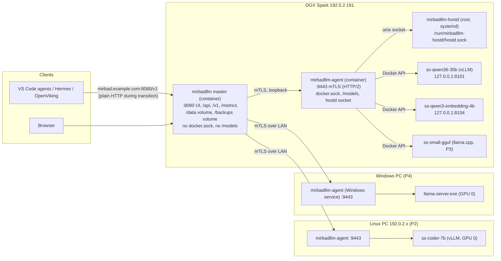
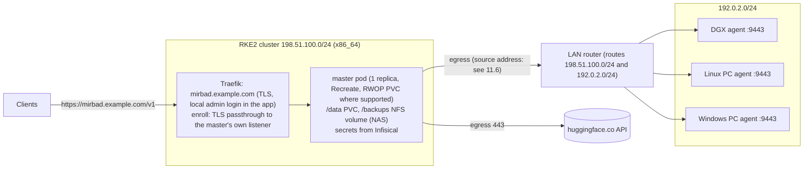
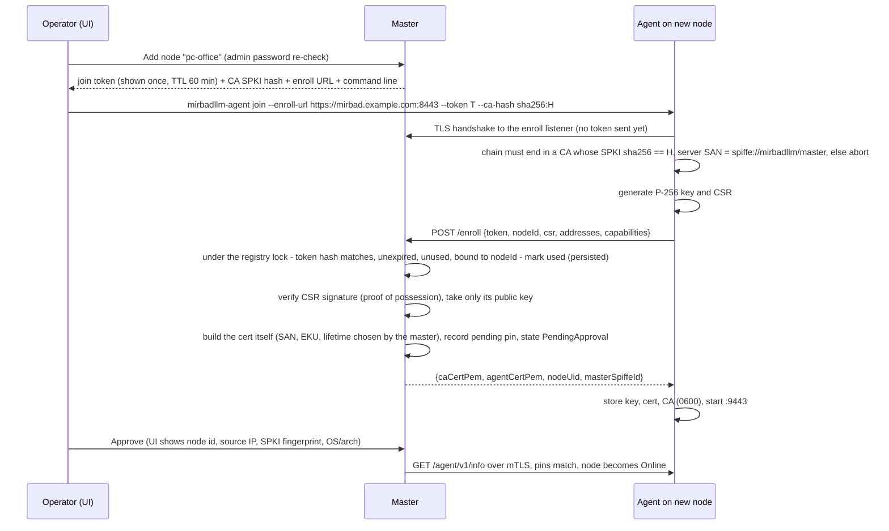
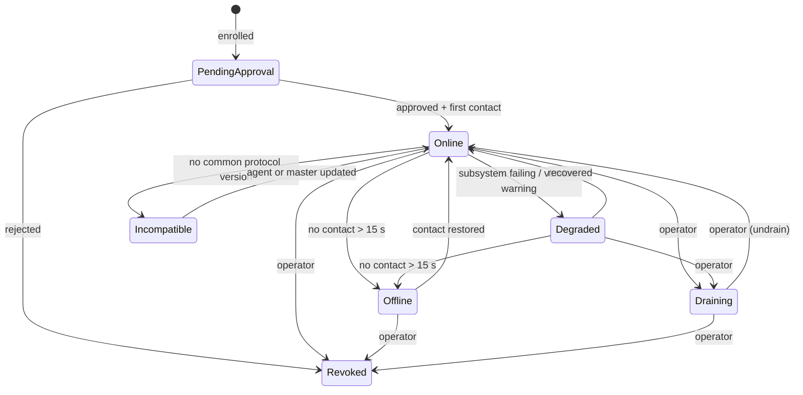
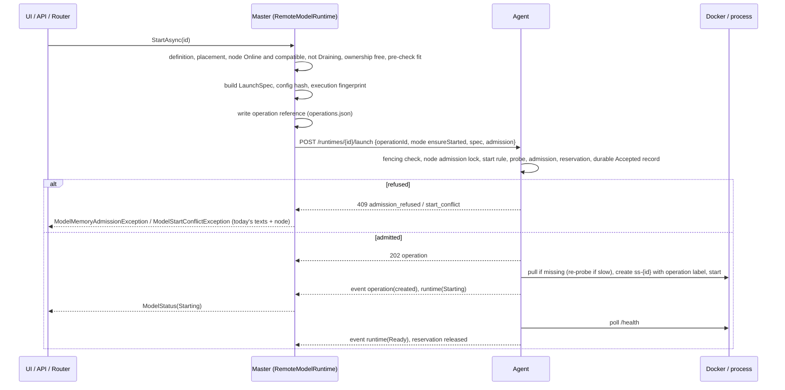

# MirbadLLM multi-node: architecture design

> Portal authorization update (2026-10-23): the signed-in admin session authorizes every portal action, with no repeated admin-password prompts. Historical password re-check decisions below are superseded by this rule. Typed destructive-action confirmations, audit records, login rate limits, agent trust checks, backup passphrases and share credentials remain in force.

Status: revision 3, for implementation planning (design only; no code in this change). Revision 2 recorded the
owner's answers to the revision-1 open questions (Appendix A, Decisions log) and responds to the independent review
of revision 1 (Appendix B, Review responses: every finding mapped to the section that changed, or to a reasoned
rejection). Revision 3 fixes the items the second review round left open (Appendix B, round 2).
Scope: turn mirbadllm from "one controller on the DGX" into "one master + one agent per machine", without
changing what API clients see.

Grounding: written against `origin/main` at `78b39d2` (PR #15). File and type names below are the ones in that
tree. Where this design changes a type, it says which file. Facts about the DGX were checked read-only on
2026-10-03: aarch64, 20 cores, 121 GiB MemTotal, one `NVIDIA GB10`, four model containers
(`ss-qwen36-35b-a3b-nvfp4`, `ss-qwen3-embedding-4b`, `ss-qwen3-vl-embedding-2b`, `ss-ov-intent-analysis`) on
`127.0.0.1:8101-8104`, `mirbadllm-hostd` active, LAN address `192.0.2.191/24`.

Client address (decided): clients use the stable name **`mirbad.example.com`**. LAN split-DNS points it at the DGX
now (plain HTTP `:8080` stays available on the DGX during the transition) and is repointed at the K8s ingress in P5.

---

## 1. Goals, non-goals, glossary

### Goals

1. **One front door.** One master serves the UI, the admin API, the single OpenAI-compatible `/v1` endpoint and
   `/metrics`. Clients keep one URL and the same served model names. `/v1/models` keeps its shape.
2. **Many machines.** Every machine that runs models (the DGX first, then Linux PCs with NVIDIA cards, Windows PCs,
   later Macs) runs a **node agent**. The master never touches a host directly; every host-specific action goes
   through that host's agent.
3. **Fixed placement.** Each model definition names its node (and GPU indices on nodes with discrete GPUs).
4. **More runtimes.** vLLM stays primary. The runtime abstraction admits llama.cpp (GGUF; container or native
   process; Linux, Windows, macOS) and later MLX, chosen per model. The DGX can run vLLM and llama.cpp models side
   by side.
5. **Per-node resource rules.** Memory admission, reserves, and the "one start at a time" rule apply per node, and per
   GPU on discrete-GPU nodes.
6. **Master can live in Kubernetes.** The master has no dependency on the Docker socket, the hostd socket, host
   paths, `nvidia-smi`, `/proc/meminfo` or the CPU architecture. It keeps its state in `/data` (a PVC in K8s), takes
   config from env/secrets, exposes probes, and ships as an amd64 + arm64 image.
7. **Phase 1 is invisible to clients.** On the DGX, the existing runtime moves behind a local agent and nothing a
   client sees changes: same URL, port, names, status codes, error shapes, streaming behaviour.

### Non-goals (for now)

- Automatic failover, standby replicas, multi-replica load balancing, KV-aware routing. The data model leaves room
  (section 5.2) but nothing implements them.
- Running the master as more than one replica.
- Tensor/pipeline parallelism **across** nodes (one model always runs on one node).
- Agent self-update. Agents are updated by CI (DGX) or by hand/scripts (other machines).
- Moving checkpoints between nodes by copying. A model that moves is re-downloaded on the new node (section 6.4).
- Deploying the master to Kubernetes in phases 1–4. We only keep it possible; P5 does the packaging.

### Glossary

| Term | Meaning |
|---|---|
| **Master** | The `MirbadLLM.Web` process after this change: UI, admin API, `/v1` router, `/metrics`, model registry, API keys, tags, backups, placement validation, monitoring aggregation, benchmark/tune orchestration, node registry, PKI. Exactly one. |
| **Node** | One machine that can run models, identified by a stable node id (slug, e.g. `dgx`). |
| **Agent** | `mirbadllm-agent`, the process on a node that executes the master's commands locally: runtimes, downloads, telemetry, host services, backup-share mounts. One per node. |
| **hostd** | The existing root helper `mirbadllm-hostd` (`src/MirbadLLM.HostAgent`). Unchanged; on Linux nodes it is reached only by the local agent over its Unix socket. |
| **Runtime kind** | How a model is served: `vllm` (today), `llamacpp`, later `mlx`. Chosen per model. |
| **Delivery** | How a runtime kind is executed on a node: `container` (Docker) or `process` (native executable). |
| **Runtime instance** | One running model on one node: a container `ss-{id}` or a supervised process. |
| **Placement** | The node (and GPU indices) a model definition is pinned to. |
| **Memory model** | `unified` (DGX GB10, Apple Silicon: CPU and GPU share one pool) or `discrete` (PC: host RAM plus per-GPU VRAM). |
| **Launch spec** | The fully built, runtime-ready description of an instance (image or executable, argv, mounts by logical name, GPU selection, labels) that the master sends to an agent. |
| **Maintenance window** | Today: a box-wide `/v1` pause while a benchmark or tuning job runs (`IMaintenanceMode`). After this change: per node (section 6.5). |

---

## 2. Topologies and components

### 2.1 Today (for reference)

One container (`deploy/compose.yaml`, service `controller`) holds router, admin API, UI and orchestration. It
mounts `/var/run/docker.sock`, `/models` (rw), `/data`, `/backups` (rslave), `/run/mirbadllm-hostd` (ro), and
gets the NVIDIA `utility` capability for `nvidia-smi`. `DockerModelRuntime` creates sibling containers on the
`mirbadllm` network; the router reaches them at `http://ss-{id}:8000/`.

### 2.2 Topology (a): master co-located on the DGX (phases 1–4)



The master and the DGX agent are two containers from the same compose file. The master talks to the DGX agent
exactly as it talks to any other agent (mTLS on `https://127.0.0.1:9443` or the `mirbadllm` network alias);
there is no in-process shortcut in production, so the co-located case exercises the same code as the remote case.

### 2.3 Topology (b): master in Kubernetes, all nodes remote (P5)



Deployment assumption (verified in P5, section 11.6): pod egress to 192.0.2.0/24 leaves with a cluster node's
address (Cilium SNAT/masquerading). If that holds, IP allow-lists on agents can only narrow to the cluster subnet,
so authentication is the mTLS identity, not the source IP (section 10). The design does not depend on the
assumption being true; it only stops relying on source IPs.

### 2.4 What moves from today's controller

| Today (file / type) | After | Notes |
|---|---|---|
| `DockerEngineClient` | Agent | Master no longer references it. |
| `DockerModelRuntime` (create/stop, label scheme, state mapping, crash-loop handling, port allocation, `/health` probe, failure log) | Agent (`ContainerRuntimeDriver`) | Same labels, same container names (`ss-{id}`), so P1 adopts the running containers. |
| Memory admission and `EnsureNoOtherModelStartingAsync` | Agent (authoritative) + master (pre-check for the UI) | The agent sees live free memory and local "Starting" state at the moment it acts. |
| `IModelRuntime` / `IModelLauncher` implementation | Master: `RemoteModelRuntime` over an agent client + status cache | The interfaces stay; callers (`ModelJobService`, `ProxyHandler`, `RestoreJobService`, pages) keep compiling. |
| `VllmArgsBuilder`, `VllmArgsNormalizer`, `VllmArgsParser`, `ModelConfigHash` | Master (unchanged) | The master builds the launch spec; the agent never interprets vLLM flags. Read-back parsing gets the container `Cmd` from the agent. |
| `ModelHealthMonitor` (auto-start on boot, transitions) | Master, per node | Auto-start runs per node when the node comes Online; the health probe itself is on the agent. |
| `MetricsSampler` | Split: agent samples (memory, GPU, GPU processes, model `/metrics`); master computes KPIs (`ModelKpiCalculator`) and keeps history | One request per node per interval instead of one per model. |
| `ProcMeminfoMemoryProbe`, `NvidiaSmiGpuProbe`, `HostAgentGpuProcessProbe` | Agent | Plus Windows and macOS probes later. |
| `HuggingFaceDownloader` | Agent | Container helper on Linux (as today); native .NET downloader from P3/P4 (section 6.4). |
| `HuggingFaceRepoInspector` | Master (unchanged) | Metadata only; needs internet egress from the master. |
| `ModelFolderInspector`, `LocalCheckpointFolders` (`ICheckpointFolders`) | Agent, served over the API; master gets `RemoteCheckpointFolders` | Tag suggestions and tuning gates read `config.json` through the agent. |
| `VllmCatalogService` (local vLLM images) | Agent reports images in its capabilities; master merges the catalog per node | |
| `HostServiceManager` – unit part via `HostAgentClient` | Agent → hostd (Linux), SCM (Windows), launchd (macOS) | Master keeps admin re-authentication. |
| `HostServiceManager` – container part via `DockerServiceClient` | Agent | Master keeps the container whitelist per node in `host-services.json`. |
| `BackupDestination` via `IHostAgentBackupMountClient` | DGX agent → hostd, topology (a) only | In K8s the backup volume is the platform's job (section 9.3). |
| `BackupService`, `BackupScheduler`, `BackupDirectory`, `RestorePlanner`, `RestoreJobService` | Master | Restore drives downloads and starts through agents. |
| `ModelJobService`, `BenchmarkSuite`, tuning planners/scorers, `BenchmarkStore` | Master | Load generation goes through the same data path clients use. GPU idle sampling and logs come from the agent. |
| `MaintenanceModeService` | Master, scoped per node | Section 6.5. |
| `JsonModelRegistry`, `JsonApiKeyStore`, `StartupTimeTracker` | Master | |
| Router (`ProxyHandler`, `ModelEndpointResolver`, `RouterChatClient`, `ModelsEndpoint`) | Master | Resolves to `https://{agent}/agent/v1/proxy/{modelId}/`, from a status cache (section 7). |
| `mirbadllm-hostd` | Unchanged, Linux nodes | Only the local agent talks to it. |

New on the master: node registry (`nodes.json`), PKI (`/data/pki`), audit log, agent client pool, node monitor,
placement validation. New process: `mirbadllm-agent`.

### 2.5 Projects

| Project | Contents | Ships in |
|---|---|---|
| `MirbadLLM.Core` | Contracts. Gains `ModelPlacement`, `RuntimeKind`, `LlamaCppSettings`, node contracts (`NodeInfo`, `NodeState`, `NodeCapabilities`), per-node `MemorySnapshot`. Core is marked "frozen, changes through the integrator" in `docs/architecture.md`; this design is that change request. | master, agent |
| `MirbadLLM.Agent.Contracts` (new) | Wire DTOs of the master↔agent protocol, protocol version constants, error codes. No logic. | master, agent |
| `MirbadLLM.NodeRuntime` (new) | Code moved out of Orchestration that runs on a node: `DockerEngineClient`, container driver (from `DockerModelRuntime`), process driver (P3/P4), probes, downloader, folder inspector, `PrometheusText` parsing. | agent |
| `MirbadLLM.Agent` (new) | The agent host: Kestrel with mTLS, the API in section 4, local op log, telemetry ring buffer, hostd client, enrollment CLI. | agent |
| `MirbadLLM.Orchestration` | Keeps registry, args builder/normalizer/parser, KPI math, jobs, recovery. Gains `RemoteModelRuntime`, `AgentClient`, `NodeRegistry`, `NodeMonitor`, `Pki`. Loses everything listed as "Agent" above. | master |
| `MirbadLLM.Router`, `MirbadLLM.Web` | As today, plus node-aware endpoints and pages. | master |
| `MirbadLLM.HostAgent` | Unchanged. | Linux nodes |

No new NuGet packages are needed: Kestrel client-certificate auth, `System.Security.Cryptography.X509Certificates`
(`CertificateRequest`, ECDSA), `SocketsHttpHandler` with HTTP/2 and client certificates, SSE via
`text/event-stream` writing and reading, and `System.Text.Json` are all in the BCL/ASP.NET Core shared framework.

---

## 3. Node model

### 3.1 Identity

- **Node id**: slug `^[a-z0-9][a-z0-9-]{0,39}$`, chosen at "Add node" time, immutable (it is in model definitions,
  container labels and cert SANs). The DGX becomes `dgx`.
- **Node uid**: a random 128-bit id generated by the master at enrollment, stored on both sides. Used to detect
  "same name, different machine" after a reinstall.
- **Agent certificate**: ECDSA P-256 key generated **on the node** (never leaves it), cert issued by the master CA,
  SAN `URI:spiffe://mirbadllm/node/{nodeId}` plus the agent's DNS names/IPs, EKU serverAuth + clientAuth, 90 days.
- **Pin**: the master stores the SHA-256 of the agent's SubjectPublicKeyInfo. A connection is accepted only if the
  chain validates to the master CA **and** the SPKI matches the pin. Re-keying (renewal with a new key) updates the
  pin in the same operation.

### 3.2 Registration and pairing

The join token is a bearer credential, so it is **only ever sent over a TLS connection the agent has already
authenticated** as the master. Revision 1 allowed plain HTTP and checked the CA afterwards; that is withdrawn.



- **Enroll listener.** The master runs a second Kestrel endpoint (default `:8443`) with a server certificate issued by
  its own CA (SAN `spiffe://mirbadllm/master` plus the configured DNS names). It serves only `POST /enroll`. In
  topology (a) it is published on the DGX; in topology (b) Traefik forwards it with an `IngressRouteTCP` in **TLS
  passthrough** mode (SNI `enroll.mirbad.example.com` or a dedicated port), so the agent sees the master's own
  certificate, not Traefik's.
- **Trust anchoring.** The agent trusts nothing but the CA whose SPKI hash came with the join command. The token is
  sent only after that check passes. A man in the middle can neither read the token nor substitute the CSR.
- **Token.** 32 random bytes, base64url; the master stores only its SHA-256 with node id, expiry and `usedAt`.
  Consumption is atomic: the master marks the token used and persists that **before** issuing the certificate (under
  the `nodes.json` semaphore). If issuance then fails, the token is burnt and the operator creates another; a token
  can never issue two certificates. Default TTL 60 minutes, configurable 10 min – 24 h.
- **Certificate content is server-controlled.** From the CSR the master uses only the public key, after verifying the
  CSR's signature with it (proof of possession). Subject, SANs (`URI:spiffe://mirbadllm/node/{nodeId}`, plus the
  addresses the operator confirmed in the approval dialog), EKU (serverAuth + clientAuth), key usage and lifetime are
  set by the master. Requested extensions are ignored.
- **Approval is mandatory** (decided). Until approved, the node is `PendingApproval`: the master calls only
  `/info`, nothing is placed there, and the pin is "pending". Reject deletes the pin and the node record.
- **The CA travels inside the enroll-listener certificate (decided in MN-004, recorded by MN-090, D35).** TLS stacks
  do not reliably send a self-signed root in the handshake (OpenSSL on Linux never does; SChannel does), so the agent
  cannot count on finding the CA whose SPKI hash is `H` in the server's chain. The enroll-listener leaf therefore
  carries the CA certificate (DER) in a **non-critical private extension**, OID `1.3.6.1.4.1.3337916915.1.1` (under an
  unregistered private enterprise number; `PkiDefaults.EmbeddedCaCertificateOid`). The joining agent's validator
  (`PeerValidator.ForEnrollListener(H)`) takes the CA from that extension (exactly one, at most 8 KiB, must parse),
  requires its SPKI hash to equal `H` and the certificate to be a self-issued P-256 CA with keyCertSign, and then
  validates the leaf against it exactly like any other chain (direct leaf → root, serverAuth, SAN URI
  `spiffe://mirbadllm/master`, validity). The extension grants no trust by itself: trust rests on `H`, and a man in
  the middle who copies the real CA into his own leaf fails the signature check. Every other validator mode ignores
  the extension. Consequence for MN-035: the enroll listener does **not** need to put the CA in its TLS chain; after
  enrollment the agent stores `EnrollResponse.caCertPem` only if its SPKI hash equals `H`.
- **Rate limit.** `/enroll` uses the same 5/minute per IP policy as `/login/submit`.
- **The DGX bootstrap (P1)** sends no token over the network: the master writes a bootstrap bundle to a directory
  shared only between the two containers (`/run/mirbadllm-bootstrap`, a named volume, mode 0700, owned by uid 1654),
  containing the CA certificate and a single-use token. The agent reads the bundle, enrolls over the enroll listener
  on the internal Docker network with the same TLS check, and deletes the bundle. The bootstrap node `dgx` is
  pre-approved. The bundle never contains the CA key, and the agent never mounts the master's `/data`.

### 3.3 Capabilities report

`GET /agent/v1/capabilities` (also embedded in enrollment). The master stores the last report in `nodes.json` so
the UI can show an Offline node's hardware.

```json
{
  "protocol": { "current": 1, "min": 1 },
  "agentVersion": "1.0.0+78b39d2",
  "features": ["runtime.vllm.container", "runtime.llamacpp.container", "downloads.hf-container",
               "services.systemd", "services.docker", "backup-mount", "gpu-processes", "telemetry.v1"],
  "os": { "family": "linux", "description": "Ubuntu 24.04 LTS", "kernel": "…" },
  "arch": "arm64",
  "cpu": { "logicalCores": 20, "model": "…" },
  "memory": { "model": "unified", "totalGiB": 121.6 },
  "gpus": [
    { "index": 0, "uuid": "GPU-5967…", "name": "NVIDIA GB10", "memoryTotalGiB": null,
      "computeCapability": "12.1", "driver": "580.x", "sharesHostMemory": true }
  ],
  "runtimes": [
    { "kind": "vllm", "delivery": "container", "available": true },
    { "kind": "llamacpp", "delivery": "container", "available": true, "images": ["ghcr.io/ggml-org/llama.cpp:server-cuda"] }
  ],
  "images": [ { "ref": "local/qwen38-vllm-dflash2:66e5414c6d75", "id": "sha256:…", "sizeBytes": 19300000000, "arch": "arm64" } ],
  "modelRoots": [ { "name": "models", "freeBytes": 812000000000, "totalBytes": 3700000000000, "folderCount": 11 } ],
  "hostServices": { "manager": "systemd", "hostdAvailable": true, "hostdVersion": "…", "containers": true },
  "backupMount": { "supported": true }
}
```

Notes: GB10 reports no per-GPU memory through `nvidia-smi` (see `GpuSnapshot` doc comment), hence
`memoryTotalGiB: null` and `sharesHostMemory: true`; the memory model is then `unified`. On a discrete PC each GPU
carries `memoryTotalGiB` and the memory model is `discrete`. Compute capability lets the master warn when an image
or quantization does not fit (e.g. NVFP4 needs Blackwell).

### 3.4 Heartbeat and liveness

The master dials agents (section 4.1), so the "heartbeat" is master-driven:

- The master keeps one **event stream** per node open: `GET /agent/v1/events` (SSE). The agent sends a `heartbeat`
  event every 5 s and state-change events as they happen, including a `health` event when its Degraded reasons change
  (checked every 5 s, D68). Each event carries the agent's monotonic `seq` and `bootId`.
- If the stream drops, the master reconnects with exponential backoff (1 s → 30 s) and, on reconnect, calls
  `GET /agent/v1/status` for a full snapshot (events are never the only source of truth).
- `lastContact` = time of the last event or successful call.

### 3.5 Node states



| State | Meaning | Effect |
|---|---|---|
| PendingApproval | Enrolled, not yet approved | Only `info`; not offered for placement. |
| Online | Reachable, protocol negotiated, all checks pass | Normal. |
| Degraded | Reachable, but something is wrong: Docker unreachable, `nvidia-smi` failing, hostd missing on a node that had it, model root below 5 % free, clock skew > 30 s, certificate expiring in < 14 days, agent older than recommended | Commands that need the broken subsystem fail with a clear reason; others work. Reasons listed in the UI. |
| Incompatible | `/info` answers but no protocol version overlaps (3.6) | **Blocked**: the router answers 503 `node_incompatible` for its models, no auto-start, no commands except `info`, `capabilities` and PKI renewal. |
| Offline | No contact for 15 s (3 missed heartbeats) | Router answers 503 `node_offline`; starts refused; UI shows last-known state greyed with "last seen". |
| Draining | Operator flag (persisted on the master) | No new starts or placements; running models keep serving until stopped. |
| Revoked | Removed | Pin deleted; master refuses connections; models placed here become unplaced. |
| Pending takeover | Was unreachable during a fencing takeover (4.2) | Blocked like Incompatible until its accepted epoch is below the master's, or the operator continues the takeover. |

Draining is stored separately (`draining: true`) so a draining node can also be Offline; the UI shows both.

### 3.6 Versioning and compatibility

- **Protocol version negotiation.** Both sides have a range `[min, current]`. On every (re)connect the master calls
  `GET /info`, computes `selected = min(master.current, agent.current)` and requires
  `selected >= max(master.min, agent.min)`. If there is no overlap the node is **Incompatible** (3.5) and stays
  blocked for routing, auto-start and every command except `info`, `capabilities` and `pki/*`, even though `/info`
  succeeded. Otherwise every later request carries `MirbadLLM-Protocol: {selected}` and the agent answers in that
  version (or 400 `protocol_mismatch` if it no longer supports it, which makes the master renegotiate).
- **Master window.** A master release supports at least `[current - 1, current]`, so one agent release behind always
  works.
- **Feature flags** (`features` in 3.3) gate individual capabilities inside a protocol version. The master checks a
  feature before offering an action (no llama.cpp option for a node without `runtime.llamacpp.*`). This generalizes
  today's "older hostd → 404 → fall back to budgets" behaviour in `MetricsSampler`.
- **Rule for changes.** Additive JSON fields never bump the protocol; removing/renaming a field or changing meaning
  does, and the master keeps the old path for one version.
- **Upgrade order.** Master first, then agents. CI redeploys the DGX agent right after the master (11.8); other
  agents are updated by hand, and the Nodes page lists agents older than the recommended version.

## 4. Master ↔ agent protocol

### 4.1 Transport and direction

**Decision: HTTPS with mutual TLS, HTTP/2, REST + JSON for commands, Server-Sent Events for streams. The master
initiates every connection to agents (port 9443); agents initiate only the one-time enrollment call.**

Why REST + JSON + SSE instead of gRPC:

- **No new packages.** gRPC on .NET needs `Grpc.AspNetCore`, `Grpc.Net.Client`, `Google.Protobuf` and
  `Grpc.Tools` (build-time codegen). The repo rule is "do not add packages without the integrator; everything here
  is doable with the BCL + ASP.NET Core" (`docs/architecture.md`, Conventions). Everything below is.
- **The data path is HTTP anyway.** The agent must proxy OpenAI HTTP/SSE traffic byte-for-byte (section 7). gRPC
  would cover only the control plane and we would still run an HTTP proxy beside it.
- **Same tools and patterns as today.** hostd is already "minimal APIs + JSON + `HttpClient`" (`HostAgentApi.cs`,
  `HostAgentClient.cs`); logs already stream as `text/event-stream` (`/api/models/{id}/logs`). Debugging is `curl
  --cert`.
- **Streaming needs are modest.** Logs, events and download/operation progress are one-way server→client streams;
  SSE fits. Nothing needs client streaming.
- What we give up: generated typed clients and schema enforcement. Mitigation: one shared DTO assembly
  (`MirbadLLM.Agent.Contracts`) referenced by both sides, plus golden-JSON contract tests (section 13).

Why the master dials the agents (and not the reverse):

- Agents sit on a routed LAN, not behind NAT; the master can reach them in both topologies.
- The master needs to open data-path connections to agents per request anyway; one direction for everything keeps
  one TLS identity model and one connection pool.
- An agent-initiated reverse tunnel would require the agent to reach the master through Traefik in K8s with client
  certs (TLS passthrough or re-encryption at Traefik), and would need us to build multiplexing on top of it.
- Trade-off: each node must accept inbound TCP 9443. That is one firewall rule per node, and mTLS + pinning makes it
  safe to expose on the LAN.

HTTP/2 between master and agent: `SocketsHttpHandler` with `KeepAlivePingDelay = 30 s`, `KeepAlivePingTimeout = 10 s`,
`PooledConnectionIdleTimeout = 5 min`; connection limits and `EnableMultipleHttp2Connections` differ per handler
(control: 2 / false, data: 16 / true) and are specified in 7.2, which is authoritative (MN-010 verified the control
handler serving 50 concurrent requests on one connection). All requests to a node share a few TLS connections, so
there is no handshake per request, and a dead peer is detected by HTTP/2 pings even mid-stream.

### 4.2 Authentication, authorization and fencing

**TLS on both sides** (both validate against the master CA only, never system roots):

- Agent (server): Kestrel `ClientCertificateMode.RequireCertificate`; custom chain policy with the master CA as the only
  trust anchor (`X509ChainTrustMode.CustomRootTrust`), EKU clientAuth, SAN URI exactly `spiffe://mirbadllm/master`,
  within validity. Nothing else is accepted.
- Master (client): custom-root chain to its CA, EKU serverAuth, SAN URI exactly
  `spiffe://mirbadllm/node/{expected id}`, and the SPKI pin (or the pending pin during a rotation, 10.2). Hostname
  validation is replaced by the SAN + pin check (agents are addressed by IP).

**Fencing: one master at a time.** A boot counter alone does not fence two masters started from copies of the same
`/data`, and a restored older `/data` would have a lower counter than agents remember. The design uses three layers:

1. **Exclusive ownership of `/data`.** At startup the master opens `/data/master.lock` with `FileShare.None` and holds
   it for its lifetime; a second process on the same volume fails to start with a clear message. In K8s the PVC uses
   access mode `ReadWriteOncePod` where the installed CSI driver supports it (to be verified for the deployed
   Longhorn version in P5), else `ReadWriteOnce` plus the file lock; the Deployment uses `strategy: Recreate`.
   Note: RWO alone does **not** guarantee one writer — it allows several pods on the same Kubernetes node.
2. **Master identity on the agents.** `/data/master.json` holds `masterInstanceId` (random, created once) and `epoch`
   (incremented and persisted at every boot, before the first agent call). Each boot also generates a random
   `bootId`. Every mutating request carries `MirbadLLM-Master: {instanceId}/{epoch}/{bootId}`. The agent persists the
   highest accepted triple in its state directory (fsync'd) and:
   - rejects a lower epoch (409 `stale_master`);
   - at an equal epoch, rejects a different `instanceId` or `bootId` (409 `competing_master`): the first master that
     reached the node at that epoch wins, so two copies booted with the same counter cannot both drive it;
   - accepts a higher epoch and persists it.
   The agent re-checks the accepted triple **before every destructive stage** of an operation (stop, remove, create,
   folder delete), not only when accepting the request, so an operation started by a master that has since been
   superseded stops at its next stage.
3. **Explicit takeover.** A master whose epoch is below what agents remember (restored `/data`, copied volume) gets
   `stale_master` everywhere and shows a red banner on the Nodes page. Takeover is an operator action, never automatic:
   (1) confirm the old master is stopped (the UI says exactly this); (2) create `/data/takeover` (or run the master once
   with `MirbadLLM__Fencing__Takeover=true`); (3) the master reads the accepted epoch of every **reachable** agent from
   `/info` and sets its epoch to at least `max(restoredEpoch, all reachable agents' epochs) + 1`, persists it together
   with a **takeover record** (`takeoverId`, new epoch, time, operator, the nodes that answered and those that did not),
   deletes the takeover flag, and continues. Creating the flag, setting the option (with `TakeoverId`), the banner's
   typed confirmation and the fleet-recovery install ("The previous master is stopped", §9.4) are each the operator's
   confirmation; the takeover then runs by itself (D106).
   - Agents that were unreachable are marked **Pending takeover**. Nothing is promised about them: an offline agent may
     remember a higher epoch than any reachable one (for example after an old backup was restored).
   - When such an agent returns, the master reads its accepted epoch first. If the master's epoch is higher, the agent
     simply accepts it on the next mutation and the node leaves Pending takeover. If it is **not** higher, the node stays
     blocked (no routing, no commands except `info`) and the Nodes page asks the operator to **continue the authorized
     takeover** for that node: the confirmation names the takeover record and the epoch the agent holds. Continuing
     raises the master's epoch to `agentEpoch + 1` (persisted, recorded in the takeover record); every other node then
     accepts the higher epoch normally. There is no automatic continuation.
   Fleet disaster recovery (9.4) uses the same procedure.

**Request freshness.** Mutating requests carry `MirbadLLM-Request-Time`; the agent rejects skew > 5 min. TLS already
prevents network replay; this bounds replays from logs.

### 4.3 Request catalogue (contract level)

Base: `https://{node address}:9443/agent/v1`. Bodies are JSON (web defaults, camelCase, enums as strings). Agent errors
use one shape, `{"error": {"code": "…", "message": "…", "details": {…}}}`; the master never forwards that shape to an
OpenAI client — it translates it (section 7.4).

**Every mutation is an operation.** Every request that changes anything (including host-service actions, certificate
and trust changes, folder deletion and cancellations) carries an `operationId` and follows section 4.4: durable
acceptance, payload-bound deduplication, a stored result. Short mutations complete before the response (200 with the
stored `OperationStatus`); long ones answer 202 and complete asynchronously.

**Mutation envelope.** Every mutation body carries `{operationId, issuedAt, expiresAt, …}`. `issuedAt` and `expiresAt`
are set once by the master when it creates the operation reference (`expiresAt = issuedAt + 24 h`) and are **part of
the payload digest**, so a retry must resend them unchanged. The agent rejects a submission whose `expiresAt` has passed
(410 `operation_expired`) or whose `issuedAt` is more than 5 minutes in the future (skew).

**Identity, health, telemetry**

| Method | Path | Request | Response |
|---|---|---|---|
| GET | `/info` | – | `{nodeId, nodeUid, agentVersion, protocol: {min, current}, bootId, startedAt, time, acceptedMaster: {instanceId, epoch, bootId}}` (no `MirbadLLM-Protocol` header needed) |
| GET | `/capabilities` | – | section 3.3 |
| GET | `/status` | – | Consistent snapshot: `{bootId, seq, health, memory: NodeMemorySnapshot, reservations, runtimes: [RuntimeStatus], downloads: [DownloadStatus], operations: [OperationStatus (non-terminal + last 100)]}`; `seq` is the event sequence number the snapshot is consistent with (4.7) |
| GET | `/events` | `?bootId=&afterSeq=` | SSE: `heartbeat`, `runtime`, `operation`, `download`, `reservation`, `health` (D68), `reset`, `overflow` (4.7) |
| GET | `/telemetry` | `?bootId=&afterSeq=&max=` | `{bootId, samples: [NodeSample], gap: bool}` from a 15-minute ring buffer (8.1) |
| GET | `/gpu/idle` | `?seconds=5&gpus=0,1` | `{averagePercent, samples, perGpu: […]}` |

`NodeMemorySnapshot`: `{model: "unified"|"discrete", hostTotalGiB, hostAvailableGiB, gpus: [{index, uuid, totalGiB?, usedGiB?, freeGiB?}]}`.

**Runtimes**

| Method | Path | Request | Response |
|---|---|---|---|
| GET | `/runtimes` | `?label=tuning` | `[RuntimeStatus]` |
| GET | `/runtimes/{modelId}` | – | `RuntimeStatus` (404 `not_found` = no instance = Stopped) |
| POST | `/runtimes/{modelId}/launch` | `LaunchRequest` | 202 `OperationStatus`; 409 `admission_refused` `{needGiB, freeGiB, availableGiB, reserveGiB, releasedGiB, gpu?, host?}`; 409 `start_conflict` `{startingModelId, gpus?}`; 409 `operation_id_conflict`; 409 `stale_master` / `competing_master`; 422 `spec_rejected` `{reason}`; 422 `gpu_missing` `{uuids}` |
| POST | `/runtimes/{modelId}/stop` | `{operationId}` | 202 `OperationStatus` (no instance → succeeded) |
| GET | `/runtimes/{modelId}/launch-config` | – | `{image, imageDigest, argv, env (names only, secret values never), mounts, gpus: [{index, uuid}], labels, executionFingerprint, createdAt}` (feeds `VllmArgsParser`, `ModelConfigHash` and the execution fingerprint, 5.1) |
| GET | `/runtimes/{modelId}/logs` | `?tail=200&follow=true` | `text/event-stream`, one `data:` line per log line |
| any | `/proxy/{modelId}/{**path}` | client request, body streamed | upstream response streamed (section 7) |

`LaunchRequest`:

```json
{
  "operationId": "7c4e…",
  "mode": "ensureStarted",
  "spec": {
    "kind": "container",
    "image": "local/qwen38-vllm-dflash2:66e5414c6d75",
    "imageDigest": "sha256:…",
    "argv": ["--model", "/models/Qwen3.6-35B-A3B-NVFP4", "--served-model-name", "qwen36-35b", "…"],
    "env": {},
    "containerPort": 8000,
    "mounts": [ { "volume": "models", "subPath": null, "target": "/models", "readOnly": true },
                { "volume": "cache",  "subPath": null, "target": "/root/.cache", "readOnly": false } ],
    "gpus": { "mode": "all" },
    "ipcHost": true,
    "healthPath": "/health",
    "labels": { "mirbadllm.served-name": "qwen36-35b", "mirbadllm.config-hash": "9f2c…",
                "mirbadllm.exec-fingerprint": "41ab…", "mirbadllm.budget-gib": "36" }
  },
  "admission": { "budgetGiB": 36, "hostBudgetGiB": null, "reserveGiB": 8, "gpuReserveGiB": null,
                 "force": false },
  "expectedConfigHash": "9f2c…",
  "expectedExecutionFingerprint": "41ab…"
}
```

`mode` (finding 4):

- `ensureStarted` = today's `StartAsync`: an existing Starting/Ready/Stopping instance is returned as it is, **whatever
  its configuration** (a running model whose saved settings changed stays "restart pending", as today); a Failed
  instance is removed and recreated; no instance → create.
- `replace` = today's `LaunchAsync`/`RestartAsync`: always stop, remove and recreate, even if the configuration is
  identical (an explicit restart must restart). Admission counts the current instance as released only after its
  removal is confirmed and memory is re-probed (4.8).
- Deduplication is by `operationId` only (4.4): a repeated id never repeats work; a **new** `replace` operation
  always recreates.

For `kind: "process"` (llama.cpp native, MLX later) the spec carries `executable` as a **logical name** (`llama-server`)
that the agent maps to a path in its own config; `argv` may use the tokens `{models}` and `{cache}`, which the agent
replaces with its configured roots after validating the resulting paths (10.3). The master never sends a host path.

`RuntimeStatus`: `{modelId, state, instanceId, hostPort, since, error, restartCount, labels, configHash,
executionFingerprint, tuning, gpus, operationId, measuredGpuGiB?}`. `RestartPending` is computed on the master (it needs
the saved definition).

**Images, folders, downloads**

| Method | Path | Request | Response |
|---|---|---|---|
| GET | `/images` | – | `[ImageInfo {ref, digest, arch, sizeBytes}]` |
| POST | `/images/pull` | `{operationId, image, digest?}` | 202 `OperationStatus` |
| GET | `/model-folders` | – | `[{folder, sizeBytes, hasConfig, partial}]` |
| GET | `/model-folders/{folder}` | – | `ModelFolderInspection` (today's record, moved to Core) |
| POST | `/model-folders/{folder}/delete` | `{operationId, confirm: "<folder>"}` | 200 `OperationStatus`; 409 `in_use` (an instance or download uses it; the master also refuses folders referenced by any placed model) |
| POST | `/downloads` | `{operationId, repoId, revision, folder, allowPatterns, token, existing: "refuse"\|"complete"}` | 202 `DownloadStatus`; 409 `already_running` / `folder_exists`; 422 `no_files_match`; 507 `insufficient_disk` |
| GET | `/downloads`, `/downloads/{folder}` | – | `DownloadStatus` (+ `needsToken` for a paused authenticated download, 6.4) |
| POST | `/downloads/{folder}/cancel` | `{operationId}` | 200 `OperationStatus` (already finished → succeeded with the final state) |
| POST | `/operations/{operationId}/cancel` | `{operationId: <new id>}` | 200; cancels a running launch (before the instance exists), image pull or download; a launch whose instance already exists must be followed by `stop` (409 `invalid_state`); a target that already ended → 200, the cancel `succeeded` with the target's final status as result (D39) |

**Host services** (feature-gated; Linux via hostd, Windows via SCM in P4). All mutations carry the envelope; they are
synchronous (200 with `OperationStatus`) and bounded by hostd's own 60 s action timeout. Recovery after a crash follows
4.4 item 8: desired-state actions are reconciled, restarts and backup-mount PUTs can end `Unknown`.

| Method | Path | Notes |
|---|---|---|
| GET | `/host/services?include=all` | Units (hostd shape) and containers |
| POST | `/host/services/{name}/{start\|stop\|restart}` | `{operationId, confirm?}`; hostd re-checks protected/deny |
| POST | `/host/services/{name}/autostart` | `{operationId, enabled, confirm?}` |
| POST, PATCH, DELETE | `/host/whitelist[/{name}]` | `{operationId, …}`; forwarded to hostd with hostd's bodies |
| GET | `/host/gpu-processes` | hostd's `GET /gpu-processes` |
| POST | `/host/containers/{name}/{action}`, `/host/containers/{name}/autostart` | `{operationId, …}`; the master enforces the container whitelist, the agent its deny rules (10.3) |
| GET, PUT, DELETE | `/host/backup-mount`; POST `/host/backup-mount/test` | Forwarded to hostd (DGX, topology a). PUT/DELETE carry `operationId`; the share password is redacted from the stored operation |

**PKI** (section 10.2; all carry `operationId` and a `rotationId`)

| Method | Path | Notes |
|---|---|---|
| POST | `/pki/rotations` | `{operationId, rotationId}` → agent creates a new key, stores it as *pending* (fsync'd), returns the CSR. Repeating the same rotation returns the same CSR. |
| PUT | `/pki/rotations/{rotationId}/cert` | `{operationId, certPem}` → agent stores the new cert as pending and starts presenting it on **new** connections; the old cert stays valid for existing ones |
| POST | `/pki/rotations/{rotationId}/commit` | Sent by the master over a **fresh** connection that negotiated the new cert; agent persists "committed", deletes the old key; idempotent; irreversible |
| POST | `/pki/rotations/{rotationId}/abort` | Only before commit: agent drops the pending key/cert and keeps the old ones; after commit 409 `already_committed` |
| GET | `/pki/rotations/{rotationId}` | Rotation stage on the agent (`pending`, `certInstalled`, `committed`, `aborted`) |
| GET | `/pki/trust` | Current trust anchors (CA SPKI hashes) and accepted master SAN |
| PUT | `/pki/trust` | `{operationId, anchors: [caPem…]}` — add a second CA during CA rotation; must keep at least one anchor that validates the calling master |

**Operations**

| Method | Path | Notes |
|---|---|---|
| GET | `/operations/{operationId}` | `OperationStatus {id, kind, target, payloadDigest, state: Accepted\|Running\|Succeeded\|Failed\|Cancelled, stage, error, progress, startedAt, endedAt, result}` |
| GET | `/operations?state=active` | All non-terminal operations (used by the master after restarts) |

**Master endpoint used by agents**

| Method | Path | Notes |
|---|---|---|
| POST | `https://{enroll listener}/enroll` | Section 3.2. The only agent→master call. |
| POST | `https://{enroll listener}/enroll/rekey` | P2 (D73, D78): `join --rekey` re-pairs an enrolled node with a rekey token, keeping its uid (9.4 step 5). Same TLS check and rate limit as `/enroll`. |

### 4.4 Operations: durability, idempotency, reconciliation

**Agent side.**

1. **Durable acceptance.** Before answering 200/202 the agent appends an `Accepted` record to its operation log
   (`{state}/operations/log.jsonl`, written and fsync'd, compacted into `operations.json` daily). The record holds the
   operation id, the agent `bootId` and node uid, the action, the target (model id, folder, unit, rotation id), the
   SHA-256 of the canonical request body **with secrets removed** (HF token, share password), and the master triple.
   If the write fails, the request fails (503 `state_unavailable`) and nothing runs.
2. **Payload-bound deduplication.** A repeated operation id with the same action, target and payload digest returns
   the stored status. The same id with a different action/target/digest → 409 `operation_id_conflict`. Ids are never
   reused by the master.
3. **Resource labels.** Containers and download helpers carry `mirbadllm.operation={operationId}`; native processes
   record it in `processes.json`. This links what exists on the node back to the operation that created it.
4. **Stages.** Each operation records its stage durably (`admitted`, `pulling`, `created`, `started`, `removed`, …).
5. **Reconciliation at agent start.** Before opening the listener the agent walks every non-terminal operation and
   compares it with what exists:
   - launch `created` but container not running (agent died between create and start) → start it if the master triple
     is still the accepted one, else remove it and mark the operation Failed (`superseded`);
   - launch `admitted`/`pulling` with no container → re-run from the pull stage (reservation re-acquired, 4.8);
   - stop `running` → finish the stop;
   - download → resume (6.4);
   - PKI rotation pending → keep pending until the master commits or aborts (10.2).
   Containers with mirbadllm labels but no operation (created before P1, or log lost) are adopted as today.
6. **Retention and expiry.** A terminal operation record is kept until its `expiresAt` + 10 minutes (clock-skew margin),
   and at least the last 1,000 records; **active operations are never pruned**. This makes "unknown" decidable without
   tombstones: an id that is not in the log **and** whose envelope has expired is answered 410 `operation_expired` (the
   record may have existed and been pruned, so the agent never re-executes it); an id not in the log with a valid
   envelope is a new operation. The master treats `operation_expired` as "read the current state" and never retries
   with a new id automatically. Chosen over tombstones because the log stays bounded by time and size, and the expiry
   rides inside the signed-by-digest request rather than in extra agent state.
7. **Cancellation** is itself an operation (`/operations/{id}/cancel`). Cancelling a launch before its instance exists
   releases the reservation; after that, cancellation means a `stop`.
8. **Operations that call hostd or Docker for host services are not universally replay-safe.** hostd's API has no
   operation ids, and an action can complete on the host before the agent persists its terminal record. The agent
   records a `dispatched` stage (fsync'd) immediately before calling hostd/Docker, and recovers as follows (hostd is not
   changed):
   - **Desired-state actions** — start, stop, autostart on/off, whitelist add/update/remove, container start/stop,
     container restart-policy changes, backup-mount DELETE: on recovery the agent reads the current state; if it matches
     the desired state the operation is `Succeeded`, otherwise it applies the action again (doing so twice has the same
     effect as once).
   - **Non-idempotent or unverifiable actions** — service **restart**, container restart, and backup-mount **PUT** (the
     share password is not stored, so the mount cannot be re-applied, and "mounted with the same settings" does not
     prove this request did it): if the agent finds the operation `dispatched` without a terminal record, it marks it
     **`Unknown`** with the observed state. Nothing is replayed. The UI shows "Outcome unknown — check the service and
     run the action again if needed"; a new attempt is an explicit new operation.
   - The same `Unknown` outcome applies when the hostd call itself times out.
   - Read-only hostd calls (`GET`, backup-mount **test**) are not operations.

**Master side.**

- Before sending a mutation the master writes an **operation reference** to `{DataPath}/operations.json`
  (`{operationId, nodeId, nodeUid, action, target, payloadDigest, issuedAt, owner}`, where `owner` links to a job, move
  or restore record, 6.7). On boot it resumes observing every open reference (`GET /operations/{id}`) instead of issuing
  replacements. A reference whose node uid no longer matches (node re-enrolled) is closed as `lost`.
- A retry after a transport error before any response reuses the same id and body. An HTTP error response is never
  retried automatically.

### 4.5 Timeouts and retries

| Call class | Connect | Total | Retries |
|---|---|---|---|
| Reads (`info`, `status`, `runtimes`, folders) | 3 s | 10 s | 2, backoff 0.5 s / 2 s |
| Mutations returning an operation | 3 s | 30 s to the 202 | Retried with the **same** operationId only on transport errors before a response; never on an HTTP error response |
| Host service actions | 3 s | 60 s (hostd's own action timeout) | none |
| `/gpu/idle` | 3 s | seconds + 10 s | none |
| Logs, events, proxy | 3 s | none (infinite) | events: reconnect loop; proxy: none |
| Telemetry | 3 s | 5 s | none (next interval) |

Starts become asynchronous: today `StartAsync` returns once the container is created (it pulls a missing image
inline, which for a 19 GB image can take many minutes). With the agent, `launch` returns 202 after admission and
the spec check; the image pull (if any) and container creation run inside the operation. `RemoteModelRuntime.
StartAsync` waits for the operation to reach "container created" (bounded by 60 s, or by the pull) so the
`IModelRuntime` contract ("returns once it is created, state Starting") holds for callers.

### 4.6 Partitions and restarts

| Event | What happens | Why it is safe |
|---|---|---|
| Master restarts | Instances keep running. On boot the master takes the file lock, bumps its epoch, loads nodes and open operation references, negotiates protocol per node, takes full `status` snapshots, resumes event streams from the snapshot `seq`, resumes observing open operations, reconciles ownership records (6.7), and only then runs per-node auto-start for models still Stopped. | Truth lives on the node, derived from Docker/processes (today's rule: "the controller can restart at any time and must adopt"). |
| Agent restarts | Containers keep running and are re-adopted by label; operation log reconciliation (4.4) finishes or fails half-done work; reservations are rebuilt (4.8). The master sees a new `bootId`, takes a snapshot. Proxied requests on that node are cut (client sees a truncated stream, or a 503 if headers were not sent yet). Telemetry for the downtime is a real gap. | Same adoption rule as today plus durable operations. |
| Agent crashes between container create and start | Reconciliation starts the created container (or removes it if superseded). | Stage records + operation labels. |
| Network loss mid-start | The master retries with the same `operationId`; the agent returns the stored operation. Meanwhile the model shows "Unknown (node offline)"; router answers 503 `node_offline`. | Durable op log. |
| Network loss mid-download | Download continues on the node; progress resumes on reconnect. A cancel sent during the partition fails and the UI says so. | Downloads are node-local and resumable (6.4). |
| Network partition (agent alive) | Agent keeps sampling; after reconnect the master back-fills telemetry from the ring buffer (≤ 15 min). | Ring buffer with boot-aware cursor (8.1). |
| Network loss mid-stream (client request) | HTTP/2 ping times out (≤ 40 s) or the connection resets; the master aborts the client response (no JSON body after headers were sent). The agent cancels the upstream request when its stream is reset. | Same failure a client sees today if vLLM dies mid-stream. |
| Two masters / restored master | Fencing (4.2): file lock, `stale_master` / `competing_master`, explicit takeover. | |
| Clock skew | Node Degraded at > 30 s; mutating calls refused at > 5 min. | |

### 4.7 Ordering, snapshots and event replay

- **Per model**: the master serializes mutating commands for one model (per-model async lock), and ownership records
  (6.7) keep jobs, moves and restores from interleaving. The agent holds a per-model lock while executing.
- **Events.** Every state change on the agent increments a per-boot sequence number `seq` and is appended to an
  in-memory event ring (last 10,000 events or 10 minutes).
- **Snapshot watermark.** `GET /status` is built under the agent's state lock and returns the `seq` it is consistent
  with. The master applies a snapshot, then subscribes with `afterSeq = snapshot.seq`, so no change is lost or applied
  twice.
- **Reconnect replay.** `GET /events?bootId=B&afterSeq=S`: if `B` is the agent's current boot and `S` is still in the
  ring, the agent replays from `S+1`; otherwise it sends a single `reset` event and closes, and the master takes a new
  snapshot. The master ignores events with `seq ≤` the last applied for the same boot.
- **Overflow.** Each subscriber has a bounded queue (1,000 events). On overflow the agent sends `overflow` and closes
  the stream; the master re-snapshots. A slow master can never make the agent buffer without bound.
- **Across nodes**: no ordering guarantees, none needed (placements are fixed and disjoint).

### 4.8 Start reservations and the per-node start rule

Today `DockerModelRuntime.EnsureNoOtherModelStartingAsync` refuses a start while another model is Starting, because
"vLLM sizes its cache from how free memory changes while it loads" (`ModelStartConflictException`). That check only sees
containers that already exist. With asynchronous starts (pull, then create) two different models could both pass
admission before either container exists, so the agent uses **reservations**.

- **Start reservation.** On `launch`, under a node-wide admission lock, the agent atomically:
  1. checks the start rule: unified node → no other start reservation on the node; discrete node → no other start
     reservation on any of the requested GPUs (a CPU-only process uses the pseudo-GPU `host`);
  2. probes memory and checks admission (6.1) against free memory **minus all memory reservations held by other
     starts** (a start in progress has not taken its memory yet);
  3. records the reservation (`{operationId, modelId, gpus, budgetGiB, hostBudgetGiB}`, persisted with the operation)
     and only then answers 202.
- **Held until Ready or terminal.** The reservation is released when the instance reports Ready (vLLM has taken its
  memory), when it fails, or when the operation is cancelled. Reconciliation after an agent restart rebuilds reservations
  from non-terminal launch operations and from instances still Starting.
- **Re-probe before create.** After a pull that took longer than 30 s, the agent re-checks admission right before
  creating the container (memory may have changed while pulling); a refusal fails the operation with the same 409
  details in its result.
- **Host memory is node-wide.** Even when GPU sets are disjoint, the host-memory part of admission is serialized under
  the node-wide lock (two starts on GPU 0 and GPU 1 can both load weights through host RAM).
- **Replacement** (`mode: replace`): stop and remove the old instance, then re-probe; the memory counted as released is
  what the probe shows, not the old declared budget. Today's formula (`available + released − reserve`) is kept only for
  the master's pre-check message.
- **Ports** are allocated under the same node-wide lock (today `AllocatePortAsync` scans labels without a lock; two
  concurrent creates could pick the same port).
- **Concurrency.** Unified nodes: one start at a time (unchanged rule). Discrete nodes: one per GPU. Configurable per
  node (`maxConcurrentStarts`). Starts on different nodes never conflict. `ModelHealthMonitor`'s boot auto-start and
  `RestoreJobService`'s auto-start become per-node queues (parallel across nodes, sequential within one).
- The agent is authoritative; `RemoteModelRuntime` maps `start_conflict` to `ModelStartConflictException` and
  `admission_refused` to `ModelMemoryAdmissionException` with today's message texts plus "on node dgx (GPU 0)".

### 4.9 Start sequence



## 5. Data model changes

### 5.1 `ModelDefinition` (`src/MirbadLLM.Core/ModelDefinition.cs`)

Added (all optional in JSON, so old files and old API clients keep working):

```csharp
/// <summary>Where the model runs. Null = unplaced (restored without a node, or its node was revoked).</summary>
public ModelPlacement? Placement { get; init; }

/// <summary>Runtime kind. Absent in JSON = Vllm (every existing definition).</summary>
public RuntimeKind Runtime { get; init; } = RuntimeKind.Vllm;

/// <summary>llama.cpp settings; required when Runtime == LlamaCpp, ignored otherwise.</summary>
public LlamaCppSettings? LlamaCpp { get; init; }

/// <summary>Host RAM this model needs besides its GPU budget (discrete nodes). Null = runtime default estimate (6.1).</summary>
public double? HostMemoryBudgetGiB { get; init; }

/// <summary>Keep serving this model while a benchmark or tuning job holds its node (section 6.5).</summary>
public bool KeepServingDuringJobs { get; init; }

/// <param name="GpuUuids">Ordered GPU UUIDs, persisted when the placement is saved. The identity of the placement.</param>
/// <param name="GpuIndices">Display/selection aid only, refreshed from the UUIDs; never used to pick a device.</param>
public sealed record ModelPlacement(string NodeId, IReadOnlyList<string>? GpuUuids = null, IReadOnlyList<int>? GpuIndices = null);

public enum RuntimeKind { Vllm, LlamaCpp, Mlx }

public sealed record LlamaCppSettings
{
    public required string ModelFile { get; init; }        // GGUF path relative to the models root (first split part)
    public string? ProjectorFile { get; init; }             // --mmproj, vision
    public int ContextSize { get; init; } = 32_768;         // -c
    public int Parallel { get; init; } = 4;                 // -np (slots)
    public int GpuLayers { get; init; } = 999;              // -ngl (999 = all; fewer = partial offload, 6.1)
    public bool? FlashAttention { get; init; }              // -fa on|off|auto
    public string? CacheTypeK { get; init; }                // -ctk
    public string? CacheTypeV { get; init; }                // -ctv
    public int? BatchSize { get; init; }                    // -b
    public int? MicroBatchSize { get; init; }               // -ub
    public LaunchDelivery Delivery { get; init; } = LaunchDelivery.Container;
    public string? Image { get; init; }                     // container delivery; default from the node
    public IReadOnlyList<string> ExtraArgs { get; init; } = [];
}

public enum LaunchDelivery { Container, Process }
```

Decisions:

- **vLLM typed fields stay at the top level.** Moving them into a `Vllm` sub-object would touch `VllmArgsNormalizer`, the
  builder/parser, tuning apply, the editor, `SettingChanges`, the backup format and every stored file for no
  functional gain now. Non-vLLM runtimes ignore them. A later cleanup can move them behind a converter that still reads
  the old shape (the technique `SpeculativeDecodingJsonConverter` uses).
- **`MemoryBudgetGiB` on unified nodes** keeps today's meaning (whole model, weights + KV + activations).
- **Discrete placements (finding 6).** vLLM takes one `--gpu-memory-utilization` for all its GPUs, so equal bytes per GPU
  can only be expressed on GPUs with equal capacity. Rules:
  - A multi-GPU (tensor-parallel) vLLM placement is allowed only on GPUs of the same model with the same
    `memory.total` (validation error otherwise). Single-GPU placements have no restriction.
  - `MemoryBudgetGiB` on a discrete placement is the total across the placed GPUs; per-GPU budget = budget ÷ n.
  - The **denominator** is that GPU model's `memory.total` as reported by `nvidia-smi` (MiB ÷ 1024, from the node's
    capabilities). `--gpu-memory-utilization` = round(perGpuBudget ÷ gpuTotalGiB, 4), invariant culture, exactly as
    `VllmArgsBuilder` formats it today.
  - **Read-back** (`VllmArgsParser`): budget = utilization × gpuTotalGiB × n, where gpuTotalGiB and n come from the
    launch metadata the agent returns in `/launch-config` (`gpus`, and labels `mirbadllm.gpu-total-gib`,
    `mirbadllm.gpu-uuids`), not from the host's MemTotal.
  - When n > 1 the builder emits `--tensor-parallel-size n` (a new owned setting in `VllmArgsNormalizer`). Unified and
    single-GPU placements emit nothing new.
  - **GPU identity is the UUID.** The editor lets the operator pick GPUs by index and name, and the master saves the
    selected GPUs' **UUIDs** (from the node's capabilities) in `Placement.GpuUuids`. Indices are kept only for display
    and are re-derived from the UUIDs whenever capabilities are refreshed (reconnect, agent restart). The launch spec
    carries UUIDs (`DeviceRequests.DeviceIDs` for Docker, `CUDA_VISIBLE_DEVICES=<uuids>` for processes). If index 0
    becomes another card after a driver update, the model still runs on its saved card.
  - A placement whose UUIDs are not all present on the node (card removed or replaced) is **refused** at launch
    (422 `gpu_missing`, listing the missing UUIDs) and flagged on the model and node pages; the operator re-selects
    GPUs, which is a normal placement edit.
  - Migration: unified placements have no GPUs; discrete placements only exist from P2, so no index-only placement is
    ever stored.
  - Host RAM: see 6.1 (`HostMemoryBudgetGiB`).
- **Unified nodes** use today's denominator (host MemTotal from the node's probe). For the DGX this is the same number as
  today, so the legacy hash is unchanged.
- **Default image per node**: `Image ?? node.DefaultVllmImage ?? MirbadLLMOptions.VllmImage`. For the DGX node the
  node default is left empty in P1, so the fallback and therefore the hash input are exactly today's.

**Two fingerprints (finding 7).** `ModelConfigHash` covers only image + canonical vLLM argv, so it cannot see a move
between two equal GPUs, a delivery change or a different mount. Instead of changing it (which would mark every
DGX container "restart pending" in P1):

- The **legacy config hash** (`mirbadllm.config-hash`) stays exactly as today for vLLM, computed by the master.
- A new **execution fingerprint** (`mirbadllm.exec-fingerprint`, 16 hex of SHA-256) covers runtime kind, delivery,
  node uid, ordered GPU UUIDs, image digest (or executable logical name + version), the environment variable names and
  non-secret values, the logical mounts, and the legacy config hash (or, for llama.cpp, its canonical argv).
- `RestartPending` = (legacy hash differs, computed as today including the `Cmd` recheck) **or** (both sides have an
  execution fingerprint and it differs). Containers without the fingerprint label (all of today's) are compared on the
  legacy hash only, so P1 changes nothing for them.
- `SettingChanges.RestartNeeded` and the Apply dialog's "old → new" list gain the placement/runtime fields; read-back
  uses `/launch-config` (`gpus`, `imageDigest`, mounts) together with `VllmArgsParser`.

**Validation** in `JsonModelRegistry` (400 on failure): the node exists and is not Revoked; GPU UUIDs exist on that
node, are unique, and satisfy the equal-capacity rule for TP; unified nodes take no GPU indices; the runtime kind and
delivery are available on that node (capabilities); `LlamaCpp` present iff kind is LlamaCpp. Validation uses the last
capabilities report, so a definition can be saved while its node is Offline.

### 5.2 Room for failover and load balancing (not built)

What would change later, so we don't paint ourselves in:

- `Placement` becomes `Placements: [{nodeId, gpuIndices, role: primary|standby|replica, weight}]`. Keep the single
  `Placement` property as the JSON shape until then; a converter can lift it into a one-element list.
- Container/instance identity is already `(modelId, nodeId)`; labels add `mirbadllm.node`. A second replica would
  need an instance suffix (`ss-{id}-{n}`) — not needed while one model = one instance.
- `ModelEndpoint` becomes a list per served name; `ModelEndpointResolver` picks one. The router's cache structure
  (section 7.1) is already keyed by served name → endpoints list with one entry.
- Admission and start rules are per node already; failover would add "start on standby when primary node is
  Offline for > T", which the node monitor can host.

### 5.3 Node registry store

`{DataPath}/nodes.json`, written like `models.json` (temp file + move, `SemaphoreSlim`):

```json
{
  "schemaVersion": 1,
  "nodes": [
    {
      "id": "dgx", "uid": "0f9a…", "displayName": "DGX Spark",
      "address": "https://127.0.0.1:9443", "altAddresses": ["https://192.0.2.191:9443"],
      "approved": true, "draining": false, "revoked": false,
      "certSpkiSha256": "b64…", "certNotAfter": "2027-01-01T00:00:00Z",
      "memoryReserveGiB": 8, "gpuReserveGiB": {}, "maxConcurrentStarts": null,
      "defaultVllmImage": null, "labels": ["arm64", "gb10"],
      "lastCapabilities": { "…": "section 3.3" }, "lastContact": "2026-10-03T09:00:00Z",
      "createdAt": "2026-10-03T08:00:00Z"
    }
  ],
  "joinTokens": [ { "sha256": "…", "nodeId": "pc-office", "expiresAt": "…", "usedAt": null } ]
}
```

`memoryReserveGiB` replaces the global `MirbadLLMOptions.MemoryReserveGiB` per node. On migration the DGX node takes
the configured global value (today 8 via `MIRBADLLM_MEMORY_RESERVE_GIB`); the global setting stays as the default
for new nodes.

`IModelRegistry` gets a sibling `INodeRegistry` (Core): `ListAsync`, `GetAsync`, `UpsertAsync`, `RevokeAsync`, plus
token methods.

### 5.4 Migration of `models.json` (one time, versioned)

`models.json` today is a bare definition list. The registry file gets a version envelope:
`{"schemaVersion": 2, "models": [...]}` (a bare array reads as version 1).

1. On first boot of a P1 master, if `nodes.json` does not exist, create the bootstrap node with id
   `MirbadLLM:Nodes:BootstrapNodeId` (decided: `dgx`), pre-approved, and enroll the co-located agent (3.2).
2. **Version-1 file only**: every definition gets `Placement = {NodeId: <bootstrap id>}`, `Runtime = Vllm`, and — for
   the models listed in `MirbadLLM:Migration:KeepServingDuringJobs` (decided default: OpenViking's models
   `qwen3-embedding-4b`, `qwen3-vl-embedding-2b`, `ov-intent-analysis`, adjusted to the actual ids at deploy time) —
   `KeepServingDuringJobs = true`. The file is rewritten immediately as version 2 (atomic temp + move) with a copy of
   the original kept as `models.v1.json`. This happens exactly once.
3. **Version-2 files**: `placement: null` means **unplaced** and is preserved. Nothing re-places a model on load.
4. Containers without a `mirbadllm.node` label are adopted by the DGX agent (the only agent that sees them). New
   containers get the label.

No step changes a running container.

**Old API clients (PUT without the new fields).** `PUT /api/models/{id}` treats *absent* `placement`, `runtime`,
`llamaCpp`, `hostMemoryBudgetGiB` and `keepServingDuringJobs` as "keep the stored value" (today PUT replaces the whole
definition; these five fields become merge-on-absent). An explicit `"placement": null` in a PUT is rejected (400
`use_unplace`), and a `placement` naming a different node (or placing an unplaced model) is rejected (400 `use_move`,
added in W1 review); unplacing and moving are their own endpoints (5.6), so an old client can never erase or reassign
a placement by omission. The model editor saves the form **on top of the stored definition** (re-read at save), so a
UI save keeps every field the form does not show, including a placement changed while the page was open.

### 5.5 Backup format v2 (`Orchestration/Recovery/BackupDocument.cs`)

`schemaVersion: 2`. Additions:

- `master`: `{masterInstanceId, epoch}` at backup time (non-secret; used by fleet recovery, 9.4).
- `nodes`: `[ {id, uid, displayName, address, altAddresses, labels, approved, draining, revoked, memoryReserveGiB,
  gpuReserveGiB, defaultVllmImage, certSpkiSha256, certNotAfter, lastCapabilities} ]`. Non-secret; includes the
  security state (approved/revoked), not only identities.
- `models[]` with `placement`, `runtime`, `llamaCpp`, `hostMemoryBudgetGiB`, `keepServingDuringJobs`.
- `hostServices`: per node: `{ nodes: { "dgx": { containers: […], restartPolicies: {…} } } }`.
- `secrets` (AES-256-GCM / PBKDF2-SHA256 600,000, only with a passphrase): API key records as today, plus
  `pki: {caCertPem, caKeyPem}` (decided: included by default when a passphrase is set; `MirbadLLM:Backup:IncludeCa`).

Never in a backup: join tokens, bootstrap bundles, agent private keys, the master's client key (re-issued from the CA),
operation logs, Data Protection keys, and each node's `agent.json` (host paths, approved images, tag pulls, helper
image, port range: the master can neither read nor write them).

Added later ("backup everything", owner decision reversing the earlier exclusions; all optional fields of version 2,
absent in older files): the running intent per node (`runningModels`), the agent-update setting, benchmark/tuning
results and start times (`history`, newest first up to 6 MiB), each node's managed systemd/SCM units (`hostUnits`, read
through the Services page's manager), and, **only inside the passphrase-encrypted `secrets`**, saved tokens and the
backup destination with its SMB password (`secrets.backupDestination`). The master keeps that password
Data-Protection-encrypted (`backup-destination.json`) from the next time the destination is saved, so it can be backed up.

`BackupDocument.Parse` accepts 1 and 2. **P1 compatibility:** P1 already writes and reads v2 (a P1 master can restore
a v1 backup: every model goes to `dgx`); this keeps P1 deployable with working backups instead of deferring v2 to P2.

Including the CA key means anyone with the file **and** the passphrase can mint a master certificate. The passphrase
already protects the API key hashes; this raises its value. The owner accepted this for one-step fleet recovery.

### 5.6 API changes

New (admin-cookie protected, like the rest of `/api`):

| Method | Path | Notes |
|---|---|---|
| GET | `/api/nodes`, `/api/nodes/{id}` | Records + live state, memory, GPUs, counts, capabilities |
| POST | `/api/nodes/join-tokens` | `{nodeId, ttlMinutes, password}` → `{token, caHash, enrollUrl, expiresAt, commands: {linux, windows, macos}}`; admin password re-check |
| POST | `/api/nodes/{id}/approve`, `/reject` | |
| POST | `/api/nodes/{id}/drain`, `/undrain` | |
| PATCH | `/api/nodes/{id}` | display name, addresses, reserves, defaults, labels |
| DELETE | `/api/nodes/{id}` | revoke; `{password, confirm}`; refuses while models are placed there unless `unplaceModels=true` |
| POST | `/api/nodes/{id}/rotate-cert` | manual renewal (10.2) |
| POST | `/api/fencing/takeover` | `{password, confirm}`; section 4.2 step 3 |
| GET/POST | `/api/nodes/{id}/fit` | admission preview for a model id or a posted definition |
| POST | `/api/models/{id}/move` | `{targetNodeId, gpuIndices?, password?}` → move record (6.7) |
| POST | `/api/models/{id}/unplace` | explicit unplace (stops it first) |
| GET | `/api/jobs` | **always an array** of benchmark/tuning jobs with `nodeId` |
| GET, DELETE | `/api/nodes/{id}/job` | the job on that node (404 when none) / cancel it |

Changed, backward compatible:

| Endpoint | Change |
|---|---|
| `GET/POST/PUT /api/models` | Definitions carry the new fields. POST without placement goes to the only node when exactly one exists, else 400 `placement_required`. PUT merge rules in 5.4. |
| `POST /api/models/{id}/start\|stop\|restart` | Unchanged paths. New 503 `node_offline`/`node_incompatible`, 409 `node_draining`, 409 `model_busy` (an ownership record holds the model, 6.7). |
| `GET /api/status` | Keeps `memory` (the bootstrap node's) and adds `nodes: [...]`; each model status adds `nodeId`. |
| `/api/downloads*`, `/api/model-folders*`, `/api/catalog`, `/api/services*` | Optional `?node=`; default = the only node, else 400 `node_required`. |
| `GET/DELETE /api/benchmark`, `/api/tuning` | **Unchanged shape**: they report/cancel the job on the bootstrap node (`dgx`). Multi-node callers use `/api/jobs` and `/api/nodes/{id}/job`. |
| `/metrics` | Series gain a `node` label; new `mirbadllm_node_up{node}`, `mirbadllm_node_state{node,state}`, per-GPU gauges `{node,gpu}`. Adding a label changes series identity in Prometheus; queries by `model` keep working. |

`/v1/*` is unchanged except for new 503 codes (7.4).

## 6. Scheduling, admission, downloads, jobs

### 6.1 Memory model per node

| | Unified (DGX, Mac) | Discrete (PC) |
|---|---|---|
| Probe | Linux `/proc/meminfo` MemTotal/MemAvailable (today's `ProcMeminfoMemoryProbe`); macOS `host_statistics64` | Host: `/proc/meminfo` or Windows `GlobalMemoryStatusEx`; GPUs: `nvidia-smi --query-gpu=index,uuid,memory.total,memory.used,memory.free` |
| GPU admission | `budget ≤ available − reserve − Σ other reservations` (today's formula plus reservations) | Per placed GPU: `budget/n ≤ gpuFree − gpuReserve − Σ reservations on that GPU` |
| Host admission | same pool | `hostBudget ≤ hostAvailable − hostReserve − Σ host reservations`, serialized node-wide |
| Start rule | One start reservation per node | One per GPU (host part node-wide) |
| UI headroom | One bar (`MemoryHeadroom`) | One bar per GPU + one for host RAM |

**Host-memory estimate** (`HostMemoryBudgetGiB` when null):

- vLLM on discrete GPUs: `4 GiB × n` (vLLM's default `--swap-space` per GPU) + 2 GiB process overhead; an explicit
  `--swap-space` in the definition replaces the 4.
- llama.cpp with all layers on GPU: 1 GiB. With partial offload (`GpuLayers` < the model's layer count): the GPU budget
  covers the offloaded layers and KV; the host budget is the remaining layers' share of the GGUF size
  (`(1 − gpuLayers/layers) × ggufBytes`) + 1 GiB; the editor computes both from GGUF metadata the agent reads.
- Unified nodes: no separate host budget (one pool).

These are estimates; Monitoring shows measured host and GPU usage next to them.

### 6.2 Fit check

- The master pre-checks from the last telemetry (≤ 5 s old) to give an immediate answer in the UI ("fits on dgx: needs
  36 GiB, 41 GiB free after the 8 GiB reserve") and in the model editor's node picker. It never refuses on its own
  pre-check when the node is reachable; the agent decides.
- The agent re-checks with a fresh probe under its start lock and refuses with numbers. Error text stays as today's
  `ModelMemoryAdmissionException` message, with "on node dgx" (and "GPU 0") added.
- `force` passes through (the UI's "Start anyway" stays).
- llama.cpp: the budget is a declaration. The editor suggests one from the GGUF size plus the KV cache for
  `ContextSize × Parallel` (computed from `config`-equivalent GGUF metadata the agent reads), and Monitoring compares
  the measured usage (GPU processes) with the declared budget, flagging "uses 2.1 GiB more than its budget". Honest
  limitation: admission for llama.cpp is only as good as that declaration.

### 6.3 Placement editing

- A model is placed when created. Changing the node of an existing model is a **move** (6.4, 6.7), not a field edit;
  the editor shows it as a separate action so it is never a side effect of saving other settings.
- Changing GPU indices on the same node is a normal edit that needs a restart: it changes the launch spec and the
  execution fingerprint (and, for a change in GPU count, the legacy config hash through `--tensor-parallel-size` and
  the utilization).

### 6.4 Downloads per node and moving models

- Checkpoints live on the node that runs them, under the agent's `models` root. The master has no models mount.
- Downloads are started by the master on the target node, one at a time per node by default (disk and WAN bandwidth),
  in parallel across nodes.
- **Moving a model = re-download on the target node from its `Sources`** (decided). Every model added through the
  editor records its Hugging Face sources (restore relies on that already); node-to-node copy would need agent-to-agent
  trust and a transfer protocol for 20–200 GB folders. The move runs as an ownership record (6.7). The old folder stays
  and is listed as "not used by any model"; removing it is the explicit `delete` folder operation.
- Models without sources (manual) cannot be moved by the UI; it says so.

**HF token handling (finding 12).** The token is never written to the master's or agent's files, logs, operation
records (payload digests are computed with secrets removed) or audit lines. But in the container-helper path
(`HuggingFaceDownloader` today, kept on Linux in P1–P2) the token is passed as the helper container's `HF_TOKEN`
environment variable, and **Docker keeps it in the container's configuration** (readable by root and the docker group
through `docker inspect`) until that container is removed. The agent therefore removes every finished download
container immediately (as today) and, at startup, removes any finished helper it finds; a running authenticated
download keeps the token in Docker's state for its duration. The native downloader keeps the token only in memory: if
the agent restarts during an authenticated download, the download becomes `Paused (needs token)` and the UI asks for
the token again. No secret-storage policy is added.

**Native downloader (P3/P4).** Nodes without the vLLM image (Windows, Mac, llama.cpp-only PCs) cannot use the
container helper. The agent gets a .NET downloader with these recovery rules:

- **Immutable revision.** At start it resolves the requested revision (branch/tag) to a commit SHA through the HF API and
  downloads `resolve/{sha}/{file}` only, so a branch moving mid-download cannot mix files.
- **Manifest.** `{models}/{folder}.partial/.mirbadllm-download.json` records repo, commit SHA, allow patterns and
  per-file `{path, size, lfsSha256?, state}`. Resume reads it; a manifest for a different repo/SHA → refuse
  (`folder_exists`) unless the operator chooses "start over".
- **Range handling.** Resume a file with `Range: bytes={have}-`. 206 → append; 200 → the server ignored the range:
  truncate and write the full body; 416 → if the local size equals the expected size, verify the hash, else delete the
  file and restart it.
- **Integrity.** LFS files: SHA-256 against the LFS oid from the API listing; small non-LFS files: size check (and the git
  blob SHA-1 when the API provides it). A mismatch deletes the file and retries once, then fails the download.
- **Disk.** Pre-check free space ≥ remaining bytes + 5 % (507 `insufficient_disk`); an out-of-space error mid-write fails
  the download as resumable (state kept).
- **Path confinement.** Repo file names are normalized; absolute paths, drive letters, `..` segments and names whose
  full path does not resolve under the `.partial` folder are rejected; no symlinks are created; existing symlinks under
  the folder are refused.
- **Existing destination.** `existing: "refuse"` (default) → 409 `folder_exists` when the final folder already exists;
  `"complete"` → verify files against the manifest and fetch only what is missing.
- **Finalize.** Rename `{folder}.partial` → `{folder}` (same volume, atomic) after every file verified.

### 6.5 Benchmarks, tuning and maintenance

Today `ModelJobService` runs one job box-wide, and while it runs `MaintenanceModeService` makes **every** `/v1` call
return 503 `maintenance` — on the DGX this pauses OpenViking's own models (`ss-qwen3-embedding-4b`,
`ss-ov-intent-analysis`).

**P1 keeps today's behaviour exactly (finding 13):** the global maintenance filter stays first in the `/v1` pipeline,
before the API-key check, body parsing and model resolution, with the same responses (including `/v1/models`). With a
single node, "global" and "node-scoped" are the same thing anyway.

**From P2 (decided):**

1. **One job per node; at most 2 jobs at once across nodes** (`MirbadLLM:Jobs:MaxConcurrent`, decided default 2).
   `JobConflictException` → 409 names the node.
2. **Node-scoped maintenance.** Models on other nodes keep serving. `MaintenanceState` gains `NodeId`;
   `IMaintenanceMode` gains `ForModel(modelId)`. Precedence on `/v1/{path}` becomes: 401 API key → 413 body too large →
   400 `model_required` → 404 `model_not_found` → 503 `maintenance` (model's node in a job, model not exempt) → 503
   node states → 503 `model_not_ready`. The API key is now checked before maintenance (resolving a model needs the body,
   and unauthenticated callers should not learn about jobs). `GET /v1/models` never answers 503 for node-scoped
   maintenance; it lists Ready models that are currently serving (paused models are left out, as not-Ready models are
   today). This precedence matrix is a test table (13). The API key is checked before the body is read, as in P1, so
   an unauthenticated caller never gets a body buffered against the upload budget (D70, D84). The order applies while
   `MirbadLLM:Router:Maintenance:NodeScoped` is on (D83); off, jobs open global windows and the P1 order holds. Unset
   (the default) is automatic: node-scoped only while two or more approved nodes make the fleet, decided per job (D101,
   D103, D106).
3. **Exemption `KeepServingDuringJobs`** (decided default on for OpenViking's models): exempt models on the job's node
   keep serving. **The model under test is never exempt** while its own job runs (tuning restarts it; it gets
   `maintenance` regardless of the flag).
4. **Noise scoped to the node.** `DrainAsync`, `SampleGpuIdleAsync` and `BenchmarkSuite`'s contention sampling
   (today `BenchmarkSuite` looks at every model in the metrics history) consider only models on the job's node (on a
   discrete node: models sharing a GPU with the model under test, plus host-heavy ones). Contention uses the request
   **counters** (`vllm:request_success_total` and prompt/generation token totals) diffed over each run, not only sampled
   `num_requests_running`, so short bursts are seen; when telemetry for the run is incomplete the result is marked
   "noise unknown" instead of "quiet".
5. **Provenance.** Benchmark and tuning results record node id and uid, GPU UUIDs and names, runtime kind and delivery,
   image digest, legacy config hash and execution fingerprint, and the data path (`proxy: agent-mtls-loopback` /
   `agent-mtls-lan` / `direct` for historical runs). Results stay after a move; comparisons, ETAs and "best" lists only
   use results whose node uid and fingerprint-relevant fields match (others are shown, labelled "different hardware").
   The fingerprint-relevant fields are the hardware and runtime: ordered GPU UUIDs, runtime kind and delivery; image
   digest and execution fingerprint are not compared, they change with the settings tuning compares (D106).
6. **Load generation stays on the master**, through the agent proxy — the path clients use. P2 measures it against a
   direct run on the node (exit criterion).
7. Tuning candidates keep the `mirbadllm.tuning=1` label. Candidate cleanup and restore after a restart happen only
   after the node's open operations are reconciled (6.7, 4.6), never blindly on reconnect.
8. `StartupTimeTracker` stays keyed by model id; a move resets that model's start-time history.

**llama.cpp (decided: benchmarks and a small tuning search, P3):** chat/embedding suites as for vLLM; tuning varies
`Parallel` (-np 1/2/4/8), `FlashAttention` (on/off), KV cache types (f16 / q8_0), and batch/micro-batch sizes
(512/2048 × 256/512), never context size or GPU layers (those change what the model can do, not how fast).

### 6.6 Native processes (llama.cpp `Delivery=Process`, MLX)

- **The DGX uses container delivery only.** Its agent runs in a container (decided) and has no access to the host's
  systemd; llama.cpp on the DGX runs from our own arm64 CUDA image built for the GB10 and pushed to Harbor (decided;
  `registry.example.com/llamacpp/server-cuda:<tag>`, built on the DGX runner).
- **Linux PCs** (agent as a systemd service, decided): native processes are started as **user** transient units of
  the agent's own account (`systemd-run --user --unit=ss-{id} --property=…`, lingering enabled for that account by the
  installer), so they survive agent restarts without root and without changing hostd. Re-adopted by unit name.
- **Windows** (P4): processes started outside the agent's job object, recorded in `{state}/processes.json` with PID,
  process start time (PID-reuse check) and operation id; re-adopted at agent start.
- **macOS** (built, docs/macos/implementation-plan.md M2): the Windows design, not per-model launchd jobs (a
  non-root LaunchDaemon cannot bootstrap jobs into the system domain). Detached children (`posix_spawn` +
  `POSIX_SPAWN_SETSID`) are recorded in `{state}/processes.json` with PID, start time and operation id, and re-adopted
  at agent start after a `KERN_PROCARGS2` check of their command line. The agent's plist sets `AbandonProcessGroup`,
  so its restarts leave the models running. llama.cpp and MLX (`python -I -m mlx_lm.server`) both run this way.
- Supervision in all cases: fixed environment (`CUDA_VISIBLE_DEVICES` = GPU UUIDs), stdout/stderr to a rotating log file
  per model (so `logs` works like Docker logs), `/health` probe, exit → Failed with the last 400 lines through
  `FailureReport`, at most 3 restarts in 10 minutes then Failed (like `FailCrashLoopAsync`).

### 6.7 Ownership records: moves, jobs, restores

Multi-step work that spans several operations (a move, a tuning run, a restore of a model, a placement edit with
restart) holds an **ownership record** on the model in `{DataPath}/ownership.json`:
`{id, kind: move|job|restore|edit, modelId, nodeUid(s), placementGeneration, stage, outstandingOperationIds, startedAt}`.

- A model with an ownership record refuses other owners (409 `model_busy` naming the holder): no tuning during a move,
  no move during a restore, no placement edit during a job. Plain start/stop requests are refused too, except the
  holder's own.
- `placementGeneration` is incremented on every placement change; operations carry it, so a stale stage of an old
  placement is detected.
- **Move stages**: `downloading` (target) → `stopping-source` → `source-stopped` (confirmed by status: no instance on the
  source) → `placement-committed` (registry write) → `starting-target` → done. The placement is **never committed until
  the source stop is confirmed**. If the source node is not serving (Offline, Incompatible, Pending takeover), the move
  pauses at `stopping-source` and the destination stays stopped; the operator may force-commit only after confirming in
  the UI that the source is gone (D106).
  The confirmation states the consequence: "If dgx comes back, the old instance may still be running there until it
  is stopped; no traffic is sent to it." When the source node returns, reconciliation stops that model there.
- **After a master restart** the master resumes every record from its stage, first reconciling its outstanding
  operations with the agents (4.4), then continuing; tuning cleanup and auto-start run only after that.

## 7. Router and data path

### 7.1 Resolution

Today `ModelEndpointResolver.ResolveAsync` calls `IModelRuntime.GetStatusAsync` **per request** (Docker list + `/health`
probe). Across a network that would add two remote calls to every request.

After: the master keeps a **runtime status cache** (`NodeMonitor`), fed by snapshots and events (4.7). The resolver
reads `servedName → (modelId, nodeId, state, node state, lastUpdate)` from memory:

- Unknown served name → 404 `model_not_found` (unchanged).
- Model unplaced → 503 `model_unplaced`.
- Node Offline / Incompatible → 503 `node_offline` / `node_incompatible`.
- Node-scoped maintenance (P2+) → 503 `maintenance`.
- State ≠ Ready → 503 `model_not_ready` (unchanged text), or auto-start when `AutoStartOnRequest` (unchanged behaviour,
  through the agent and the reservation rules).
- Ready → proxy to `https://{agent}/agent/v1/proxy/{modelId}/v1/{path}{query}`.

The cache can be one event late. If the model just crashed, the agent's proxy answers 503 `model_not_running` before
any response headers; the master translates it to 503 `model_not_ready` and refreshes that model at once.

### 7.2 Data path decision

**Decision: the agent runs a reverse proxy on its mTLS listener; model ports stay bound to 127.0.0.1 (or the
node-local Docker network) and are never reachable from the LAN. mTLS is used on loopback too (decided), so the DGX
exercises the same path as remote nodes.**

| | Agent-side reverse proxy (chosen) | Direct node port + network ACL |
|---|---|---|
| Who can reach a model | Only holders of the master's client cert | Anyone whose source IP passes the ACL |
| K8s master | Works: identity is the cert | Weak if pod egress is SNATed (11.6): the ACL must allow the cluster subnet |
| Firewall per node | One port (9443) | One port per model, changing as models start |
| Windows / macOS | Same code | Windows Firewall / pf rules managed per model |
| TLS | master→agent; plain loopback agent→model | Plain HTTP on the LAN unless each runtime does TLS |
| Extra cost | One proxy hop on the node | None |

The cost of the hop is a **measured target**, not a claim: P1 exit criteria set the budget (14). No anonymous/plain-HTTP
fallback is planned; if the target is missed, the first levers are connection reuse, buffer sizes and Kestrel/HTTP/2
settings.

**HTTP/2 on every agent request (finding 14).** `HttpClient.DefaultRequestVersion` does not apply to
`SendAsync(HttpRequestMessage)`, which `ProxyHandler` uses. Every request to an agent therefore sets
`request.Version = HttpVersion.Version20` and `request.VersionPolicy = HttpVersionPolicy.RequestVersionExact` (no
silent downgrade; a failed HTTP/2 negotiation is a connection error and makes the node Degraded with "HTTP/2 not
negotiated"). The agent's Kestrel endpoint is `Http1AndHttp2` with ALPN (curl debugging stays possible).

**Node-aware clients: two independently owned handlers per node.** Connection pools belong to a
`SocketsHttpHandler`, so two `HttpClient`s over one handler would still share connections. Each node therefore gets
**two** handlers, each owned by its own `HttpClient`:

- **control** (status, operations, events, telemetry, PKI): `MaxConnectionsPerServer = 2`,
  `EnableMultipleHttp2Connections = false` (one or two HTTP/2 connections are plenty; it never competes with
  inference streams);
- **data** (proxy, `RouterChatClient`, benchmark load, model metrics scrapes): `EnableMultipleHttp2Connections = true`,
  `MaxConnectionsPerServer = 16`, bounded further by the per-node in-flight limit below. **On .NET 10 the 16 is set but
  not enforced** for HTTP/2 with multiple connections (MN-021 finding, W2 review): `SocketsHttpHandler` opens a new
  connection whenever the existing ones reach Kestrel's 100 streams. The effective bound is the master's per-node
  in-flight limiter (`MaxDataInFlightPerNode`, default 512) plus the agent's own 512 limit, i.e. at most ≈ 6 connections
  at Kestrel's stream limit.

Both are built by one factory with the same authentication policy (client certificate, custom-root + SAN + pin
validation, current/pending pins and CA roots from 10.2) and the same `KeepAlivePingDelay = 30 s`,
`KeepAlivePingTimeout = 10 s`, `KeepAlivePingPolicy = WithActiveRequests`, `ConnectTimeout = 5 s`. On a certificate or
trust change the factory builds new handlers for both; the old ones are kept until their in-flight requests finish (or
5 minutes), then disposed.

Additions from the MN-010 spike (recorded by MN-090; the shared builders are `MirbadLLM.Pki.PkiTls` and
`PeerValidatorSource`):

- **`UseProxy = false`** on both handlers (also `UseCookies = false`, `AllowAutoRedirect = false`,
  `AutomaticDecompression = None`): an `HTTP(S)_PROXY` in the master's environment must never carry agent traffic.
- **`SslOptions.AllowTlsResume = false`** on the client. On Windows a new handler with no client certificate connected
  and the agent saw the master's certificate (a cached SChannel credential, not session resumption); 10.2 relies on a
  fresh handler handshaking with exactly its own credentials. No measurable cost.
- **`ClientCertificateContext`** (`SslStreamCertificateContext.Create(cert, null, offline: true)`) rather than
  `ClientCertificates`; certificates with keys are loaded through a PKCS#12 round trip (`TlsCredentials`), because
  SChannel refuses in-memory keys (`0x8009030D`).
- **Validators are read per handshake** from a `PeerValidatorSource`, so a pending pin (10.2 step 2) or a new trust
  anchor applies to the next new connection without rebuilding a handler or the agent's listener; established
  connections are drained by the handler replacement above.
- **Agent listener:** Kestrel `Limits.MaxRequestBodySize` ≥ 64 MiB plus headroom (the default, 30,000,000 bytes, would
  413 bodies the master accepts); the agent **streams** the request body to the model (`StreamContent(Request.Body)`),
  it never buffers it again; the certificate is chosen per handshake (`ServerCertificateSelector` or a TLS handshake
  callback) so rotation is a swap.
- **Error classification (7.4, MN-021):** with TLS 1.3 an agent that refuses the master's certificate shows up on the
  master as `HttpRequestError.InvalidResponse`/`Unknown` ("the server did not complete the HTTP/2 handshake"),
  indistinguishable from an agent crash; a refusal by the master's own validator, or an ALPN failure against an
  HTTP/1.1-only agent, shows up as `SecureConnectionError`. "HTTP/2 not negotiated" is therefore reported only when
  the validator accepted the agent (`PeerValidator.WithResultObserver`) and the handshake still failed with
  `SecureConnectionError`. The agent logs its own refusal reason, which the master cannot see.

**Agent proxy rules.**

- Route `/agent/v1/proxy/{modelId}/{**path}`. Allowed paths by default: `v1/*`, `health`, `metrics`, `tokenize`,
  `detokenize`, `version`, `pooling`, `score`, `rerank`, `classify` (configurable). Anything else 404 — vLLM's
  development endpoints stay out of reach.
- Upstream `http://ss-{id}:8000/` when the agent is on the `mirbadllm` Docker network (DGX), else
  `http://127.0.0.1:{hostPort}/`. Connect timeout 10 s, no overall timeout.
- Same header rules as `ProxyHandler` (hop-by-hop, `Authorization`, `Host` dropped), response buffering disabled,
  flush per chunk, client abort cancels upstream.
- If the instance is not running, or the connection to it is refused **before** any response, the agent answers 503
  `model_not_running` (agent error shape).
- **Agent errors are marked** (D40): every error the agent writes on the proxy route (and its request-pipeline refusals)
  carries the response header `MirbadLLM-Agent-Error: {code}`; the proxy strips that header from model responses. The
  master translates an answer only when the header is present (7.4); without it the response is the model's own and is
  passed through, whatever its status or body.

**Bounded resources (finding 15).**

- Request bodies: today's 64 MiB per request is kept; the master gets a global in-flight upload budget
  (`MirbadLLM:Router:MaxBufferedBodyBytes`, default 512 MiB, a byte semaphore). A request that cannot get budget
  within 10 s gets 503 `server_busy` with `Retry-After: 5`. `ReadBodyAsync` keeps one buffer (no `MemoryStream` +
  `ToArray` double copy), so a 64 MiB request costs 64 MiB, not 128.
- In-flight proxied requests: per node limit (default 512) on master and agent; excess → 503 `server_busy`.
- Response copy keeps today's await-write-then-flush loop (backpressure: a slow client slows the upstream read, nothing
  piles up); copy buffer 16 KiB.
- Event subscriber queues are bounded (4.7); the telemetry ring is fixed size.
- Tests cover slow readers, client aborts, long silent responses and large multimodal uploads (13).

### 7.3 Streaming

SSE works end to end because no hop buffers: Kestrel response buffering disabled on master and agent,
`HttpCompletionOption.ResponseHeadersRead` on both clients, flush per read.

In K8s (P5), Traefik (finding 16, timeouts verified against the deployed Traefik version):

- No buffering or retry middleware on the inference routes.
- Entry point `transport.respondingTimeouts`: `readTimeout` bounds reading the **request** (raise from the 60 s default
  only if large uploads need it), `writeTimeout` must be 0 or longer than the longest generation (it bounds writing the
  response), `idleTimeout` covers idle keep-alive client connections only.
- `serversTransport.forwardingTimeouts.responseHeaderTimeout` must be 0 (or longer than the longest non-streaming
  generation: such a request sends no headers until it is done).
- `serversTransport.idleConnTimeout` only governs idle pooled connections to the backend; it does **not** protect an
  active request with a silent gap and is not relied on.
- P5 tests: long pre-header wait (non-streaming 10-minute generation), silent SSE gaps, Blazor WebSockets, client
  disconnect propagating to vLLM.

### 7.4 Unavailable semantics and error translation

All client-visible errors use the OpenAI shape (`OpenAiError.WriteAsync`).

**Before response headers are sent**, the master translates agent outcomes:

| Status | `code` | When | `Retry-After` |
|---|---|---|---|
| 404 | `model_not_found` | unknown served name (unchanged) | – |
| 503 | `model_not_ready` | not Ready (unchanged), or agent said `model_not_running` | 30 (unchanged) |
| 503 | `maintenance` | job on this model's node, model not exempt | job estimate (unchanged rule) |
| 503 | `node_offline` | node not reachable for > 15 s | 30 |
| 503 | `node_incompatible` | no common protocol version | 300 |
| 503 | `node_unreachable` | connection to the agent failed now | 10 |
| 503 | `model_unplaced` | model has no placement | – |
| 503 | `server_busy` | upload budget or in-flight limit | 5 |
| 502 | `upstream_unavailable` (type `api_error`) | agent reached, unexpected agent error (unchanged code) | – |

Any other response from the model (vLLM's own 400/422/500 bodies) is passed through unchanged, status and body, as today.
"Agent outcome" means a response carrying `MirbadLLM-Agent-Error` (7.2, D40); the body is then an
`AgentErrorResponse` with that code.

**After response headers are sent** (streaming or not), a transport failure cannot be turned into a 502 JSON body: the
master aborts the client connection (`HttpContext.Abort()`), records the request as failed in `RouterStats`, and logs
it. This matches what a client sees today when vLLM dies mid-stream.

## 8. Monitoring

### 8.1 Collection

- Each agent samples every 5 s (`MetricsSampleIntervalSeconds`, sent by the master on connect): host memory, per-GPU
  telemetry (utilization, power, temperature, clocks, memory on discrete GPUs), GPU processes with owners (hostd on
  Linux; `nvidia-smi --query-compute-apps` + process-to-model mapping on Windows), and a scrape of every Ready model's
  `/metrics`, filtered to the metric families `ModelKpiCalculator` and `BenchmarkSuite` use (`vllm:*` today,
  `llamacpp:*` for llama.cpp with `--metrics`).
- The agent keeps a 15-minute ring buffer of samples numbered `(bootId, seq)`. The master pulls
  `GET /telemetry?bootId=&afterSeq=` every 5 s. The cursor is boot-aware: a different `bootId` means the master starts
  from the oldest sample of the new boot and records a gap for the time the agent was down.
- **After a network partition** shorter than 15 minutes (agent alive), the master back-fills the gap with real samples.
  **After agent downtime**, nothing was sampled: the gap stays a gap (Product principle 2: honest numbers, no
  interpolation). The response's `gap: true` flag tells the master when samples were dropped from the ring.
- The master computes KPIs as today (`ModelKpiCalculator.Compute` on consecutive scrapes) and stores them in
  `InMemoryMetricsHistory`, now with host samples keyed by node (`GetHost(nodeId, window)`); model samples stay keyed by
  model id. Retention unchanged (1 h, in memory). Back-filled samples are inserted in time order.
- llama.cpp metrics map to the same `ModelKpis` where an equivalent exists (requests processing/deferred,
  prompt/predicted tokens per second, KV cache usage); missing KPIs render as "—".

### 8.2 History store

Kept in memory for now (unchanged trade-off: a master restart loses the last hour). With the master in K8s, a later
option is to let the cluster's Prometheus scrape `/metrics` (it already has all KPIs with `node` and `model`
labels) and keep long-term history there. No new storage is designed now.

### 8.3 UI

- **Status bar**: today "free memory, GPU%, Ready count". Single node: unchanged. Several nodes: "Ready 5/6 · 2 nodes"
  plus a `chip--failed` "1 node offline" chip linking to the Nodes page when any node is Offline, and `chip--busy`
  "Node degraded" for Degraded.
- **Dashboard**: model cards grouped by node, each group headed by the node's name, state badge (`StateBadge`
  vocabulary extended with Online/Degraded/Incompatible/Offline/Draining, colour + icon + text), and its memory headroom
  (one bar for unified, one per GPU for discrete). With a single node there is no group header (looks like today).
  The tag filter applies across groups; a `?node=` filter is added.
- **Monitoring**: node selector (Segmented control when ≤ 4 nodes, a select otherwise; kept in `?node=`); host charts
  per node; for discrete nodes, "Memory by model" becomes one chart per GPU plus host RAM. Model tabs list the
  selected node's models.
- **Node offline alerting**: UI chip and Nodes page; `/metrics` `mirbadllm_node_up{node}` for external alerting.
  No webhook (decided); the UI chip, the Nodes page and `/metrics` are the alerting surface.

---

## 9. Services, backups, restore

### 9.1 Services page per node

- A node selector at the top of `/services` (`?node=`; hidden with one node). Managed/Discovered work as today for
  the selected node.
- The master keeps admin re-authentication (`IAdminReauthenticator`), the protected-service confirms and the
  container whitelist (`host-services.json`, now per node). hostd keeps the unit whitelist and the deny list on each
  Linux node, unchanged.
- Windows (P4): the agent implements the same `/host/services` contract over the Service Control Manager, with its
  own compiled deny list (e.g. `WinDefend`, `EventLog`, `RpcSs`, `Dnscache`, `LanmanServer`, `TermService`,
  `wuauserv`, the agent itself) and a whitelist in its state directory. macOS later via `launchctl`.
- Nodes without host-service support show "This node's agent does not manage services" instead of the tabs.

### 9.2 Backups

- Built by the master (`BackupService`), format v2 (section 5.5). Contains all nodes and placements.
- Weights are never backed up (unchanged).
- hostd's unit whitelist stays out of the backup (unchanged, root-owned on each node).

### 9.3 Backup destination

**The backup destination belongs to the master, not to nodes.** Nodes hold nothing worth backing up beyond what the
master records.

- **Topology (a) — host-mounted mode** (today's code path): the master writes `/backups`; the DGX agent forwards the
  Destination panel's mount requests to hostd, which mounts the NAS share at `/srv/mirbadllm/backups`, propagated
  into the master container (`rslave`). `MirbadLLM:Backup:MountNodeId` (default `dgx`) says which node's hostd that is.
- **Topology (b) — external-volume mode** (`MirbadLLM:Backup:Mode=ExternalVolume`, decided: an NFS volume on the NAS):
  no hostd. The Destination panel is read-only ("managed by the platform") and shows what mountinfo reports for
  `/backups`. Before each run `CheckBeforeBackupAsync` verifies, in this mode: `/backups` is a mount point; its
  filesystem type and source match the configured expectation (`MirbadLLM:Backup:ExpectedFsType=nfs4`,
  `ExpectedSource=192.0.2.200:/volume1/…`); and a probe file can be written, read and deleted as uid 1654. A mismatch
  skips the run and reports it (today's "skip rather than write to the wrong disk" rule).
- A Longhorn volume was considered for `/backups` and not chosen: Longhorn filesystems are ext4/xfs, which today's
  network-share guard (`BackupDirectory`, CIFS/SMB/NFS only) cannot tell apart from a local disk, and the application
  backup file would then only leave the cluster through a separate Longhorn backup schedule that the app cannot see.
  The NAS NFS volume puts the files off-cluster directly.

### 9.4 Restore: configuration import vs fleet disaster recovery

Two explicit modes, chosen on the Restore tab (finding 9):

**Configuration import** (default; any master, including one that already has nodes):

- Imports model definitions, tags, sources, API keys (with passphrase) and the Services container lists. Never imports
  the CA, node trust state or fencing data.
- Placement: a model keeps its node only if a node here has the **same uid** (a matching slug alone is not enough: a
  reused name may be a different machine). Otherwise the operator picks a target node per model, or leaves it
  unplaced. Folder presence is checked on the target node (`RemoteCheckpointFolders`).
- Downloads per node (sequential within a node, parallel across nodes); auto-start per node with the reservation rules;
  admission refusals reported per model, as today.

**Fleet disaster recovery** (only on an **empty** master: no nodes, no models; refused otherwise, so fleets are never
merged).

**Recovery mode.** A normal first boot would not leave the master empty: `JsonModelRegistry` writes `SeedModel`
(`ornith-9b-fp8`) when `models.json` is missing, the PKI creates a fresh CA, and the bootstrap logic creates the `dgx`
node. Fleet DR therefore starts the master in **recovery mode** (`MirbadLLM__Recovery__Mode=FleetRestore`, or an empty
`/data/recovery` marker file), which:

- suppresses model seeding, CA generation, bootstrap node creation, auto-start, the backup scheduler and all agent
  connections;
- serves only the login page, the Restore tab and `/healthz` (`/readyz` reports not ready, `/v1` answers 503
  `maintenance` with "restoring");
- requires the local admin password (`MirbadLLM__AdminPassword`) — the normal login, nothing new;
- installs the backup **before** normal registry and PKI initialization: it writes `master.json` (backup instance id,
  epoch from the backup), `pki/` (CA from the backup), `nodes.json`, `models.json` (v2), `apikeys.json`,
  `host-services.json`, then removes the marker and restarts into normal mode, where the takeover (step 4) runs.

Provisional material: if the master had already booted once normally on this volume, the following may be **replaced**
by the restore because nothing outside the master depends on them yet: the seeded `ornith-9b-fp8` definition, a CA and
master certificates that never issued an agent certificate, an unused bootstrap token/bundle, Data Protection keys, and
an empty `apikeys.json`/`host-services.json`. Anything else (another node, a non-seed model, an issued agent
certificate, a used join token) makes the master non-empty, and fleet DR is refused.

1. Requires a v2 backup with the `pki` secret section and the passphrase.
2. The CA from the backup must equal any CA supplied by configuration (Infisical secret); if both exist and differ the
   master refuses to start and says which two fingerprints conflict.
3. Restores nodes with uid, pins, addresses, approved/draining/revoked state, then models with placements, keys and
   service lists.
4. Runs the **takeover** procedure (4.2) after the operator confirms the old master is stopped: the install dialog asks
   for that confirmation with the admin password, the install writes `{DataPath}/takeover`, and the takeover runs right
   after the restart into normal mode (D106): the restored master learns each agent's accepted epoch and moves above it.
5. Reattaches each node: mTLS with the restored pin; `/info` must return the same node uid (else that node is marked
   "identity mismatch" and left unattached). An agent whose certificate expired meanwhile cannot do mTLS: it is shown
   as "certificate expired — re-pair", and re-pairing (`mirbadllm-agent join --rekey`) keeps its running models and
   its state; only the key and certificate are replaced.
6. Not recovered: metrics history, benchmark/tuning history, operation logs, hostd unit whitelists (root-owned on each
   node, unchanged), Data Protection keys (users log in again).

## 10. Security

### 10.1 Threat model

| Threat | After this design | Mitigation / residual risk |
|---|---|---|
| Someone on the LAN calls a model port | Ports bound to 127.0.0.1 on every node | Agent proxy is mTLS-only. |
| Someone on the LAN calls an agent | Port 9443 open on the LAN | Client cert from the master CA with the master SAN required; no anonymous agent endpoint. |
| Someone on the LAN calls the master | `/v1` open until the first key (unchanged); `/api` behind admin login; enroll listener | Enrollment needs a valid one-time token over authenticated TLS (3.2); rate-limited; approval required. |
| Interception during enrollment | Token only sent after the agent authenticated the master's CA by hash | A MITM can neither read the token nor swap the CSR (3.2). |
| Stolen join token | One use, 60 min TTL, bound to a node id | Approval step shows source IP + fingerprint. A fake node gets traffic only if the operator places a model there. |
| Replay | TLS; request time ±5 min; payload-bound operation ids; fencing | |
| Two masters / restored master | File lock, RWOP where supported, `(instanceId, epoch, bootId)` on agents, explicit takeover (4.2) | |
| Master compromise | Controls every model, sees all inference traffic, reads key hashes, can mint agent certs, and can run code on every node through any allowed image or runtime feature (e.g. a model with remote code) | API guardrails (10.3) remove the trivial escalations (arbitrary bind mounts, privileged containers, arbitrary host binaries) but are **not a containment boundary**. Treat master compromise as compromise of every node's GPU workload and, through the Docker access each agent holds, potentially of each node. |
| Agent compromise | The agent process is in the `docker` group = root-equivalent on its node | It can lie about status and read traffic for its own models; it cannot call the master (no master API accepts agent certs; enrollment needs a token) and cannot impersonate another node (pin per node). Revoke the node. |
| Stolen backup + passphrase | API key hashes + CA key | Accepted by the owner for one-step fleet recovery; rotate the CA (10.2) if a backup and its passphrase leak. |
| Malicious model repo / image | Unchanged from today | Image digests pinned per node (10.3); `trust_remote_code` stays the operator's explicit choice in ExtraArgs. |

### 10.2 PKI

- **CA ownership: the master.** ECDSA P-256, 10-year self-signed CA created on first boot in `{DataPath}/pki/`
  (`ca.key` 0600, uid 1654), or supplied by configuration in K8s (`MirbadLLM__Pki__CaCertPem`,
  `MirbadLLM__Pki__CaKeyPem` from Infisical). If both a PVC CA and a configured CA exist and differ, the master refuses
  to start. On every load the CA certificate and key are checked to be a matching pair.
- **Validation on both sides** (4.2): custom root trust only, exact SAN URIs, EKU, validity.
- **Master certificates**: a client certificate (SAN `spiffe://mirbadllm/master`, EKU clientAuth) and an
  enroll-listener server certificate (same SAN + DNS names, EKU serverAuth), 30 days, re-issued by the master at half
  life; the old one stays valid until it expires, so agents never see a gap.
- **Agent certificates**: 90 days, renewed at 60 days with a two-phase rotation (finding 10):
  1. Master writes a rotation record (`rotationId`, node uid, stage) to `nodes.json`, then `POST /pki/rotations` → agent
     generates a pending key (persisted) and returns the CSR (same CSR on retry).
  2. Master signs it (server-controlled content, as in 3.2), stores the new SPKI as **pending pin** next to the current
     pin, and `PUT /pki/rotations/{id}/cert`. From now on the master accepts either pin for this node.
  3. The agent presents the new certificate on **new** connections. The master builds a **fresh** handler (no pooled
     connection), connects, verifies the new pin, and sends `commit` over that connection.
  4. **Commit is irreversible and idempotent.** The master persists "committing" before sending `commit`. On commit the
     agent persists "committed" and deletes the old key; a repeated `commit` for the same rotation returns success.
     After commit the master promotes the pending pin, drops the old one, and replaces **both** of the node's handlers
     (control and data, 7.2) so pooled connections using the old certificate drain.
  5. Failure handling: before commit, any stage may be retried with the same ids, and `abort` returns both sides to the
     old material. **Once the master has persisted "committing", abort is no longer allowed** (the agent answers 409
     `already_committed` to an abort after commit). A lost commit response is resolved by querying the rotation
     (`GET /pki/rotations/{id}`) or retrying `commit`, then finishing promotion. A master crash resumes from the stored
     stage. Nothing is deleted before the new certificate has been proven on a fresh connection.
  6. Expiry recovery: a node whose certificate expired (offline for > 90 days) is re-paired with `join --rekey`
     (9.4); its models and state are kept.
  Renewal problems put the node in Degraded from 14 days before expiry. **P1 ships this rotation** (the bootstrap DGX
  certificate would otherwise expire 90 days after P1).
- **Revoking an agent**: delete its pins (Revoke). The master is the only client of agents and the only verifier of
  agent certificates, so no CRL/OCSP is needed.
- **CA rotation** (leaked CA key, e.g. a leaked backup + passphrase). Both sides hold both roots during the rotation:
  1. Generate the new CA. The master persists a CA-rotation record and **adds the new CA to its own trust store for
     agent certificates** next to the old one (`pki/trust.json`), so it can validate agent certificates signed by either.
  2. `PUT /pki/trust` adds the new CA to every Online agent as a second anchor.
  3. Issue new master certificates (client and enroll listener) under the new CA.
  4. Rotate every agent certificate (two-phase, above) under the new CA; each commit is verified on a fresh connection
     that validated against the new root.
  5. Only when every non-revoked node has committed a certificate under the new CA does the master remove the old root
     from its trust store, then `PUT /pki/trust` with only the new CA on each agent. Nodes that were offline keep the
     rotation open (and the old root trusted on the master) until they rotate or are re-paired; the operator can close
     the rotation early, which re-pairs those nodes.
  A manual, documented procedure; a Nodes-page action in P5.
- Agents keep `agent.key` (0600, agent account), `agent.crt`, `ca.crt`, the pending rotation material and the accepted
  master triple in their state directory (`/var/lib/mirbadllm-agent`, or a named volume for the DGX container;
  `%ProgramData%\mirbadllm-agent` with an ACL for the service account on Windows).

### 10.3 Agent guardrails (not a containment boundary)

Said plainly (finding 11): **on Linux, an agent that can use the Docker socket is root-equivalent on its node, and a
master that can start containers with arbitrary argv on a GPU node can run code there.** The rules below are API
guardrails that remove easy escalations and mistakes; they do not contain a compromised master.

- **Images pinned by digest**: each node's `agent.json` lists approved images as `repository@sha256:…` (or
  repository + allowed digests). A launch must name an approved digest (`spec.imageDigest`); tags alone are refused.
  Pulls of anything else → 422 `spec_rejected`. Adding an image is a node-local config change (or a Nodes-page action
  that the agent accepts only with an operator-confirmed digest).
- **Mounts**: only logical volumes `models` (read-only for runtimes; read-write only for the download helper) and
  `cache`; mount targets limited to a fixed set (`/models`, `/root/.cache`); optional `subPath` must be a plain relative
  path that resolves, **after resolving symlinks**, inside the volume root.
- **Paths in argv/folders**: `{models}`/`{cache}` tokens and folder names are validated the same way (no `..`, no
  absolute paths, symlinks resolved and confined); `folder delete` refuses symlinks and anything outside the models
  root.
- **Container options**: no `privileged`, no `cap-add`, no host network or PID namespace; `ipc: host` and GPU device
  requests allowed (vLLM needs them, as today); container port fixed to the runtime port, published on 127.0.0.1 only;
  the port is allocated by the agent, not chosen by the master.
- **Identity labels**: the agent sets `mirbadllm.model`, `mirbadllm.node`, `mirbadllm.operation` itself and refuses
  specs that try to set them; it only stops/removes containers carrying its own labels, plus those named through the
  host-services API (the master's container whitelist), never its own container or the master's.
- **Executables** (native delivery): only logical names configured on the node; no shell.
- **Bootstrap material** is separate from the master's state: the agent never mounts `/data`; the bootstrap bundle
  (3.2) holds only the CA certificate and a single-use token.
- **hostd** stays **the root helper for whitelisted host operations** (systemd units, the backup mount), with its
  existing deny list, whitelist, typed-name confirms and journald lines. The agent reaches its socket through the
  `docker` group, as the controller does today.
- Windows (P4, decided): a dedicated service account; the installer (elevated) grants that account start/stop rights
  on each whitelisted service when it is whitelisted (`sc sdset`), so the agent itself never runs as LocalSystem.

### 10.4 Secrets

| Secret | Topology (a) | Topology (b) |
|---|---|---|
| Admin password, backup passphrase, legacy API key | `deploy/.env` (unchanged) | Infisical → K8s Secret → env |
| CA cert + key | `{DataPath}/pki` | Infisical → Secret (preferred) |
| Master certificates' keys | `{DataPath}/pki` (re-issuable) | PVC (re-issuable) |
| Data Protection keys (cookie signing) | `{DataPath}/dataprotection-keys` (unchanged) | PVC |
| Join tokens | SHA-256 only, in `nodes.json` | same |
| HF token | memory only on master and agent; **in Docker's container config for the life of a container-helper download** (6.4) | same |
| Share password | passes through once to hostd (unchanged) | n/a (external volume) |
| Agent private keys | node only | node only |

Operation records and audit lines never contain secrets: payload digests are computed after removing secret fields,
and stored payloads keep secrets as `"***"`.

### 10.5 Audit log

- Master: `{DataPath}/audit/{yyyy-MM}.jsonl`, one line per mutating action: time, actor (admin session id hash, API
  caller IP, or `system:autostart|restore|job|move`), action, node, model, operation id, result, error code. Kept 12
  months; shown on node detail ("Recent commands").
- Agent: one structured line per operation with operation id and result (journald / Windows Event Log), so both sides
  join on operation id.
- hostd: unchanged journald lines.

## 11. Kubernetes hosting of the master (compatibility now, packaging in P5)

### 11.1 Image

- Same `deploy/Dockerfile`, built as a `linux/amd64` + `linux/arm64` manifest list, pushed to Harbor
  (`registry.example.com/mirbadllm/master:<sha12>`).
- Built on self-hosted runners only (owner rule): arm64 on the DGX runner, amd64 on `homek8-general`; a final job
  assembles the manifest list (`docker buildx imagetools create`). No GitHub-hosted runners.
- The image runs as the non-root `app` user (uid 1654) on port 8080 (and 8443 for enrollment). Nothing in it needs
  Docker, a GPU or host paths after P1.

### 11.2 Configuration

All by env (`MirbadLLM__…` binding, as today): `DataPath=/data`, backup options
(`Backup__Mode=ExternalVolume`, expected fs type/source), admin password, bootstrap off
(`Nodes__BootstrapNodeId=` empty), CA from secrets, enroll listener names. Removed from the master's config surface:
`DockerEndpoint`, `ModelsHostPath`, `CacheHostPath`, `DockerNetwork`, `UseContainerNetwork`, `UpstreamHost`,
`PortRangeStart`, `HostAgentSocket`, `ModelsLocalPath` (they move to `agent.json`); the master ignores them if present.

**Authentication: local admin login only (decided).** No Authentik forward-auth and no trusted identity headers in this
design. The app does not read any identity header, so a client-supplied `X-authentik-*` header has no effect. Putting
Authentik (forward-auth or OIDC) in front of the UI later remains possible: it would need the trusted-proxy rules and
header stripping described in revision 1's review (finding 20), and machine endpoints (`/v1`, `/metrics`, `/healthz`,
`/readyz`, enrollment) must stay outside it.

### 11.3 State on a PVC, single replica

- `/data` holds `models.json`, `nodes.json`, `apikeys.json`, `host-services.json`, `operations.json`, `ownership.json`,
  `benchmarks/`, `tuning/`, `startup-times.json`, `maintenance.json`, `dataprotection-keys/`, `pki/`, `audit/`,
  `master.json`, `master.lock`. Small JSON files written atomically (temp + move), guarded by in-process semaphores.
- **Single replica is required** for structural reasons: the JSON stores rely on in-process locks; jobs, restores,
  maintenance and router stats are in-memory singletons; Blazor Server circuits are in memory; fencing assumes one live
  master. Enforcement (4.2): `master.lock`, `ReadWriteOncePod` where the deployed Longhorn CSI supports it (verify in P5;
  else `ReadWriteOnce`, which allows several pods **on one node**, so the lock and `Recreate` carry the guarantee), and
  agent-side `(instanceId, epoch, bootId)` checks.
- Volume permissions: `securityContext.fsGroup: 1654`, `runAsUser: 1654`, `runAsNonRoot: true`.
- Limits: if the K8s node running the pod fails, the pod reschedules after the volume detaches (minutes, measured in
  P5); `/v1` is down for all clients meanwhile although every model keeps running. Clients see connection errors.
  Fixing that needs a different store and leader election, not a second replica of this design.
- Graceful shutdown: `terminationGracePeriodSeconds: 60`; on SIGTERM the master stops accepting new `/v1` requests,
  lets in-flight streams finish for up to 50 s, then aborts them, writes state and releases the lock.

### 11.4 Probes and resources

- `startupProbe`: `GET /healthz`, 60 × 2 s. `livenessProbe`: `GET /healthz` (process answers; never depends on agents).
- `readinessProbe`: `GET /readyz` — registry, node registry and PKI loaded, `/data` writable, lock held. **Not** "all
  agents Online".
- Resources: requests 250m CPU / 512 Mi; memory limit 1.5 Gi (the 512 MiB upload budget, 7.2, plus history and circuits);
  no CPU limit. Revised with P5 measurements.

### 11.5 Ingress and TLS

- Traefik `IngressRoute` for `mirbad.example.com` on `websecure` (cluster certificate), routes: UI, `/api`, `/v1`,
  `/metrics`, `/healthz`. Plain HTTP for `/v1` stays available on the DGX's `:8080` during the transition (decided);
  in K8s an HTTP entry point for `/v1` is optional and off by default.
- Enrollment: `IngressRouteTCP` with TLS passthrough to the master's `:8443` (3.2), on a dedicated SNI name
  (`enroll.mirbad.example.com`) or port.
- Blazor Server needs WebSockets (passed by default). Single replica, no sticky sessions needed.
- Timeouts and no buffering/retry middleware on inference routes: 7.3.
- `/metrics` access for Prometheus: through the ingress with a Metrics-scope API key (the existing `/metrics` gate), or
  in-cluster from the monitoring namespace only (NetworkPolicy, 11.6); either way the API key gate stays.

### 11.6 Network path to the agents — deployment assumptions with checks

The design does not depend on these facts; P5 verifies each from the actual pod before go-live:

| Assumption | Check |
|---|---|
| Pod egress to 192.0.2.0/24 is routed via the LAN router and leaves with a node IP (Cilium masquerading) | From the pod: `curl --cert … https://192.0.2.191:9443/agent/v1/info`; agent log shows the source address |
| Return routing works (no asymmetric path / firewall drop) | Same call succeeds; long SSE stream survives 10 minutes |
| MTU is consistent (no black-holed large packets across the VLAN boundary) | Large request (64 MiB) and large response through the proxy |
| DNS resolution of `huggingface.co` and its CDN redirect hosts works from the pod | Repo inspection call from the pod |
| `mirbad.example.com` resolves to the ingress for LAN clients after the flip (LAN split-DNS; Windows clients with the ISP gateway's IPv6 DNS may bypass it) | `nslookup` from a Windows client; fix client DNS if needed |

`CiliumNetworkPolicy` for the master: ingress only from Traefik (and, if chosen, the monitoring namespace for
`/metrics`); egress to 192.0.2.0/24 TCP 9443, `huggingface.co` (+ CDN hosts) 443, kube-dns. Agents' host firewalls
allow TCP 9443 from the cluster node subnet and the DGX; mTLS is the actual control.

### 11.7 Argo CD / home-gitops `generic-app` chart fit

Needed: Deployment with `strategy: Recreate`, a PVC (RWOP if supported), an NFS volume for `/backups`, env from a
Secret, three probes, `securityContext`, an IngressRoute plus an IngressRouteTCP (passthrough) with a serversTransport
reference, a CiliumNetworkPolicy. Whatever the chart does not support goes into extra manifests in the app's folder
(checked in P5).

### 11.8 What is not needed in K8s

No Docker socket, no `DOCKER_GID`, no `/models` mount, no hostd socket, no `rslave` propagation, no GPU or NVIDIA
`utility` capability, no `nvidia-smi`, no host networking, no privileged settings, no node affinity to the DGX.

CI for topology (a): `deploy/ci-deploy.sh` redeploys the master and then the DGX agent container, each with its own
health check and rollback. hostd keeps its manual install.

## 12. UI/UX changes (per `DESIGN.md`)

All changes use existing components and rules: `StateBadge` (colour + icon + label), `.num` for measurements and
"—" for missing values, `Pager` for growing lists, one inline action + "⋯" `RowMenu`, `ConfirmDialog` stating exact
consequences, Segmented control for small option sets, Line `Tabs` with `?tab=` in the URL, `PageHeader`,
`MemoryHeadroom` + `Legend`, copy rows like Connect.

### 12.1 Nodes page (`/nodes`, new; side nav under Manage)

- **List** (table, paged): name + id, state badge (Online / Degraded / Incompatible / Offline / Draining / Pending
  approval), address, OS · arch, memory model, GPUs (`1 × GB10`, `2 × RTX 4060 Ti 16 GB`), a compact headroom bar
  (unified) or per-GPU mini bars, models (Ready / placed), agent version (with "update available"), last seen (live
  "Xs ago" stamp). Inline action **Open**; "⋯": Drain / Undrain, Rotate certificate, Revoke.
- **Add node** (primary button): dialog asks node id (slug, validated live), display name, token lifetime and the admin
  password. Result: the join command in copy rows with Line tabs per OS (Linux systemd, Windows, macOS), the enroll URL
  (`https://…:8443`), the CA hash and the expiry. The dialog then waits live ("Waiting for the agent to connect…");
  when the agent enrolls it shows the source address, OS/arch, GPUs and SPKI fingerprint with **Approve** (primary)
  and **Reject**.
- **Node detail** (`/nodes/{id}`), Line tabs:
  - *Overview*: state with reasons, headroom (unified bar, or one per GPU plus host RAM), capabilities, protocol
    version, certificate expiry and rotation state, open operations, recent commands (audit).
  - *Models*: the model cards placed here (same `ModelCard`).
  - *Files*: model folders with size and "used by", downloads in progress (including "Paused — needs token"), "Remove
    files" for unused folders.
  - *Services*: the per-node Services view.
  - *Settings*: display name, addresses, memory reserves (host and per GPU), default vLLM/llama.cpp images (with
    approved digests), max concurrent starts, labels.
- Revoke confirm: "Revoke node pc-office? 2 models placed there become unplaced and stop serving. The agent keeps
  running but the master will no longer talk to it."
- **Fencing banner**: when agents answer `stale_master`/`competing_master`, a failed-state banner on every page links
  to the takeover dialog, which states the precondition ("the previous master is stopped") in its title.

### 12.2 Model editor

- New **Placement** section at the top (it decides what the rest means): node select listing Online/Degraded/Offline
  nodes with their state and a fit hint per node ("41.2 GiB free after reserve — fits", "needs 36 GiB, 12.0 free —
  does not fit now"); Pending/Revoked nodes are not offered. On discrete nodes, GPU checkboxes with each GPU's name
  and free VRAM.
- **Runtime** Segmented control (vLLM / llama.cpp; MLX later), showing only kinds the node supports, with the
  kind-specific fields below. vLLM fields unchanged.
- Checkpoint folder picker and "Download from Hugging Face" act on the selected node.
- For an existing model the node is read-only with a **Move to another node…** action (section 6.4 flow in a
  dialog with exact download size and the stop/start consequence).
- "Keep serving during benchmarks and tuning" checkbox with field help explaining the noise trade-off.

### 12.3 Dashboard, Models, Monitoring, Services, Connect, Backup

- Dashboard: grouped by node (8.3). Models table: a Node column (sortable/filterable), hidden with one node.
- Monitoring: node selector (8.3). Services: node selector (9.1).
- Connect: unchanged (one URL); the Ready-model list adds the node in muted text.
- Backup: restore preview with node column and target pickers (9.4); Destination panel read-only in K8s (9.3).
- Maintenance banner: names the node and lists the exempt models still serving.
- Keyboard: `g` then `n` goes to Nodes (documented in the `?` overlay).

---

## 13. Testing strategy

Constraints from the repo: xUnit v3, hand-written fakes, no mocking library, 0 warnings.

1. **Unit tests** for pure logic: placement validation (incl. equal-capacity TP rule), per-GPU and host admission
   math with reservations, `--tensor-parallel-size` and utilization denominators with read-back round trips,
   **legacy hash stability** (every current DGX definition yields today's hash), execution fingerprint, node state
   machine, protocol negotiation table, fencing decisions (lower / equal-different / higher triples), token
   consumption, certificate content (SAN/EKU ignore CSR extensions), backup v1/v2 parsing and both restore modes,
   migration (v1 → v2 once; v2 `null` stays unplaced; PUT merge rules), router error precedence matrix
   (413/401/400/404/maintenance/node/not-ready, P1 order and P2 order), event replay/overflow rules.
2. **Contract tests** over `MirbadLLM.Agent.Contracts`: golden JSON for every request/response, and one shared suite
   run against (a) the real agent hosted in-process with a fake Docker engine (`DockerEngineClient` over a fake
   `HttpMessageHandler`, the pattern existing tests use) and (b) `FakeAgent`. Both must pass, so the fake cannot drift.
3. **`FakeAgent`**: simulated instances on a `TimeProvider`, configurable start duration and failures, unified or N
   discrete GPUs, durable op log in a temp directory, and a **fake model server** (`/health`, vLLM-shaped `/metrics`,
   streaming chat/embeddings with configurable token rate, silent gaps, mid-stream resets).
4. **Version compatibility**: master against a `FakeAgent` at protocol N−1 (works, features degrade with messages) and
   at a non-overlapping version (node Incompatible, router 503, no auto-start).
5. **Local two-agent dev setup without GPUs**: two agent processes (`--node-id dev-a --runtime fake --memory unified:64
   --port 9443`, `--node-id dev-b --memory discrete:2x16 --port 9444`) plus the master in Development, all on one box;
   enrollment, approval, UI, router, streaming, jobs (fake numbers), downloads (from a local fake HF endpoint) and
   partitions work end to end on a laptop.
6. **Development exit tests** (required before a phase is "done", independent of deployment):
   - lost acknowledgement: response dropped after durable acceptance → retry returns the stored operation, one
     container;
   - agent crash between create and start → reconciliation starts (or removes, if superseded) it;
   - duplicate operation id with a different payload → 409 `operation_id_conflict`;
   - stale queued operation from a superseded master → stopped at its next destructive stage;
   - restored older `/data` → `stale_master` everywhere until takeover; takeover then succeeds;
   - two masters with equal epochs → the second gets `competing_master`;
   - failed certificate rotation at every stage (lost response, master crash, agent crash) → both sides end on a
     working certificate; commit only after a fresh-connection check;
   - concurrent admission: N parallel launches on one unified node → exactly one reservation; on a discrete node →
     one per GPU, host part serialized; no duplicate ports;
   - event stream gap and overflow → snapshot + resume without lost or doubled state;
   - move with the source Offline → destination stays stopped, placement not committed;
   - native download: 200/206/416 responses, hash mismatch, disk full, path traversal names, resume after restart,
     token-needed pause;
   - expired operation ids: retry after `expiresAt` → 410 `operation_expired`, nothing re-executed; future `issuedAt` →
     rejected; changed `expiresAt` on retry → `operation_id_conflict`;
   - ambiguous hostd outcomes: agent killed after `dispatched` for a stop (reconciled to `Succeeded`), a restart and a
     backup-mount PUT (both `Unknown`, nothing replayed), and a hostd timeout;
   - takeover with an offline agent holding the highest epoch: it stays Pending takeover/blocked on return until the
     operator continues the takeover; then every node accepts the raised epoch;
   - post-commit abort attempt → 409 `already_committed`; lost commit response → query/retry finishes promotion;
     CA rotation with one node offline keeps both roots on the master until it rotates;
   - GPU renumbering: swap the fake node's indices between restarts → the model launches on the same UUID; remove a
     GPU → launch refused with `gpu_missing`;
   - fleet DR in recovery mode: no seed model, no new CA, backup installed before normal init; refused on a non-empty
     master;
   - pool isolation: saturate the data handler with 16 × 64 streams → control calls (status, events) keep their latency.
7. **Chaos tests** (opt-in category): fault-injecting `DelegatingHandler` on the master's agent clients (drop, delay,
   reset mid-stream, 5xx) and kill/restart of a real agent process, across start, stop, download, tuning candidate,
   restore, move and rotation. Each asserts end state and that no second container is created.
8. **Performance** (measured targets; P1 on the DGX, P2 over the LAN, P5 through Traefik and the LAN router): classic suite and a
   64-stream run, direct vs. through the agent proxy (TTFT p50/p95, aggregate tok/s); **slow client** (reader at 1 KB/s
   while 63 streams run: other streams unaffected, memory flat); **large bodies** (16 × 64 MiB concurrent uploads:
   budget enforced, `server_busy` not OOM); long silent non-streaming request; client abort propagates to vLLM.
9. **Security tests**: agent refuses no cert, wrong CA, wrong SAN, wrong EKU, unpinned SPKI, expired certs; enrollment
   with reused/expired/wrong-node tokens and with a wrong CA hash (token never sent); CSR with extra extensions
   (ignored); spec rejection (undeclared digest, extra mount, symlinked subPath, privileged, label spoofing).

## 14. Phased delivery

Each phase has **development exit criteria** (tests and a dev/staging run; required to merge the phase) and
**deployment acceptance** (on the real machines; required to switch production). They are kept separate so a phase
can be finished in code before its live switch.

### P1 — Agent split on one box (DGX), no visible change for clients

Work: `MirbadLLM.Agent`, `MirbadLLM.Agent.Contracts`, `MirbadLLM.NodeRuntime`; Docker/probes/downloads/folder
inspection/container services move to the agent; `RemoteModelRuntime`, agent clients (HTTP/2 per request, control and
data pools), `NodeMonitor` with snapshot/event replay, durable operation log and reconciliation, reservations and port
lock, fencing (lock + triple + takeover), PKI with bootstrap enrollment of `dgx` and **two-phase renewal**, enroll
listener, `nodes.json`, registry v2 migration, **backup v2 read/write** (v1 restore still works), router via the agent
proxy with error translation and bounded buffers, telemetry split, legacy hash + execution fingerprint, compose with two
services (master without Docker socket, `/models`, hostd socket or NVIDIA capability), CI deploying both, minimal Nodes
page. Maintenance stays global with today's precedence (6.5).

Development exit criteria:
- All existing tests pass (updated only where a type moved) plus contract, fake-agent and the P1 items of 13.6.
- Golden test: every current definition's legacy config hash unchanged.
- Recorded `/v1` request set (models list, streaming chat, embeddings, malformed body, unknown model, missing key,
  maintenance) returns the same status codes, error bodies and `Retry-After` as before.

Deployment acceptance (DGX):
- The four running containers are adopted without restart; no model shows "restart pending".
- Proxy overhead within the targets: TTFT p50 +≤ 3 ms, TTFT p95 +≤ 10 ms, aggregate tok/s at N=64 within 2 % of the
  direct path (if missed, tune per 7.2 and re-measure; the phase does not ship until met or the owner accepts the
  measured cost).
- Master container runs without Docker socket, `/models`, hostd socket or NVIDIA capability.
- **Partition test** (block the master↔agent connection for 60 s, agent alive): UI shows Offline, `/v1` answers 503
  `node_offline`, models keep running; afterwards history is back-filled with no gap.
- **Agent downtime test** (stop the agent for 60 s): same UI/router behaviour; afterwards containers are adopted and the
  history shows an honest ~60 s gap.
- `mirbad.example.com` points at the DGX and clients work through it; `:8080` still works.

### P2 — Remote Linux + NVIDIA node, placement, per-GPU memory

Work: join tokens over the authenticated enroll listener, approval UI; agent packaged as a systemd service for Linux
PCs; discrete memory model, per-GPU + host admission, GPU selection by UUID, TP on equal GPUs; node default images with
digests; model editor Placement section; move flow and ownership records; Dashboard grouping; Monitoring/Services node
selectors; restore modes (config import, fleet DR); node-scoped maintenance with exemptions, job API
(`/api/jobs`, `/api/nodes/{id}/job`), noise scoping and provenance; audit log.

Development exit: all 13.6 items; precedence matrix for P2 order; two-agent dev setup green.

Deployment acceptance:
- A Linux PC with one 16 GB GPU enrolls, is approved, serves a small vLLM model through `mirbad.example.com/v1` while the
  DGX keeps serving.
- Admission refuses a model that does not fit a GPU with exact numbers; two starts on two GPUs of one node run
  concurrently; two on one GPU are serialized.
- A tuning run on the DGX does not pause the PC's models; OpenViking's exempt models keep answering; the result is
  flagged noisy only if they were busy.
- Fleet DR rehearsal: restore a v2 backup onto a fresh master, takeover, both nodes reattach without re-pairing.
- Benchmark through the proxy over the LAN vs. on-node direct: difference within run-to-run noise, or documented and
  accepted.

### P3 — llama.cpp runtime

> **Addendum (MN-201):** [design-p3p4.md](design-p3p4.md) details P3/P4 for the owner's Windows PC (native
> llama.cpp process delivery, the Windows agent, the OpenViking move) and defers the DGX container and Linux user-unit
> parts of P3 to a later P3b. Where the two differ, the addendum is newer.

Work: `RuntimeKind.LlamaCpp`, `LlamaCppSettings`, launch specs for llama-server (container delivery first, own arm64
image for the GB10 in Harbor, amd64 image for PCs), GGUF variant picking from `RepoInspection`, budget/host estimates,
llama.cpp metrics mapping, native .NET downloader (6.4), native process delivery on Linux PCs (user transient units),
benchmarks and the small tuning search (6.5).

Exit: a GGUF model runs on the DGX (container) next to vLLM models and on the Linux PC; KPIs shown (or "—"); restore
re-downloads the chosen variant; budget vs measured shown; tuning applies a winner.

### P4 — Windows node agent

Work: Windows service under a dedicated account (self-contained `win-x64`), installer granting per-service rights,
Windows memory/GPU probes, native llama.cpp delivery with re-adoption, SCM host services with deny list and whitelist,
certificates in `%ProgramData%`.

Exit: a Windows PC with an 8–16 GB GPU enrolls, runs a llama.cpp model, survives agent restart and reboot (per-node
auto-start), and its whitelisted services can be controlled from the Services page.

### P5 — Master hosted in Kubernetes

Work: multi-arch image pipeline; `/readyz`; external-volume backup mode with the NAS NFS volume; enroll passthrough;
home-gitops app (chart values + extra manifests), Infisical secrets, CiliumNetworkPolicy, Traefik timeouts; migration
runbook: stop the master on the DGX → copy `/data` to the PVC → start in K8s (same instance id, higher epoch: no
takeover needed because the old master is stopped and its epoch is lower) → repoint `mirbad.example.com` → agents
already trust the CA; CA rotation procedure as a Nodes-page action.

Exit (deployment): all checks of 11.6 pass from the pod; streaming, long non-streaming requests and WebSockets work
through Traefik; added latency and 64-stream throughput via the LAN router measured and accepted; restore of `/data` into a
new PVC works; pod reschedule time measured and documented.

### Later

macOS agent with launchd and MLX (`mlx_lm.server`); failover to a standby placement; multiple replicas per served name
with load balancing; long-term metrics in the cluster Prometheus; node-to-node checkpoint copy; agent self-update;
Authentik in front of the UI.

## 15. Risks, open questions, alternatives

### 15.1 Risks

| Risk | Impact | Mitigation |
|---|---|---|
| Proxy hop costs more than the targets on the DGX | Lower aggregate tok/s at high concurrency | Measured in P1 acceptance; tuning levers in 7.2; owner decides if a residual cost is acceptable. |
| Master is a single point of failure (esp. K8s reschedule times) | `/v1` down while models run | Documented (11.3); same property as today in topology (a). |
| Status cache staleness | One failed request after a crash | Agent's `model_not_running` + immediate refresh (7.1). |
| Consumer GPUs: VRAM used by desktop/games/other CUDA apps | Starts refused or OOM later | Per-GPU reserve; Degraded reason when non-mirbadllm VRAM use is high; measured usage shown. |
| llama.cpp memory not enforced | Exceeds its budget | Measured vs declared warnings; conservative estimates. |
| Durable op log / reconciliation bugs | Duplicate or orphaned containers | 13.6 exit tests; operation labels make orphans visible; adoption rule as fallback. |
| Fencing misuse (takeover while the old master still runs) | Two masters fight | Takeover only by explicit operator action with the precondition stated; equal-epoch rule rejects the second one. |
| Core contract churn (Core is "frozen") | Merge conflicts | Core changes in one PR at the start of P1. |
| Version skew between CI-deployed DGX agent and manual agents | Features unavailable on some nodes | Negotiation, feature flags, Incompatible state, "update available". |
| CA key in backups | Larger blast radius of a leaked backup + passphrase | Accepted by the owner; CA rotation procedure. |

### 15.2 Open questions

None blocking. All revision-1 questions are answered (Appendix A). Items left to verify during implementation, not
decisions: Longhorn RWOP support on the deployed version (11.3), the `generic-app` chart's coverage (11.7), the network
checks of 11.6, and the exact model ids of OpenViking's models at migration time (5.4).

### 15.3 Alternatives considered

| Alternative | What it would give | Why not now |
|---|---|---|
| **Kubernetes-native workers** (DGX and PCs as K8s nodes, NVIDIA GPU operator, models as pods) | Scheduling, restarts, placement by node selectors, one control plane | The DGX is arm64 GB10 with unified memory, shared with ComfyUI/Ollama/OpenViking outside K8s; GPU operator memory accounting does not model "free unified memory minus reserve", so our admission rule would be lost. Windows PCs cannot join as GPU workers practically. Every node would need kubelet, CNI and storage, plus cross-subnet cluster networking. Large migration for a handful of models. |
| **Ray Serve / vLLM production-stack / llm-d** | Router with KV-aware routing, autoscaling, multi-node serving | Assumes K8s or Ray clusters on the GPU nodes, Python control plane, vLLM-only (no llama.cpp on Windows/Mac); overkill for fixed placement of a few models; would replace the parts of mirbadllm that work (admission, tuning, UI). |
| **gRPC for master↔agent** | Typed contracts, codegen, built-in streaming | New packages and build tooling against the repo rule; the data path stays HTTP anyway; SSE covers our one-way streams. Revisit if the protocol grows a lot. |
| **NATS (or another message bus)** | Decoupling, offline queues, fan-out | Another stateful service to run and secure; commands here need synchronous answers (admission refusals with numbers), and volume is tiny. Offline queueing of commands is not wanted (a start queued while a node is down should fail, not run later). |
| **Agent-initiated reverse tunnel** (agents dial the master) | Works through NAT; no inbound port on nodes | No NAT here; needs multiplexing and through-Traefik client-cert handling; we would reimplement HTTP/2 over a tunnel. Revisit for nodes outside the LAN. |
| **WireGuard/Tailscale mesh instead of mTLS** | Network-level encryption and identity | More infrastructure on every node and in the cluster; does not give per-request identity in the app; mTLS is in the BCL. |
| **Direct model ports + ACLs** | No proxy hop | Section 7.2: ACLs cannot distinguish the master from other pods behind SNAT; per-model firewall management on three OSes. |
| **LiteLLM as the router** | Mature OpenAI-compatible proxy | Separate Python service duplicating our router, API keys and stats; does not know our runtime state or maintenance windows. |
| **SPIFFE/SPIRE for identities** | Standard workload identity, rotation | Heavy for a handful of nodes; we borrow only the SAN URI convention so a later move stays possible. |
| **Copying checkpoints node-to-node** | Faster moves for big models, works for manual models | Needs agent-to-agent trust and a transfer protocol; re-download covers models with sources. Listed under "Later". |


---

## Appendix A. Decisions log

Owner answers to the revision-1 open questions (2026-10-03) are marked **owner**; the rest are design decisions this
document makes and the owner has not overruled.

| # | Decision | By | Where |
|---|---|---|---|
| D1 | One master (UI, registry, keys, tags, backups, `/v1`, placement, monitoring, jobs); one agent per machine, DGX included | owner (brief) | 1, 2 |
| D2 | Fixed placement (node + GPU indices); no failover or load balancing yet, data model left open | owner (brief) | 5.1, 5.2 |
| D3 | Clients use `mirbad.example.com`: LAN split-DNS → DGX now, → K8s ingress in P5; plain HTTP `:8080` on the DGX stays during the transition | owner (Q2) | header, 11.5, 14 |
| D4 | DGX node id `dgx` | owner (Q4) | 5.4 |
| D5 | No Authentik; local admin login only; Authentik possible later | owner (Q12) | 11.2 |
| D6 | mTLS also on loopback for the co-located DGX agent; no plain-HTTP fallback | owner (Q1) | 7.2 |
| D7 | Agent as a container on the DGX, as a systemd service on Linux PCs | owner (Q3) | 2.2, 6.6 |
| D8 | Admin approval after enrollment is mandatory | owner (Q5) | 3.2 |
| D9 | CA key included in the passphrase-encrypted backup section by default | owner (Q6) | 5.5, 9.4 |
| D10 | OpenViking's models default to "keep serving during benchmarks" after migration | owner (Q7) | 5.4, 6.5 |
| D11 | llama.cpp: benchmarks plus a small tuning search | owner (Q8) | 6.5 |
| D12 | Own arm64 llama.cpp CUDA image for the GB10 in Harbor | owner (Q9) | 6.6 |
| D13 | Windows agent under a dedicated service account | owner (Q10) | 10.3 |
| D14 | Alerts: UI + `/metrics`, no webhook | owner (Q11) | 8.3 |
| D15 | At most 2 concurrent benchmark/tuning jobs across nodes, one per node | owner (Q14) | 6.5 |
| D16 | K8s backups on a NAS NFS volume (external-volume mode) | owner (Q15) | 9.3 |
| D17 | Generic-app chart gaps are filled with extra manifests in the app folder | owner (Q13, default) | 11.7 |
| D18 | Transport: HTTPS + mTLS + HTTP/2, REST/JSON + SSE; master dials agents; no new packages | design | 4.1 |
| D19 | Data path through an agent-side reverse proxy; model ports stay local | design | 7.2 |
| D20 | Enrollment only over TLS authenticated by the CA hash; DGX bootstrap via a local bundle | design (review 1) | 3.2 |
| D21 | Fencing: file lock + RWOP where supported + agent-persisted `(instanceId, epoch, bootId)` + explicit takeover | design (review 2) | 4.2 |
| D22 | Durable, payload-bound operation log with reconciliation; master-side operation references | design (review 3) | 4.4 |
| D23 | `ensureStarted` vs `replace` launch modes | design (review 4) | 4.3 |
| D24 | Start reservations held to Ready/terminal; node-wide host admission and port lock | design (review 5) | 4.8 |
| D25 | TP only on equal-capacity GPUs; per-GPU denominator with read-back from launch metadata; host-memory budget | design (review 6) | 5.1, 6.1 |
| D26 | Legacy vLLM hash unchanged + new execution fingerprint | design (review 7) | 5.1 |
| D27 | Moving a model = re-download from its sources | design | 6.4 |
| D28 | Maintenance stays global in P1; node-scoped with exemptions from P2 | design (review 13) | 6.5 |
| D29 | Restore has two modes: configuration import and fleet DR (empty master only) | design (review 9) | 9.4 |
| D30 | Two-phase certificate rotation, shipped in P1 | design (review 10, 21) | 10.2, 14 |
| D31 | Agent restrictions are API guardrails, not containment; images pinned by digest | design (review 11) | 10.3 |
| D32 | DGX runs llama.cpp only as containers; native delivery on PCs/Windows/Mac | design (review 21) | 6.6 |
| D33 | Backup v2 read/write already in P1 | design (review 21) | 5.5, 14 |
| D34 | Existing `/api/benchmark` and `/api/tuning` keep their shape (bootstrap node); `/api/jobs` is always a list | design (review, Missing) | 5.6 |
| D35 | The enroll-listener certificate carries the CA in a non-critical private extension (`1.3.6.1.4.1.3337916915.1.1`); trust still rests only on the CA hash `H` | MN-004, W1 review (MN-090) | 3.2 |
| D36 | TLS validators are swappable per handshake (`PeerValidatorSource`) and all endpoints share `PkiTls` (`AllowTlsResume = false`, `ClientCertificateContext`, `UseProxy = false` on handlers) | MN-010 spike, W1 review (MN-090) | 7.2, 10.2 |
| D37 | `PUT /api/models/{id}` changing the node answers 400 `use_move` (sibling of `use_unplace`); `POST /api/models` and the editor's create path place a model without placement on the only node (bootstrap node until the node registry is composed), else 400 `placement_required` | W1 review (MN-090) | 5.4, 5.6 |
| D38 | One canonical payload form: `OperationPayload` (recursive redaction of `token`/`password` and of `spec.env` entries named in `secretEnvNames`, canonical JSON with sorted properties, SHA-256) lives in `MirbadLLM.Agent.Contracts` and is used by the agent's operation log, FakeAgent and the master's operation references, so `operations.json` and the agent store the same digest | W2 review (MN-092) | 4.4, 10.4 |
| D39 | Cancelling an operation that already ended is not an error: 200, the cancel operation `succeeded` with the target's final status as result (real agent, FakeAgent and suite agree); 409 `invalid_state` only for a launch whose instance exists (use `stop`) or a kind that cannot be cancelled; image pulls and downloads are cancellable through `/operations/{id}/cancel` | W2 review (MN-092) | 4.3, 4.4 |
| D40 | Response header `MirbadLLM-Agent-Error: {code}` marks every error the agent writes on the proxy route (and pipeline refusals, and the master's local `server_busy`); the proxy strips it from model responses; the router translates only marked answers and passes everything else through | W2 review (MN-092) | 7.2, 7.4 |
| D41 | Refusal recording: launch, stop, cancel and PKI refusals are decided before the durable accept and record nothing (the start reservation precedes the 202, 4.9); storage and host-service refusals found by their executor (Hugging Face, hostd, Docker, folder state) are recorded as `failed` before the first stage and a same-id retry answers the same error. The master treats every 4xx as "nothing ran" either way | W2 review (MN-092) | 4.3, 4.4 |
| D42 | Every `Unknown` host-service outcome (hostd/Docker timeout or lost connection after dispatch, agent restart after dispatching a restart or backup-mount PUT) carries error code `outcome_unknown` (504) with the observed state in message and result; a same-id retry answers it again; the master keeps the reference open and maps it to "Outcome unknown — check …" | W2 review (MN-092) | 4.4 item 8 |
| D43 | Crash-loop rule stays today's: a container Docker restarted at least once (or `restarting`) that is still not healthy is stopped and reported Failed with exit code and last log lines; never left at Starting. The "3 restarts in 10 minutes" wording is withdrawn | W2 review (MN-092) | 4.3, 6.1 |
| D44 | One HTTP status per agent error code (`ErrorMappings.AgentStatus`), used by every agent package and FakeAgent | W2 review (MN-092) | 4.3 |
| D45 | The agent fsyncs the containing directory after the operation-log snapshot rename (before truncating the log), after creating `log.jsonl` and after the fencing-state rename (Linux). Other stores keep the MN-090 rule (fail-safe without it; decision with MN-047) | W2 review (MN-092) | 4.2, 4.4 |
| D46 | Single publishers: `ReservationEvent`s only by the reservation manager (inside the event-bus state lock); `OperationEvent`s by each package's gate (runtime `MutationGate`, `StorageOperations`, `HostServiceOperations`), never by the operation log; a gate publishes the log's latest status, and `/status` never re-opens an ended operation | W2 review (MN-092) | 4.7 |
| D47 | `IRuntimeDriver.CheckSpec` runs the driver's guardrails before reserving, so an unapproved digest, a writable models mount or a wrong port is a synchronous 422 `spec_rejected`. The P1 container driver accepts only `gpus.mode = all` and an empty `env`; env variables (with secret handling) and GPU selection by UUID with `gpu_missing` are P2 (MN-107, MN-106) | W2 review (MN-092) | 4.3, 10.3 |
| D48 | Enrollment: a bootstrap-purpose token pre-approves, so it enrolls only a bootstrap node that holds no pin (current or pending), the same rule as the bundle writer; an older bundle's unexpired token cannot take over an enrolled node (P1 has no token-revoke API; MN-102). Re-enrollment (`join --force`, bootstrap over a lost identity) deletes the previous identity's rotation state (`pki-rotation.json`, `agent.pending.*`) before writing the new key. The CSR check precedes token consumption (a broken CSR never burns a token; both refusals are the same 403); a token consumed before a failed record write stays burnt; enroll keeps its own 5/min/IP budget; enrolled certificates carry only the SPIFFE SAN (rotations add the node addresses as DNS/IP SANs; validation reads the URI only) | W3 review (MN-094) | 3.2 |
| D49 | Rotation: the master aborts, on both sides, a rotation the agent cannot finish before "committing" (it refuses the certificate for its own pending key while still Pending) and the next pass starts a new one; every step is a new operation (steps are idempotent per rotation id; the in-step retry reuses the id); commit only over a connection that negotiated the pending certificate and start's 409 names `details.activeRotationId` (real agent, FakeAgent and suite agree); order "persist committed, then promote over the old key" confirmed; one enroll-listener certificate (`MasterCertificates`, persisted, re-issued at half life, served by `EnrollListenerTls` when registered) | W3 review (MN-094) | 3.2, 10.2 |
| D50 | Backup secrets are bound to their document's version (associated data `mirbadllm-backup/v{schemaVersion}`): v1 files keep decrypting and a v2 section (which may hold the CA) never decrypts inside a v1 document. `BackupDocument.CurrentSchemaVersion` stays 1 (frozen constant for v1); the service writes `MultiNodeSchemaVersion` (2). `BackupNode.MaxConcurrentStarts` is carried like the reserves (additive) | W3 review (MN-094) | 5.5 |
| D51 | Master-side refusals of model commands: `NodeUnavailableException` (Core, an `InvalidOperationException`) with a reason; the admin API answers 409 (unplaced, node not registered/revoked, draining) or 503 (not serving, agent unreachable) instead of 500; `/api/status` answers 503 while the node has no fresh memory telemetry. Boot auto-start waits (up to `StartupTimeout`) for a node that is not synchronized yet (4.6: auto-start after the snapshot). A launch that ended cancelled before create stays an `InvalidOperationException` (rare; P2; superseded by D64: 409) | W3 review (MN-094) | 3.5, 4.6, 5.6 |
| D52 | Fencing and protocol answers reach the node state from every caller: `AgentOperationRunner.AgentErrorObserver`, set by `NodeMonitor` to `NodeStatusCache.ReportAgentError` (`stale_master`/`competing_master` → PendingTakeover, `protocol_mismatch` → renegotiate) | W3 review (MN-094) | 4.2, 3.6 |
| D53 | Node cache rules confirmed: a heartbeat whose seq is above the cursor is a gap (the agent builds a heartbeat under its state lock only when the subscriber's queue is empty, so it never claims an undelivered seq) → re-snapshot; an identity mismatch is shown as Incompatible with its own reason; re-snapshot at once after `reset`/`overflow`, backoff only when that repeats without progress; `lastContact` is persisted on each (re)connect only; `agent_outdated` is not computed in P1 (master and agent deploy together, no recommended version yet) | W3 review (MN-094) | 3.4–3.6, 4.7 |
| D54 | Router through the agent: `node_unreachable` tells the client only "could not be reached; try again shortly" (transport/TLS detail goes to the log); `node_offline` says "not serving (state: …)" for pending approval/takeover; agent `not_found` on the proxy route → `model_not_ready` + cache refresh; a transport failure after the agent answered but before the first byte → 502 `upstream_unavailable`; `/v1/models` lists only models whose route is Ready (a model on a non-serving node is absent); the resolver reads the registry's committed placement (fresher than the cache's 5 s served-name index). The upload budget is not FIFO (bounded 10 s wait → `server_busy`) and a chunked body may transiently hold 1.5× its size while growing: accepted for P1, measured by MN-046 | W3 review (MN-094) | 7.1, 7.2, 7.4 |
| D55 | Storage refusals decided upstream keep today's types: the agent marks a Hugging Face refusal `invalid_request` with `UpstreamRefusalDetails { source: "huggingface" }` and the master maps it back to `HuggingFaceApiException` (download API 422 as today). Benchmark/tuning provenance stores `proxy` only for agent paths (null = direct), so today's wiring writes the same JSON | W3 review (MN-094) | 6.4, 6.5 |
| D56 | Reconciliation rulings: a superseded launch at stage `created` has its instance removed even if the start happened just before the crash (it ran for a master that lost the node; the current master's auto-start decides); a launch whose envelope expired while the agent was down fails `operation_expired` with nothing created; Docker unreachable at agent start fails the launches `docker_unavailable` and a created container then reads Starting, as today's created container does (MN-026 waits for Docker before reconciling) | W3 review (MN-094) | 4.4, 4.6 |
| D57 | Feature flags (3.3, 3.6) are capabilities from the agent's configuration, never health: `downloads.hf-container` and `runtime.vllm.container` are reported while Docker is down (the routes answer 503 `docker_unavailable`, the node is Degraded with `docker_unreachable`, the runtime capability says `available: false`); 501 `not_supported` only for what the agent does not offer. The request pipeline's feature list is built once before the listener opens and kept for the process (a build with a failing contributor is not kept) | W4 review (MN-096) | 3.3, 3.5, 3.6 |
| D58 | Agent start in bootstrap mode: an agent without an identity waits up to `BootstrapWait` (10 min) for a bundle and an answering enroll listener, then exits non-zero; an agent that still has an identity retries an unreachable listener for at most 1 minute, then serves with that identity and keeps the bundle for the next start. The master starts no node-monitor worker for a record without a pin (the bootstrap node before enrollment) | W4 review (MN-096) | 3.2, 3.4 |
| D59 | Benchmark provenance `proxy`: `agent-mtls-loopback` = the agent runs on the master's host (a loopback agent address, or the co-located bootstrap node while the master writes its bootstrap bundle, topology a); every other node `agent-mtls-lan`. The DGX agent address stays `https://mirbadllm-agent:9443` (the agent container on the host's Docker network); P5 turns bootstrap off and the DGX then reads `lan`, which is then true | W4 review (MN-096) | 6.5 item 5, 7.2 |
| D60 | (Done by MN-047, D72.) `DockerModelRuntime`, `MetricsSampler` and `UpstreamUri` stay in the tree, unregistered (architecture test), as the parity references of today's behaviour for existing tests until MN-047 ports those tests to recorded fixtures and deletes them (with `ModelEndpointResolver`, the direct `UpstreamBenchmarkTargetResolver` and the local catalog/folder services if still unused) | W4 review (MN-096) | 2.4 |
| D61 | The master learns registry changes (enrollment, pins, addresses, approval, revocation) by `NodeRegistrySync` polling `nodes.json` every 5 s (rotation refreshes its node itself); accepted for P1 (one node, bootstrap enrollment). P2's approve/revoke API (MN-102) refreshes the client factory at once after its writes, so a revocation never waits for the poll | W4 review (MN-096) | 3.2, 3.5 |
| D62 | Master-side folder reads through an agent that cannot answer are an error, not "nothing found": `/api/model-folders` and `/api/model-folders/{folder}` answer 503 with the reason (`NodeUnavailableException`, NotServing), the model editor says why its folder list is empty; a node the status cache knows is not serving fails at once. The vLLM catalog never fails (the node's last reported images) | W4 review (MN-096) | 5.6, 12.2 |
| D63 | The CA may come from configuration (`MirbadLLM__Pki__CaCertPem`/`CaKeyPem`) only as §10.2/§10.4 say: topology (b), from a secret (Infisical); it is never copied to disk, a configured CA that differs from `{DataPath}/pki` stops the master, and backups carry it in the encrypted section (D9). The DGX keeps the CA in `{DataPath}/pki` and its compose sets neither key; tests use the keys only to share a test CA with FakeAgent | W4 review (MN-096) | 10.2, 10.4 |
| D64 | A start that ended (cancelled, superseded, expired) before its container existed is `ModelStartInterruptedException` (Core, an `InvalidOperationException`): the admin API answers 409 instead of 500. Supersedes the last sentence of D51 | W4 review (MN-096) | 5.6 |
| D65 | The master's Kestrel endpoints: the enroll listener is added in code, so the configured application addresses (`urls`, else `http_ports`/`https_ports`; the image sets `ASPNETCORE_HTTP_PORTS=8080`) are re-added in code too; Kestrel's one "Overriding address(es)" start-up warning is expected and preceded by an information line saying so | W4 review (MN-096) | 3.2, 11.1 |
| D66 | Agent composition rulings: `/status` memory on the P1 agent is unified with no per-GPU list (GB10 has no per-GPU memory; the master reads GPUs from telemetry), a discrete reader comes with MN-104/MN-105; the contract row for `ss-*` refuses only a labelled model container (it launches one first), consistent with the MN-092 ruling on hand-made `ss-*` containers; `RoutesOfMissingFeaturesAreNotSupported` runs against a second agent without the host features | W4 review (MN-096) | 4.3, 6.1, 13 |
| D67 | Admin API answers for agent refusals (MN-047, completes D51/D64): a launch the agent ended Failed `superseded` or `operation_expired` before its container existed is `ModelStartInterruptedException` (409); `stale_master`/`competing_master` map to `NodeUnavailableException` (NotServing, 503; the node turns Pending takeover, D52); start/restart/stop answer the agent's own status for an actionable refusal (409 conflict, 410 expired, 422 spec rejected, 503 Docker/hostd/op log down or busy, 504 timeout or unknown outcome) and 504 for a stop that did not finish in time; the master's own faults (invalid request, forbidden) stay 500. Downloads with Docker/hostd down or the node unreachable answer 503 (was 409), consistent with start/stop and D62. `RemoteModelRuntime` never lets a raw `AgentException` escape | MN-047 review (MN-043/MN-044 findings) | 5.6, 4.8 |
| D68 | Node health travels in the event stream: additive protocol-1 event `health` (`HealthEvent{health}`), a state change with its own seq. The agent checks its health contributors every `Agent:HealthCheckInterval` (default 5 s = heartbeat) and publishes when the set of reason codes changed (a boot starts from healthy; changing error text alone does not publish); `NodeStatusCache` applies it, so Online ↔ Degraded follows the agent without a re-snapshot. Chosen over a periodic `/status` refresh, which would mix health reads with the snapshot/cursor protocol. `/status` still probes health itself | MN-047 review (MN-044 seed 4420) | 3.4, 3.5, 4.3, 4.7 |
| D69 | Directory fsync (closes the D45 follow-up): `DirectorySync` moves to `MirbadLLM.Core`; the agent keeps the throwing `Flush` for its op log, fencing, enrollment and rotation state; the master's stores (`master.json`, `nodes.json`, `models.json`, API keys, operation references, every `PkiFiles` write) call the best-effort `TryFlushParent` after their rename (each is fail-safe when a rename is lost, so a failed directory flush is not an error). Linux only; a no-op on Windows | MN-047 review | 4.2, 4.4, 10.2 |
| D70 | `/v1` request body limit: the router raises the request's server limit to 64 MiB + 8 MiB framing headroom (the agent's rule) and keeps enforcing exactly `Protocol.MaxProxyRequestBodyBytes` (64 MiB) on the decoded body with its 413 `request_too_large`, with or without `Content-Length`; every other master endpoint keeps Kestrel's 30,000,000-byte default | MN-047 review (MN-046 finding) | 7.2 |
| D71 | The `Chaos` test category runs in the default suite (deterministic seeds, about 35 s in parallel with the rest; it found the D67/D68 bugs and keeps them fixed); only the full `Perf` run stays opt-in (`MIRBADLLM_PERF=1`), so a default run reports 3 skipped tests: the two by-design contract skips (MN-106, MN-107) and the opt-in perf run | MN-047 review | 13 |
| D72 | D60 carried out: `DockerModelRuntime`, `MetricsSampler`, `UpstreamUri`, `ModelEndpointResolver`, the direct `UpstreamBenchmarkTargetResolver`, `VllmCatalogService`, `LocalCheckpointFolders` and `ModelSourcing`'s local fallbacks are deleted. Their parity tests compare the multi-node code with outputs recorded from the legacy code before deletion (`Agent/Fixtures/legacy-container-create.json`, `Multinode/Fixtures/legacy-metrics-sampler-kpis.json`, the catalog's image lists); the per-model memory rule lives on as `ModelMemoryAttribution`. Kept: `IModelEndpointResolver` (implemented by `AgentEndpointResolver`; the router's plain-upstream fallback is a later clean-up), `ModelFolderInspector`, `DockerEngineClient`, `FailureReport` (agent side) | MN-047 review | 2.4 |
| D73 | **P2 protocol and compatibility (MN-101).** The protocol stays version 1: the whole P2 delta is additive, so no negotiation change (§3.6) is needed. Four feature flags gate what a P1 agent would refuse or misread: `gpus.uuids` (MN-106, lifts D47's UUID refusal), `launch.env` (MN-107, lifts D47's env refusal), `admission.discrete` (MN-105) and `images.digest-pinned` (MN-107) (`AgentFeatures.P2`; `AgentFeatures.P1` lists the rest). Rules: (1) every new wire and file field is omitted at its default (`WhenWritingNull`/`WhenWritingDefault`), so a P1-shaped object serializes byte-identically and P1 golden fixtures, payload digests and the DGX's legacy hash are unchanged; (2) a P2 master sends a gated field or value (`gpus.mode = uuids`, a non-empty `env`, `admission.gpuReservesGiB`) only to an agent that reports its feature, so a P1 agent (the DGX until it is upgraded) receives exactly what a P1 master sends; (3) a P2 agent under a P1 master is harmless (the master ignores unknown features and fields). The only new route is the master's enroll-listener `POST /enroll/rekey` (MN-114), outside `AgentRoutes.All`; the agent catalogue keeps its 50 routes. New master-computed health reasons `placed_gpu_missing`, `ca_rotation_pending`; `GpuSample.memoryFreeGiB`/`name` (MN-104). Master state files are forward-only: a P2 master's `nodes.json` may hold a `rekey` join token, which a P1 master cannot parse, so downgrading the master from P2 to P1 is not supported (as for `models.json` v2 before P1) | MN-101 | 3.6, 4.3, 5.1, 10.3 |
| D74 | **P2 integration branch.** P1 is live on the DGX (`main` auto-deploys), so P2 integrates on `feature/multinode-p2` (cut from `main` at the P1 release, merge #73). Every P2 task branches `feature/mn-1XX` from it and merges back by pull request; nothing reaches `main` until the owner starts P2 deployment acceptance. Wave reviews merge `main` into `feature/multinode-p2` once per wave | MN-101 | plan 1.1 |
| D75 | **Placement generation lives on the placement.** `ModelPlacement.Generation` (omitted at 0, not part of equality; `SameLocation` compares node + ordered UUIDs). MN-108's registry validator increments it on every placement change and refuses a save whose generation is older than the stored one (`PlacementConflictException` → 409 `placement_changed`). That closes the W1-review race (a stale `PUT /api/models/{id}` reverting a move) without making the PUT handler's read-merge-write atomic. Ownership records copy the generation they started from; a stage of an older generation is stale | MN-101 | 5.4, 6.7 |
| D76 | **Model registry extension points.** `JsonModelRegistry` gains a constructor taking `IEnumerable<IModelDefinitionValidator>` and `IOptions<ModelRegistryOptions>` (both no-ops by default). Validators run on every save and delete after the built-in checks, **under the registry lock** with the stored definition (`ModelDefinitionChange`), in registration order. They may stamp server-owned fields (the generation) and refuse by throwing (`PlacementValidationException`/`ArgumentException` → 400 `placement_invalid`, `ModelBusyException` → 409 `model_busy`, `PlacementConflictException` → 409); they must not call `IModelRegistry`. `ModelSeedPolicy.None` leaves a missing `models.json` empty until the first save (recovery mode). Recovery mode itself is a composition decision: `RecoveryOptions.IsActive` (option `MirbadLLM:Recovery:Mode=FleetRestore` or the `{DataPath}/recovery` marker) is read once by MN-130, which then registers the restricted host (no seeding, CA generation, bootstrap node, auto-start, scheduler or agent connections). `/v1` gets a global `restore` maintenance window, so no new router code is needed. MN-113 installs the backup | MN-101 | 5.1, 9.4 |
| D77 | **Where P2 contracts live.** Agent wire DTOs stay in `MirbadLLM.Agent.Contracts` (`AgentJson`). Master admin-API DTOs (`/api/nodes*`, join tokens, fit, move/unplace, `/api/jobs`, fencing) and master file formats (`ownership.json`, `pki/trust.json`, audit lines) are records in `MirbadLLM.Core`, so API, services and Blazor pages share one shape. The API serializes them with the master's web options (camelCase, PascalCase enums: golden fixtures under `Contracts/Fixtures/Api/`), files with `MasterStateJson` (camelCase enums: fixtures next to the wire ones). Refusals are ProblemDetails with an `ErrorCodes` value in `code`; `ErrorCodes.ApiStatus` fixes one status per P2 API code (`placement_invalid`, `placement_changed`, `model_not_movable`, `models_placed`, `node_revoked`, `reauthentication_failed`, `job_conflict`, `job_limit_reached`, `master_not_empty`, `backup_unsuitable`, `recovery_mode`). Requests holding a password or token redact it in `ToString` | MN-101 | 5.6, 12 |
| D78 | **Join tokens in P2.** `JoinTokenPurpose.Rekey` is created by an operator (MN-102, `rekey: true`) and consumed only by `/enroll/rekey` (MN-114); `/enroll` must refuse it. Revoking an unused token expires it (`INodeRegistry.ExpireUnusedJoinTokensAsync`, still readable by a P1 master); used and expired records are pruned after N days (`PruneJoinTokensAsync`). Both are default-interface stubs throwing `NotSupportedException` until MN-102 implements them in `JsonNodeRegistry`. Rekey keeps the node uid and approval, replaces the pins, aborts the node's open rotation on the master, and is refused (`enrollment_refused`) for an unknown, revoked or uid-mismatched node | MN-101 | 3.2, 9.4, 10.2 |
| D79 | **Node-scoped jobs and maintenance.** `MaintenanceState.NodeId` (null = global: P1 and recovery mode). `IMaintenanceMode.Active`, `ForModel(modelId)` (node scope + `KeepServingDuringJobs`, never the model under test) and `ForNode(nodeId)` are default members that keep P1's single global window, so today's implementation stays valid; MN-110 makes `MaintenanceModeService` multi-window (keyed by job id) and MN-111 only calls it. `JobOptions` (`MirbadLLM:Jobs:MaxConcurrent`, default 2); `/api/jobs` is a list of `NodeJobSummary`; `/api/nodes/{id}/job` and the old `/api/benchmark` and `/api/tuning` keep today's job-snapshot shape. Benchmark provenance is `BenchmarkProvenance` (node uid, GPU UUIDs, runtime, delivery, digest, hashes, proxy, `BenchmarkNoise`); `IsComparableWith` means same node uid, GPU UUIDs, runtime and delivery | MN-101 | 6.5 |
| D80 | **Fencing, audit, CA rotation and discrete-memory interfaces.** `IFencingCoordinator` (`GetStatus`, `TakeOverAsync`, `ContinueAsync`, `Version`) with `FencingStatus`/`NodeFencingState` is implemented by MN-115 and shown by MN-121; the typed confirmation is `TakeoverConfirmations.PreviousMasterStopped`; `FencingOptions.TakeoverId` makes the takeover option one-shot (ignored once `master.json` holds a record with that id). `IAuditLog` with `AuditRecord`/`AuditActors`/`AuditActions`/`AuditResults` (`{DataPath}/audit/{yyyy-MM}.jsonl`, 12 months; `NullAuditLog` until MN-130 registers MN-116's log): each P2 API task writes its own lines through the interface, and MN-116 adds the store, the reader and a filter for the older endpoints. CA rotation: `MasterTrustDocument` (`pki/trust.json`, at most 2 anchors plus a `CaRotationRecord`) and `IMasterTrustAnchors`, read by the agent client factory (MN-116). Discrete memory: `IGpuInventory` (Core; MN-104 implements it, MN-106 reads it in `CheckSpec` for `gpu_missing`, MN-105 for admission), `AdmissionRequest.GpuReservesGiB` + `ReserveForGpu` (on discrete nodes `reserveGiB` is the host-RAM reserve), `HostSample.Gpus` and `IMetricsHistory.GetHost(nodeId, window)` for the per-node and per-GPU charts. Left out on purpose: `GpuIdleQuery` by UUID (the master maps UUIDs to current indices), `ModelStatus.NodeId` (the definition's placement says it), an approved-image Nodes-page action, and Orchestration-only types that one W7 task owns (`JobSnapshot.NodeId` by MN-111, `BackupNode` image digests by MN-113) | MN-101 | 4.2, 6.1, 8.3, 10.2, 10.5 |
| D81 | **One audit actor rule (W7 review).** Every audit line, from the pre-P2 route filter and the P2 APIs (node admin, takeover, per-node jobs), takes its actor from `AuditActorResolver`: `admin:` + the first 12 hex of the SHA-256 of the session's `sid` claim, else `api:{ip}`. The login adds a random 128-bit `ClaimTypes.Sid` to the cookie ticket, so the actor stays the same across sliding renewals of the cookie and never derives from the cookie value; the three local cookie hashes of MN-102/MN-111/MN-115 are gone | W7 review (MN-126) | 10.5 |
| D82 | **Wave 7 composition (ahead of MN-130, for the Wave 8 UI).** The master composes `AddMirbadLLMNodeApi` + `MapNodeApi` (MN-102), `AddTakeoverService` + `MapFencingApi` (MN-115), `AddMirbadLLMAudit` + `MapAuditApi` (MN-116) with the pre-P2 `/api` routes mapped inside one `LegacyApiAuditFilter` group (it acts only on its listed routes; the P2 routes write their own lines), `AddPlacementValidation` with the registry built over its validators and the ownership store (MN-108), `MirbadLLM:Jobs` bound and passed to `ModelJobService` with the bootstrap node, the ownership store, per-node folder inspection and the D83 switch (MN-111), and `INodeHostServices` as a singleton (MN-120). A single-DGX deployment that does not call the new routes is unchanged (the takeover runs only when its option is set; a save that keeps its placement is not re-validated and keeps generation 0); audit lines are now written to `{DataPath}/audit`. Left to MN-130: the recovery-mode host, the CA-rotation hosted service over `MasterTrustStore` (with `MasterTrustStore.RecoverCaFiles` before `CaStore.LoadOrCreate` and the PKI options passed to `CaRotationService`), `LaunchFeaturesContributor` and the other agent contributors, the discrete memory reader swap, `FleetRecovery`, and `RestorePlanner`'s node registry and per-node resources | W7 review (MN-126) | 2.5, 10.5 |
| D83 | **Node-scoped maintenance is opt-in** (superseded in part by D101/D106: unset is now automatic, node-scoped with two or more fleet members). One switch, `MirbadLLM:Router:Maintenance:NodeScoped` (default **false**; MN-110 shipped true, which together with MN-111's node-scoped windows would have changed `/v1` on the live DGX during a job), read by the router and by `ModelJobService`: off, every job opens a global window (`NodeId` null) and the P1 order and 503 texts hold exactly; on, the P2 order (§6.5 item 2). P2 deployment acceptance turns it on (MN-130). One pause rule, `MirbadLLM.Core.MaintenanceScope` (moved from the router), used by the router, `MaintenanceModeService` and the job list. Readers use every open window (`IMaintenanceMode.Active`/`ForModel`, `LiveSnapshot.Windows`, `ModelJobService.JobOnNode`/`CancelJob`), never `Current`/`Cancel()` alone; the banner's Stop stops its own window's job | W7 review (MN-126) | 6.5 |
| D84 | **401 before 413 in the P2 order** (MN-110 kept it; the design said 413 first): the API-key filter runs before the body is read, so an unauthenticated caller cannot make the master buffer up to 72 MiB against the upload budget; answering 401 to an over-size anonymous request leaks nothing. §6.5 item 2 corrected | W7 review (MN-126) | 6.5, 7.4 |
| D85 | **Model image digest now, launch env later.** `ModelDefinition.ImageDigest` (additive, omitted when null, `sha256:` + 64 hex, validated by the registry) pins a model's own image: `LaunchSpecBuilder` sends it as `spec.imageDigest` (a model with its own image never borrows the node default's digest); the PUT keeps an absent digest only while the image is unchanged; it is not in the legacy config hash (the execution fingerprint covers it). A model's launch `env` has no source yet and stays deferred: P2 launches need none (the HF token travels with downloads), and env with secret values needs a storage and redaction design (§10.4); it comes with the first runtime that needs it (P3 llama.cpp / native processes) as `ModelDefinition.Env` + secret names. The DGX keeps `AllowTagPulls=true` (locally built images have no repository digest); a PC keeps `false` and needs `ApprovedImages` plus the node default image digest or a model `ImageDigest` | W7 review (MN-126, MN-107 gap) | 5.1, 10.3, 10.4 |
| D86 | **CA rotation consumers follow the current CA.** Enrollment, rekey, the bootstrap bundle (rewritten by its 5-minute check once the CA switched), dev join tokens, the node API's join/rekey commands and backups read `MasterCertificates.Authority` at use time, so no restart is needed after a rotation and a backup carries the current issuing CA (before step 3 the old one, from step 3 the new one; backups made before a rotation hold the old key and should be deleted). A node enrolled or re-paired under the new CA during a rotation is adopted (no previous client certificate for it). `IMasterTrustAnchors` is the only trust of the agent client factory: `UpdateMasterTls` refuses another trust, `UpdateMasterClient` swaps the certificate only. The previous client certificate is used only at `MasterReissued`/`AgentsRotating` and dropped at close. A configured CA (topology b, D63) is never rotated (`CaRotationRefusedException` code `not_supported`; an open rotation or a repair is `invalid_state`). `CaRotationNodeProgress.EnrolledAt` (additive): a rekey restarts the node's entry. Audit redaction also covers a token after `=` and `password`/`passphrase`/`secret`/`token`/`apiKey` assignments | W7 review (MN-126) | 9.2, 10.2, 10.5 |
| D87 | **Internal writers hold ownership.** Configuration import takes an `OwnershipKind.Restore` record per model (`restore-{job}-{model}`), re-reads the model under it, writes inside `ModelWriteScope.AsOwner` and releases it once that model's downloads and auto-start end (every path); `RestoreOwnershipRecovery` releases stale `restore-*` records at boot. A model held by a job, move or edit is skipped with a note naming the holder; the stored generation wins over the backup's. Fleet DR writes into staging (no validators). Revoke sets the node draining before listing its models (a placement racing the revoke is refused under the registry lock), refuses a held model with `model_busy` before stopping anything, and unplaces inside `ExpectStoredPlacement`. The model editor shows validator refusals (a delete during a job is now refused; P1 allowed it) and writes edits onto the placement it re-read. A join token's display name survives a master restart (`{DataPath}/pending-node-names.json`, not in backups) | W7 review (MN-126) | 5.1, 5.6, 6.7, 9.4 |
| D88 | **Per-node Services lists in backup v2.** Each registered node's `host-services.{node}.json` goes into `hostServices.nodes` (the bootstrap node's lists stay in `host-services.json`, so a single-DGX backup is unchanged); configuration import maps them by node uid (unmatched lists are noted, not written), fleet DR restores all; `NodeHostServicesFiles.ImportAsync` starts a missing file empty, never with the DGX defaults; fleet recovery keeps an operator-edited first-boot `host-services.json` as `host-services.json.pre-recovery` | W7 review (MN-126) | 5.5, 9.1, 9.4 |
| D89 | **Linux PC agent packaging.** The HF download helper runs as the agent's own uid:gid (`Agent:DownloadHelperUser`, default `auto`: the effective ids on Linux when the agent is not root and can write `ModelsRoot`, else the image default; `image` or `uid[:gid]` explicit) with `HOME=/tmp`, so the non-root agent can delete what it downloaded; folders downloaded as root before stay root-owned. `install-agent.sh rekey`/`--rekey` re-pairs an installed node (stop, `join --rekey` as the service user, start; the old identity is restarted on failure) and the master's rekey line calls it | W7 review (MN-126, MN-103) | 6.4, 9.4, 10.3 |
| D90 | **Takeover state rules.** A Pending-takeover mark is cleared only by the node's own `/info` showing an epoch below the master's (not by another agent answering the address) or by a new takeover; a fencing block is judged against the epoch it was decided under, so after a takeover or continuation a node reads Pending takeover (marked) or Unknown, never a transient `NeedsContinuation`/Stale, until its next `/info` (`NodeStatusCache.EpochRaised`). Pending takeover wins over Offline. `MirbadLLM__Fencing__Takeover=true` without `TakeoverId` keeps P1's re-run on every boot; only the id makes it one-shot (MN-121's red warning shows while it is set) | W7 review (MN-126) | 3.5, 4.2 |
| D91 | **Deferred / accepted (W7).** `GpuProcess.GpuUuid` (per-GPU model memory instead of an even split, exact for tensor parallel today) goes to MN-106 with a hostd redeploy (`--query-compute-apps=gpu_uuid,…`). The old `/api/benchmark` and `/api/tuning` keep `{current, last}` for the bootstrap node; `current` gains an additive `nodeId` (accepted under D79). Discrete placements stay refused until a node reports `gpus.uuids` (MN-106). Job recovery waits per node and recovers a node once it appears (`IJobRecoveryGate.IsPerNode`); tuning folder inspection goes to the job's node | W7 review (MN-126) | 6.5, 8.1 |
| D92 | **The stale-instance sweep needs two nodes (W8 review).** MN-109's reconciliation stops an instance of a known model on a serving node it is not placed on. A master with fewer than two non-revoked nodes (the live single DGX) skips the pass: there no move or force-commit can leave a stale instance, and an unplaced model's instance or a model placed on an unregistered node id would otherwise be stopped (a test proves the single-DGX configuration stops nothing: unplaced, foreign node id, tuning candidate, job-held, adopted and unknown containers). With two nodes it also leaves a move's own instance on its target alone (the registry read may predate the commit), besides tuning candidates, job/restore holders and unknown containers. No option: the rule is structural | W8 review (MN-128) | 6.7 |
| D93 | **A move carries the Hugging Face token.** `ModelMoveRequest.HfToken` (Core, additive, omitted when null, redacted in `ToString`) is kept in the master's memory for the move's `downloading` stage only and passed to the target agent's `DownloadStartRequest.Token`; it is never written to `ownership.json`, logs, audit lines or the move view, and the operation digest is computed without it (§6.4 finding 12). A move resumed after a master restart has no token: a gated download that then fails ends the move with a hint to start it again with the token | W8 review (MN-128, MN-109 gap) | 6.4, 6.7, 10.4 |
| D94 | **Move outcomes after the commit; generation after an unplace.** A start on the target that is refused for good (memory admission, `gpu_missing`/`spec_rejected`, unsupported) ends the move at `done` with the reason (audited `failed`; the placement stays committed, the operator starts the model, e.g. "Start anyway?"). Before this, `ModelMemoryAdmissionException` and `ArgumentException` (neither an `InvalidOperationException`) were retried forever while the record held the model. A start conflict (another start holds the slot) and transient failures are retried for at most `StartTargetTimeout`. Accepted: the generation lives on the placement (D75), so an unplace drops it and the next placement starts again at 1; a stale editor save is still refused (`ExpectStoredPlacement` compares node and ordered GPUs), only an API client re-sending an old full placement for the same node at the same generation after unplace + re-place could slip through (a stored generation floor would need a Core field; not worth it in P2) | W8 review (MN-128) | 5.4, 6.7 |
| D95 | **GPU-by-UUID launches (MN-106 review).** A placed GPU missing from the master's view (the node's last capability report) or unequal GPUs are refused as the agent would refuse them: an `ArgumentException` over a 422 `gpu_missing`/`spec_rejected` `AgentException`, so the start API answers 422, not 500. The agent refreshes its GPU inventory before taking the node-wide accept lock (nvidia-smi takes up to 5 s per run; every launch and stop waits for that lock). Kept: `GpuRef.Index` −1 for a card that is gone (display only, the UUID is the identity; pages show "—"); the 1-line agent composition edit passes `IGpuInventory` to the container driver, which on the DGX changes only `uuids` launches (a P1 master never sends them) while `GpuSelectionContributor` stays unregistered until MN-130; the three `RemoteModelRuntime` edits build unified launches exactly as before (legacy hash, argv, fingerprint). The hostd's compute-apps parser keeps a row whose `gpu_uuid` is not a UUID (`[N/A]`) with no GPU (even split), so the DGX's measured model memory cannot depend on the new column; D91's hostd redeploy is on the live-DGX list | W8 review (MN-128) | 5.1, 8.1 |
| D96 | **Discrete admission composition and refusal details (MN-105 review).** `AdmissionOptions.MemoryModel` per node stays MN-130's: it composes the discrete `INodeMemoryReader` (`DiscreteAdmission.CreateMemoryReader`), the reservation manager over it and `DiscreteAdmissionContributor`; until then every agent admits unified, exactly P1. The agent's refusal numbers reach the master through the exception's inner `AgentException`: `AgentErrorMapper.AdmissionDetails` returns need, free, available, reserve, released, held and the refusing GPU UUID or the host part, for the "Start anyway?" dialog. The FakeAgent admits per GPU, as the real agent, when it reports `admission.discrete` | W8 review (MN-128) | 4.8, 6.1 |
| D97 | **Benchmark provenance and noise (MN-112 review).** Core: `BenchmarkNoise` serializes camelCase everywhere and `BenchmarkProvenance` omits null members, so `/api` writes provenance as the store and the frozen fixture do (an empty GPU list is still written by `/api`; the store omits it). The drain before measuring is GPU-scoped on a discrete node (the measured model and its noise scope), so a busy keep-serving model on another GPU no longer makes the run noisy or waits 120 s; unified nodes keep the node rule. Accepted: provenance is recorded per run, not per candidate (all candidates of a run measure the same node, GPUs and runtime; each candidate keeps its own config hash); the settle wait for the scrape after the last run adds up to one 5 s scrape interval per measurement (15 s bound, only with a scope), also on the DGX | W8 review (MN-128) | 6.5 |
| D98 | **One caller rule for re-checks (MN-117/MN-121 review, extends D81).** The admin password re-check budget is keyed by the session (`sid:` + the session hash of the login's `sid` claim), else the remote IP, else a shared `unknown` bucket; the Blazor pages resolve their caller from the circuit's authentication state (before, every re-check from a page shared the `unknown` bucket, so one admin's typos locked out all sessions). The login form keeps its per-IP budget. The takeover banner and the fencing API share one confirmation, re-check and refused-audit helper (identical audit lines). The add-node dialog cannot confirm until its read of the registered nodes is in. The join/rekey prompt variant is built from the installer line's parts and offered only when it rebuilds the master's line exactly | W8 review (MN-128) | 10.5, 12.1 |
| D99 | **Fit numbers (MN-122 review).** The fit preview never shows more free memory than the GPU (or host) has after its reserve: a running model gets its own budget added back, but a reading from before its instance took the memory already counts it as free (MN-122 saw 19.5 GiB free on a 16 GiB GPU). Accepted: the status cache's node memory is refreshed only by `/status` snapshots; the fit and the memory probe prefer telemetry (5 s), so the cache stands in only when telemetry is missing | W8 review (MN-128) | 6.2 |
| D100 | **W8 flaky tests: causes, not timeouts.** (1) `RealAgentContractTests.SecretsAreNeitherStoredNorPartOfTheDigest` (`ObjectDisposedException` at agent shutdown) was a real disposal bug twice over: the operation log's `IHealthContributor` alias resolved the log itself late, so the container disposed the log before the download and image services that write to it (the alias is now a non-disposable wrapper); and `AgentDownloadService.DisposeAsync` waited only for downloads still listed as active, while a monitor that had just seen its helper finish was still writing the terminal record (every monitor is now tracked and awaited). The record matters for restart recovery, so the log does not drop late writes. Rule: a disposable singleton must not be aliased through a factory that a non-dependent resolves late. (2) `AgentRouterTests.FakeAgent_ResetMidStream_AbortsTheClient`, `AgentProxyTests.ModelResetMidStream…` and `FakeModelServerTests.ResetAfterTokenCountStopsGenerationEarly`: the fake model server aborted ~70 ms after a flush, which under load dropped unsent bytes (even the headers, so the proxy answered 502); the reset now waits until the client read the tokens. (3) `EnrollmentTests.Join…`/`RekeyTests` connect timeouts: the 3 s enroll connect timeout (TCP + TLS) exceeded under three concurrent suites only, never on a quiet machine: superseded by D124 (the cause is the agent's own CA-hash chain check inside that budget). (4) `TakeoverTests` (~line 129) is fixed by the action filter: 14/14 stress passes. (5) `DevMultinodeSmokeTests.MasterDgxAndDevBServeV1ThroughBothNodesWithTheFakeRuntime` failed once in the review's sweep (503 "not ready (state: Starting)" right after `/v1/models` listed the model Ready; not reproduced in 27 more runs, 15 of them under load): the agent's runtime board could publish an older driver read after a newer one (a launch's look at the existing instance, taken just before it turned Ready, reported after the watcher's Ready), and `GET /runtimes/{id}` answered the live state while `/status` lagged it by a watch interval. Every driver read now takes a `RuntimeStateBoard.BeginObservation` ticket (an older read never overwrites a newer publish) and `GET /runtimes/{id}` applies what it answers; same events, never out of order | W8 review (MN-128) | 4.7, 13 |
| D101 | **P2 composition (MN-130).** *Agent:* the memory model is decided once per process (`AgentMemoryModel`: `TelemetryOptions.MemoryModel`, else the GPU probe; no or failing `nvidia-smi` = unified). It selects the reservation manager's `AdmissionOptions.MemoryModel` and, on discrete nodes only, its dedicated per-GPU reader (`DiscreteAdmission.CreateMemoryReader`), the `/status` reader (`DiscreteNodeMemoryReader` on discrete nodes, P1's `ProbeNodeMemoryReader` on unified ones) and the P2 flags: `LaunchFeaturesContributor` and `GpuSelectionContributor` are wrapped so they contribute only when the report is discrete (ungated they would have reported `launch.env` and `gpus.uuids` on the DGX), `DiscreteAdmissionContributor` checks it itself; all three after the telemetry contributor. A unified node therefore reports P1's features exactly. *Node-scoped maintenance (D83):* `MirbadLLM:Router:Maintenance:NodeScoped` true/false as set; **unset = automatic**: a job opens a node-scoped window only when two or more non-revoked nodes are registered at its start (`NodeScopedMaintenancePolicy`, per job, decided before anything is reserved; a registry read failure = global), and the router switch is on (a global window keeps the P1 order whatever it says). The single DGX keeps global windows and P1's `/v1` without any configuration change; a second node turns P2 scoping on with no restart. *Held models (§6.7):* operator start/stop/restart (admin API, Dashboard, apply-changes dialog) are refused 409 `model_busy` while another record holds the model (`HeldModelGuard`, honouring `ModelWriteScope.CurrentOwnerRecordId`); the holders' own work and boot auto-start are not checked, so a stale record never blocks auto-start. *Recovery mode (D76):* `MasterBoot.Prepare` (`FleetRecovery.PrepareBoot`) runs before anything touches the data path; recovery mode registers an in-memory CA (configured, else throw-away) and in-memory master certificates, `ModelSeedPolicy.None`, `RecoveryMaintenanceWindow` as `IMaintenanceMode`, no enroll listener, no bootstrap node, no CA-rotation init, and removes every MirbadLLM hosted service; a gate serves only login, `/backup`, `/healthz`, `/v1` (503 "restoring"), Blazor and static paths (`/api`, `/metrics` 503 `recovery_mode`, pages redirect to `/backup`). The master lock is kept. `FleetRecovery` is registered in both modes with `StopApplication` as restart callback; a red banner shows while the recovery option is still set after an install. *Audit actors:* `AuditScope` system scopes around boot auto-start, each job run and each restore run (owner strings stay null for job/restore launches: `IModelRuntime` carries no owner; a restart mid-job attributes to `system`). *Takeover:* a failing automatic takeover backs off (poll interval doubling to `TakeoverServiceOptions.MaxRetryInterval`, 5 min); status and `Version` are untouched | MN-130 | 4.8, 6.5, 6.7, 9.4, 10.2 |
| D102 | **W9 review fixes (MN-132).** *Fleet members:* every "two or more nodes" rule counts approved, non-revoked nodes (`Orchestration.Nodes.NodeFleet`): the automatic node-scoped maintenance (D101), the stale-instance sweep (D92), the editor's Placement section and the default placement of a new model (`placement_required`; before any approval, the non-revoked nodes as before). A node that enrolled and waits for approval serves nothing and takes no placement, so it must not change `/v1` or stop anything on the single DGX; asserted by `P2CompositionTests` (pending node registered, real benchmark, create without placement). *Agent memory model:* the capability report follows the process decision (`AgentMemoryModel`): `MemoryModelReportContributor` sets the report's memory model to it (a disagreeing later GPU read logs 2643 once) and the P2 flags are gated on it, not on the report; `NvidiaSmiGpuInventory.Answered` tells a failing `nvidia-smi` from "no GPU" (2642). Before, a node whose `nvidia-smi` failed at startup admitted as unified but advertised `gpus.uuids`/`launch.env` once the probe worked. New agent option `Agent:MemoryModel` (`Unified`/`Discrete`, null = probe); `agent.dgx.json` sets `Unified`, so the DGX's P1 admission, `/status` and features no longer depend on how `nvidia-smi` reports the GB10's `memory.total`. *Recovery gate:* static assets by known extension only, never under `/api`, `/metrics`, `/models`, `/nodes` (a model id with a dot rendered the model editor in recovery mode). *UI (helper branch):* the apply dialog checks the job on the model's own node (`JobAffecting`, also a benchmark), the Dashboard's "Start anyway?" uses `AdmissionDetails` (refusing GPU by index), held-model refusals name the holder and where to stop it (`EditorRefusals.Runtime`; the move dialog's start now checks the guard), the move dialog clears token and password after every send (a refused move kept the token in the form), components resolve services once at initialization, an admin cookie without `sid` (issued before D81, renewed by the 7-day sliding expiry) is signed out (`SessionCookieValidation`), so each old browser logs in once after P2 deploys. `DownloadRequest.ToString` redacts the token | W9 review (MN-132) | 3.3, 4.8, 6.5, 6.7, 9.4, 10.4, 10.5, 12.2 |
| D103 | **W9 rulings (MN-132).** *D101 races:* the node-scoped choice is made once per job before anything is reserved; a node approved mid-job leaves that job's window global until it ends (conservative: the whole fleet pauses, P1 order), a revoke mid-job keeps the node scope, and a global window wins over node-scoped ones in the router; in automatic mode the router switch is on, which with only global windows answers exactly as off (asserted on the DGX with a real benchmark). Job summaries read the live window. *Contributors on discrete reports only:* a node without GPUs is unified (`MemoryModelOf` of none), so it reports no `launch.env` either; launch env is P3 (D85) and CPU-only nodes are P3 llama.cpp, so this is sensible. *Held-model guard at operator entry points only:* accepted, with the check-then-act gap (a job that takes the record between the check and the stop finds its model stopped and fails, nothing is corrupted); the DGX owner was told a manual start/stop during a benchmark now answers 409 `model_busy`, and the UI names the job and says to stop it from the banner. *Recovery mode:* `FleetRecoveryException.Code`/`Status` stays unmapped (no endpoint; the Restore tab shows the message; a future endpoint maps `Status`); job/restore agent operations read `system:job`/`system:restore` (scopes, not owner strings; a restart mid-job attributes to `system`), the start itself is audited with the admin's actor. *`PlacementFit` stays unregistered:* stateless, built once per component; the fit API already prefers a registered instance, so a later registration (singleton in `AddPlacementValidation`) changes nothing. *Sessions without `sid`:* forced re-login (above) rather than documenting the shared `unknown` budget. Not merged: the helper's best-effort folder cleanup (`08b2d94`), replaced by waiting for the save to finish (D104) | W9 review (MN-132) | 6.5, 6.7, 9.4, 10.5, 12.2 |
| D104 | **W9 flaky tests: causes, not timeouts.** (1) `P2CompositionTests.RecoveryModeServesTheRestrictedHost…` (`ObjectDisposedException`, response aborted): `Backup.razor` looked `FleetRecovery` up lazily in `DisposeAsync`, which runs while the request scope is being disposed; resolved once in `OnInitialized` (the helper fixed the same pattern in the move/apply dialogs, the editor and the benchmark/tune poll loops). (2) `MasterArchitectureTests.FolderReadsAnswer503WithTheReasonWhenTheNodeCannotBeReached` (`ObjectDisposedException` in `MoveService.StopAsync`): a host torn down out of order stopped the service after the container disposed it; `StopAsync` after `Dispose` is now a no-op. (3) `ModelEditorMultinodeTests.Save_KeepsEveryFieldTheFormDoesNotShow(realRegistry: True)` (`IOException` on `models.json` in `Dispose`): the save reads the stored model back after the write the test waited for; the real-registry tests now wait for the navigation that ends the save. (4) The helper's new editor test triggered an element a later render replaced; it now waits for the stored value and triggers inside `InvokeAsync`. (5) `MoveTests.StaleInstanceSweep_WithTwoNodes_StopsAStaleInstance_ButNotTuningCandidates_OrJobHeldModels` (2 of 5 runs, `held` stopped): the test placed a job ownership record and a tuning candidate right after the master started, and boot job recovery for `pc-office` (run once the node is reconciled, polled every 2 s) then released the record as left over (no running job held it) and relaunched the candidate, so the sweep stopped `held`. The product is right (a live job's record and candidate are skipped); the tests now wait for `ModelJobService.HasRecovered(node)` (new, read-only) before placing fixtures, as does the one-node sweep test. Rule: a component must not resolve services in a path `DisposeAsync` reaches, and a test over real stores waits for the component's own work to finish before disposing them | W9 review (MN-132) | 13 |
| D105 | **P2 final review fixes (MN-124).** *`gpu_missing` at the admin API:* `AdminApiEndpoints.NodeProblem` adds the `code` extension when the agent's code is also a master API code (`ErrorCodes.ApiCodes`: `gpu_missing`, `invalid_state`, `confirmation_required`), for the agent's refusal and `LaunchSpecBuilder`'s; other agent codes keep P1's message-only body. *`placed_gpu_missing` (D73, §5.1):* computed by `NodeStatusCache` from the model index (placements by GPU UUID) against the node's last capability report: the node reads Degraded (still serving its other models) with one reason per model, `placed_gpu_missing: model 'x' is placed on GPU(s) …`; a placement change republishes only the nodes whose placed GPUs changed. Never on the DGX (no UUID placements). *Restore onto a discrete node:* the Restore tab sends a target without GPUs; `RestorePlacements.Resolve` picks the backup's GPU count (at least 1) from the largest equal cards (same name and memory), lowest indices first (`DefaultGpus`), else restores the model unplaced; both with a job note; the tab says GPUs are chosen automatically (`RestoreNodeChoice.Discrete`). The uid-matched machine keeps the backup's GPUs as before. *Re-pair during a CA rotation:* `EnrollmentService` and `RekeyService` call `CaRotationService.NodeEnrolled(nodeId, issuer)`; a certificate from the open rotation's new CA takes the node out of the previous-client set at once (in memory; after a master restart the startup pass adopts it), `ApplyPreviousClients` is serialized. `RestartRecommended` removed (unused: the master follows `MasterCertificates.Authority`). *Forced memory model:* a model forced by `Agent:MemoryModel` that the probe disagrees with logs 2644 once (information, no restart advice); 2643 stays for a startup decision the probe no longer agrees with. *Enroll port:* `deploy/compose.multinode.yaml` publishes `${MIRBADLLM_ENROLL_PORT:-8443}:8443` on the master (P2's join and rekey need it); the listener serves only `POST /enroll` and `POST /enroll/rekey` (gate, proven on the real `Program`); the agent's 9443 stays unpublished. *DGX container agent re-pair:* the bootstrap bundle is not written for an enrolled node, so a lost state volume needs `join --rekey` inside the agent image against the volume: the rekey dialog shows that procedure for the bootstrap node (`ContainerAgentRekey`), never `install-agent.sh`. *Smaller:* the benchmark/tune dialog names the paused node when the window is node-scoped and samples the model's node; the editor's empty-image option names the placed node's default image; an explicit `--swap-space` reaches the agent as `hostBudgetGiB` (the fit preview's estimate), otherwise nothing is sent (bodies unchanged); a move's commit forgets the model's start time (§6.5 item 8); the node settings' "Concurrent starts" hint says it is stored, not applied | P2 final review (MN-124) | 3.2, 4.2, 5.1, 5.6, 6.1, 6.5, 6.7, 9.4, 10.2, 12.1, 12.2 |
| D106 | **P2 final review rulings (MN-124).** *Takeover confirmation (§4.2, §9.4):* creating `{DataPath}/takeover`, setting `MirbadLLM:Fencing:Takeover` (with `TakeoverId`) and installing a backup in fleet recovery are explicit operator actions and are the confirmation that the old master is stopped; nothing else is asked, and the takeover then runs by itself (fleet DR's takeover after the restart is intended). "Never automatic" means never without one of these actions. The fleet install dialog now requires "The previous master is stopped" ticked as well as the admin password, and the Restore tab no longer points to a Nodes-page takeover that does not exist (the banner and `POST /api/fencing/takeover` remain for a stale master found later). *Per-node APIs (deferred to P3):* `?node=` and `node_required` on `/api/downloads*`, `/api/model-folders*`, `/api/catalog`, `/api/services*` are not built; the UI covers a PC (the editor's folder list, inspection, catalog and Hugging Face download run on the chosen node; moves and restores download on the target; the Services page has a node selector) and API clients keep acting on `dgx`, as in P1. `nodes` in `/api/status`: `/api/nodes` has them. The `/metrics` `node` label would change the identity of every P1 series on the live DGX (dashboards, alerts): P3 with a dashboard migration. *`agent_outdated` (D53):* still not computed: there is no recommended-version policy, the DGX agent deploys with the master, a PC is installed from the same commit, and protocol negotiation plus feature flags already block or gate an agent that is too old; the constant stays for P4 (self-update). *Comparability (§6.5 item 5):* the "fingerprint-relevant fields" are the hardware and runtime: node uid, ordered GPU UUIDs, runtime kind and delivery (`BenchmarkProvenance.IsComparableWith`); image digest and execution fingerprint are not compared on purpose, they change with every setting tuning compares. *Force-commit (§6.7):* offered for any source that is not serving (Offline, Incompatible, Pending takeover), not only Offline: each blocks the confirmed stop the same way; the typed node id, the password, the stated consequence and the sweep once the source serves again cover it. *`NodeRecord.MaxConcurrentStarts`:* stored, not sent (it needs an additive wire field behind a feature flag); the agent applies `Agent:MaxConcurrentStarts`; P3. *D83 superseded in part by D101:* the key unset means automatic (node-scoped with two or more fleet members), not off; §6.5 item 2 aligned. *Two-node rules:* every behavioural rule goes through `NodeFleet` (automatic node-scoped maintenance, the sweep, the editor's Placement section, the default placement); the display rules (Dashboard grouping, Monitoring and Services selectors, status readout) drop Pending approval and Revoked by live state, which is the same set; `TakeoverService` and the restore planner count non-revoked nodes on purpose (enrolled agents) | P2 final review (MN-124) | 4.2, 5.6, 6.5, 6.7, 7.5, 9.4 |
| D107 | **O1: Windows service hosting package (owner, 2026-10-07).** `Microsoft.Extensions.Hosting.WindowsServices` is approved, pinned at **10.0.12** (the version of the repo's other Microsoft packages, `Microsoft.AspNetCore.Mvc.Testing` 10.0.12). MN-202 added only the `PackageVersion` entry to `Directory.Packages.props`; no project references it yet. MN-215 adds the `PackageReference` to `src/MirbadLLM.Agent/MirbadLLM.Agent.csproj` and calls `AddWindowsService` (a no-op outside the SCM, so Linux, the DGX container and the dev setup are unaffected); agent lines reach the Windows Event Log through `Microsoft.Extensions.Logging.EventLog`. Its dependency `System.ServiceProcess.ServiceController` may be used by MN-228 for the SCM (no further package; P/Invoke into `advapi32` otherwise). The hand-written SCM bridge is not built. No other package is added in P3/P4 (DPAPI is a P/Invoke of `CryptProtectData`, not `System.Security.Cryptography.ProtectedData`) | owner (O1), MN-202 | design-p3p4 A.4.1 |
| D108 | **O2: llama.cpp binaries (owner).** Official pinned llama.cpp release builds, `win-cuda-13.4` variant (native sm_120 kernels for the RTX 50 cards), verified by SHA-256 against `deploy/agent/windows/llama-cpp.lock.json` (shape `LlamaCppLockFile`: version, CUDA, minimum driver, assets with URL, SHA-256 and size; the SHA-256 comes from the GitHub API digest and is recomputed after download, both must agree). The installed folder carries `manifest.json` (`ExecutableManifest`), which the agent re-verifies. Building llama.cpp ourselves is the fallback only, if spike S1 finds a defect in the official build on these cards | owner (O2) | design-p3p4 A.1.2 |
| D109 | **O3: `Qwen3-VL-Embedding-2B` stays on the DGX (owner).** It keeps running under vLLM on the DGX until spike S3 (MN-205) shows llama.cpp image embeddings match the vLLM reference; only then a separate, owner-approved move | owner (O3) | design-p3p4 A.5.4 |
| D110 | **O4: Ollama-registry acquisition stays in the design (owner).** The agent-side pull of a registry manifest's single model layer, pinned by digest, remains the designed way to obtain an Ollama GGUF, and its contract is frozen (`ModelSource.Kind = ollama` + `OllamaSource`, `DownloadStartRequest.source/ollama`, feature `downloads.ollama`, 422 `unsupported_manifest`, `UpstreamRefusalDetails.Ollama`). It is **not needed now** (D113): MN-221 and the Ollama parts of MN-226 and MN-229 are optional/deferred | owner (O4) | design-p3p4 A.2.2 |
| D111 | **O5: service account (owner).** The agent runs as the virtual account `NT SERVICE\mirbadllm-agent` (no password, own SID, no interactive logon); its llama-server children run under it too. Fulfils D13 | owner (O5) | design-p3p4 A.4.2 |
| D112 | **O6: OpenViking vectors at cut-over (owner).** Keep the existing vector index if spike S2's similarity bar is met (median cosine between today's embeddings and llama.cpp Q8_0 at OpenViking's dimension, after truncate + L2); otherwise re-index with OpenViking's own rebuild before or right after the cut-over | owner (O6) | design-p3p4 A.5.2 |
| D113 | **O7: the planner stays on the DGX (owner).** `ov_intent_analysis_sft v7` (`guoxuter/ov_intent_analysis_sft:v7_q8`) keeps running on the DGX exactly as today; nothing in P3/P4 touches it. Only `Qwen3-Embedding-4B` moves to the Windows PC. Consequences: the migration plan (§A.5), the live acceptance checklist (plan-p3p4 §4.2) and the cut-over (MN-242) cover the embedding model only; spike S2 measures embedding parity only (no planner exact-match run, no registry pull); the Ollama-registry puller (MN-221) and the Ollama source in the editor (MN-226) and the admin API (MN-229) become optional/deferred; no P3/P4 exit criterion depends on them | owner (O7) | design-p3p4 A.0, A.5; plan-p3p4 4 |
| D114 | **O8: OpenViking's models on the RTX 5060 Ti only (owner).** The embedding model is placed by UUID on GPU 1 (RTX 5060 Ti 16 GB) and nowhere else; GPU 0 (RTX 5070, display card) gets no OpenViking model | owner (O8) | design-p3p4 A.5.1 |
| D115 | **O9: cut-over date (owner).** Left to the owner, after migration step 5; nothing changes for OpenViking before | owner (O9) | design-p3p4 A.5.2 |
| D116 | **P3/P4 protocol and compatibility (MN-202).** The protocol stays version 1; the whole delta is additive. Flags: new `downloads.ollama`, `gguf.inspect`, `admission.gpu-budgets` (`AgentFeatures.P3`) plus the three P1 constants first reported now (`runtime.llamacpp.process`, `downloads.hf-native`, `services.scm`; together `AgentFeatures.P3Reported`); no P1/P2 agent reports any of them. Rules as D73: (1) every new wire and file field is omitted at its default (`LaunchSpec`/`LaunchConfig.executableVersion`, `AdmissionRequest.gpuBudgetsGiB`, `RuntimeCapability.versions`, `DownloadStartRequest.source/ollama`, the new `LlamaCppSettings` members, `ModelSource.Kind/Ollama`, `BenchmarkProvenance.executableVersion`, `NodeFitResult.estimate`, `DownloadRequest.Source/Ollama`), so every P1/P2 fixture is byte-identical and the DGX's launch bodies, legacy hashes and fingerprints are unchanged; (2) a P3 master sends a gated field, value or route only to an agent reporting its flag (process specs only to `runtime.llamacpp.process`, `gpuBudgetsGiB` only to `admission.gpu-budgets`, `source: ollama` only to `downloads.ollama`, the GGUF route only to `gguf.inspect`); (3) a P3 agent under a P2 master is harmless (unknown flags ignored; a P2 master cannot build process specs). The catalogue gains one route, `GET /model-folders/{folder}/gguf` (`GgufInspect`, 51 routes), gated by `gguf.inspect`; the real agent maps a stub (501 until MN-209), so every catalogue route is mapped exactly once. `AgentRoute.AlternativeFeatures` + `IsOfferedBy`: a route is offered when its `Feature` **or** an alternative is reported, so `POST /downloads` works on a node with only the native downloader (`downloads.hf-native`, `downloads.ollama`) and the host-service mutations work through the SCM (`services.scm`); the agent middleware, `FakeAgent` and the contract suite check features only through `IsOfferedBy`. New agent codes (422) `executable_missing`, `executable_unverified`, `gguf_invalid`, `unsupported_manifest`, mapped to `ArgumentException` on the master and passed through the admin API's `code` (D105); no router code. New agent health reasons `executable_unverified`, `gpu_external_use_high`. Master state files are forward-only: an Ollama source or llama.cpp settings in `models.json` make a downgrade to a P2 master unsupported | MN-202 | design-p3p4 A.9; 3.6, 4.3, 5.1 |
| D117 | **Where P3/P4 contracts live and what is stubbed (MN-202).** *Core:* `LlamaCppSettings` (`ContextSize` is per slot; `Embedding`, `Pooling` as `LlamaCppPooling` strings, `EmulateDimensions`/`EmulatesDimensions`, `ChatTemplate` parsed by `LlamaCppChatTemplate` (`builtin:{name}` or one file name in the model folder), `Reasoning`, `Threads`, `GpuBudgetsGiB` in placement order summing to the budget, `SplitMode` none/layer, `ExecutableVersion`); `ModelSourceKind`/`OllamaSource`; `LlamaCppFlags` (always-emitted args with `--fit off` and the `{port}` token, builder-only path flags, path/URL/download flags, flags refused in ExtraArgs), shared by the master builder and the agent validator; `ProcessArgvTokens.Port`; `EmbeddingDimensions` (the router's `dimensions` rule: truncate + L2 on a 200 JSON answer, 400 `invalid_request_error` above the returned length); `GgufMemoryEstimate`; `LlamaCppLockFile`; `RuntimeVersion`; placement problems `gpu_budgets_mismatch`, `executable_version_unavailable`, `llamacpp_settings_invalid`; `PoolingDetection` answers Embedding for llama.cpp embedding models (logic done here, so MN-225 does not edit Core). *Agent.Contracts:* `GgufInspectQuery`/`GgufSummary`, `ExecutableNames.LlamaServer`, `ProcessEnvironment.Reserved` (case-insensitive; refused in `spec.env`), `LlamaCppMetrics`, `HostServiceManagers` with the frozen SCM → `HostUnit` mapping, `IAgentClient.InspectGgufAsync` (implemented by the master's `AgentClient`; a default member throwing `NotSupportedException` keeps test doubles compiling). The master's builder always sends a concrete `executableVersion` (model pin, else the node default from `RuntimeCapability.versions`) and process argv keeps its tokens in `launch-config`, so launch and read-back fingerprints agree. *NodeRuntime abstractions:* `IProcessHost` (`ProcessHostStart`, `ProcessIdentity`, `IHostedProcess`), `IExecutableCatalog` (`ExecutableOptions`, `ExecutableManifest`, `ResolvedExecutable`), `IGgufReader` (`GgufLimits`, `GgufFormatException`), `ProcessRecord`/`ProcessRecordsDocument`/`IProcessRecordStore`, `IInstanceKeyProtector`, `IGpuStartMeter`, and `IRuntimeDriver.GetUpstreamApiKeyAsync` (default null: container upstreams unchanged). *Agent options:* `Agent:Docker:Enabled` (default true), `Agent:Executables[]`, `Agent:Process` (`StartTimeout` 10 min, `RestartBudget` 2 in `RestartWindow` 10 min, `LogMaxBytes` 50 MiB, `LogFilesKept` 2, `HealthPollInterval` 2 s); validation is MN-232's. *Projects:* `tests/MirbadLLM.FakeLlamaServer` (`fake-llama-server`, stub `Main` exiting 2 until MN-211), referenced by the unit tests; `AllowUnsafeBlocks` in NodeRuntime for LibraryImport. *Outside the contract folders (smallest edits, so W12–W14 code against a consistent tree):* `AgentRequestMiddleware`, `FakeAgent` and `AgentContractSuite` check features through `IsOfferedBy`; `AgentErrorMapper` maps the four new codes like `spec_rejected`; `AgentClient.InspectGgufAsync` (so MN-226 and MN-229 do not depend on each other); `FakeAgent` answers `GgufInspect` from `SetGgufSummary`; the agent maps the GGUF stub (`Storage/GgufEndpoints.cs`; MN-209 replaces the handler). Golden fixtures: `GgufSummary` and `GgufInspectQuery` next to the P1/P2 ones; the P3 shapes of extended DTOs and every new file format under `Contracts/Fixtures/P3/` (`P3ContractTests`) | MN-202 | design-p3p4 A.1–A.9 |
| D118 | **llama-server argv and the GGUF estimate after spike S1 (MN-207).** `LlamaCppFlags.AlwaysArgs` becomes `--host 127.0.0.1 --port {port} --metrics --no-ui --cache-ram 0 --fit off`: `--no-webui` is deprecated at `b11476` (C4), and the default host-RAM prompt cache (up to 8 GiB, uncounted by admission) is always off (C6); `--ui`, `--no-ui`, `--webui`, `--no-webui`, `--cache-ram`, `-cram` join the ExtraArgs refusal list. Embedding micro-batch (C2): "one micro-batch per input" holds only for non-causal models; the builder emits `-b = -ub = LlamaCppSettings.EmbeddingMicroBatch()` = `MicroBatchSize`, else `min(ContextSize, 2048)` for causal models (GGUF `attention.causal` absent or true; Qwen3-Embedding: identical vectors at 2048 and 8192) and `ContextSize` for non-causal ones; new `GgufSummary.CausalAttention` lets the editor write `MicroBatchSize = ContextSize` for a non-causal GGUF. Estimate (C1): the formula is kept (KV exact, compute ×1.2 vs measured ×1.076, CUDA context 0.45 vs ≈ 0.1 GiB: 17–18 % above the measurement, the safe side); the worked example is corrected to 8.9 GiB at `ub` 2048 (measured 7.6) and 13.5 GiB at `ub` 8192 (measured 11.4). Free GPU memory comes from `nvidia-smi` only, never from CUDA or llama.cpp, which over-report it under WDDM (C9). Additive: fixtures under `Fixtures/P3/` only | MN-207 | design-p3p4 A.1.6, A.1.7, A.1.10, A.5.1 |
| D119 | **`dimensions` and the request `model` field after spike S2 (MN-207).** OpenViking (`provider: "openai"`) never sends `dimensions`: it takes the full 2560 values, keeps the first 1024 without L2 and searches by cosine; the DGX vLLM refuses `dimensions` for Qwen3-Embedding-4B with 400 (C7). The router's emulation (`EmbeddingDimensions`, MN-217) therefore acts only when a client sends `dimensions` to a llama.cpp embedding model with `EmulateDimensions`; any other request and its answer pass byte for byte. The cut-over keeps `provider: "openai"` and `dimension: 1024`; OpenViking already calls mirbadllm's `/v1` with the served name `Qwen3-Embedding-4B`, so if step 0 reads the same, the cut-over changes no `ov.conf` key. llama-server does not validate the request `model` and echoes it (C8): harmless, because the router routes by served name and the echoed string is the one the client sent | MN-207 | design-p3p4 A.3, A.5.2 |
| D120 | **llama.cpp pin and verification after spike S1 (MN-207).** Pin **`b11476`**, commit `988190680`, `win-cuda-13.4-x64` + the `cudart` zip, `minDriver` `615.00` (C10); releases are flagged prerelease, so they are looked up by tag, never through `releases/latest`. `llama-server.exe` is a 9 KB launcher (C3), so the lock file gains `commit` and `files` (SHA-256 and size of all 55 unpacked files; `LlamaCppLockedFile`): the installer requires exactly that set before it writes the version folder's `manifest.json`, and the agent's catalogue verifies every manifest file (in the background, ≈ 712 MiB) and treats any unlisted `.exe`/`.dll` in the folder as a mismatch. `deploy/agent/windows/llama-cpp.lock.json` is committed with the measured values (asset digests equal to GitHub's, file hashes from the verified zips). The launcher loads `llama-server-impl.dll` in-process (PID and image path stay `llama-server.exe`). The binaries need the Visual C++ 2015–2022 x64 runtime (`msvcp140.dll`, `vcruntime140.dll`, `vcruntime140_1.dll`), which the zips do not ship: the installer checks for it and stops with a clear message instead of downloading it | MN-207 | design-p3p4 A.1.2 |
| D121 | **Process supervision after spikes S4 and S1 (MN-207).** (1) The per-instance job is never `KILL_ON_JOB_CLOSE`: the agent holds its only handle, so the job closes on every agent stop, upgrade or crash and would kill llama-server (F2). (2) The job cannot be re-opened by name after an agent restart (the kernel drops the name with the last handle); adoption verifies PID, creation time and image path, opens the process with `SYNCHRONIZE | PROCESS_QUERY_LIMITED_INFORMATION | PROCESS_SET_QUOTA | PROCESS_TERMINATE`, creates a new job and assigns the process to it (nested jobs, Windows 8+); `jobName` is a label. (3) The child inherits only its std handles (`PROC_THREAD_ATTRIBUTE_HANDLE_LIST`). (4) The orphan sweep is required and kills a process only when it is provably the agent's: image under the version folder, owner = the service account, and its arguments (`IProcessHost.ReadArgumentsAsync`, default null = never kill) hash to the `argvDigest` of a record or of a pending start written durably before the create (`ProcessRecordsDocument.Pending`, `PendingProcessStart`, new `IProcessRecordStore` members); anything else, such as the owner's own llama-server on port 8000, is logged as foreign and never touched (C11). (5) Port allocation skips ports any process listens on and test-binds with exclusive use (C11). (6) The health probe and the metrics scrape send the per-instance key: only `/health` is open (C5). All contract changes additive (no implementation existed yet) | MN-207 | design-p3p4 A.1.3, A.1.4, A.1.9 |
| D122 | **Windows service, installer and TLS after spike S4 (MN-207).** F7: `WindowsServiceLifetime` reports RUNNING when the host starts, before hosted services, so only the code before `app.RunAsync` counts against the SCM's 30 s; on Windows it stays file reads plus adoption by `OpenProcess`, and long start work (Ready probes, catalogue hashing, key sweep) runs in `BackgroundService.ExecuteAsync`, never in a blocking `StartAsync` (which keeps 9443 closed). F1: the installer protects the ProgramData root only and resets everything below it to inherit (`icacls "$Root\*" /reset /T`); the old `/inheritance:r … /T` left every existing file with an empty DACL. F6: `install-agent.ps1` runs under Windows PowerShell 5.1 (no `#Requires -Version 7`, `-AsHashtable` or `utf8NoBOM`; ASCII only). F4: the firewall rule uses `-Service mirbadllm-agent`, `-Profile Private` only and the master's address (default: the enroll URL's host); the installer warns in red when the Windows Firewall is off (it is off on the owner's PC). F5: the join line clears `MIRBADLLM_JOIN_TOKEN` inside its `finally`; `-PromptToken` reads the token with `Read-Host -AsSecureString`; never a `-JoinToken` parameter; the installer clears the variable itself. F3: an unclean exit leaks one CNG key file per live certificate in the service profile (`C:\Windows\ServiceProfiles\mirbadllm-agent\AppData\Roaming\Microsoft\Crypto\Keys`); keep dispose-on-swap and add a start-up sweep of the account's own key folders, only when running as `NT SERVICE\mirbadllm-agent` (`EphemeralKeySet` is what SChannel refuses). F8: uninstall stops the account's runtime processes, cannot remove the virtual account's profile before a reboot, and prints the removal command. F1/F4/F5/F6/F8 are fixed in the script now (with tests); the rest is in the MN-212/MN-215/MN-216/MN-218 briefs | MN-207 | design-p3p4 A.4.1, A.4.2, A.4.4, A.4.5, A.4.7 |
| D123 | **O6 decided by spike S2: keep the OpenViking vectors (MN-207).** Q8_0 on llama.cpp vs the live DGX at 1024 dims over 195 texts: mean 0.99946, median 0.99947, p5 0.99920, min 0.99848; top-10 overlap 0.976, top-1 agreement 97 % (two rank-1/2 near-tie swaps). No re-index. Post-cut-over check bar (migration step 3, acceptance item 14), measured the way OpenViking embeds (no `dimensions`, truncate to 1024, L2, cosine) on S2's text set: **median ≥ 0.998, min ≥ 0.995, top-10 overlap mean ≥ 0.95** | MN-207 (owner decision O6 applied) | design-p3p4 A.5.2; plan-p3p4 4.2 |
| D124 | **Enroll connect timeout is TCP only; the D100 (3) and overflow-test flakes had causes.** (1) The agent's enroll and rekey call (`AgentEnrollment.SendAsync`) used the 3 s policy connect as `SocketsHttpHandler.ConnectTimeout`, which also covers the TLS handshake, and the handshake includes the agent's CA-hash check of the listener certificate: a custom-root `X509Chain` build, ~0.13 s on a quiet Windows PC, 0.7–1.7 s with eight other processes building chains (measured; plain CPU load does not slow it). Past 3 s a reachable master was reported `Unreachable`. The 3 s now bounds the TCP connect only (`ConnectCallback`); the handshake counts against the 30 s total. Still no automatic retries. Proof: a listener that answers TLS 4 s late failed every time before, enrolls now (`Join_WaitsForASlowHandshake_TheConnectTimeoutIsTcpOnly`); 20 concurrent runs of `EnrollmentTests`+`RekeyTests` failed 3 of 20 before, 0 of 40 after. (2) `NodeMonitorTests.AnOverflowTriggersANewSnapshotAndNeverMovesTheCursor` waited for the master-side tap's subscription, which is recorded before the request reaches the agent; a late registration got the stop's events as a ring replay (no overflow, no second snapshot). It now waits for `FakeAgent.SubscriberCount` | flaky-test fix (enroll) | 3.2, 4.5 |
| D125 | **W12 review fixes (MN-219).** *Master, llama.cpp:* `RemoteModelRuntime` sends `expectedConfigHash` null for a process spec (`BuiltLaunchSpec.LegacyConfigHash`; it sent `""`), decides restart-pending for it on the execution fingerprints alone (it fired before only because `""` is not null), reads a `kind: process` llama-server instance back through `LlamaCppArgsParser` (it went through `VllmArgsParser`, which returned the saved definition, so the Apply dialog showed no "old"), and answers `IModelLauncher.ComputeConfigHashAsync`/`GetLaunchedConfigHashAsync` for a llama.cpp model with the execution fingerprint (they answered `""`/null, so every tuning candidate and benchmark run looked like one configuration; the fingerprint leaves out the tuning label, so a candidate equals its applied definition). vLLM paths unchanged. `FakeAgent` accepts a process spec when it reports `runtime.llamacpp.process` and records `LaunchRequests` (minimal; MN-233 extends it). *Agent, downloads:* a paused authenticated native download stays `Failed` + `NodeDownloadStatus.NeedsToken = true` (decided: no `DownloadState.Paused`, a P1/P2 master cannot read a new member; the field was frozen for exactly this), and `AgentDownloadService` now maps `NeedsToken` from `NativeDownloadService.NeedsToken` (always false before); its disk pre-check counts the bytes already in `{folder}.partial` on the native path (a resume near a full disk was refused); native download folders compare case-insensitively on Windows ("Foo"/"foo" ran as two downloads into one `.partial`). *Agent, process driver:* an adoption whose `OpenAsync` throws (Win32Exception when the new job cannot be made) no longer aborts `RecoverAsync` (the agent would not start): the record is dropped and the sweep ends the process; a failing command-line read or kill of one sweep candidate is logged and the sweep goes on (before, recovery threw after adopting and the next call adopted every record again: one more job and a leaked supervisor each time; adoption now also skips a model already adopted); the sweep never kills a candidate that is now an instance's own process (a crash restarted during recovery has the record's digest and a later start); the per-instance key is protected before the create (a DPAPI failure left a running llama-server without a record); a kill that throws during a stop leaves the instance Failed, and under the model lock a Stopping instance counts as an interrupted stop, so EnsureStarted starts it again (it answered AlreadyRunning forever). *GGUF:* the route refuses a file reached through a linked folder (on Linux a link's final target is only checked as text); hostile split parts whose sizes overflow only when summed throw `GgufFormatException` (an `OverflowException` gave a 500). *Router:* a non-finite number or a duplicate key in a llama.cpp embeddings answer is malformed (502), never a framework 500. *External GPU use:* a Ready instance whose start was not measured counts its budget (the GPU stayed unjudged until a restart), and a GPU the master's reserves stop covering is no longer judged and its reason clears (it stuck). Every fix has a test that failed before it. Reviewed, no change: the test-only `WindowsProcessHost.TryQueryIdentity(pid)` (an exited process still reads as gone: its image-path query fails; guard test added); the reflection on `ServiceBase` for pre-shutdown (guarded by `PreshutdownIsAccepted_ThroughServiceBasesAcceptedControls`). The Windows-only tests ran on this Windows leg (none skipped); the real-host driver test now references `WindowsProcessHost` directly instead of by reflection | W12 review (MN-219) | design-p3p4 A.1.3, A.1.6, A.2.1, A.4.3 |
| D126 | **Typed llama.cpp settings are refused in ExtraArgs (MN-219).** llama-server takes the last value of a repeated flag, so an ExtraArg such as `-c 32768` or `-ngl 10` silently overrode the typed setting the budget and the GGUF estimate were computed from. New Core list `LlamaCppFlags.TypedInArgv` (`-c`/`--ctx-size`, `-np`/`--parallel`, `-ngl`/`--gpu-layers`/`--n-gpu-layers`, `-b`/`--batch-size`, `-ub`/`--ubatch-size`, `-ctk`/`--cache-type-k`, `-ctv`/`--cache-type-v`, `-fa`/`--flash-attn`, `--embedding`/`--embeddings`, `--pooling`, `-ts`/`--tensor-split`, `-mg`/`--main-gpu`), refused through `RefusedExtraArgs` (400 at save, `llamacpp_settings_invalid` in placement). Additive: no llama.cpp model is saved yet, and no fixture uses them. `-sm`/`--split-mode` stays allowed (`row` has no typed setting; frozen by `P3ContractTests`), as do sampling and other flags. The parser still keeps such tokens of a hand-built argv verbatim after the always-args | W12 review (MN-219) | design-p3p4 A.1.6 |
| D127 | **The port check runs under the reservation lock (MN-219).** MN-211's driver bumped past a port another program holds itself, outside the reservation lock, so two concurrent launches whose reservations got P (held) and P+1 could both start on P+1. `AdmissionOptions.PortInUse` (null = not checked) makes `ReservationManager` skip such ports for reservations and leases; MN-232 sets it to `ProcessPorts.IsTaken` on a process node. The DGX (containers) leaves it null, so its ports are unchanged. The driver's own check before the create stays as a safety net | W12 review (MN-219) | design-p3p4 A.1.4 |
| D128 | **A running process's log is rotated by copy and truncate (MN-219).** Logs rotated only before a start, so a long-running llama-server (one line per request at default verbosity) grew past `LogMaxBytes` without bound. While an instance runs, the supervision loop checks its file every `HealthPollInterval`; at or above the limit it shifts `.1`→`.2`, copies the file to `.1` and truncates it in place. The child's handle is append-only (`FILE_APPEND_DATA`, shared for writing; the fake host's is `FileMode.Append`), so its next write lands at the new end (asserted against a real child under `WindowsProcessHost`); lines written between the copy and the truncation are lost (accepted). The process is never restarted for it | W12 review (MN-219) | design-p3p4 A.1.3 |
| D129 | **W12 cross-task rulings (MN-219), handed to W13/W14.** (1) *Master memory attribution for process instances* (MN-223): a process `InstanceId` is a PID and WDDM `nvidia-smi` rows report no memory, so `ModelMemoryAttribution` would show "measured: 0"; for `delivery: process` instances the master uses `RuntimeStatus.MeasuredGpuGiB` (measured at start), else the budget, labelled "measured at start". No contract change: `GpuProcess.UsedMiB` stays non-nullable (0 = not reported on WDDM) and `ProcessRecord.MeasuredGpuGiB` stays the sum (split by `--tensor-split` where needed). (2) *Reserves after an agent restart* (MN-232): `gpu_external_use_high` learns the reserves from launches only; the agent persists the last ones it learned in its state directory and loads them at start (no contract change; pushing them at connect would be one). (3) *Docker off* (MN-232): `POST /images/pull` and the other container routes answer 503 `docker_unavailable` before an operation is accepted (today the pull is accepted and fails inside with `NotSupportedException`). (4) *Unequal GPUs without budgets* (MN-224): the tensor split follows capacity minus reserve while admission splits the budget evenly; the master derives per-GPU budgets in the same proportion when a llama.cpp model has none. (5) *Adoption and children* (accepted): after adoption the new job holds only llama-server; children created before the restart stay in the orphaned job (llama-server starts none; documented). (6) *Chaos flake* `ChaosSequenceTests.SeededFaultSequencesSettleToEveryInvariant(4402)` ("an operation never returned", Linux, once): not reproduced (see the MN-219 Outcome); `RemoteStorage.IsPresent`'s sync-over-async wait is ruled out (only restore planning calls it, the chaos plan does not restore); MN-220/MN-231 re-run it and MN-230 investigates if it recurs. (7) *Lows deferred to MN-239's list* (reviewed, not fixed): `ModelRootPaths.Locate` checks a folder link's final target only as text (P1 code; the DGX's models root is written only by the agent), the native downloader's 416 "already complete" check hashes without the handle confinement and a resumed `.partial` trusts files marked verified by size, a cancel can race a start's registration, a failed state write in `MarkReadyAsync` marks a healthy instance Failed, pending starts of a folder whose listing failed are dropped, and the inheritable NUL/log handles exist for the instant of the create (another `Process.Start` then could inherit them) | W12 review (MN-219) | design-p3p4 A.1.3, A.4.3; tasks MN-223/224/232 |
| D130 | **W13 cross-task rulings (MN-230), handed to W14/W15.** *Fixed in this review, each with a test that failed first:* (1) a llama.cpp launch sends its own `HostBudgetGiB` (`PlacementFit.EstimateHostGiB`, 1 GiB fully offloaded) instead of letting the agent apply vLLM's 4 GiB × GPUs + 2, so the fit preview and admission agree; an explicit `HostMemoryBudgetGiB` (what a partial offload needs) still wins. (2) A llama.cpp tune always runs on a workload preset: the classic goals compare at N=16 while llama.cpp chat levels stop at the slots (≤ 8), so every candidate came back "No N=16 measurement" and a run through `POST /models/{id}/tune` (default `Balanced`) had no winner. (3) `TuningDescriptions` covers the four llama.cpp dimensions (they fell through to the refinement text), and the tune page ticks the small tune's own steps (it offered the vLLM Quick preset, ran the whole tune with every box unticked, and narrowed to one step when a box was ticked). (4) A KPI a runtime does not report is NaN: the Dashboard's fleet requests/min sums only finite values and `LineChartPoint` treats a non-finite value as a gap (one llama.cpp model blanked the fleet tile and made the KV chart draw `M12,NaN`). The two llama.cpp ratios are capped at 1 until the live check of the prefix-cache assumption (plan-p3p4 §4.2 item 15a, W16). (5) `?node=` refuses a node that is not approved (409 `invalid_state`) instead of forwarding the Hugging Face token to it, and the download list/read/cancel routes answer 503 for an unreachable node instead of 500. (6) Per-GPU budgets must name every GPU of the start; a map missing one let that GPU fall back to an even split of the whole budget. (7) `GgufChoiceDetails` carries the candidate file names of the "several model GGUFs" refusal, so the editor's picker no longer parses the sentence (additive; the master falls back to parsing). (8) `-AllowService` refuses wildcards (`Get-Service -Name 'Sp*'` granted rights on whichever service matched first) and matches the name exactly. (9) The Services page quotes the service name in the `-AllowService` line it tells the operator to paste into an elevated shell. (10) "measured at start" follows the model's own `delivery: process` (`ModelMemoryAttribution.IsProcessDelivery`), not the node's runtime list. (11) The join/rekey one-line form's PSReadLine warning says what really happens (out of the history file, still in the window's Up-arrow history, scrollback and any transcript) and the prompt variant says it is the safer line. (12) The shared-prefix workload reads llama.cpp's `prompt_tokens_cached_total` as well as the vLLM hit counters, so a llama.cpp run reports real cache reuse instead of "cache metrics unavailable" (the agent's filter already keeps the family). (13) Test isolation: `ProcessRuntimeDriverTests` gives every model its own `TestPorts` reservation (two models shared one port, so the driver walked to "port + 1", the next test's reservation — the "address already in use" seen in `RekeyTests` and on PR #130's first CI run). *Ruled, no code change:* the executable catalogue's size+mtime change detection is backed by the admin-only ACL on the version folder (§A.8 line added; a full re-hash runs at every start); MN-228's extra deny-list entries (WdNisSvc, RpcEptMapper, DcomLaunch, SamSs, mpssvc, BFE) are kept; `/api/status` `nodes` is additive and is written on the DGX too. *Deferred with a precise instruction:* the per-GPU split of a multi-GPU process model's memory in the stacked chart (even, not by the per-GPU budgets; display only), the hostd-worded texts reachable on the SCM path, the editor's two fit verdicts (budget vs GGUF estimate), the runtime selector hidden on a single-node fleet, the ExtraArgs whitespace round-trip, the stale GGUF read race, `NodeDetail`'s blocking agent-status read and the ~400 px clipping of the Nodes list's stacked rows → MN-239's list; the per-instance key's DPAPI machine scope is documented as ACL-backed, not account-backed → MN-238's docs. | W13 review (MN-230) | design-p3p4 A.2.1, A.6, A.7, A.8, A.12; plan-p3p4 §4.2; tasks MN-232/233/236/237/239 |
| D131 | **W14 composition rulings (MN-234), handed to W15.** *The seven decisions MN-232 asked this review to bless:* (1) **The P3/P4 composition gate is `Agent:Docker:Enabled == false` plus an available `IProcessHost` and `IInstanceKeyProtector`** (registered behind `OperatingSystem.IsWindows()`, or injected by a test or the dev setup) — **blessed**. Docker on is P2's composition registration for registration, which is what plan-p3p4 §1.4 demands and what `P2CompositionTests`, `P3ContractTests` and the pinned DGX fixture (SHA-256 `ac80c5f2…`, re-verified) prove; gating the platform-neutral half on the two services' *presence* rather than on the OS is what lets the Linux leg exercise the whole process composition instead of skipping it. No second switch: an `Agent:Runtime: process\|container` setting would be a second source of truth and a config-contract change this late. (2) **`AdmissionOptions.OnAdmission`** (one delegate, one line in `ReservationManager.TryReserveAsync`, null on the DGX) — **blessed**. A decorator really is unsafe: `AgentReconciler.cs:167` does `if (_reservations is ReservationManager manager)` and would silently stop rebuilding reservations, and `DiscreteAdmissionContributor`/`GpuBudgetsContributor` take the concrete type. Documented as running *before* the admission semaphore (unlike `PortInUse`, D127): an observer must be thread-safe and must not assume the admitted order, so that a refusal teaches the reserves too and no I/O happens under the lock. (3) **Widening `GpuSelectionContributor` and `LaunchFeaturesContributor` past `ContainerRuntimeDriver`** — **blessed**, and the DGX is provably unchanged: reverting both contributors to their pre-W14 form turns exactly one test red (the Windows node losing `gpus.uuids` and `launch.env`) while every DGX pin stays green, because `AddProcessRuntime` returns early with Docker on, so no Linux/DGX node has a process driver for the new disjuncts to see. The `Any` fold over-reports in principle; today both drivers answer `true` to both questions from the same `IGpuInventory`, so it cannot bite — recorded, not changed. (4) **`Agent:CacheRoot` mandatory on a process node at composition, not in `AgentOptions.Validate()`** — **blessed**, because `Validate()` is reached by the frozen `P3ContractTests.AgentOptions_BindTheP3Sections_…`, which binds a Docker-off `agent.json` without a cache root. Fixed what that cost: the composition's `ArgumentException` was thrown outside the region `Main` catches, so the service died unhandled with nothing in the Event Log — error-1053 territory under the SCM. `Program.CreateAsync` now names it as an `AgentStartupException`. (5) **`LaunchSpecBuilder.Admission` sends `HostBudgetGiB = null` for a placement with no GPU** — **confirmed**, and for a stronger reason than "it would double-count": the agent already charges the *whole* `BudgetGiB` to host RAM there (`DiscreteAdmission.EffectiveHostBudgetGiB`, `gpuCount == 0 ? budgetGiB`), which is right for a CPU-only GGUF and is already proven by `DiscreteReservationTests` (a 13 GiB CPU-only start refused against 12 GiB free, a 12 GiB one admitted holding 12). On the unified DGX `HostBudgetGiB` is ignored outright. Recorded here so it is not re-litigated. (6) **`DockerAvailability.Gate(IHealthContributor)` and `Filter(IHealthContributor)` unused by the composition** — **kept**, not pruned: the composition does not register the Docker-only contributors at all, which is a stronger guarantee than gating them, and the wrappers remain the seam for a composition that does (MN-214's tests use both). The class doc claimed the wrappers were what keeps them from being called, which was wrong about how MN-232 wired it; corrected. (7) **A Linux node with Docker off and no process host has no runtime driver** — **it must not refuse to start**: refusing would also refuse the Linux leg that proves the `OperatingSystem.IsWindows()` guards, and such an agent still enrolls, reports, serves telemetry, downloads and host services. It now logs one warning (event 2644 as MN-234 shipped it; MN-239 moved every P3 line off the P2 memory-model block, so it is 2684 from then on) naming the switch and the consequence, so the misconfiguration is visible instead of showing up only as an empty runtime list. *Fixed in this review, each with a test that failed first:* `GpuReserveStore` marked the reserves as held **before** the write, so one transient `IOException` left D129 (2) permanently off (every later launch stopped at the "unchanged" check); `DockerAvailability` was `TryAdd`ed, so a pre-registered one could disagree with the switch that drove the composition and re-open D129 (3) on a node with no Docker client; two `Agent:Executables` entries with the same name were accepted and each got its own default, so `Find(name, null)` — and with it the node's default llama.cpp version and every launch fingerprint — followed JSON ordering; `RuntimeDriverUpstreamResolver` let one driver's exception hide another's answer, so on a two-driver node (MN-236's dev setup) a Docker outage would stop a healthy llama.cpp model's `/v1` traffic; `PlacementFit.GgufAsync` did not check `node.Approved`, and since MN-233 gave that class the agent clients a fit preview could read a GGUF off an unapproved node, against the gate `ApiNodeScope` states as "before it, nothing is sent to the node" (the verdict is still answered — that is MN-108's design — only the remote read is withheld); the Dashboard's generation tiles summed plainly while the request tiles used `FiniteSum`, and MN-230's edit had orphaned a doc comment onto it. *Test fidelity, the weak-assertion sweep (MN-232's own B3/B6 pattern, found by break-testing):* the composition's upstream-resolver test stayed green with the fold cut to one driver and now composes two; the `FiniteSum` reimplementation in `P3CompositionTests` is gone (it proved nothing about `Dashboard.razor`); the llama.cpp throughput assertions were `IsFinite` checks that `CounterMath.PerSecond` and Prometheus's NaN filter make unfailable, and now assert a real rate; `P3Fleet` no longer seeds the Windows node's `LastCapabilities`, so the capability round-trip is proven rather than read back from the fixture it just wrote, and its `ConnectAsync` waits for the master's first capability read (not seeding makes that wait load-bearing); the `ModelSourcing` source-text grep became a call through the production method with a deliberately contradictory message; and the `FakeAgent` Windows node now answers as the product's node does (no image list, `containers: false`, no hostd version, no `hostd_missing`), so it is **Online** instead of permanently Degraded with a Linux-worded reason — before this it offered the vLLM arm64 image in the editor's picker for a node with no container runtime. MN-232's claim that "reconciliation covers process records" is **true** and now has the test it lacked (an instance known only to `processes.json`, with the operation log deleted, reconciled and reported on `/runtimes` and `/status`; red when `RuntimeOperations.ListAsync` stops aggregating every driver). *Deferred with a precise instruction:* the composed `PlacementFit` put an uncached 3 s remote GGUF read on the model editor's keystroke path (`RefreshFitAsync` loops every node and is bound to `@bind-Value:after`), `InspectRemoteGguf` passes no cancellation token and logs nothing when it swallows, the `FakeAgent.Storage` `GgufChoiceDetails` guard is still a source-text tripwire, `WindowsMemoryProbe` is registered only when Docker is off so a Windows node with Docker on would read `/proc/meminfo`, and the Linux `HostServicesContributor` is registered unguarded on a Windows node → MN-239's list. *Ruled, no code change:* `/api/nodes/{id}/fit` keeps its 200-with-reason answer for an unapproved node (one `ApiNodeScope` rule cannot cover the node-id routes — approve, reject, patch and delete must work before approval; the rule that matters is "nothing is sent to the agent", now enforced in `PlacementFit`); `InspectRemoteGguf`'s silent null is the documented "not checked" degradation, so it leaves MN-239's list; and `MapMirbadLLMAgent` keeps `GetRequiredService<DockerAvailability>()`, because a missing registration must fail loudly rather than default to behaving as a Docker node. | W14 review (MN-234) | design-p3p4 A.4.3, A.9; plan-p3p4 §1.4; tasks MN-236/237/239 |
| D132 | **P3/P4 final-review rulings (MN-239); the phase's readiness verdict is plan-p3p4 §4.2.0.** *The bugs found after the carried lists were written, each fixed with a test that failed first:* (1) **MN-239-17, the host-memory mismatch.** `LaunchSpecBuilder.Admission` sent `HostBudgetGiB = PlacementFit.EstimateHostGiB` — a flat 1 GiB for llama.cpp — while the preview and the editor showed `PlacementFit.LlamaCppHostGiB(estimate)` = 1 GiB + the layers left on the CPU. Measured on the embedder with `GpuLayers 18` of 36 blocks: preview 2.99 GiB, launch 1 GiB, so a partial offload could be admitted on a third of the host RAM the UI implied. **`Admission` now takes the estimate and applies the same formula**; the launch path asks the composed `PlacementFit` for it (`PlacementFit.EstimateAsync`) and only for a llama.cpp model without an explicit `HostMemoryBudgetGiB`, so a vLLM start on the DGX makes no extra call and its launch body is unchanged. D130's alternative (the editor writes the figure on save) was rejected: it would miss every model created through the API and every `GpuLayers` a tune applies, and it would turn the preview's "estimated" flag off, which is what tells the operator the figure is not the model's own. When the node cannot answer at launch time the launch degrades to the old flat 1 GiB — and the agent re-checks under its own start lock regardless. (2) **The proxy's 1 s upstream cache was never invalidated when a driver replaced an instance.** A tuning relaunch moved `llama-server` to a new port inside the TTL, the request went to the dead port and the proxy answered 503 `model_not_running`, which recorded the candidate `Failed` (`AgentProxy[1902] Proxy: ov-intent-analysis-win at http://127.0.0.1:22577/ did not answer (… actively refused it.)`). Keying the entry on the instance id does **not** fix it — inside the TTL the driver is never asked, so nothing learns the id changed — and retrying the request is unsafe because the proxy streams the body it has already consumed. The fix is a notification: `UpstreamChanges`, a per-model generation counter in `NodeRuntime.Abstractions` that `ProcessRuntimeDriver` bumps on every create, adoption and removal, and that the resolver stamps on each cached answer (read **before** asking the driver, so a change that races the answer leaves the entry stale-marked). A plain singleton rather than a callback because the resolver depends on every `IRuntimeDriver` and a driver that depended on the resolver would close a DI cycle; and the container driver is left alone on purpose, since `ss-{id}:8000` survives a replacement. The TTL stays and so does its purpose; **MN-236's `UpstreamCacheDuration = 0` pin in the dev setup is now a workaround for a fixed bug and should go when MN-236's setup is next touched** (kept here: removing it is a change to another task's file for no test gain). (3) **Two installer bugs the owner hit for real.** The brief's premise was wrong and the record should say so: `install-agent.ps1` does **not** default the node id to the machine name (`install` without `-NodeId` throws). What happened is worse, because it bites an operator who *does* pass the flag: `$NodeId` carried `[ValidatePattern('^[a-z0-9][a-z0-9-]{0,39}$')]`, and **PowerShell's `ValidatePatternAttribute.Options` defaults to `RegexOptions.IgnoreCase`**, while the agent's `Protocol.NodeIdPattern` is matched with `CultureInvariant` alone. So `-NodeId DevelopmentPC` passed the installer, was written to `agent.json`, and the agent exited code 2 before it could log — SCM error 1053 with **nothing** in the Application log. The attribute is gone; `Test-NodeId` uses the agent's literal with the agent's options, `Assert-NodeId` runs **above the verb switch** so nothing is installed or enrolled first, and the message names the value, the rule, the 1053 symptom, that nothing was written, and the slug to re-run with. **Refuse, do not sanitise:** the node id is the identity (the certificate's SPIFFE id, the master's "Add node" line, every model definition), so turning `DevelopmentPC` into `developmentpc` silently would enroll the node under an id nobody typed. And a second `install` printed "Keeping existing agent.json" and dropped every passed setting, leaving `NodeId` stale while the node enrolled as `devpc`; `$PSBoundParameters` (captured at script scope) now distinguishes explicit from defaulted, an explicit value **updates** the file and prints the change, and changing the node id of an enrolled node prints a red warning naming the previous id and the `rekey` line. Update rather than refuse, because a refusal would block the only run that repairs the state the owner was already in. (4) **`ProcessRuntimeDriverTests.OrphanSweep_NeverKillsTheProcessTheDriverRestartedWhileItRan`** waited `Task.Delay(50)` for a condition it does not control; it now polls for the condition the sweep actually depends on — the restart's commit, i.e. `processes.json` naming the new PID with `RestartCount 1` — and fails loudly if it does not arrive. *Found while working the lists, fixed here (each with a test that failed first):* **D129 (7d)** a cancel that landed while a start was still planning answered from whatever `_entries` held at that instant and reported success (or "no such download") while the download ran on and renamed its `.partial` into place — `CancelAsync` now decides under the start gate and waits for the run outside it, and `StartAsync` publishes the entry only after its token source and task exist; **D129 (7e)** a failed Ready write (a `processes.json` rewrite) threw out of `MarkReadyAsync` into the supervisor's catch-all and called `SetFailed`, so a live, probed, serving `llama-server` read **Failed** with nothing left to correct it — an `IOException`/`UnauthorizedAccessException` there now costs an adoption after a restart, not the instance, and says so; **D129 (7f)** recovery removed **every** pending start while the sweep skipped a folder whose listing had failed, so the orphan that entry existed to find was forgotten for good, holding its port and its VRAM — the sweep now reports the folders it could not list and those entries are kept for the next recovery. **D129 (6) is closed, and it was the test's arithmetic.** `ChaosSequenceTests.SeededFaultSequencesSettleToEveryInvariant(4402)` recurred here with MN-219's message and again would not reproduce alone (5 runs of the class, green). An operation that exceeds `ChaosRunner`'s 45 s per-operation ceiling is logged and its task **completes**, so the whole-plan `WaitAsync(60 s)` could only time out on wall-clock — about 14 s of slack once a plan's step offsets are counted, which a fully parallel 4 500-test run in a 16 GiB container supplies. Both budgets are now named constants and the **relationship** is pinned (`PlanCeiling >= OperationCeiling + 30 s`), rather than the wait being lengthened, which would hide the next real violation. `RemoteStorage.IsPresent` was never the cause. *Rulings, no code change:* **`GET /api/catalog?node=` is master-local and stays so.** `RemoteVllmCatalogService` answers from the status cache or the node's last capability report, so an approved node that is unreachable answers **200** with the images it last reported — deliberately, because that is what lets the editor show an Offline node's images at all; the docs claimed "unreachable is 503" for it and are corrected (operations-p3p4 §6, operations-p2 §6.1), the route's own `NodeUnavailableException` catch is labelled defensive, and MN-237's `NodeScopedAdminCalls_…Answer503_NotA500` already pins the 200. **`BenchmarkSuiteOptions` and `ModelJobOptions` stay unbound to configuration.** The knobs that would shorten a benchmark are the five collection-valued ones, and `ConfigurationBinder` *appends* to a collection that already holds a default — `Levels: [1]` would yield `[1,4,8,16,1]`, a **longer** run, silently. Binding them means making those defaults null and re-homing them at the point of use (`BenchmarkSuite` reads `.Count` on three), and `ModelJobOptions` carries a `Random` and a get-only guard dictionary that are not configuration-shaped. A full suite is owner-triggered, runs in a maintenance window and is bounded by `MirbadLLM:Jobs:MaxConcurrent`; deferred with the instruction above and the failing test that matters (`Levels: [1]` must yield exactly `[1]`). **The executable catalogue's size+mtime check stays** (D130 re-affirmed, and the ACL claim verified: `icacls /inheritance:r` leaves exactly three ACEs and **no write bit** for the service account, asserted on a real folder by the installer's Pester suite). Pinning the manifest's own hash is ruled out for a reason worth recording: the only place to put the pin is `agent.json`, where the service account **has** modify — that moves the bar from "write Program Files" to "write agent.json", which is weaker, not stronger. Two residual gaps recorded as instructions, not fixed: an already-verifying version folder never has its ACL re-applied (`install-agent.ps1` returns early on the "intact" branch), and `C:\Program Files\mirbadllm-agent` gets no explicit ACL at all (inheritance only). **`-AllowService` gets no `-DenyService` here**, but operations-p3p4 now carries the exact `sc sdset` revert, including that `-AllowServiceAutostart`'s `DC` lives in the same ACE (so the revert takes it too, and a downgrade is re-running `-AllowService` without the flag) and the one-line rollback; the `-DenyService` design is written down for whoever takes it. **`NodeFitResult.Estimate` stays read by nobody**: it is an additive field already shipped in the `/fit` JSON and the editor computes the same figures locally. **The ~400 px clipping has no automated proof** — there is no layout or computed-style harness anywhere in the suite, and a CSS source grep would be the tripwire MN-234 removed; the cause was found (`.data-table--stack td` is a flex row with no `flex-wrap` and no `min-width: 0`, and `.panel--scroll-x` turns the overflow into off-screen content) and fixed in `app.css` and `NodeDetail.razor.css`, to be confirmed by screenshot at 400 px. **`ModelEditor.ReadGgufAsync`'s version guard has no test**: bUnit dispatches each event through the renderer and waits for the handler, so two reads can never be in flight in a test; the guard is four lines of the same shape as `LoadAgentStatusAsync`'s and cannot regress a read whose generation still matches. **The `FakeAgent`'s discrete start conflict keeps the vLLM wording** for a fake Windows node: it is test fidelity, three master-side tests pin that sentence, and the product path is covered by H2's own two tests. *Event ids:* **2640–2644 were each used by two `LoggerMessage` templates** — the P2 memory-model lines in `AgentMemoryModel.cs` (documented in operations-p2 and pinned by frozen tests) and the five P3 lines added in W13/W14 — so the number no longer identified a line and operations-p3p4 §11.5 said "match the text, not the id". The **P3** lines moved to the free `2680–2684` block, the stopgap is gone, and a new test scans every hand-written source of the two assemblies that log into the agent's Event Log and names `id → file:line, file:line` on a collision (with two guard assertions so a broken scanner cannot pass vacuously). An agent older than MN-239 logs those five as 2640–2644, which operations-p3p4 now says. *Also: no Windows leg existed in CI* — `ci.yml` had only the self-hosted `dgx-spark` linux/arm64 job, so `WindowsProcessHostTests`, the DPAPI half of `InstanceKeyTests`, the `powershell.exe`/Pester parts of `WindowsInstallerTests`, `WindowsServiceHostingTests` and `WindowsDevSetupTests` ran on no machine in CI, which is how the two installer bugs reached a live install. A `test-windows` job now runs on the project's own self-hosted Windows label `mirbadllm-win` (never a GitHub-hosted runner), gated on the repository variable `WINDOWS_CI` because a job whose label no runner carries stays **queued** and holds up every required check, while a job skipped by `if:` reports success; `deploy` still needs only the Linux leg. No red README exception is needed — every job can run self-hosted, and the Windows tests need no GPU, Docker, elevation or model files — so the README states the two legs, their labels and the runner-image requirements (the pinned SDK, Windows PowerShell 5.1, and **Pester**, without which the installer suite skips itself silently). Registering that runner and setting `WINDOWS_CI=1` are **owner actions** and are the first condition of the readiness verdict. | P3/P4 final review (MN-239) | plan-p3p4 §4.2; design-p3p4 A.1.5, A.4.3, A.8; operations-p3p4 §6, §11.2, §11.5, §12.1; tasks MN-240/241/242 |

## Appendix B. Review responses (independent review of revision 1, round 1)

Status per finding: **Accepted** (fixed as proposed), **Partial** (fixed, with a stated deviation), **Rejected** (with
reason). Section numbers refer to this revision.

| # | Finding (short) | Status | Change |
|---|---|---|---|
| 1 | Enrollment token over plain HTTP; CA check after the fact | Accepted | 3.2: token sent only over TLS authenticated by the CA hash; enroll listener (`:8443`, TLS passthrough in K8s); DGX bootstrap via local bundle; atomic token consumption; CSR proof of possession; server-controlled SAN/EKU/lifetime. |
| 2 | Boot counter is not fencing; RWO claim wrong | Accepted | 4.2: `master.lock`, RWOP where supported, `(instanceId, epoch, bootId)` persisted on agents, equal-epoch rule, explicit takeover, re-check before destructive stages; 11.3 corrects the RWO statement. Round 2: takeover epoch ≥ max(restored, reachable agents) + 1, unreachable agents Pending takeover, explicit continuation when a returning agent holds a higher epoch. |
| 3 | Operation log not restart-safe | Accepted | 4.4: durable acceptance before 202, payload digest binding, operation labels, stages, reconciliation incl. created-not-started, no pruning of active ops, 24 h retry horizon, master-side operation references. Round 2: `issuedAt`/`expiresAt` in the envelope and digest, 410 `operation_expired` (chosen over tombstones); host-service/backup-mount recovery reconciles desired-state actions and marks restarts/mount PUTs `Unknown` (hostd unchanged). |
| 4 | Same-config dedup conflicts with explicit restart | Accepted | 4.3: `mode: ensureStarted | replace`; dedup only by operation id. |
| 5 | Async starts need reservations | Accepted | 4.8: atomic start + memory reservations before 202, held to Ready/terminal, rebuilt on recovery, re-probe after slow pulls, node-wide port lock, measured release on replace. |
| 6 | Multi-GPU budgets and host RAM underspecified | Accepted | 5.1: TP only on equal-capacity GPUs, exact denominator and read-back, GPU selection by UUID; 6.1: host-memory budget, llama.cpp partial offload model, node-wide host admission. Round 2: UUIDs persisted at save (`Placement.GpuUuids`), indices display-only and remapped, missing UUIDs refused (`gpu_missing`). |
| 7 | Placement invisible to the hash | Accepted | 5.1: legacy hash kept, execution fingerprint added, `/launch-config` returns execution metadata, `SettingChanges` and read-back updated together. |
| 8 | Missing placement vs unplaced conflated | Accepted | 5.4: versioned one-time migration with the configured bootstrap id; v2 `null` preserved; PUT merge-on-absent; explicit unplace/move endpoints. |
| 9 | CA recovery does not guarantee reattachment | Accepted | 9.4: configuration import vs fleet DR (empty master only), uid agreement required, security state in backup (5.5), takeover, conflicting-CA refusal, expired-certificate re-pair keeping state, exclusions listed; 10.2: CA cert/key pair checked on load. Round 2: recovery mode (no seeding, no CA generation, admin login, backup installed before normal init) and the list of replaceable provisional material. |
| 10 | Renewal commit window | Accepted | 10.2: rotation id, pending key and pin, fresh-connection proof before commit, abort/rollback, crash resume, handler replacement, expiry recovery; 4.3: `/pki/rotations*` and `/pki/trust` in the catalogue. Round 2: commit irreversible + idempotent, abort only before commit, lost commit resolved by query/retry; master holds old + new CA during CA rotation and drops the old root only after all nodes verified. |
| 11 | Image allow-list is not containment | Accepted | 10.1/10.3: guardrails wording, digest pinning, mount target and symlink-resolved path validation, label/port control, bootstrap separated from `/data`, "root helper for whitelisted host operations". |
| 12 | HF token "never stored" is false for the container helper | Partial | 6.4, 10.4: persistence in Docker's container config acknowledged, cleanup at completion and at agent start, redaction in op records/audit, native path asks for a fresh token after restart. Deviation: no secret-storage policy is added (owner preference for not storing tokens). |
| 13 | Moving maintenance after resolution changes P1 behaviour | Accepted | 6.5: P1 keeps the global filter and precedence; node-scoped maintenance in P2 with an explicit precedence matrix and `/v1/models` semantics; matrix tested (13.1). |
| 14 | HTTP/2 not actually enabled; error envelopes | Accepted | 7.2: version + exact policy per request, ping policy, node-aware control/data clients used by proxy, chat, benchmark and scrapes; 7.4: translation before headers, abort after response start. Round 2 (N1): two independently owned handlers per node with separate bounded capacity, same auth policy, both rotated and drained on certificate changes. |
| 15 | Buffers, limits, unmeasured overhead | Accepted | 7.2: single-buffer body read, global upload budget, per-node in-flight limits, bounded queues, separate control pool; overhead as measured targets (14); no anonymous fallback; 11.4 memory limit raised; 13.8 slow-client and large-body tests. |
| 16 | Traefik `idleConnTimeout` misused | Accepted | 7.3: correct semantics for entry-point read/write/idle timeouts, `responseHeaderTimeout`, `idleConnTimeout`; no buffering/retry middleware; P5 tests. |
| 17 | No cross-operation ownership for moves/jobs | Partial | 6.7: persisted ownership records with node uids, placement generation, stages, outstanding ops; conflicting work refused; reconciliation before cleanup/autostart; placement never committed before a confirmed source stop. Deviation: with the source node Offline the operator may **force-commit** after an explicit confirmation, because a dead node must not block a move forever; the router only sends traffic to the committed placement, and the returning node's stale instance is stopped during reconciliation. |
| 18 | Benchmark noise spans all nodes; no provenance | Accepted | 6.5: contention scoped to the node/GPUs, counter-based activity, "noise unknown" for incomplete telemetry, provenance fields, comparisons limited to compatible runs, model under test never exempt. |
| 19 | Network-share guard does not fit Longhorn | Partial | 9.3: external-volume mode without hostd, with mount, fs type, source and writability checks. Deviation: no Longhorn mode — the owner chose a NAS NFS volume, so the "Longhorn snapshot vs app backup" distinction is not needed; the reason for not using Longhorn is recorded in 9.3. |
| 20 | Network and Authentik trust rules | Partial | 11.6: network facts listed as assumptions with concrete checks (reachability, return path, MTU, source address, DNS/HF egress); 11.5: Prometheus access defined; 11.3: fsGroup 1654 and graceful shutdown. Authentik header-trust items are not applicable: Authentik was removed by the owner (11.2); the app reads no identity headers. |
| 21 | Exit criteria impossible or mis-phased | Accepted | 14: partition back-fill vs honest gap after agent downtime; two-phase renewal and backup v2 in P1; DGX llama.cpp via containers (6.6); development exit separated from deployment acceptance. |

**Missing items:**

| Item | Status | Change |
|---|---|---|
| Mutation contracts for cancel, host services, cert/trust, folder delete | Accepted | 4.3: every mutation is an operation with `operationId`; cancel endpoints; host-service, PKI and folder-delete contracts; 4.4 retry semantics. Round 2: universal replay safety withdrawn; 4.4 item 8 defines desired-state reconciliation and `Unknown` outcomes. |
| Snapshot/event watermark, boot-aware cursors, replay, overflow | Accepted | 4.7 (snapshot `seq`, replay ring, `reset`, bounded queues with `overflow`); 8.1 (boot-aware telemetry cursor, `gap` flag). |
| Native download recovery details | Accepted | 6.4: immutable resolved revision, manifest, 200/206/416 handling, integrity, disk exhaustion, path confinement, existing destinations, atomic finalize. |
| Protocol negotiation; block incompatible nodes | Accepted | 3.6 algorithm; 3.5 `Incompatible` state blocks routing, auto-start and commands; 7.4 `node_incompatible`. |
| Stable multi-node job API | Accepted | 5.6: existing endpoints keep their shape for the bootstrap node; `/api/jobs` (always a list) and `/api/nodes/{id}/job`. |
| Development exit tests (lost acks, create/start crash, duplicate ids, stale ops, restored epochs, failed rotation, concurrent admission, slow clients, large bodies) | Accepted | 13.6 and 13.8; required by every phase's development exit (14). |

**Round 2 (review of revision 2):** the reviewer accepted 1, 4, 5, 7, 8, 11, 13, 15, 16, 18, 21 and the partial
acceptances 12, 17, 19, 20 (17 with the requirement that the force-commit confirmation states the consequence, now in
6.7). Items 2, 3, 6, 9, 10, 14 and the new issue N1 (shared handler ≠ separate pools) were fixed as described in the
rows above; the requested extra development exit tests are in 13.6.

| # | Finding | Status | Change |
|---|---|---|---|
| N1 | Two clients over one handler share one pool | Accepted | 7.2: two handlers per node (control, data) with separate connection limits; 10.2 rotates and drains both. |

No finding was rejected outright. The partial acceptances (12, 17, 19, 20) are explained above.
