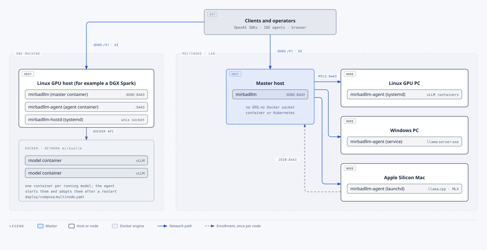

# Setup guide

> MirbadLLM's HTTP endpoints, including `/mcp`, are intended for a trusted LAN. Use a TLS reverse proxy and network access controls before exposing them more widely; bearer keys must never travel over untrusted plain HTTP.

This guide installs MirbadLLM in one of three layouts. Most fleets start with the first and grow with the second:

- [Single machine](#single-machine): one Linux machine with an NVIDIA GPU runs the master and its own agent as two
  containers. It can be an old gaming tower, a GPU workstation or a DGX Spark.
- [Add nodes](#add-nodes): this is where your spare machines join. A Windows gaming PC or gaming laptop with an
  NVIDIA card runs llama.cpp as a native process, a Linux PC runs vLLM, llama.cpp or SGLang in containers, and NIM where it's enabled, and an Apple Silicon Mac or
  MacBook runs llama.cpp on Metal or MLX. Each one serves the models that fit its memory.
- [Development fleet](#development-fleet): a master and two fake-runtime agents on one computer, for working on the
  code. No GPU or Docker is needed.

To look at the UI before you install anything, run the [demo](#demo): one container with a fake fleet.



## Ports

| Port | Who listens | Who connects | Notes |
|---|---|---|---|
| 8080 | Master | Browsers, API clients, joining nodes (bundle download) | UI, `/api`, `/v1`, `/metrics`, `/healthz`. Plain HTTP; put a TLS reverse proxy in front for anything beyond the LAN |
| 8443 | Master (enroll listener) | Joining nodes | TLS. Serves only enrollment and rekey, each with a one-time token |
| 9443 | Every agent | The master only | Mutual TLS. Allow it from the master's address only |

## Single machine

### Prerequisites

- Linux on x86_64 or arm64 with an NVIDIA GPU and driver (`nvidia-smi` works). The reference deployment is a DGX
  Spark on DGX OS (Ubuntu 24.04).
- Docker Engine with the Compose plugin and the NVIDIA Container Toolkit. Check with
  `docker run --rm --gpus all ubuntu nvidia-smi`.
- A vLLM image the machine can run. The official `vllm/vllm-openai` images and NVIDIA's vLLM containers for DGX Spark
  are common choices; check that the image supports your GPU and CPU architecture.
- Disk space for the checkpoints you plan to serve.

### Install

These steps run the published images, so nothing is built and the repository is not needed. The images are
`ghcr.io/samykabu/mirbadllm` (the master) and `ghcr.io/samykabu/mirbadllm-agent`, for linux/amd64 and linux/arm64.
To build the images yourself, see [Build from source](#build-from-source).

1. Make a folder for the installation and download the compose file and the example settings of the newest
   [release](https://github.com/samykabu/MirbadLLM/releases).

   ```bash
   mkdir mirbadllm && cd mirbadllm
   curl -fsSLO https://github.com/samykabu/MirbadLLM/releases/latest/download/compose.release.yaml
   curl -fsSL -o .env https://github.com/samykabu/MirbadLLM/releases/latest/download/env.example
   ```

2. Create the host folders. The master runs as uid 1654 (the `app` user of the .NET image), so its folders belong to
   that uid.

   ```bash
   sudo install -d -o 1654 -g 1654 /srv/mirbadllm/data /srv/mirbadllm/backups
   sudo install -d /srv/mirbadllm/models /srv/mirbadllm/cache
   ```

3. Edit `.env` and set at least these values:

   ```bash
   stat -c %g /var/run/docker.sock          # the value for DOCKER_GID
   ```

   | Variable | Value |
   |---|---|
   | `DOCKER_GID` | the number printed above |
   | `MIRBADLLM_VLLM_IMAGE` | your vLLM image, for example `vllm/vllm-openai:<tag>` |
   | `MIRBADLLM_ADMIN_PASSWORD` | a password for the UI |
   | `MIRBADLLM_BACKUP_PASSPHRASE` | a passphrase for encrypted backups (keep a copy elsewhere) |
   | `MIRBADLLM_NODE_ID` | a short name for this machine, for example `tower`: lower-case letters, digits and `-`. Set it before the first start, because a later change makes a different node. Left unset, the node is called `dgx` |

   `MIRBADLLM_VERSION` selects the release: `1.2.0` for that release, `1.2` for the newest 1.2.x. Left unset, it is
   `latest`, the newest release. The master and the agent always take the same value.
   [configuration.md](configuration.md) lists every variable.

4. Pull the images and start the master and the agent. Compose reads the `.env` next to the compose file.

   ```bash
   docker compose -f compose.release.yaml up -d
   ```

   The master writes a bootstrap bundle on first start, and the agent enrolls from it as node `dgx`, already
   approved.

5. Open `http://<host>:8080/` and sign in with the admin password.

The installation is complete when the **Nodes** page shows the node as **Online** and the Overview shows its memory.
`docker ps` lists two containers, `mirbadllm` (the master) and `mirbadllm-agent`.

The agent looks at the GPUs when it starts. Cards with their own VRAM get a memory budget each, so a model is admitted
against the card it is placed on. A machine whose GPU shares the system memory, such as a DGX Spark, is counted as one
pool. `MIRBADLLM_MEMORY_MODEL=Unified` or `Discrete` in `.env` pins the answer when `nvidia-smi` reports the memory in
a way that misleads it. The model list starts empty: add your first model on **Models**.

### Build from source

To run code that is not released yet, or your own changes, build the two images from a clone. The compose file
`deploy/compose.multinode.yaml` is the one above with a build section for each image, and it reads `deploy/.env`.

```bash
git clone https://github.com/samykabu/MirbadLLM.git
cd MirbadLLM
cp deploy/.env.example deploy/.env          # set the values of step 3
docker compose -f deploy/compose.multinode.yaml --env-file deploy/.env up -d --build
```

The first build takes several minutes. A build from a clone shows version `1.0.0`; only release images carry the
version of their release.

### Optional: the host agent

The host agent (`mirbadllm-hostd`) lets the node's **Services** tab manage systemd units such as ComfyUI or Ollama,
and it mounts a NAS share for backups. It is installed from a clone of the repository. Edit
`deploy/hostd/hostd.json` first, then install it:

```bash
sudo bash deploy/hostd/install-hostd.sh
journalctl -u mirbadllm-hostd -f
```

Without it the node reports **Degraded** with a hint, and everything else works. [host-services.md](host-services.md)
describes what it may and may not do.

### Add a model

1. Open **Models** and choose **Add model**.
2. Pick the runtime and the source, for example a Hugging Face repository or one GGUF variant from it.
3. Enter a served name. That is the `model` value API clients send.
4. Check the runtime settings and the memory budget. The editor estimates the budget and explains each setting.
5. Save, then choose **Start**.

A start on a large model takes a few minutes while the weights load and kernels compile. The model is ready when its
state reads **Ready**.

### Connect a client

Open **Access** to create an API key and copy client settings. The base URL is `http://<host>:8080/v1`. Until the
first key exists, `/v1` accepts requests without one, and the header shows a warning.

### Update

With the published images, pull the release that `MIRBADLLM_VERSION` names and restart. With `latest` or a
`<major>.<minor>` value, that is the newest matching release. To move to a specific release, change the value first.

```bash
docker compose -f compose.release.yaml pull
docker compose -f compose.release.yaml up -d
```

To go back, set `MIRBADLLM_VERSION` to the earlier release and run the same two commands. Take a backup first: an
older release is not guaranteed to read data that a newer one has written.

An installation built from source pulls the new code and rebuilds:

```bash
git pull
docker compose -f deploy/compose.multinode.yaml --env-file deploy/.env up -d --build
```

`deploy/ci-deploy-multinode.sh` does the same with health checks and rollback: it builds both images, redeploys the
master, then the agent, and rolls both back if either fails its health check. Run it with
`MIRBADLLM_ENV_FILE=$PWD/deploy/.env bash deploy/ci-deploy-multinode.sh`, or `DRY_RUN=1` to print the steps.
Model containers keep running during an update, and the agent adopts them again.

### Upgrading from a pre-rename install (SparkServe)

MirbadLLM was called SparkServe before. A host or node installed under that name upgrades in place; nothing has to be
reinstalled or re-paired.

What happens on its own:

- **Configuration.** `SparkServe:*` keys (`SparkServe__*` in the environment) are read as `MirbadLLM:*`, and
  `SPARK_SERVE_*` keys in `deploy/.env` as `MIRBADLLM_*`; a new key set in the same place wins. The master logs a
  warning listing the old keys it found, and so does the deploy script.
- **Encrypted data.** Saved tokens, the backup destination's credentials and login cookies keep their Data Protection
  names, so they still decrypt. Backups made before the rename (`spark-serve-backup-*.json`) are listed, pruned and
  restored like new ones, encrypted secrets included.
- **Running models.** Containers labelled `spark-serve.*` are adopted, not started again; new containers get
  `mirbadllm.*` labels. Downloads started before the rename resume.
- **The DGX.** The first `deploy/ci-deploy-multinode.sh` run finds the containers `spark-serve` and `spark-serve-agent`,
  stops them, copies their volumes into `mirbadllm-agent-state` and `mirbadllm-bootstrap`, starts `mirbadllm` and
  `mirbadllm-agent` on the same ports, data folders and env file (`~/spark-serve/repo/deploy/.env` is still found),
  connects the running model containers to the `mirbadllm` network, and removes the old containers only once both new
  ones are healthy. If either fails, the new ones go and the old ones start again. `/srv/spark-serve/*` and
  `/run/spark-serve-hostd` are used for as long as the `mirbadllm` folders do not exist. `DRY_RUN=1
  MIRBADLLM_RENAME_CUTOVER=1` prints the steps.
- **Agents on PCs and Macs.** **Update now** works on an agent installed before the rename: the master still signs
  orders in the form its update helper accepts, and every bundle carries the folder name that helper looks for. The
  upgrade keeps the install's old names (systemd unit `spark-serve-agent`, Windows service `spark-serve-agent`,
  LaunchDaemon `com.spark-serve.agent`, user `_sparkserve`, the `spark-serve-agent` folders), because the identity,
  the folder permissions and, on Windows, the service account's SID belong to them. Only the program inside is new.
  The same goes for the host agent: rerunning `install-hostd.sh` (or `install-agent.sh install-hostd` on a Mac)
  keeps `spark-serve-hostd`, its socket and its backup mount.
- **Agent protocol.** Masters and agents send both `MirbadLLM-*` and `SparkServe-*` headers and read either, and
  certificates of both trust domains are accepted, so a new master and an old agent (or the reverse) work together
  while the fleet is updated. New certificates still carry the `spark-serve` trust domain that old agents require.

What you may do by hand:

- Rename the keys in `deploy/.env` to `MIRBADLLM_*` and any `SparkServe__*` variables to `MirbadLLM__*` to silence
  the warnings.
- After a successful DGX cut-over, remove the old volumes and network once you no longer want the way back:
  `docker volume rm spark-serve-agent-state spark-serve-bootstrap` and, when no container uses it any more,
  `docker network rm spark-serve`.
- Self-hosted CI runners: register the Windows and Mac runners with the labels `mirbadllm-win` and `mirbadllm-mac`
  (the Linux runner keeps `dgx-spark`).
- Metrics are now named `mirbadllm_*`; update Prometheus queries and dashboards that used `spark_serve_*`.
- To give a PC or Mac agent the new names, uninstall it (keeping its state), install it again with the current
  installer and re-pair it with a rekey token from the Nodes page.

## Add nodes

Every node needs a reachable address the master can dial on 9443, and it must reach the master on 8080 and 8443.

1. On the master, open **Nodes** and choose **Add node**. Pick the operating system.
2. Copy the one-line command and run it on the new machine: in a shell with `sudo` on Linux, in an elevated
   Windows PowerShell 5.1 window on Windows, or in Terminal on macOS. It downloads the agent bundle from the master,
   checks its SHA-256, installs the agent as a service and enrolls it with a one-time token.
3. Back on **Nodes**, compare the key fingerprint the command printed with the one shown, and choose **Approve**.

The node is ready when it shows **Online** and its GPUs or memory appear on its page. Each operating system has its
own install guide with every option, upgrades and removal:

| Node | Runtime | Service | Guide |
|---|---|---|---|
| Linux PC with NVIDIA GPUs | vLLM, llama.cpp and SGLang in Docker; NIM when explicitly enabled with an approved digest | systemd unit `mirbadllm-agent` | [deploy/agent/linux/README.md](../deploy/agent/linux/README.md) |
| DGX Spark | vLLM, llama.cpp and SGLang in Docker; capability-gated NIM | agent container | [Single machine](#single-machine) |
| Windows 11 PC with an NVIDIA GPU | llama.cpp (`llama-server.exe`) as native processes | Windows service `mirbadllm-agent` | [deploy/agent/windows/README.md](../deploy/agent/windows/README.md) |
| Apple Silicon Mac | llama.cpp with Metal, MLX through `mlx_lm.server` | LaunchDaemon | [deploy/agent/macos/README.md](../deploy/agent/macos/README.md) |

SGLang and NIM are not controlled by a native Windows agent. On Windows, run and enroll a separate Linux agent in
WSL2; it is a distinct node with its own roots, Docker access, identity and lifecycle.

Once a second node is approved, the model editor shows a **Placement** section: pick the node and, on a PC, the GPUs.
The operator guides describe placement, moves, per-node jobs and node states in depth:
[multi-node basics](multinode/operations.md), [Linux PC nodes](multinode/operations-p2.md) and
[Windows nodes and llama.cpp](multinode/operations-p3p4.md).

### Agent updates

Every build carries its commit, and a release image also carries its version: the sidebar shows `1.2.0 · 826bc75`
for release 1.2.0 built from commit `826bc75`. Builds are compared by the commit. A node whose agent runs another
build shows **Agent from another build** on the Nodes page, which is the case for every other node after the master
moves to a new release. Update it with **Update now** on the node's page, **Update N nodes** on the Nodes page, or
turn on automatic updates after each master update. The master signs an update order for that node, the agent downloads the bundle and
a root helper verifies the signature against the CA saved at install time before it runs the bundle's upgrade, which
rolls back if the new agent does not come up. The agent itself never gets elevated rights. The design is in
[multinode/agent-updates.md](multinode/agent-updates.md).

## Demo

The demo is one container that shows the UI with a fleet in it. It needs Docker and nothing else: no GPU, no model
files and no settings.

```bash
docker run --rm -p 127.0.0.1:8080:8080 ghcr.io/samykabu/mirbadllm-demo
```

Open `http://127.0.0.1:8080/` when the log prints `Up`. Once the image is pulled, that takes about 20 seconds
(measured on an x86_64 PC). Add `:1.2.0` to the image name for a specific release. Stop the demo with Ctrl+C.

The container runs the master and two node agents, the same processes as the
[development fleet](#development-fleet) below, and a loop that sends chat requests to the models:

| Node | What it stands in for | Fake models |
|---|---|---|
| `demo-dgx` | a unified-memory machine with 128 GiB | `fake-chat-large`, `fake-coder` |
| `demo-pc` | a PC with two 24 GiB GPUs and 64 GiB of RAM | `fake-chat-small`, `fake-assistant` |

What is real and what is fake:

- All data is fake. The models are small servers that answer with made-up text, so token rates, latencies, benchmark
  results and tuning results are made-up numbers. Memory and GPU figures come from the fake nodes.
- The master, the agents, mTLS between them, admission, the router and the UI are the real code. You can add, start
  and stop fake models, create API keys and call `/v1` on the published port. Once an API key exists, `/v1` requires
  one, and the generated traffic stops because the demo's own requests carry none.
- Downloads, image pulls and host services are not available, and no real model can run.
- The state lives inside the container. A new container starts again from the same fleet.

The demo is not a deployment. Its access rules are those of a development machine:

- It has no admin password and no API key. Anyone who can reach the published port can change everything in it and
  call `/v1`. The header shows **Admin login disabled** and **/v1 open: no API keys** for that reason.
- The command above publishes the port on `127.0.0.1` only. Keep it there, and do not publish it on a LAN or the
  internet.
- The master runs in the ASP.NET Core `Development` environment, because the fake runtime and the join-token helper
  refuse to start in any other. A failed request therefore shows error details that a production master hides.
- Publish only port 8080. The agents listen on the container's loopback.

To build the demo image from a clone, run `docker build -f deploy/Dockerfile --target demo -t mirbadllm-demo .`

## Development fleet

`tools/dev-multinode` runs a master and two node agents on a developer machine (Windows, Linux or macOS), with fake
models in place of vLLM containers. Agent `dgx` is a unified node like a DGX Spark; agent `dev-b` is a discrete PC
with two fake 16 GiB GPUs. Nothing touches Docker or a GPU, and everything listens on loopback.

### Prerequisites

- The .NET 10 SDK, 10.0.100 or a later feature band (`global.json` pins it).
- PowerShell 7 (`pwsh`) or Bash.

### Start and stop

```bash
pwsh tools/dev-multinode/start.ps1 -Reset      # Windows, or PowerShell 7 anywhere
tools/dev-multinode/start.sh --reset           # Linux and macOS
# UI at http://127.0.0.1:5080/, /v1 at http://127.0.0.1:5080/v1
pwsh tools/dev-multinode/stop.ps1              # or tools/dev-multinode/stop.sh
```

| Process | Address | How it enrolls |
|---|---|---|
| master (Development) | `http://127.0.0.1:5080`, enroll listener `https://127.0.0.1:8443` | not applicable |
| agent `dgx` | `https://127.0.0.1:9443`, fake models on ports 18100 to 18149; `unified:64` | bootstrap bundle (pre-approved) |
| agent `dev-b` | `https://127.0.0.1:9444`, fake models on ports 18150 to 18199; `discrete:2x16`, 32 GiB host RAM | `join` with a development join token, then approved through the node API |

The script builds the solution, starts the master and both agents, and runs a smoke step: it adds `fake-dgx` on
`dgx` and `fake-devb` on GPU 1 of `dev-b`, starts both, and sends buffered and streamed chat requests through `/v1`.
Skip the smoke step with `-NoSmoke` or `--no-smoke`.

State, logs (`logs/*.log`) and process ids live in `artifacts/dev-multinode`. A restart keeps the CA and both
enrollments; `-Reset` or `--reset` starts clean. Change ports with `-MasterPort`, `-EnrollPort`, `-DgxPort` and
`-DevBPort` (or the `MASTER_PORT`, `ENROLL_PORT`, `DGX_PORT` and `DEVB_PORT` environment variables).

The fake models are small vLLM-shaped HTTP servers (`/health`, `/v1/*`, `/metrics`), so benchmarks and tuning run
with made-up numbers. Everything else is the real agent: mTLS, fencing, the operation log, admission, events, the
proxy and telemetry. Downloads, image pulls and host services are not available on these nodes.

Both development switches refuse to run in production: the agent does not start when `DevFakeRuntime` is on outside
the `Development` environment or when its listener is not loopback-only, and the master does not start when
`MirbadLLM:DevJoinTokens` is set outside `Development`.

A Windows-only variant that adds a Windows dev agent with a fake `llama-server` is described in
[multinode/dev-setup-windows.md](multinode/dev-setup-windows.md).

## Troubleshooting

| Symptom | Cause | Fix |
|---|---|---|
| Model stuck in **Starting** | Weights still loading or kernels compiling; a few minutes is normal on large models | Wait, and read the model's **Logs** tab. A failed start shows the runtime's error there |
| 409 on start | The memory budget does not fit free memory minus the reserve | Free memory on the node, lower the budget, or force the start if you accept the risk |
| 413 `request_too_large` | The request body is larger than 64 MiB | Send a smaller prompt or batch |
| Node shows **Degraded** | The host agent is missing, a GPU is busy with other work, or the agent is unreachable | The node's page names the cause; check `nvidia-smi` and the agent's service log |
| **Agent from another build** | The node's agent runs a different commit than the master | **Update now** on the node's page |
| Backups say *Not visible yet* | A NAS share was mounted on the host after the master started | Restart the master container so mount propagation picks it up |
